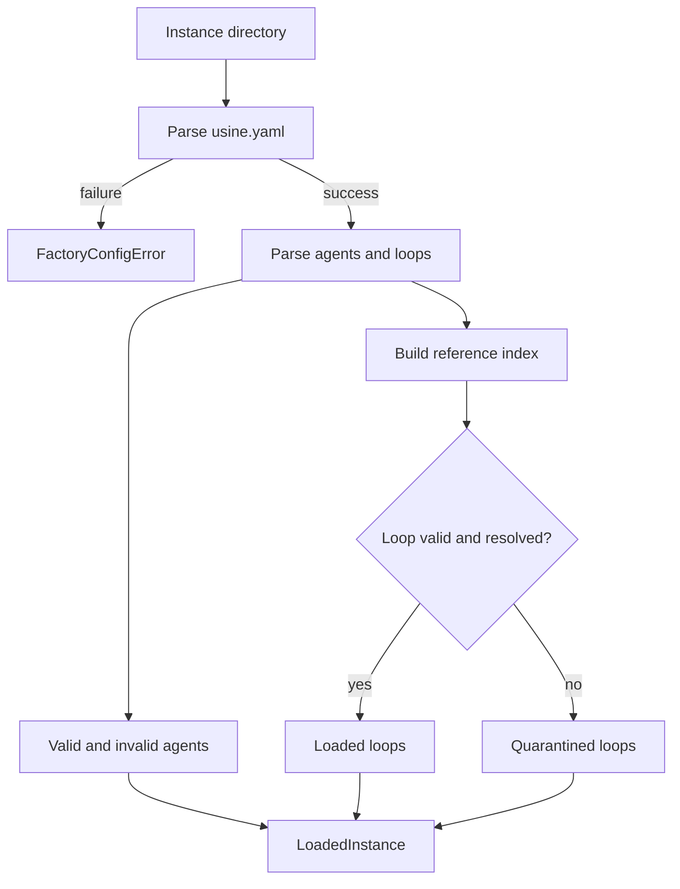



This PR adds the first complete instance-folder boundary. It parses `usine.yaml`, agent Markdown files, and loop Markdown files into strict domain values. It then returns one `LoadedInstance` snapshot. A factory config error stops the load. A file-owned agent or loop error stays in the snapshot, so valid sibling loops can still run.

The change also adds a typed CEL service. Loop trigger expressions must return a boolean. Prompt interpolations must return a scalar. Both forms are checked against the payload slice for the loop's stream before the loop enters the loaded set.

The main review questions are:

- Does each authored schema match the intended file contract?
- Does quarantine keep all invalid references out of `loaded.loops`?
- Do the issue, pull-request, and schedule descriptors expose the correct payload fields and CEL types?
- Do edits preserve the authored document details that the UI must round-trip?





`ExpressionEngine` separates validation from evaluation and exposes only usine-owned values. A caller supplies a `Source`, an `Environment`, and plain JSON. The service returns typed check or evaluation errors. The contract does not expose the installed CEL library, so another layer can implement the same service tag.



The live adapter builds a fresh CEL environment from declared object fields and root variables. It disables dynamic unlisted variables. This makes unknown roots and unknown object paths check failures instead of deferred runtime failures.



`checkExpected` also checks the expression's result type. Boolean triggers accept only `bool`. Prompt expressions accept CEL scalar types. Evaluation repeats the relevant check, evaluates normalized JSON, and decodes the result before it crosses the seam. JSON integers become `bigint` where CEL declares `int` or `uint`.






The adapter tests use the public service and live CEL layer rather than a module mock.
The assertions distinguish parse, type, and unexpected-result failures.




The config package declares the CEL namespace for each stream. Every namespace has `repo` and `item` roots. The `item` type changes between the issue, pull-request, and schedule payload slices. `environmentFor()` is exhaustive over the three `Trigger["on"]` values.

The field declarations in this file are a load-bearing review surface. They determine which paths and types are accepted in both `trigger.if` and `{{ ... }}` expressions. The final assembly below shows which object descriptors each stream receives.







`UsineConfig` requires `version: 1` and a managed-repo registry. It supplies defaults for settings, a local worker, disabled webhooks, and the optional operator. The schema rejects duplicate names and constrains names, repo identities, tags, positive limits, cron values, and IANA time zones.

The authored YAML uses snake_case. `Schema.encodeKeys` maps it once to camelCase domain fields. The same mapping supports encoding back to authored keys.



Loop and agent names come from their `.md` filenames. Loop defaults are `approval: none` and `step: run`. Schedule triggers use Effect's cron and named-zone parsers at schema construction.



Selectors use intersection semantics across axes: a repo must match the explicit repo list *and* at least one requested tag when both are present. An omitted selector matches every managed repo.





The parser first splits Markdown frontmatter, parses strict YAML, and rejects excess properties. It derives identity from the filename. For a loop, it then selects the stream environment, checks `trigger.if` as boolean, finds every prompt interpolation, and checks each interpolation as scalar. Only then does it construct `LoopFile`.

```pseudo
parse loop file
  derive name from filename
  split frontmatter and body
  decode strict frontmatter
  select stream environment
  check trigger as boolean
  check each interpolation as scalar
  construct LoopFile
```



Prompt rendering reuses the loop's stream descriptor. It evaluates all interpolation spans and replaces only those spans in the Markdown body.





`InstanceFolder.load()` treats `usine.yaml` as the factory boundary. A read or parse failure there becomes `FactoryConfigError`. After that boundary succeeds, the loader reads agent and loop directories in parallel. It sorts Markdown filenames and parses up to 16 files concurrently per directory.



A malformed agent enters `invalidAgents`. A malformed loop enters `quarantinedLoops`. A parsed loop is checked against the valid agent roster and registry before it enters `loops`. The loader then constructs the aggregate from all five result sets.





Reference checking has one pure owner. It rejects an unknown agent, an unknown selected repo, or an unknown selected tag with a file-owned `reference` error. The loader uses that error for quarantine.

`LoadedInstance` applies the same rule as a construction invariant. Code cannot construct a snapshot whose `loops` refer outside its loaded roster or registry, even if it bypasses `InstanceFolder.load()`.




The fixture exercises the complete filesystem, parser, live CEL layer, and aggregate path.
These tests distinguish fatal factory state from file quarantine and prove the aggregate invariant.
The tests cover rules that are easy to weaken during parser changes.






The writer parses YAML into a token-preserving document AST and updates one non-empty path. `updateFrontmatter()` changes only the YAML half and appends the original Markdown body unchanged.

The AST stringifier always emits LF, so newline restoration has one owner: `restoreNewlines` normalizes and re-applies the authored style. `updateYaml()` detects the style from its source; `updateFrontmatter()` applies the file's delimiter style, which also covers a one-line YAML half that carries no newline of its own.




The tests cover the authored-text preservation rules through the public writers.
Guards the regression where the AST stringifier silently renormalized a CRLF-authored file to LF on its first edit.




`@usine/core` now owns the branded instance directory and the approval literal set. The config loader consumes these types directly. The engine keeps its existing public names as aliases to the core values, so its database and submission model use the same runtime schema and TypeScript type.


















