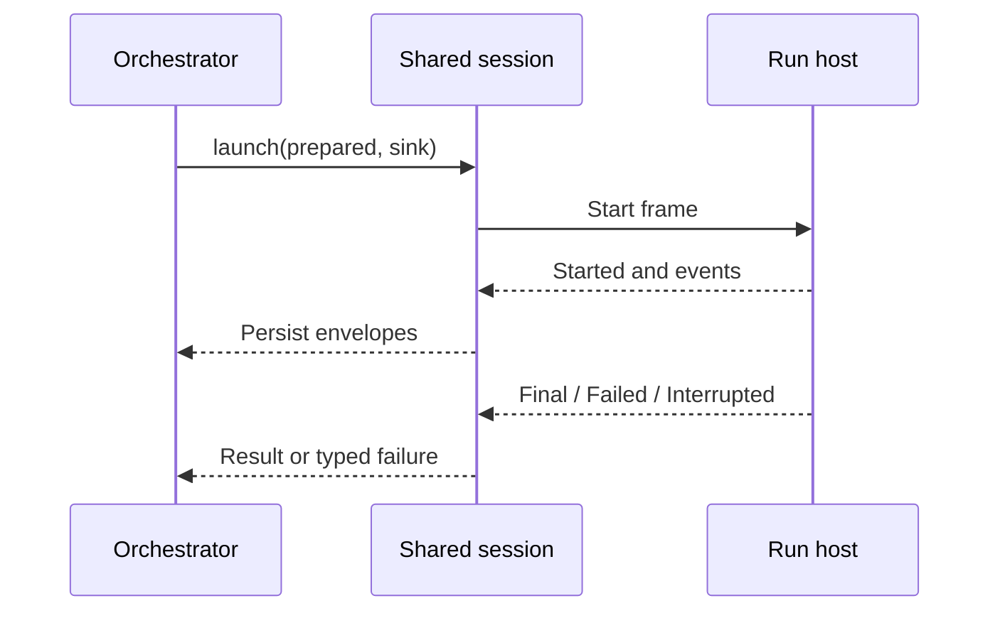



This change adds an exe.dev Worker adapter without changing the five executor operations or the Attempt channel protocol. The orchestrator stays local. It uses local SQLite for durable state, while a named exe.dev VM holds the cached repository and runs the one-shot run host over SSH.

The main review points are:

- preflight verifies the baked VM and reports a typed capability failure;
- prepare attaches a bounded native GitHub integration grant and creates a remote worktree;
- local and remote adapters now use one channel and cancellation state machine;
- cleanup removes the worktree and releases the shared grant after each Attempt;
- the scheduler checks the configured Worker kind against the supplied adapter.


One composition supports one Worker kind. A config can name `local` and `exe.dev`, but `stepExecutorLayer` rejects any Worker whose kind differs from `executor.kind`. This PR does not compose a mixed local-and-remote pool.






`Worker.Kind` is now the shared source for the `local` and `exe.dev` values. The config schema reuses this type. Each `Executor` also declares its kind, so the scheduler can validate the complete Worker list before it creates capacity slots or starts work.



The scheduler validates all configured Workers against that value. It then runs preflight concurrently and only creates the slot queue after every check succeeds.



The new composition provides Node process services to the exe.dev adapter, connects it to the existing scheduler, and provides that scheduler to the local SQLite engine. Its default grant duration is `maxAttemptMinutes + 5`, rather than the adapter's standalone 65-minute default.





Preflight does not install software. It resolves the configured Worker name through exe.dev machine metadata, requires a running VM, parses a restricted SSH destination, and reads an absolute remote home directory.

It then checks these capabilities in order:

1. Git returns a recognized version string.
2. Node.js has major version 22 or later.
3. The remote run host reports the current Attempt protocol version.
4. Every configured harness login command exits successfully.
5. Every configured native GitHub integration passes exe.dev's integration test.

Failures become `WorkerCapabilityError` values tagged as `machine`, `toolchain`, `run-host`, `harness-login`, or `credentials`. This makes image skew fail during scheduler startup instead of during an Attempt.







The adapter maps each managed repository to one native exe.dev integration. Prepare attaches or refreshes that integration with a time limit before it accesses the remote repository.

A partitioned semaphore serializes updates for each Worker and integration pair. A reference count permits concurrent Attempts to share the attachment:

```pseudo
prepare Attempt
  lock Worker + integration
  attach or refresh bounded grant
  increment active count

cleanup Attempt
  lock Worker + integration
  if more Attempts remain
    decrement active count
  else
    detach integration
```



The SSH client receives only an allowlist of ordinary process and SSH-agent variables. GitHub credential variables are not copied from the orchestrator. The remote clone uses exe.dev's integration host, and the run host receives only the public `GH_HOST` selector. The credential itself stays at the exe.dev edge.



Prepare uses a stable bare cache per Worker and repository, but a separate worktree per Attempt. The repository lock prevents concurrent clone or fetch operations from changing the same cache. A first clone uses a staging path and moves it into place only after success. Every prepare fetches the requested revision, parses `FETCH_HEAD` as a commit SHA, and creates a detached worktree.



Every remote command is converted to one shell command after the SSH `--` boundary. The quoting function single-quotes the executable and each argument, including embedded single quotes. This prevents a revision or path from becoming a second remote shell command.



Cleanup removes the Git worktree registration, removes the directory as a fallback, prunes the cache, and releases the grant. Missing prepared state is a logged no-op, so repeated cleanup is safe. If prepare fails, its error path also removes partial workspace state and releases the grant.



The local adapter no longer owns framing and cancellation logic. `runHostSessionFor` now owns that behavior for both adapters. Each adapter supplies only a process spawn function:

- local spawn sets the worktree as `cwd`, injects its redacted repository credential, and scrubs that credential from stderr;
- exe.dev spawn opens SSH, selects the remote worktree, and connects the same framed input queue to SSH stdin.



The shared session strictly decodes each newline-delimited envelope, applies `AttemptChannel.admit` for attempt identity and sequence rules, appends accepted envelopes to the transcript sink, and requires both a terminal envelope and a successful process exit for success.



Cancellation is idempotent. The first call records and sends an `Interrupt` frame. If the process does not exit within the grace period, the session hard-kills it. The orchestrator then runs adapter cleanup in an `ensuring` block, regardless of the launch outcome.


The implementation does not always kill the SSH process immediately, as the linked issue text states. It first uses the protocol interrupt and kills only after delivery failure or grace expiry. This matches the two-stage cancellation rule in ADR 0006.








The fake SSH suite checks the adapter at the process boundary. The opt-in integration test checks the complete local-orchestrator to remote-VM path.


A fake SSH process exercises preflight, prepare, launch, transcript append, and repeated cleanup.
Two Attempts share one Worker and integration.
The tests keep readiness errors separate from runtime infrastructure failures.
The test clock covers both branches of the shared cancellation state machine.
This environment-gated test uses a real baked VM and native integration.














