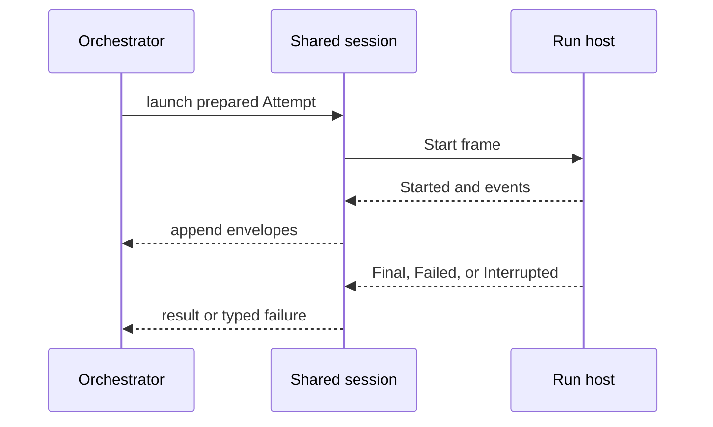



This change adds an exe.dev Worker adapter behind the existing five executor operations. The orchestrator and SQLite store stay local. A persistent exe.dev VM keeps repository caches and runs one run host per Attempt over SSH.

The main review points are:

- preflight verifies the baked VM before the scheduler creates capacity;
- prepare attaches a bounded native GitHub integration grant and creates an isolated worktree;
- local stdio and remote SSH now use one framing and cancellation implementation;
- cleanup removes remote worktrees and releases shared grants;
- each scheduler composition accepts only one Worker kind.


A single composition does not support a mixed Worker pool. The config schema accepts both `local` and `exe.dev` entries, but `stepExecutorLayer` rejects every Worker whose kind differs from the supplied `Executor.kind`.






`Worker.Kind` now owns the `local` and `exe.dev` values, and the config schema reuses it. The `Executor` contract also exposes `kind` beside the unchanged five operations.



At layer construction, the scheduler first validates all configured Workers against that adapter kind. It then runs every preflight concurrently and creates capacity slots only after all checks succeed.



The new composition supplies Node process services to the exe.dev adapter, connects it to the scheduler, and provides that scheduler to the local SQLite engine. Unless the caller overrides it, the grant window is `maxAttemptMinutes + 5`.





Preflight resolves the configured Worker name from exe.dev metadata. It requires a running VM, parses the SSH destination, and requires an absolute remote home directory. It then checks Git, Node.js 22 or later, the current Attempt protocol version, each configured harness login, and each configured native GitHub integration.

A failed check becomes `WorkerCapabilityError` with one of five capability values: `machine`, `toolchain`, `run-host`, `harness-login`, or `credentials`. This moves VM image skew to scheduler startup instead of an active Attempt. Preflight does not install or attach anything.







Prepare maps the managed repository to one native exe.dev integration. Before repository access, it sweeps crash leftovers once per Worker and acquires the grant. It uses a stable bare cache for each repository and a separate detached worktree for each Attempt. A repository semaphore serializes cache updates. A new cache is cloned to a staging path and moved into place only after success.



Grant updates are serialized by Worker and integration. Each prepare attaches or refreshes the bounded grant and increments an in-memory reference count. Cleanup decrements the count and detaches only after the final active Attempt releases it.

```pseudo
prepare Attempt
  sweep Worker once
  lock Worker + integration
  attach or refresh grant
  increment active count
  fetch cache and add worktree

cleanup Attempt
  remove and prune worktree
  lock Worker + integration
  if another Attempt is active
    decrement active count
  else
    detach integration
```



Every remote command becomes one quoted shell string after the SSH `--` boundary. The quoting handles embedded single quotes, so repository revisions and paths cannot add a second command. The SSH process receives only an environment allowlist. The run host receives the public integration host selector, not a GitHub credential. **Credential values are intentionally omitted from this walkthrough.**



Cleanup attempts worktree removal and grant release independently, logs both failures, and removes prepared state only after both resources are clean. The scheduler runs cleanup in `ensuring`, so launch success, failure, and interruption all enter this path without letting cleanup change the Attempt outcome.



The local adapter no longer owns protocol framing or cancellation. `runHostSessionFor` now handles both transports. Each adapter supplies only a process spawn function: the local adapter starts the run host in its worktree, while the exe.dev adapter starts SSH and connects the same input queue to SSH stdin.



The session strictly decodes each newline-delimited outbound envelope. `AttemptChannel.admit` enforces Attempt identity and sequence rules before the sink persists it. A `Final` envelope is not sufficient by itself: the process must also exit successfully.



Cancellation is idempotent. The first call persists and sends one `Interrupt` envelope. If delivery fails, delivery times out, or the process does not exit during the grace period, the session sends `SIGKILL`. Hard-kill itself is also time-bounded.


The implementation differs from the linked issue text, which says to kill the SSH session and then clean up. The code first performs the protocol interrupt and kills only on delivery failure or grace expiry. This behavior matches ADR 0006's two-stage cancellation rule.








The fake SSH suite checks the adapter at the child-process seam. The opt-in integration test checks the full local-orchestrator to remote-VM path.


A fake SSH process runs preflight, prepare, launch, transcript append, and repeated cleanup.
Concurrent Attempts share one Worker integration without releasing it early.
The Effect test clock covers cooperative and forced cancellation branches.
This environment-gated test uses an existing baked VM and native integration.















