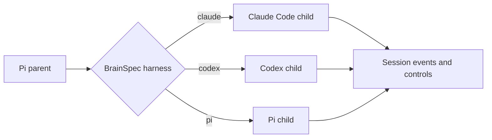



This change completes the child harness dispatcher. The Pi parent can now start Claude Code, Codex, or Pi from the Agent's `BrainSpec.harness`. Each backend returns the same session event and control contract.

Codex adds the largest new path. It owns a scoped `codex app-server` process, correlates JSON-RPC responses, rejects unknown models, starts a headless ephemeral thread, and converts Codex notifications into usine session events. Pi now uses the existing SDK seam for child sessions as well as the parent session.

The Attempt channel moves to protocol v3. A successful parent launch sends a `Started` payload with model data. The engine updates the Attempt and appends the envelope in one database transaction.

`Started` records the rostered child brain and the SDK-selected Pi parent model. A parent can start no children or several children, so each backend-selected child model stays on its own `ChildSession` events.





The public `ChildBackend` seam does not change for the subagents extension. The new dispatcher reads the child session's authored harness and calls one concrete service. The switch is exhaustive because `Harness` contains only `claude`, `codex`, and `pi`.



The Node composition supplies all three implementations to the dispatcher. The Pi parent still depends only on `ChildBackend`, so changing an Agent file does not change parent orchestration.






The Pi SDK setup is shared by parent and child sessions. It parses a requested `provider/model`, selects the SDK model, keeps the session in memory, and disables project settings, extensions, prompt templates, skills, and themes. The inline subagents extension is still available to the parent through `extensionFactories`.



The child adapter starts Pi without extensions, then rebuilds the public `ChildSession` with the SDK-selected model. It emits normalized SDK events and exposes native `steer` and `abort` operations. SDK and control failures remain typed `SessionOperationError` values.







Codex needs a process transport in addition to a child adapter. The process starts from the worker user's home directory, not from the Attempt worktree. The command also marks the target worktree as untrusted before Codex starts a thread. This prevents process startup from loading repository-owned Codex configuration.



The transport assigns a numeric id to each request and stores a `Deferred` response in a pending map. The stdout router resolves the matching request, emits notifications to a queue, and rejects server-to-client requests because usine runs the child headlessly. An unexpected stdout close, stderr failure, or process exit fails every pending request and the notification stream.



After JSON-RPC initialization, the adapter reads every model catalog page. It disables provider fallback. It then starts an ephemeral thread and a turn with `approvalPolicy: never` and danger-full-access sandbox settings. The thread response supplies the model stored on the normalized child session.



Completed Codex items become one text event or a tool completion event. Streaming text deltas are not persisted. Turn completion resolves or fails the common session channel. `turn/steer` and `turn/interrupt` retain both thread and turn identity.







The shared event model now includes a pool identifier and optional primary and secondary rate windows. A Codex `account/rateLimits/updated` notification becomes `PoolRateLimitsUpdated` for the `chatgptPlan` pool. The event then follows the same Attempt transcript path as text and tool events.









Protocol v3 adds `SpawnedSpec` to the first successful outbound frame. The schema requires a child brain and a parent model. A launch failure can instead be the first and terminal `Failed` frame, because no effective parent session exists in that case.



The run host now launches the Pi parent before it emits `Started`. It gets the parent model from the returned parent session. It copies the child brain from the incoming Agent spec.




The Attempt writeback targets issue #57 item 1: when `parent_model` is absent, `Started` replaces it with the model selected by the Pi SDK. The rostered child brain remains the Attempt-level spec. Codex and Pi record each selected child model on that child's session events.




When the engine receives an outbound `Started`, it updates the Attempt model columns and appends the transcript row inside one database transaction. Other inbound and outbound envelopes only append their transcript row through the same transaction wrapper.



The update writes both model fields in one SQL statement. A replayed `Started` therefore converges on the same values before its transcript append completes.








This keeps harness selection at the shared dispatcher seam.
A scripted `CodexConnection` tests behavior without replacing module imports.
A narrow `PiSdk` layer provides the real adapter seam.
The reducer tests the new first-frame alternatives and the `SpawnedSpec` wire shape.
The local SQLite test reads the Attempt projection after the transcript append.
An environment-gated Vitest case runs the Codex backend against an explicitly selected model.
A separate environment-gated Vitest case runs the Pi backend against an explicitly selected model.



The dispatcher matrix proves that the same parent request selects each backend from `BrainSpec.harness`. The existing live Agent loop covers the full Claude subagent path. The two new live contracts cover the Codex and Pi vendor boundaries. Together, these checks keep loop orchestration independent from the Agent brain frontmatter.














