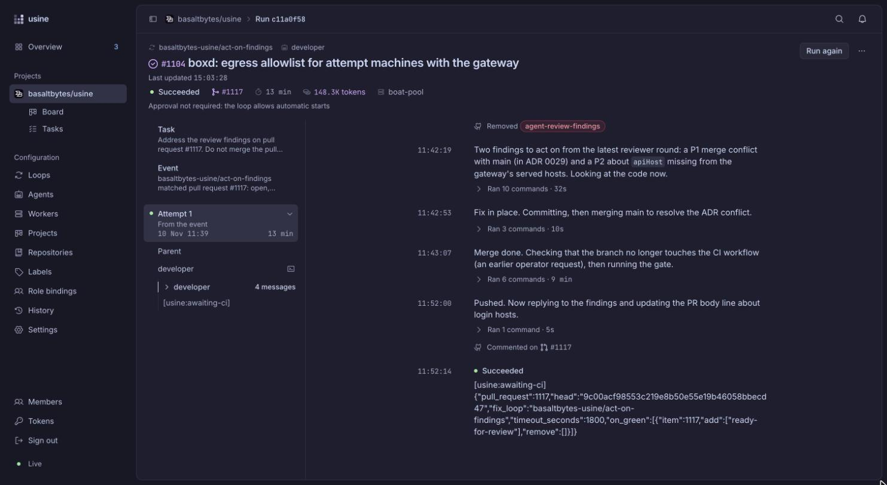
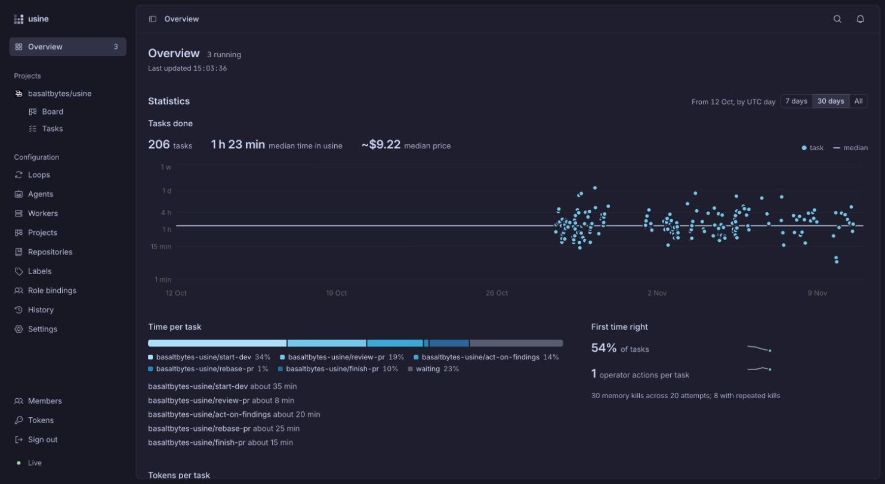

<p align="center">
  <a href="https://docs.usine.dev">
    <picture>
      <source media="(prefers-color-scheme: dark)" srcset="./apps/docs/src/assets/logo-dark.svg">
      
    </picture>
  </a>
</p>

<h1 align="center">usine</h1>

<p align="center">Run coding agents on your GitHub issues and pull requests, on your own machines.</p>

<p align="center">
  
  <a href="https://www.npmjs.com/package/@usine/server"></a>
  <a href="https://github.com/basaltbytes/usine/actions/workflows/ci.yml"></a>
  <a href="./LICENSE"></a>
  <a href="https://docs.usine.dev"></a>
</p>

<p align="center">
  <a href="https://docs.usine.dev/guides/follow-a-run/">
    
  </a>
</p>

> [!WARNING]
> usine is alpha software. The configuration format, the CLI, and the `@usine/*` package APIs can change in any release. Back up the instance folder and read the release notes before you upgrade.

usine is a self-hosted orchestrator for coding agents. It watches the GitHub repositories you register. When an issue or pull request matches a loop you wrote, usine starts Claude Code, Codex, or Pi in a checkout on one of your workers. The agent does the task and usually ends by opening or updating a pull request.

You decide which work starts on its own and which waits for your approval. A web UI shows every run, its transcript, and the runs that need a decision from you.

This repository is developed with usine. The screenshots on this page come from the instance that works on `basaltbytes/usine`.

## Quick start

You need macOS or Linux, Node.js 22.22 or later, Git, and a GitHub account that can create a GitHub App.

```sh
npm install --global @usine/server
mkdir my-factory && cd my-factory
usine up
```

`usine up` prints a sign-in link and opens setup in your browser. In setup, you create the GitHub App, install it on your repositories, and connect a Claude or ChatGPT login.

The [quickstart](https://docs.usine.dev/get-started/quickstart/) covers the full path, including the agent CLIs to install, up to a first pull request opened by an agent on a scratch repository.

To pin the server version in the instance folder instead of installing it globally, run `npm create usine@latest my-factory`.

## Loops

A loop pairs a trigger with a task for an agent. This one starts work on every open issue labeled `ready-for-agent` and waits for your approval before each run:

```markdown
---
trigger:
  on: issue
  if: >-
    item.state == "OPEN" &&
    item.labels.nodes.exists(label, label.name == "ready-for-agent")
approval: required
agent: developer
---

Complete issue #{{ item.number }}: {{ item.title }}.

Remove `ready-for-agent` from the issue before you edit.
Open a non-draft pull request whose body includes `Closes #{{ item.number }}`.
Run the repository checks and push. Do not merge the pull request.
```

The condition is a [CEL](https://cel.dev) expression over the item's GitHub data. The body is the task, with values from the item filled in. Create loops in the web UI, or keep them as Markdown files and load them with `usine config import`.

usine ships no built-in loop. Loops usually hand work to each other with labels: a development loop opens a pull request, a review loop reads it, and a fix loop acts on the findings. See [Write a loop](https://docs.usine.dev/guides/write-a-loop/) and [Connect review and fix loops](https://docs.usine.dev/guides/review-fix-loops/).

## Features

- Runs Claude Code, Codex, and Pi. An agent names a harness, a model, a reasoning effort, and standing instructions.
- Runs agents on your Claude or ChatGPT subscription, or on API keys. The session that coordinates each attempt needs a ChatGPT login or an API key.
- Triggers on issues, pull requests, and schedules. Each loop selects its items with an expression, so one instance serves many repositories with different rules.
- Starts runs on its own or holds each one for your approval, per loop.
- Waits for CI after a fix is pushed and moves the pull request back to review when the checks pass. A cycle budget stops a review and fix cycle that doesn't converge.
- Shows a board per project. Lanes map to GitHub labels, and moving a card changes the labels on GitHub.
- Streams each attempt's transcript. You can message the agent while it works, pause it, cancel it, or retry with an edited task.
- Lists the runs that wait on you under Needs attention. An agent that needs a decision asks in a comment on the issue or pull request.
- Runs attempts on the local machine, on Linux hosts over SSH with a container per attempt, in Cloudflare sandboxes, or on machines created per attempt on Hetzner, Boat, or boxd.
- Keeps credentials off workers. A gateway proxies GitHub and model requests, adds the credentials, and limits outbound traffic to an allowlist.
- Resumes attempts after an orchestrator restart. A failed or canceled attempt keeps its work on a salvage branch or in its checkout.
- Reports time from issue to merge, tokens, and estimated cost per task, and the share of tasks done right the first time.
- Saves every configuration change as a revision that you can inspect and revert.
- Serves an [operator HTTP API](https://docs.usine.dev/reference/operator-api/), the same one the web UI uses.

<p align="center">
  <a href="https://docs.usine.dev/guides/read-statistics/">
    
  </a>
</p>

## Concepts

- An **instance** is one installation of usine: its configuration, credentials, and run history.
- A **project** groups repositories that share a board and a set of loops.
- A **loop** selects issues, pull requests, or schedule ticks, and gives each one to an agent.
- An **agent** is a harness, a model, and standing instructions.
- A **run** is the work for one matching item. Each try is an **attempt**.
- A **worker** is a machine that runs attempts.

[Concepts](https://docs.usine.dev/get-started/concepts/) describes each term in full.

## Documentation

| Topic | Pages |
| --- | --- |
| First run | [Quickstart](https://docs.usine.dev/get-started/quickstart/), [Concepts](https://docs.usine.dev/get-started/concepts/) |
| Loops and agents | [Write a loop](https://docs.usine.dev/guides/write-a-loop/), [Write an agent](https://docs.usine.dev/guides/write-an-agent/) |
| Operating runs | [Follow a run](https://docs.usine.dev/guides/follow-a-run/), [Message a running agent](https://docs.usine.dev/guides/message-an-agent/) |
| Workers and gateways | [Manage workers](https://docs.usine.dev/guides/workers/), [Configure a gateway](https://docs.usine.dev/guides/configure-a-gateway/) |
| Hosting | [Linux](https://docs.usine.dev/guides/host-usine-on-linux/), [macOS](https://docs.usine.dev/guides/host-usine-on-macos/), [Upgrade an instance](https://docs.usine.dev/guides/upgrade-an-instance/) |
| Reference | [CLI](https://docs.usine.dev/reference/cli/), [Configuration](https://docs.usine.dev/reference/configuration/loops/), [Operator API](https://docs.usine.dev/reference/operator-api/) |

## Packages

usine is a pnpm monorepo. The engine is published as separate packages under the `@usine` scope, so you can run the server or embed the parts you need.

| Package                                          | Contents                                                                 |
| ------------------------------------------------ | ------------------------------------------------------------------------ |
| [`@usine/server`](./apps/server)                 | The `usine` CLI. Runs the orchestrator and serves the web UI             |
| [`create-usine`](./packages/create-usine)        | Creates an instance folder with a pinned server version                  |
| [`@usine/orchestrator`](./packages/orchestrator) | The full engine as an Effect layer that you can start in-process         |
| [`@usine/engine`](./packages/engine)             | Event ledger, run scheduling, and restart recovery                       |
| [`@usine/core`](./packages/core)                 | Domain model: events, runs, steps, attempts, run states, and failures    |
| [`@usine/config`](./packages/config)             | Configuration validation, revisions, and import and export               |
| [`@usine/expression`](./packages/expression)     | CEL expression checking and evaluation                                   |
| [`@usine/github`](./packages/github)             | GitHub App authentication, polling, and scoped tokens                    |
| [`@usine/agents`](./packages/agents)             | Claude Code, Codex, and Pi backends, prompts, and harness preflight      |
| [`@usine/durable`](./packages/durable)           | The durable conversation of each attempt, resumed after a restart        |
| [`@usine/executor`](./packages/executor)         | Worker adapters: local, SSH, Cloudflare, and provisioned machines        |
| [`@usine/gateway`](./packages/gateway)           | Credential proxy for GitHub and model providers, with an egress allowlist |
| [`@usine/cloudflare`](./packages/cloudflare)     | The Cloudflare Worker that runs each attempt in a sandbox                |

Packages are 0.x, and their APIs change between minor versions.

## Development

```sh
pnpm install
pnpm build
pnpm test
pnpm check    # typecheck, and check the committed OpenAPI document
pnpm lint
```

[CONTRIBUTING.md](./CONTRIBUTING.md) covers the test setup and CI. [CONTEXT.md](./CONTEXT.md) is the glossary, [docs/architecture](./docs/architecture) describes what is built, and [docs/adr](./docs/adr) records the reasons behind past decisions.

## License

usine is licensed under the [GNU Affero General Public License v3.0](./LICENSE). You can run it, change it, and embed the `@usine/*` packages in your own software. If you offer usine, or software that includes it, to others over a network, you have to publish the complete source of that software under the same license. Versions published before 2026-10-24 remain under the MIT license.

## Author

usine is built by [Basaltbytes](https://basaltbytes.com). For news about the project, follow [@_philDL](https://x.com/_philDL) on X.
