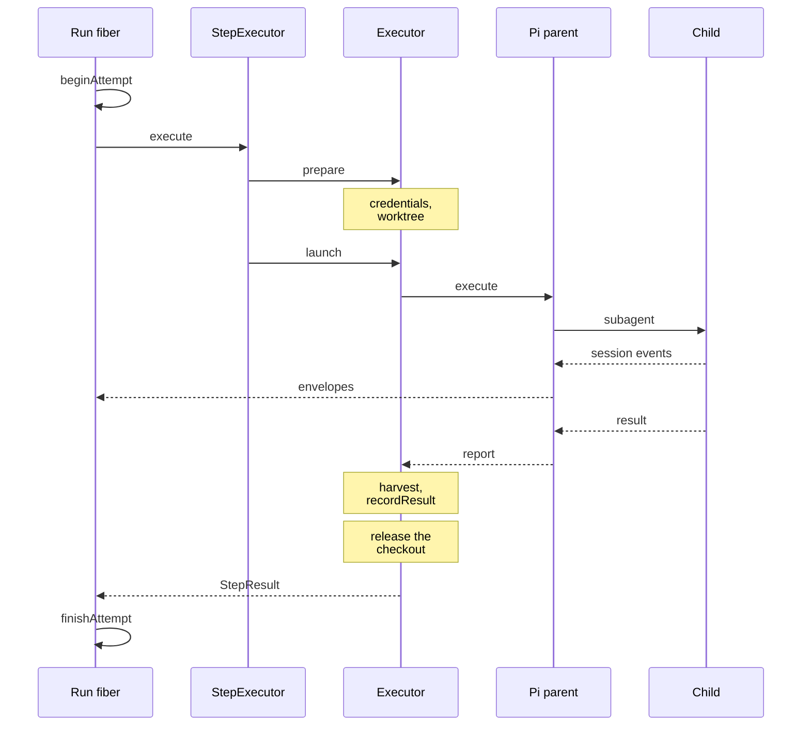
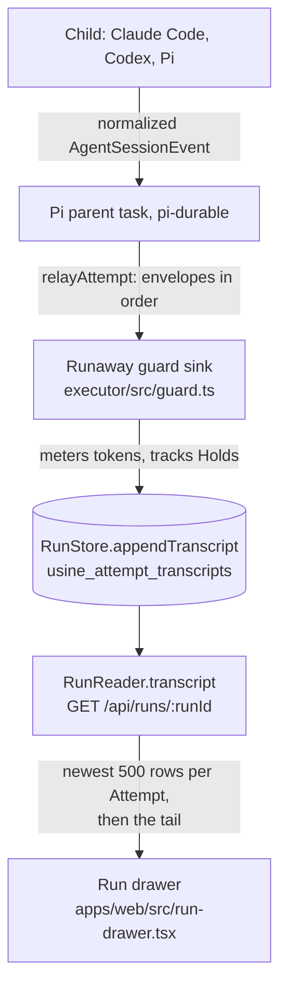
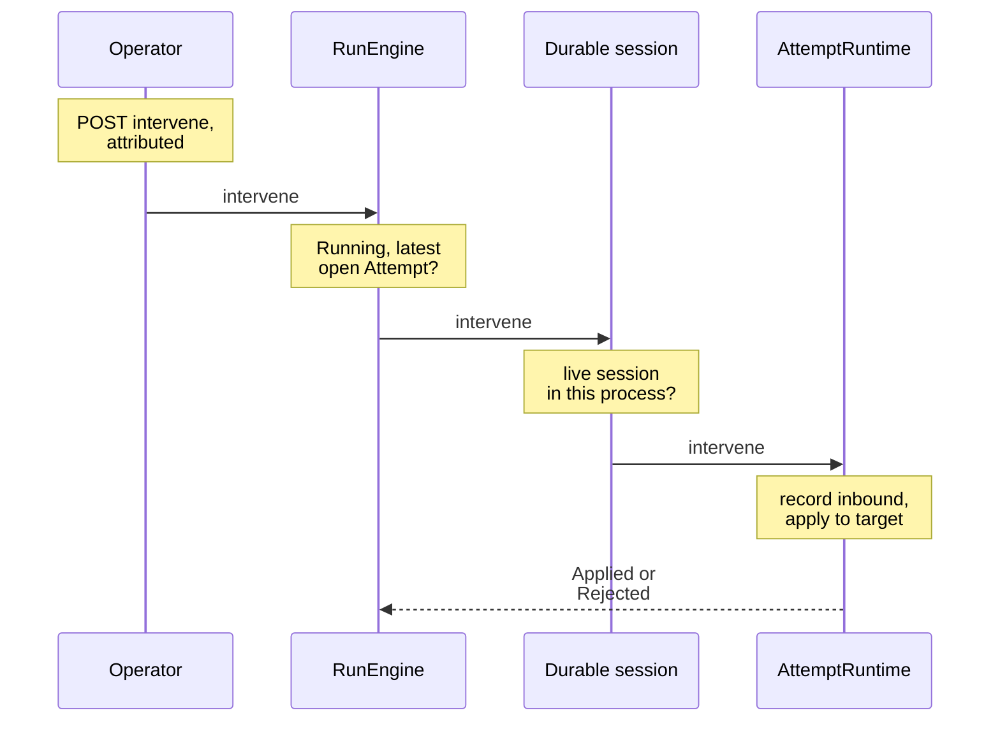

import { Steps } from "@astrojs/starlight/components";

:::note
This page describes commit [`7c0c3d3`](https://github.com/basaltbytes/usine/tree/7c0c3d3696123d11e3d5b9cc3d27e18bb21e84e9) of basaltbytes/usine as it was on 2026-10-16, and the later operator question marker and salvage rebase ([#241](https://github.com/basaltbytes/usine/issues/241), [#282](https://github.com/basaltbytes/usine/issues/282)). Code links point at that commit.
:::

An Attempt goes through six layers. All of them run inside the orchestrator process except the children. The table lists them from the engine down.

| Layer            | Code                                                                                                                                                                                                                                                                                                                    | Does                                                                                                      |
| ---------------- | ----------------------------------------------------------------------------------------------------------------------------------------------------------------------------------------------------------------------------------------------------------------------------------------------------------------------- | --------------------------------------------------------------------------------------------------------- |
| Run fiber        | [run-driver.ts:288](https://github.com/basaltbytes/usine/blob/7c0c3d3696123d11e3d5b9cc3d27e18bb21e84e9/packages/engine/src/engine/run-driver.ts#L288)                                                                                                                                                                   | Starts or reattaches the Attempt, gives the executor a transcript sink, records the outcome.              |
| `StepExecutor`   | [scheduler.ts:163](https://github.com/basaltbytes/usine/blob/7c0c3d3696123d11e3d5b9cc3d27e18bb21e84e9/packages/orchestrator/src/scheduler.ts#L163)                                                                                                                                                                      | Builds a `CheckoutRequest` from the Run and the settings, then calls `prepare` and `launch` in one scope. |
| `Executor`       | [executor.ts:172](https://github.com/basaltbytes/usine/blob/7c0c3d3696123d11e3d5b9cc3d27e18bb21e84e9/packages/executor/src/executor.ts#L172)                                                                                                                                                                            | Checkout, credentials, guard, salvage, harvest on one Worker kind.                                        |
| Durable session  | [durable-session.ts:73](https://github.com/basaltbytes/usine/blob/7c0c3d3696123d11e3d5b9cc3d27e18bb21e84e9/packages/executor/src/durable-session.ts#L73)                                                                                                                                                                | Shared by every Worker kind: runs the parent task, stops it, routes interventions, implements `isLive`.   |
| `AttemptRuntime` | [attempt-runtime.ts:70](https://github.com/basaltbytes/usine/blob/7c0c3d3696123d11e3d5b9cc3d27e18bb21e84e9/packages/durable/src/attempt-runtime.ts#L70), implemented in [runtime.ts:36](https://github.com/basaltbytes/usine/blob/7c0c3d3696123d11e3d5b9cc3d27e18bb21e84e9/packages/durable/src/attempt/runtime.ts#L36) | The Pi parent as a pi-durable task, its `subagent` tool, the envelope relay.                              |
| Child backends   | [children.ts](https://github.com/basaltbytes/usine/blob/7c0c3d3696123d11e3d5b9cc3d27e18bb21e84e9/packages/agents/src/pi/children.ts)                                                                                                                                                                                    | Claude Code, Codex, or Pi, on the Worker the executor chose.                                              |

The Effect workflow and cluster modules of [ADR 0003](https://github.com/basaltbytes/usine/blob/main/docs/adr/0003-durable-execution-on-effect-workflow.md) no longer exist. A migration dropped their tables ([`20261011153856_drop_workflow_tables`](https://github.com/basaltbytes/usine/tree/7c0c3d3696123d11e3d5b9cc3d27e18bb21e84e9/packages/engine/drizzle/20261011153856_drop_workflow_tables)), and the Run lifecycle is the fiber described in [Run lifecycle](/architecture/run-lifecycle/).

## One Attempt end to end



The fiber begins the Attempt and gives `StepExecutor` a sink for envelopes. `StepExecutor` calls the executor to prepare the checkout with new credentials, then to launch the Attempt, which runs the Pi parent task through `AttemptRuntime.execute`. The parent starts children with its `subagent` tool. Every envelope from the parent and its children goes through the runaway guard to the fiber's sink, which appends it to the transcript. When the parent reports, the executor harvests the checkout, stores the result with the task, and releases the checkout before `launch` returns, so the worktree is removed or its salvage is recorded before the fiber calls `finishAttempt`.

## The executor contract

`Executor` ([executor.ts:172](https://github.com/basaltbytes/usine/blob/7c0c3d3696123d11e3d5b9cc3d27e18bb21e84e9/packages/executor/src/executor.ts#L172)) is the interface that [ADR 0006](https://github.com/basaltbytes/usine/blob/main/docs/adr/0006-executor-contract-run-host-attempt-channel.md) defines:

| Operation                            | Does                                                                                                                                                                              |
| ------------------------------------ | --------------------------------------------------------------------------------------------------------------------------------------------------------------------------------- |
| `kind`                               | The Worker kind that the executor handles. `StepExecutor` refuses a configured Worker of another kind.                                                                            |
| `preflight(worker, brains)`          | Verifies Git and each rostered brain where the Worker runs children. Doesn't install anything.                                                                                    |
| `prepare(request)`                   | Needs a `Scope`. Checks the Attempt's brain again, gets repository access, creates or reattaches the checkout, and returns a `PreparedAttempt` with `workspace` and `launch(io)`. |
| `cancel(attemptId)`                  | Stops preparation, or cancels the live parent task, waits a grace period, then interrupts.                                                                                        |
| `intervene(attemptId, intervention)` | Delivers an operator action to the live session.                                                                                                                                  |
| `isLive`, `outcome`                  | Tell a restarted engine whether to reattach an open Attempt or finish it with a stored result.                                                                                    |
| `recover(attempt, record)`           | Salvages or removes a checkout that an earlier process left.                                                                                                                      |

```ts title="packages/executor/src/executor.ts"
/** Prepares isolated checkouts, runs Attempts on a Worker, and releases their resources (ADR 0006). */
export class Executor extends Context.Service<
  Executor,
  {
    /** Reconciles an old checkout before new Attempts start; records its salvage before releasing any work. */
    readonly recover: <E>(
      attempt: AttemptRecovery,
      record: (salvage: AttemptSalvage) => Effect.Effect<void, E>,
    ) => Effect.Effect<void, E | ExecutorError>;
    readonly kind: WorkerKind;
    /**
     * Whether the orchestrator can reattach to the Attempt's parent task after a restart: the
     * task is still running, or it reported success before the executor harvested its checkout.
     */
    readonly isLive: (attemptId: AttemptId) => Effect.Effect<boolean, AttemptFailure>;
    /**
     * The result that an Attempt's finished parent task wrote to durable storage before an
     * orchestrator restart: the harvested result, or the parent's failure. None when
     * nothing is stored, or when `isLive` returns true and the orchestrator reattaches instead.
     */
    readonly outcome: (
      attemptId: AttemptId,
    ) => Effect.Effect<Option.Option<Result.Result<StepResult, AttemptFailure>>, AttemptFailure>;
    /** Verifies Git and each rostered brain where the Worker runs children; never installs tools or logs in. */
    readonly preflight: (
      worker: WorkerName,
      brains: ReadonlyArray<BrainSpec>,
    ) => Effect.Effect<void, ExecutorError>;
    /**
     * Verifies the assigned brain before acquiring the Attempt in the caller's scope. Clone, fetch, and lock waits
     * remain interruptible; partial preparation releases everything already acquired
     * before reporting failure. Each request identifies a fresh Attempt, or a live one
     * to reattach when `reattach` is set.
     */
    readonly prepare: (
      request: CheckoutRequest,
    ) => Effect.Effect<PreparedAttempt, ExecutorError, Scope.Scope>;
    /**
     * Stops preparation and releases partial resources, or cancels the live
     * parent task with a grace period before forced termination. A canceled prepared Attempt
     * cannot launch. Repeated cancellation after release is a no-op.
     */
    readonly cancel: (attemptId: AttemptId) => Effect.Effect<void, ExecutorError>;
    /** Delivers an attributed operator action to the active Attempt's live session. */
    readonly intervene: (
      attemptId: AttemptId,
      intervention: AttemptChannel.Intervention,
    ) => Effect.Effect<void, AttemptFailure>;
```

`CheckoutRequest` ([executor.ts:93](https://github.com/basaltbytes/usine/blob/7c0c3d3696123d11e3d5b9cc3d27e18bb21e84e9/packages/executor/src/executor.ts#L93)) has the Attempt id, Worker, repository, revision, Event payload, task text, Agent, parent model and effort, `maxChildren`, the two optional ceilings, the salvage ref, the salvage to resume from, and `reattach`. The revision is `HEAD` for issue and schedule Runs ([trigger-submission.ts:17](https://github.com/basaltbytes/usine/blob/7c0c3d3696123d11e3d5b9cc3d27e18bb21e84e9/packages/orchestrator/src/trigger-submission.ts#L17)) and the head commit for pull request Runs ([loop-evaluation.ts:78](https://github.com/basaltbytes/usine/blob/7c0c3d3696123d11e3d5b9cc3d27e18bb21e84e9/packages/orchestrator/src/polling/loop-evaluation.ts#L78)).

### Preparing the checkout

`provisionWorktree` ([provision.ts:233](https://github.com/basaltbytes/usine/blob/7c0c3d3696123d11e3d5b9cc3d27e18bb21e84e9/packages/executor/src/provision.ts#L233)) is the same for every Worker kind. Under a per-repository lock it clones into a staging directory (`git clone --bare --filter=blob:none`) and renames it to the cache, or updates the cache's remote URL. Then it fetches the revision, records `FETCH_HEAD` as the base commit, fetches the previous Attempt's salvage when the request resumes one, and runs `git worktree add --detach`. The revision of an issue or schedule Run is `HEAD`, so a retry gets the default branch tip as it is at that moment. A resumed salvage goes on top of that base ([#282](https://github.com/basaltbytes/usine/issues/282)):

- `git merge-base` finds the commit the salvage forked from. When it is the base, the worktree checks out the salvage as it is.
- When the salvage holds no changes beyond its fork point (`git diff --name-only`), it is dropped and the worktree starts from the base.
- Otherwise the worktree checks out the salvage and `git rebase --onto <base> <fork point>` moves its commits onto the base, with usine as the committer.
- When the rebase fails, or the salvage shares no history with the base, the executor removes that worktree and adds a new one at the base. The salvage branch keeps the work, `RunSpec.conflictingSalvage` names it, the parent's prompt tells the Agent, and the `Started` envelope carries it, so the transcript shows it. The worktree is `<worker directory>/attempts/<attempt id>` and the cache is `<worker directory>/repos/<repository>.git`, where both names replace every character other than letters, digits, `_`, `.`, and `-` with `_` ([provision.ts:21](https://github.com/basaltbytes/usine/blob/7c0c3d3696123d11e3d5b9cc3d27e18bb21e84e9/packages/executor/src/provision.ts#L21)).

### Launch, guard, release

`launch` ([prepared-attempt.ts](https://github.com/basaltbytes/usine/blob/7c0c3d3696123d11e3d5b9cc3d27e18bb21e84e9/packages/executor/src/prepared-attempt.ts)) wraps the sink with the runaway guard ([prepared-attempt.ts:114](https://github.com/basaltbytes/usine/blob/7c0c3d3696123d11e3d5b9cc3d27e18bb21e84e9/packages/executor/src/prepared-attempt.ts#L114)) and races the parent task against the guard's wall-clock trip. The guard ([guard.ts:139](https://github.com/basaltbytes/usine/blob/7c0c3d3696123d11e3d5b9cc3d27e18bb21e84e9/packages/executor/src/guard.ts#L139)) arms only the ceilings that `usine.yaml` sets. The token meter sums the highest `SessionTokensUpdated` count per session ([guard.ts:32](https://github.com/basaltbytes/usine/blob/7c0c3d3696123d11e3d5b9cc3d27e18bb21e84e9/packages/executor/src/guard.ts#L32)). The wall clock pauses while any child is held ([guard.ts:64](https://github.com/basaltbytes/usine/blob/7c0c3d3696123d11e3d5b9cc3d27e18bb21e84e9/packages/executor/src/guard.ts#L64)). At 80% of either ceiling ([guard.ts:8](https://github.com/basaltbytes/usine/blob/7c0c3d3696123d11e3d5b9cc3d27e18bb21e84e9/packages/executor/src/guard.ts#L8)) the guard sends the parent one `Steer` from operator `engine` ([prepared-attempt.ts:119](https://github.com/basaltbytes/usine/blob/7c0c3d3696123d11e3d5b9cc3d27e18bb21e84e9/packages/executor/src/prepared-attempt.ts#L119)). When a ceiling is reached, the guard stops the Attempt and fails it with `RunawayFailure`.

When the parent reports success, the executor harvests the checkout with `harvestFacts` ([harvest.ts:135](https://github.com/basaltbytes/usine/blob/7c0c3d3696123d11e3d5b9cc3d27e18bb21e84e9/packages/core/src/step/harvest.ts#L135)): the commits from the base commit to `HEAD`, then the pull requests whose head is the final commit, from `gh api repos/<repo>/commits/<head>/pulls`. Pull request discovery has a ten-second timeout and never fails the Attempt. `StepResult` also allows a `Comment` fact ([result.ts:20](https://github.com/basaltbytes/usine/blob/7c0c3d3696123d11e3d5b9cc3d27e18bb21e84e9/packages/core/src/step/result.ts#L20)), but no code produces one.

If the Attempt ends any other way, `salvageWorktree` ([salvage.ts:56](https://github.com/basaltbytes/usine/blob/7c0c3d3696123d11e3d5b9cc3d27e18bb21e84e9/packages/executor/src/salvage.ts#L56)) runs before the worktree is removed. Uncommitted changes become a `wip(usine): salvage attempt <id>` commit, and `git push --force` pushes HEAD to `usine/salvage/<run>/<number>`. If the push fails, the executor keeps the worktree on the Worker and records its path as `Retained`. The next Attempt of the Run applies the newest pushed salvage onto its base, as described in [Preparing the checkout](#preparing-the-checkout) ([ADR 0013](https://github.com/basaltbytes/usine/blob/main/docs/adr/0013-cost-accounting-native-meters-guardrails.md), amendments of 2026-09-18 and 2026-10-18).

## The durable layer

`AttemptRuntime` ([attempt-runtime.ts:70](https://github.com/basaltbytes/usine/blob/7c0c3d3696123d11e3d5b9cc3d27e18bb21e84e9/packages/durable/src/attempt-runtime.ts#L70)) runs the Pi parent as a pi-durable task called `usine.attempt` ([task.ts:46](https://github.com/basaltbytes/usine/blob/7c0c3d3696123d11e3d5b9cc3d27e18bb21e84e9/packages/durable/src/attempt/task.ts#L46)). The task is stored in `.usine/durable.sqlite` ([storage-path.ts:5](https://github.com/basaltbytes/usine/blob/7c0c3d3696123d11e3d5b9cc3d27e18bb21e84e9/packages/durable/src/storage-path.ts#L5)), which `@earendil-works/pi-durable` 1.1.0 opens. Building the layer ([live.ts:74](https://github.com/basaltbytes/usine/blob/7c0c3d3696123d11e3d5b9cc3d27e18bb21e84e9/packages/durable/src/live.ts#L74)) resumes every unfinished task ([runtime.ts:50](https://github.com/basaltbytes/usine/blob/7c0c3d3696123d11e3d5b9cc3d27e18bb21e84e9/packages/durable/src/attempt/runtime.ts#L50)).

| Operation              | Does                                                                                                                  |
| ---------------------- | --------------------------------------------------------------------------------------------------------------------- |
| `execute(request, io)` | Creates the task, or finds it after a restart, forwards its activity to `io`, and waits for the parent's report.      |
| `isLive`, `finished`   | Whether the task is still open, and what a finished task left: `ParentReported`, `ResultRecorded`, or `ParentFailed`. |
| `recordResult`         | Stores the harvested `StepResult` with the task.                                                                      |
| `request`              | The stored request of a task, read for a reattachment.                                                                |
| `intervene`            | Applies an operator action to the parent or a child.                                                                  |
| `cancel`               | Aborts children, then the parent conversation.                                                                        |

The stored request contains the RunSpec, the Worker, and the worktree path ([attempt-runtime.ts:14](https://github.com/basaltbytes/usine/blob/7c0c3d3696123d11e3d5b9cc3d27e18bb21e84e9/packages/durable/src/attempt-runtime.ts#L14)). The task doesn't store the child host or the environment; every `execute` call passes them again, because the environment contains the Attempt's credential configuration ([ADR 0011](https://github.com/basaltbytes/usine/blob/main/docs/adr/0011-github-app-identity-scoped-worker-tokens.md)).

The parent's first turn is the prompt from `assemblePrompt` ([prompt.ts:58](https://github.com/basaltbytes/usine/blob/7c0c3d3696123d11e3d5b9cc3d27e18bb21e84e9/packages/agents/src/prompt.ts#L58)): the repository, the salvage it resumes from, the Event payload as JSON, the Agent persona, the task text, completion rules, and GitHub rules (review with `COMMENT` only, and end every comment, issue, pull request, and review with the signature line from `githubSignature`, which ends in `usine agent: <name>`, [prompt.ts:28](https://github.com/basaltbytes/usine/blob/7c0c3d3696123d11e3d5b9cc3d27e18bb21e84e9/packages/agents/src/prompt.ts#L28)). The parent's only tool is `subagent` ([subagent.ts:31](https://github.com/basaltbytes/usine/blob/7c0c3d3696123d11e3d5b9cc3d27e18bb21e84e9/packages/durable/src/attempt/subagent.ts#L31)). Each call starts one child of the Agent's harness in the checkout. The tool is declared `replay: "unsafe"` ([subagent.ts:271](https://github.com/basaltbytes/usine/blob/7c0c3d3696123d11e3d5b9cc3d27e18bb21e84e9/packages/durable/src/attempt/subagent.ts#L271)): after a restart, the interrupted call ends with the output committed so far, and the parent decides whether to delegate again. A final answer that starts with `[usine:blocked]` fails the Attempt with `AgentFailure` ([task.ts:58](https://github.com/basaltbytes/usine/blob/7c0c3d3696123d11e3d5b9cc3d27e18bb21e84e9/packages/durable/src/attempt/task.ts#L58)). A final answer that starts with `[usine:question]` fails it with `QuestionFailure`, whose `question` is the text after the marker; the prompt asks the Agent to post the question on the Item first, and the Loop then holds the Item ([Operator questions](/architecture/run-lifecycle/#operator-questions)). `reportedOutcome` in `@usine/agents/runtime` reads both markers, for the parent and for every child harness. A child's marker reaches the parent as its `subagent` result, and the Attempt record keeps the first child report with its kind, so a parent that answers without relaying it still fails with the child's blocker or question. usine enforces `max_children` with the `children` count in the Attempt record; one more spawn fails the Attempt with `ChildSessionBudgetFailure`.

The parent's billing pool depends on its provider: a model from `openai-codex` uses the ChatGPT plan and every other model uses API keys ([authentication.ts:30](https://github.com/basaltbytes/usine/blob/7c0c3d3696123d11e3d5b9cc3d27e18bb21e84e9/packages/agents/src/pi/authentication.ts#L30), [ADR 0021](https://github.com/basaltbytes/usine/blob/main/docs/adr/0021-pi-parent-pool-follows-authentication.md)).

### Reattach after a restart

<Steps>

1. `RunDriver.openAttempt` ([run-driver.ts:234](https://github.com/basaltbytes/usine/blob/7c0c3d3696123d11e3d5b9cc3d27e18bb21e84e9/packages/engine/src/engine/run-driver.ts#L234)) calls `isLive`. The durable session returns true when the task is live, or when it finished with `ParentReported` and its checkout isn't harvested yet ([durable-session.ts:396](https://github.com/basaltbytes/usine/blob/7c0c3d3696123d11e3d5b9cc3d27e18bb21e84e9/packages/executor/src/durable-session.ts#L396)).

2. `beginAttempt` returns `ReattachAttempt`, with the same Attempt id and number, and no retry used ([lifecycle.ts:132](https://github.com/basaltbytes/usine/blob/7c0c3d3696123d11e3d5b9cc3d27e18bb21e84e9/packages/engine/src/engine/lifecycle.ts#L132)).

3. `prepare` with `reattach` reads the stored RunSpec, issues new credentials, and reuses the existing worktree.

4. `execute` finds the task in storage and continues its relay from the stored sequence.

</Steps>

An Attempt whose task no longer exists fails with an `InfraFailure`, and the next Attempt starts from the newest pushed salvage. If a launch is interrupted and no one canceled it, the process is shutting down, so the task stays live and the worktree stays on disk ([durable-session.ts:193](https://github.com/basaltbytes/usine/blob/7c0c3d3696123d11e3d5b9cc3d27e18bb21e84e9/packages/executor/src/durable-session.ts#L193)).

## The Attempt channel and the transcript

[channel.ts](https://github.com/basaltbytes/usine/blob/7c0c3d3696123d11e3d5b9cc3d27e18bb21e84e9/packages/core/src/attempt/channel.ts) defines the envelopes, at protocol version 7. Outbound payloads are `Started`, `SessionEvent`, `Final`, `Failed`, `Interrupted`, `InterventionApplied`, and `InterventionRejected`. Inbound payloads are `Steer`, `Interrupt`, `OperatorMessage`, `Release`, and `Cancel`, each with a target: the parent or a child session id. `admit` ([channel.ts:221](https://github.com/basaltbytes/usine/blob/7c0c3d3696123d11e3d5b9cc3d27e18bb21e84e9/packages/core/src/attempt/channel.ts#L221)) enforces the order: one `Started` or `Failed` first, contiguous sequences, nothing after the terminal envelope.

```ts title="packages/core/src/attempt/channel.ts"
/** Nonterminal operator controls; cancellation is an Attempt operation. */
export const OperatorAction = Schema.Union([Steer, Interrupt, OperatorMessage, Release]);
export type OperatorAction = typeof OperatorAction.Type;
export const InboundPayload = Schema.Union([OperatorAction, Cancel]);
export type InboundPayload = typeof InboundPayload.Type;
// ...
export const OutboundPayload = Schema.Union([
  Started,
  SessionEvent,
  Final,
  Failed,
  Interrupted,
  InterventionApplied,
  InterventionRejected,
]);
export type OutboundPayload = typeof OutboundPayload.Type;
```

`relayAttempt` ([relay.ts:171](https://github.com/basaltbytes/usine/blob/7c0c3d3696123d11e3d5b9cc3d27e18bb21e84e9/packages/durable/src/attempt/relay.ts#L171)) sends `Started`, then the parent's committed entries and the children's session events in the order they happened, then one terminal envelope. The next sequence numbers are in the durable Attempt record, so a relay that restarts continues the same sequence.

The sink that the Run fiber gives to the executor calls `RunStore.appendTranscript` ([store.ts:546](https://github.com/basaltbytes/usine/blob/7c0c3d3696123d11e3d5b9cc3d27e18bb21e84e9/packages/engine/src/store/store.ts#L546)). Each envelope becomes one row of `usine_attempt_transcripts`. A unique index on Attempt, direction, and channel sequence keeps the first copy when a reattached relay sends an envelope again. A `Started` envelope writes the parent model the SDK chose to the Attempt row, and an `InterventionApplied` envelope sets `operator_intervened`. Envelopes of protocol versions 3 and 4 ([transcript.ts:21](https://github.com/basaltbytes/usine/blob/7c0c3d3696123d11e3d5b9cc3d27e18bb21e84e9/packages/engine/src/transcript.ts#L21)) and 5 and 6 ([transcript.ts:43](https://github.com/basaltbytes/usine/blob/7c0c3d3696123d11e3d5b9cc3d27e18bb21e84e9/packages/engine/src/transcript.ts#L43)) still decode.



The operator's first read returns the newest 500 rows of each Attempt ([projection.ts:37](https://github.com/basaltbytes/usine/blob/7c0c3d3696123d11e3d5b9cc3d27e18bb21e84e9/packages/orchestrator/src/operator/projection.ts#L37), [projection.ts:192](https://github.com/basaltbytes/usine/blob/7c0c3d3696123d11e3d5b9cc3d27e18bb21e84e9/packages/orchestrator/src/operator/projection.ts#L192)), later reads return the rows after a sequence, at most 500 rows across all Attempts ([projection.ts:39](https://github.com/basaltbytes/usine/blob/7c0c3d3696123d11e3d5b9cc3d27e18bb21e84e9/packages/orchestrator/src/operator/projection.ts#L39)), and the drawer loads earlier pages of one Attempt on request. The drawer polls every second while the Run can be canceled ([run-drawer.tsx:91](https://github.com/basaltbytes/usine/blob/7c0c3d3696123d11e3d5b9cc3d27e18bb21e84e9/apps/web/src/run-drawer.tsx#L91)).

## The live channel for interventions

Operator input never becomes an Event ([ADR 0018](https://github.com/basaltbytes/usine/blob/main/docs/adr/0018-takeover-and-edit-and-retry.md)). It takes this path:



<Steps>

1. `POST /api/runs/:runId/intervene` with the Attempt id, the target, and the action.

2. `Operator.intervene` ([operator.ts:471](https://github.com/basaltbytes/usine/blob/7c0c3d3696123d11e3d5b9cc3d27e18bb21e84e9/packages/orchestrator/src/operator/operator.ts#L471)) attributes it to `operator` from `usine.yaml`, or to `local operator`.

3. `RunEngine.intervene` ([engine.ts:120](https://github.com/basaltbytes/usine/blob/7c0c3d3696123d11e3d5b9cc3d27e18bb21e84e9/packages/engine/src/engine/engine.ts#L120)) refuses unless the Run is `Running` and the Attempt is its latest open one.

4. The executor's durable session ([durable-session.ts:312](https://github.com/basaltbytes/usine/blob/7c0c3d3696123d11e3d5b9cc3d27e18bb21e84e9/packages/executor/src/durable-session.ts#L312)) refuses with `AgentFailure` when the Attempt has no live session in this process (for example, before a reattachment).

5. `AttemptRuntime.intervene` ([runtime.ts:305](https://github.com/basaltbytes/usine/blob/7c0c3d3696123d11e3d5b9cc3d27e18bb21e84e9/packages/durable/src/attempt/runtime.ts#L305)) records the inbound envelope, applies the action, and records `InterventionApplied` or `InterventionRejected`. Both go to the transcript through the same sink as the other envelopes.

</Steps>

On the parent, `Interrupt` aborts the current turn and marks the parent paused in its `HoldDoc`. An `OperatorMessage` to a paused parent resumes it with the message, and one to a busy parent is sent as a steer ([runtime.ts:225](https://github.com/basaltbytes/usine/blob/7c0c3d3696123d11e3d5b9cc3d27e18bb21e84e9/packages/durable/src/attempt/runtime.ts#L225)). `Release` resumes a paused parent. On a child, an `OperatorMessage` places a Hold and `Release` ends it ([runtime.ts:205](https://github.com/basaltbytes/usine/blob/7c0c3d3696123d11e3d5b9cc3d27e18bb21e84e9/packages/durable/src/attempt/runtime.ts#L205)). The `subagent` call waits for the Hold to end before it returns the held child's result to the parent ([subagent.ts:223](https://github.com/basaltbytes/usine/blob/7c0c3d3696123d11e3d5b9cc3d27e18bb21e84e9/packages/durable/src/attempt/subagent.ts#L223)).

## Harnesses

| Harness     | Driven by                                                                                                                                                                                                                                                            | Where it runs                                                                                                                                                                                                            | Preflight                                                                                                                                                                                                                                                                                                                                                                                       | Pool         |
| ----------- | -------------------------------------------------------------------------------------------------------------------------------------------------------------------------------------------------------------------------------------------------------------------- | ------------------------------------------------------------------------------------------------------------------------------------------------------------------------------------------------------------------------ | ----------------------------------------------------------------------------------------------------------------------------------------------------------------------------------------------------------------------------------------------------------------------------------------------------------------------------------------------------------------------------------------------- | ------------ |
| Claude Code | `@anthropic-ai/claude-agent-sdk` 0.3.261, executable `claude`, `permissionMode: "bypassPermissions"`, user settings only ([claude.ts:183](https://github.com/basaltbytes/usine/blob/7c0c3d3696123d11e3d5b9cc3d27e18bb21e84e9/packages/agents/src/pi/claude.ts#L183)) | Locally, or one SSH command with a pid file through `spawnClaudeCodeProcess` ([claude.ts:160](https://github.com/basaltbytes/usine/blob/7c0c3d3696123d11e3d5b9cc3d27e18bb21e84e9/packages/agents/src/pi/claude.ts#L160)) | `claude --version`; `claude auth status --json` must report a `claude.ai` first-party login ([preflight.ts:74](https://github.com/basaltbytes/usine/blob/7c0c3d3696123d11e3d5b9cc3d27e18bb21e84e9/packages/agents/src/preflight/preflight.ts#L74))                                                                                                                                              | Claude plan  |
| Codex       | `codex app-server` JSON-RPC over stdio, `approvalPolicy: "never"`, sandbox `danger-full-access` ([codex.ts:132](https://github.com/basaltbytes/usine/blob/7c0c3d3696123d11e3d5b9cc3d27e18bb21e84e9/packages/agents/src/pi/codex/codex.ts#L132))                      | Locally, or one SSH command with a pid file ([app-server.ts:121](https://github.com/basaltbytes/usine/blob/7c0c3d3696123d11e3d5b9cc3d27e18bb21e84e9/packages/agents/src/pi/codex/app-server.ts#L121))                    | `codex --version` must be 0.144.0 or 0.153.4; account check through the app-server ([preflight.ts:20](https://github.com/basaltbytes/usine/blob/7c0c3d3696123d11e3d5b9cc3d27e18bb21e84e9/packages/agents/src/preflight/preflight.ts#L20), [preflight.ts:51](https://github.com/basaltbytes/usine/blob/7c0c3d3696123d11e3d5b9cc3d27e18bb21e84e9/packages/agents/src/preflight/preflight.ts#L51)) | ChatGPT plan |
| Pi          | `@earendil-works/pi-coding-agent` 1.1.0 in the orchestrator process                                                                                                                                                                                                  | Local Workers only; it refuses a remote host ([pi.ts:69](https://github.com/basaltbytes/usine/blob/7c0c3d3696123d11e3d5b9cc3d27e18bb21e84e9/packages/agents/src/pi/pi.ts#L69))                                           | Starts a session to check the model and its API-key authentication ([preflight.ts:86](https://github.com/basaltbytes/usine/blob/7c0c3d3696123d11e3d5b9cc3d27e18bb21e84e9/packages/agents/src/preflight/preflight.ts#L86))                                                                                                                                                                       | API keys     |

`childDispatcherLayer` picks the backend from the Agent's `harness` ([children.ts:31](https://github.com/basaltbytes/usine/blob/7c0c3d3696123d11e3d5b9cc3d27e18bb21e84e9/packages/agents/src/pi/children.ts#L31)). Every child gets only the Attempt's environment, with no variables from the orchestrator's own environment ([runtime.ts:38](https://github.com/basaltbytes/usine/blob/7c0c3d3696123d11e3d5b9cc3d27e18bb21e84e9/packages/agents/src/runtime.ts#L38)). On the local Worker that is `HOME`, `LANG`, `LC_ALL`, `PATH`, `SHELL`, `TMPDIR`, `USER`, the credential variables, and `TURBO_CACHE_DIR` ([local.ts:72](https://github.com/basaltbytes/usine/blob/7c0c3d3696123d11e3d5b9cc3d27e18bb21e84e9/packages/executor/src/local/local.ts#L72), [local.ts:280](https://github.com/basaltbytes/usine/blob/7c0c3d3696123d11e3d5b9cc3d27e18bb21e84e9/packages/executor/src/local/local.ts#L280)). On a remote Worker, the variables are added to the machine's own environment. Before a remote checkout is kept or removed, `CHILD_KILL_SCRIPT` stops every process listed in a `<worktree>.child-*.pid` file ([child-host.ts:106](https://github.com/basaltbytes/usine/blob/7c0c3d3696123d11e3d5b9cc3d27e18bb21e84e9/packages/agents/src/child-host/child-host.ts#L106)), because the exit of an SSH client doesn't mean that its remote command stopped.

Pi children on a local Worker run their tools in the orchestrator process. Their grep and find tools inherit the orchestrator's environment ([#181](https://github.com/basaltbytes/usine/issues/181)).
