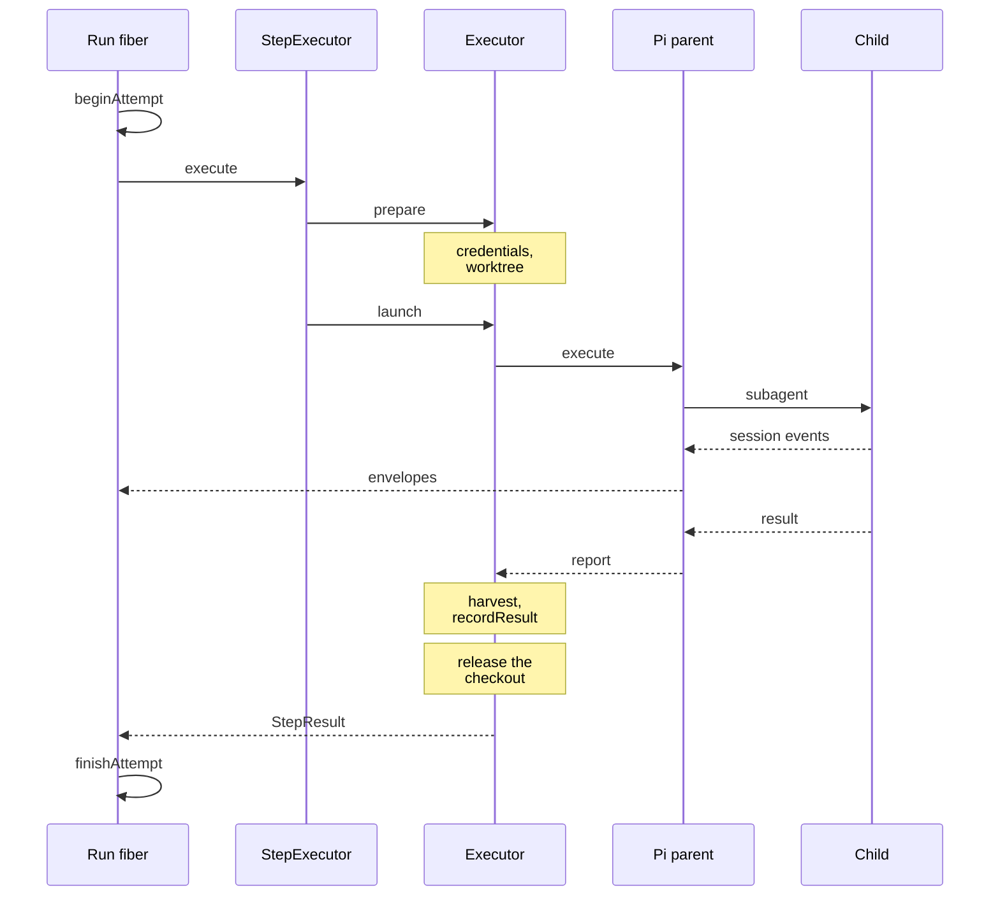
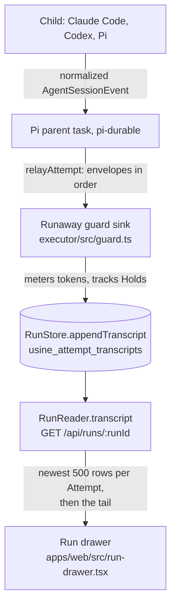
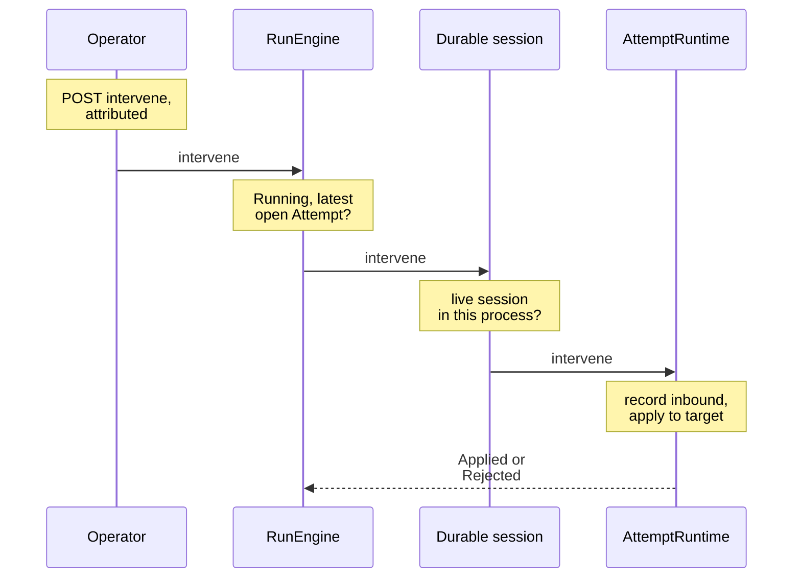

:::note
This page describes commit [`7c0c3d3`](https://github.com/basaltbytes/usine/tree/7c0c3d3696123d11e3d5b9cc3d27e18bb21e84e9) of basaltbytes/usine as it was on 2026-10-16, and the later operator question marker, blocker failure, relayed harness failure, salvage rebase, parent hold, and Claude Agent SDK 0.3.308 ([#241](https://github.com/basaltbytes/usine/issues/241), [#341](https://github.com/basaltbytes/usine/issues/341), [#364](https://github.com/basaltbytes/usine/issues/364), [#282](https://github.com/basaltbytes/usine/issues/282), [#159](https://github.com/basaltbytes/usine/issues/159), [#481](https://github.com/basaltbytes/usine/issues/481)), the pool of a Claude Code child whose gateway uses an API key ([#248](https://github.com/basaltbytes/usine/issues/248)), the Pi child's fixed tool set ([#181](https://github.com/basaltbytes/usine/issues/181)), the checkout that a launch keeps while its parent task's stop is unconfirmed ([#523](https://github.com/basaltbytes/usine/issues/523)), the container per attempt on an SSH worker with Docker ([#548](https://github.com/basaltbytes/usine/issues/548)), the machine per attempt on an SSH worker with a provisioner ([#550](https://github.com/basaltbytes/usine/issues/550)), the restart of a stopped attempt container before its salvage ([#575](https://github.com/basaltbytes/usine/issues/575)), the salvage's left-out paths and `Rejected` record ([#581](https://github.com/basaltbytes/usine/issues/581)), and the resume of a Claude Code child whose SSH connection broke ([#603](https://github.com/basaltbytes/usine/issues/603)). Code links point at that commit, except for the container's and the provisioner's.
:::

An attempt passes through six layers, from the engine down; all but the children run in the orchestrator.

| Layer            | Code                                                                                                                                                                                                                                                                                                                    | Does                                                                                                   |
| ---------------- | ----------------------------------------------------------------------------------------------------------------------------------------------------------------------------------------------------------------------------------------------------------------------------------------------------------------------- | ------------------------------------------------------------------------------------------------------ |
| Run fiber        | [run-driver.ts:288](https://github.com/basaltbytes/usine/blob/7c0c3d3696123d11e3d5b9cc3d27e18bb21e84e9/packages/engine/src/engine/run-driver.ts#L288)                                                                                                                                                                   | Starts or reattaches the attempt, gives the executor a transcript sink, records the outcome.           |
| `StepExecutor`   | [scheduler.ts:163](https://github.com/basaltbytes/usine/blob/7c0c3d3696123d11e3d5b9cc3d27e18bb21e84e9/packages/orchestrator/src/scheduler.ts#L163)                                                                                                                                                                      | Builds a `CheckoutRequest` from the run and settings, then calls `prepare` and `launch` in one scope.  |
| `Executor`       | [executor.ts:172](https://github.com/basaltbytes/usine/blob/7c0c3d3696123d11e3d5b9cc3d27e18bb21e84e9/packages/executor/src/executor.ts#L172)                                                                                                                                                                            | Checkout, credentials, guard, salvage, and harvest on one worker kind.                                 |
| Durable session  | [durable-session.ts:73](https://github.com/basaltbytes/usine/blob/7c0c3d3696123d11e3d5b9cc3d27e18bb21e84e9/packages/executor/src/durable-session.ts#L73)                                                                                                                                                                | Shared by all worker kinds: runs and stops the parent task, routes interventions, implements `isLive`. |
| `AttemptRuntime` | [attempt-runtime.ts:70](https://github.com/basaltbytes/usine/blob/7c0c3d3696123d11e3d5b9cc3d27e18bb21e84e9/packages/durable/src/attempt-runtime.ts#L70), implemented in [runtime.ts:36](https://github.com/basaltbytes/usine/blob/7c0c3d3696123d11e3d5b9cc3d27e18bb21e84e9/packages/durable/src/attempt/runtime.ts#L36) | The Pi parent as a pi-durable task, its `subagent` tool, the envelope relay.                           |
| Child backends   | [children.ts](https://github.com/basaltbytes/usine/blob/7c0c3d3696123d11e3d5b9cc3d27e18bb21e84e9/packages/agents/src/pi/children.ts)                                                                                                                                                                                    | Claude Code, Codex, or Pi, on the executor's chosen worker.                                            |

The Effect workflow and cluster modules of [ADR 0003](https://github.com/basaltbytes/usine/blob/main/docs/adr/0003-durable-execution-on-effect-workflow.md) are gone; a migration dropped their tables ([`20261011153856_drop_workflow_tables`](https://github.com/basaltbytes/usine/tree/7c0c3d3696123d11e3d5b9cc3d27e18bb21e84e9/packages/engine/drizzle/20261011153856_drop_workflow_tables)), and the fiber in [Run lifecycle](/architecture/run-lifecycle/) replaces them.

## Attempt flow



The executor releases the checkout before `launch` returns, so the worktree is removed or its salvage recorded before `finishAttempt`.

## Executor contract

`Executor` ([executor.ts:172](https://github.com/basaltbytes/usine/blob/7c0c3d3696123d11e3d5b9cc3d27e18bb21e84e9/packages/executor/src/executor.ts#L172)) is the interface of [ADR 0006](https://github.com/basaltbytes/usine/blob/main/docs/adr/0006-executor-contract-run-host-attempt-channel.md). `StepExecutor` refuses a worker whose kind differs from the executor's `kind`. [ADR 0029](https://github.com/basaltbytes/usine/blob/main/docs/adr/0029-worker-kinds-and-adapter-set.md) records which worker kinds usine supports and why. Of what it adds, the container per attempt ([#548](https://github.com/basaltbytes/usine/issues/548)) and the machine per attempt on an SSH worker with a provisioner ([#550](https://github.com/basaltbytes/usine/issues/550)) are built, and Cloudflare Sandboxes ([#551](https://github.com/basaltbytes/usine/issues/551)) aren't. `prepare` gets repository access, creates or reattaches the checkout, and returns a `PreparedAttempt` with `workspace` and `launch(io)`. The engine calls `recover` once per persisted attempt at each start, except for attempts on a worker that `usine.yaml` no longer declares.

```ts title="packages/executor/src/executor.ts"
/** Prepares isolated checkouts, runs Attempts on a Worker, and releases their resources (ADR 0006). */
export class Executor extends Context.Service<
  Executor,
  {
    /** Reconciles an old checkout before new Attempts start; records its salvage before releasing any work. */
    readonly recover: <E>(
      attempt: AttemptRecovery,
      record: (salvage: AttemptSalvage) => Effect.Effect<void, E>,
    ) => Effect.Effect<void, E | ExecutorError>;
    readonly kind: WorkerKind;
    /**
     * Whether the orchestrator can reattach to the Attempt's parent task after a restart: the
     * task is still running, or it reported success before the executor harvested its checkout.
     */
    readonly isLive: (attemptId: AttemptId) => Effect.Effect<boolean, AttemptFailure>;
    /**
     * The result that an Attempt's finished parent task wrote to durable storage before an
     * orchestrator restart: the harvested result, or the parent's failure. None when
     * nothing is stored, or when `isLive` returns true and the orchestrator reattaches instead.
     */
    readonly outcome: (
      attemptId: AttemptId,
    ) => Effect.Effect<Option.Option<Result.Result<StepResult, AttemptFailure>>, AttemptFailure>;
    /** Verifies Git and each rostered brain where the Worker runs children; never installs tools or logs in. */
    readonly preflight: (
      worker: WorkerName,
      brains: ReadonlyArray<BrainSpec>,
    ) => Effect.Effect<void, ExecutorError>;
    /**
     * Verifies the assigned brain before acquiring the Attempt in the caller's scope. Clone, fetch, and lock waits
     * remain interruptible; partial preparation releases everything already acquired
     * before reporting failure. Each request identifies a fresh Attempt, or a live one
     * to reattach when `reattach` is set.
     */
    readonly prepare: (
      request: CheckoutRequest,
    ) => Effect.Effect<PreparedAttempt, ExecutorError, Scope.Scope>;
    /**
     * Stops preparation and releases partial resources, or cancels the live
     * parent task with a grace period before forced termination. A canceled prepared Attempt
     * cannot launch. Repeated cancellation after release is a no-op.
     */
    readonly cancel: (attemptId: AttemptId) => Effect.Effect<void, ExecutorError>;
    /** Delivers an attributed operator action to the active Attempt's live session. */
    readonly intervene: (
      attemptId: AttemptId,
      intervention: AttemptChannel.Intervention,
    ) => Effect.Effect<void, AttemptFailure>;
```

`CheckoutRequest` ([executor.ts:93](https://github.com/basaltbytes/usine/blob/7c0c3d3696123d11e3d5b9cc3d27e18bb21e84e9/packages/executor/src/executor.ts#L93)) has the attempt id, worker, repository, revision, event payload, task text, agent, parent model and effort, `maxChildren`, the two optional ceilings, the salvage ref, the salvage to resume from, and `reattach`. The revision is `HEAD` for issue and schedule runs ([trigger-submission.ts:17](https://github.com/basaltbytes/usine/blob/7c0c3d3696123d11e3d5b9cc3d27e18bb21e84e9/packages/orchestrator/src/trigger-submission.ts#L17)), so a retry gets the default branch tip of that moment, and the head commit for pull request runs ([loop-evaluation.ts:78](https://github.com/basaltbytes/usine/blob/7c0c3d3696123d11e3d5b9cc3d27e18bb21e84e9/packages/orchestrator/src/polling/loop-evaluation.ts#L78)).

### Checkout preparation

`provisionWorktree` ([provision.ts:233](https://github.com/basaltbytes/usine/blob/7c0c3d3696123d11e3d5b9cc3d27e18bb21e84e9/packages/executor/src/provision.ts#L233)), the same for every worker kind, clones into a staging directory under a per-repository lock (`git clone --bare --filter=blob:none`) and renames it to the cache, or updates the cache's remote URL. It then fetches the revision, records `FETCH_HEAD` as the base commit, fetches the previous attempt's salvage if the request resumes one, and runs `git worktree add --detach`. A resumed salvage goes on top of the base ([#282](https://github.com/basaltbytes/usine/issues/282)):

- If the salvage forked from the base (`git merge-base`), the worktree checks it out unchanged.
- If it has no changes after its fork point (`git diff --name-only`), it's dropped.
- Otherwise, `git rebase --onto <base> <fork point>` moves its commits onto the base, with usine as committer.
- If the rebase fails or the salvage shares no history with the base, the worktree is recreated at the base. The salvage branch keeps the work; `RunSpec.conflictingSalvage`, the parent's prompt, and the `Started` envelope include its name.

The worktree is `<worker directory>/attempts/<attempt id>` and the cache `<worker directory>/repos/<repository>.git`, with every character other than letters, digits, `_`, `.`, and `-` replaced by `_` ([provision.ts:21](https://github.com/basaltbytes/usine/blob/7c0c3d3696123d11e3d5b9cc3d27e18bb21e84e9/packages/executor/src/provision.ts#L21)).

#### Checkout in an attempt container

On an SSH worker whose machine has Docker, the checkout isn't a linked worktree, whose git directory is inside the cache: the attempt's container mounts the cache read-only, so a commit couldn't write its objects there. `remoteExecutorFor` ([remote.ts](https://github.com/basaltbytes/usine/blob/main/packages/executor/src/remote/remote.ts)) creates `attempts/<attempt id>` on the machine, starts the container `usine-<attempt id>` ([container.ts](https://github.com/basaltbytes/usine/blob/main/packages/executor/src/remote/container.ts)), and runs `git init` in it. The checkout's `.git/objects/info/alternates` names the cache's objects, and its `origin`, the repository URL, is a partial-clone remote (`extensions.partialClone`, `remote.origin.promisor`, `blob:none`), so `git checkout --detach <base>` fetches the missing blobs into the checkout's own objects. Commits, branches, fetches, and the salvage write only the checkout. A rebase failure empties the directory instead of removing it, since the container mounts that directory. The checkout starts with no `origin/*` refs; the cache's are as old as its clone.

| Path in the container                                                   | Mount                                                      |
| ----------------------------------------------------------------------- | ---------------------------------------------------------- |
| `<worker directory>/attempts`                                           | an empty tmpfs, for the children's PID files               |
| `<worker directory>/attempts/<attempt id>`                              | the checkout, read-write                                   |
| `<worker directory>/repos/<repository>.git`                             | the cache, read-only                                       |
| `<worker directory>/credentials/<attempt id>`                           | the token directory, read-only, without a gateway          |
| `<worker directory>/gh`, `/run/usine-gateway`                           | gh's configuration and socket, read-only, behind a gateway |
| `/home/usine/.claude/.credentials.json`, `/home/usine/.codex/auth.json` | the SSH user's login of the attempt's harness, read-write  |
| `/usr/local/share/usine/seed/.claude.json`, `.../.codex/config.toml`    | copied into `/home/usine` by the image's entrypoint        |

The fetch into the cache runs as the SSH user; every other command of the attempt runs with `docker exec -i usine-<attempt id> sh -c <command line>`, because the checkout's git configuration and hooks are the agent's to change. `RemoteShell.container` ([child-host.ts](https://github.com/basaltbytes/usine/blob/main/packages/agents/src/child-host/child-host.ts)) wraps the command line, so the children, harvest, salvage, pre-push hook, and the attempt's harness check use the same code as without a container. The PID files are in the container's tmpfs, and the kill script runs in the container; a missing or stopped container has no child to stop. The container starts after the credential, so the attempt's harness check runs after the checkout exists, outside the repository's fetch lock. Its finalizer runs after the checkout's release, which salvages in it, and before the credential's. If the container stopped before the release, for example because the kernel killed it for memory or a test signaled its init, the release starts it again with `docker start` and salvages in it ([#575](https://github.com/basaltbytes/usine/issues/575)); the salvage never runs git in the checkout as the SSH user.

### Launch, runaway guard, and release

`launch` ([prepared-attempt.ts](https://github.com/basaltbytes/usine/blob/7c0c3d3696123d11e3d5b9cc3d27e18bb21e84e9/packages/executor/src/prepared-attempt.ts)) wraps the sink with the runaway guard ([prepared-attempt.ts:114](https://github.com/basaltbytes/usine/blob/7c0c3d3696123d11e3d5b9cc3d27e18bb21e84e9/packages/executor/src/prepared-attempt.ts#L114)) and races the parent task against the guard's wall clock. The guard ([guard.ts:139](https://github.com/basaltbytes/usine/blob/7c0c3d3696123d11e3d5b9cc3d27e18bb21e84e9/packages/executor/src/guard.ts#L139)) enforces only the ceilings that `usine.yaml` sets. Its token meter sums the highest `SessionTokensUpdated` count of each session ([guard.ts:32](https://github.com/basaltbytes/usine/blob/7c0c3d3696123d11e3d5b9cc3d27e18bb21e84e9/packages/executor/src/guard.ts#L32)), and its wall clock pauses while any child is held ([guard.ts:64](https://github.com/basaltbytes/usine/blob/7c0c3d3696123d11e3d5b9cc3d27e18bb21e84e9/packages/executor/src/guard.ts#L64)). At 80% of either ceiling ([guard.ts:8](https://github.com/basaltbytes/usine/blob/7c0c3d3696123d11e3d5b9cc3d27e18bb21e84e9/packages/executor/src/guard.ts#L8)), it sends the parent one `Steer` from operator `engine` ([prepared-attempt.ts:119](https://github.com/basaltbytes/usine/blob/7c0c3d3696123d11e3d5b9cc3d27e18bb21e84e9/packages/executor/src/prepared-attempt.ts#L119)); at a ceiling, it stops the attempt and fails it with `RunawayFailure`.

On success, `harvestFacts` ([harvest.ts:135](https://github.com/basaltbytes/usine/blob/7c0c3d3696123d11e3d5b9cc3d27e18bb21e84e9/packages/core/src/step/harvest.ts#L135)) collects the commits from the base commit to `HEAD`, then the pull requests whose head is the final commit, from `gh api repos/<repo>/commits/<head>/pulls`. GitHub isn't queried for a final commit that no remote ref points at (`git ls-remote origin`). Discovery times out after ten seconds and never fails the attempt. No code produces the `Comment` fact that `StepResult` allows ([result.ts:20](https://github.com/basaltbytes/usine/blob/7c0c3d3696123d11e3d5b9cc3d27e18bb21e84e9/packages/core/src/step/result.ts#L20)).

Any other ending runs `salvageWorktree` ([salvage.ts:56](https://github.com/basaltbytes/usine/blob/7c0c3d3696123d11e3d5b9cc3d27e18bb21e84e9/packages/executor/src/salvage.ts#L56)) before the worktree is removed: it commits uncommitted changes as `wip(usine): salvage attempt <id>` and force-pushes `HEAD` to `usine/salvage/<run>/<number>`. If the push fails, the worktree stays on the worker, recorded as `Retained`. The commit leaves out what Git ignores, `.pnpm-store`, `node_modules`, and `.turbo` at any depth, and each file larger than GitHub's 100 MiB limit. A salvage that leaves out such a file pushes the rest and keeps the worktree, recorded as `PartlyPushed` with the pushed ref and commit, which the next attempt resumes from. A push that GitHub refuses for a file over that limit (`GH001`) is recorded as `Rejected`, and recovery doesn't push that commit again ([#581](https://github.com/basaltbytes/usine/issues/581)). The run's next attempt applies the newest pushed salvage onto its base ([ADR 0013](https://github.com/basaltbytes/usine/blob/main/docs/adr/0013-cost-accounting-native-meters-guardrails.md), amendments of 2026-09-18 and 2026-10-18).

Before the release, the durable session stops the parent task. If it can't confirm the stop, it keeps the worktree on disk without salvage (`keepUntilStopped`), because the task may still write there. The next `Executor.cancel` that confirms the stop salvages and removes the worktree with a new credential, as recovery after a restart does, and the engine frees the attempt's slot only after that ([#523](https://github.com/basaltbytes/usine/issues/523)). `cancel` takes the reason of the engine's stop (`cancel`, `failed`, or `startup`), which the session logs.

### Machine per attempt

This section includes the lifecycle changes in [#564](https://github.com/basaltbytes/usine/issues/564), 2026-10-28.

A worker with a `provisioner` creates a machine for each attempt ([ADR 0029](https://github.com/basaltbytes/usine/blob/main/docs/adr/0029-worker-kinds-and-adapter-set.md)). The SSH executor provides `WorkerMachines` ([executor.ts](https://github.com/basaltbytes/usine/blob/main/packages/executor/src/executor.ts)) beside `Executor`, and the scheduler and engine use it around the attempt; [ssh with a provisioner](/architecture/workers-and-gateway/#ssh-with-a-provisioner) describes the providers' side.

| Moment                                                         | What happens                                                                                                                                                                                                                                                                                                                                                                            |
| -------------------------------------------------------------- | --------------------------------------------------------------------------------------------------------------------------------------------------------------------------------------------------------------------------------------------------------------------------------------------------------------------------------------------------------------------------------------- |
| A slot frees on a provisioned worker                           | The scheduler leases the slot, then the engine persists the attempt. `execute` calls `WorkerMachines.create(worker, runId, attemptId, brains)` with that persisted ID. The creation request includes the attempt label.                                                                                                                                                                 |
| The attempt's preparation                                      | After SSH readiness and any due machine checks, `prepare` creates the checkout on that attempt's machine. Provider failures retry within the same attempt, keeping its slot, with the configured backoff. Cancellation stops creation and releases the slot.                                                                                                                            |
| The end of the attempt                                         | The executor releases the checkout, then the lease releases the slot, whose `release` deletes the machine. If the durable session can't confirm that the parent task stopped, the slot stays occupied ([#523](https://github.com/basaltbytes/usine/issues/523), [#545](https://github.com/basaltbytes/usine/issues/545)), and so does the machine, until a reconcile confirms the stop. |
| A restart                                                      | Startup recovery reconciles each earlier attempt's checkout on its machine, which the executor finds by its tags. `StepExecutor.occupy(worker, attemptId)` takes a slot for an attempt that still runs and adopts its machine.                                                                                                                                                          |
| After startup recovery, and at each reconcile, every 3 minutes | The engine runs `StepExecutor.sweep` after the stops that it retries, and the executor deletes the machines of provisioned workers that no attempt or creation of this process holds.                                                                                                                                                                                                   |

A failed creation isn't an attempt failure: no attempt starts, so the run uses no retry. `create` fails with `MachineUnavailableError`, whose `reason` is `capacity`, `quota`, `refused`, `provider`, `unreachable`, or `timeout`, or with the `WorkerCapabilityError` of the machine checks on the worker's first machine of the day. The scheduler then frees the slot, keeps the run's place in the queue, and creates no machine on that worker for 30 seconds, then for twice as long after each further failure, up to 10 minutes; a creation that succeeds resets the pause. The **Workers** page and the log show the reason and the time of the next try.

## Durable layer

`AttemptRuntime` ([attempt-runtime.ts:70](https://github.com/basaltbytes/usine/blob/7c0c3d3696123d11e3d5b9cc3d27e18bb21e84e9/packages/durable/src/attempt-runtime.ts#L70)) runs the Pi parent as the pi-durable task `usine.attempt` ([task.ts:46](https://github.com/basaltbytes/usine/blob/7c0c3d3696123d11e3d5b9cc3d27e18bb21e84e9/packages/durable/src/attempt/task.ts#L46)), stored in `.usine/durable.sqlite` ([storage-path.ts:5](https://github.com/basaltbytes/usine/blob/7c0c3d3696123d11e3d5b9cc3d27e18bb21e84e9/packages/durable/src/storage-path.ts#L5)), which `@earendil-works/pi-durable` 1.1.0 opens. Building the layer ([live.ts:74](https://github.com/basaltbytes/usine/blob/7c0c3d3696123d11e3d5b9cc3d27e18bb21e84e9/packages/durable/src/live.ts#L74)) resumes every unfinished task ([runtime.ts:50](https://github.com/basaltbytes/usine/blob/7c0c3d3696123d11e3d5b9cc3d27e18bb21e84e9/packages/durable/src/attempt/runtime.ts#L50)).

| Operation              | Does                                                                                                             |
| ---------------------- | ---------------------------------------------------------------------------------------------------------------- |
| `execute(request, io)` | Creates the task, or finds it after a restart, forwards its activity to `io`, and waits for the parent's report. |
| `isLive`, `finished`   | Whether the task is open, and what a finished task left: `ParentReported`, `ResultRecorded`, or `ParentFailed`.  |
| `recordResult`         | Stores the harvested `StepResult` with the task.                                                                 |
| `request`              | The task's stored request, read for a reattachment.                                                              |
| `intervene`            | Applies an operator action to the parent or a child.                                                             |
| `cancel`               | Aborts children, then the parent conversation.                                                                   |

The stored request has the RunSpec, worker, and worktree path ([attempt-runtime.ts:14](https://github.com/basaltbytes/usine/blob/7c0c3d3696123d11e3d5b9cc3d27e18bb21e84e9/packages/durable/src/attempt-runtime.ts#L14)), but not the child host or the environment: each `execute` passes those again, because the environment has the attempt's credential configuration ([ADR 0011](https://github.com/basaltbytes/usine/blob/main/docs/adr/0011-github-app-identity-scoped-worker-tokens.md)).

The parent's first turn is the `assemblePrompt` prompt ([prompt.ts:58](https://github.com/basaltbytes/usine/blob/7c0c3d3696123d11e3d5b9cc3d27e18bb21e84e9/packages/agents/src/prompt.ts#L58)): the repository, the salvage it resumes from, the event payload as JSON, the agent persona, the task text, and fixed completion and GitHub rules, including the `githubSignature` line ([prompt.ts:28](https://github.com/basaltbytes/usine/blob/7c0c3d3696123d11e3d5b9cc3d27e18bb21e84e9/packages/agents/src/prompt.ts#L28)). [Loop files](/reference/configuration/loop-files/) describes the prompt.

The parent's only tool is `subagent` ([subagent.ts:31](https://github.com/basaltbytes/usine/blob/7c0c3d3696123d11e3d5b9cc3d27e18bb21e84e9/packages/durable/src/attempt/subagent.ts#L31)); each call starts one child of the agent's harness in the checkout. It's declared `replay: "unsafe"` ([subagent.ts:271](https://github.com/basaltbytes/usine/blob/7c0c3d3696123d11e3d5b9cc3d27e18bb21e84e9/packages/durable/src/attempt/subagent.ts#L271)): after a restart, the interrupted call ends with the output committed so far, and the parent decides whether to delegate again. One spawn beyond `max_children`, counted by `children` in the attempt record, fails the attempt with `ChildSessionBudgetFailure`.

A final answer starting with `[usine:blocked]` or `[usine:question]` fails the attempt with `BlockedFailure` or `QuestionFailure`, whose `message` or `question` is the text after the marker ([task.ts:58](https://github.com/basaltbytes/usine/blob/7c0c3d3696123d11e3d5b9cc3d27e18bb21e84e9/packages/durable/src/attempt/task.ts#L58)). The prompt asks the agent to record it on the item first, and the loop then suppresses the item ([Operator questions and blockers](/architecture/run-lifecycle/#operator-questions-and-blockers)). `reportedOutcome` in `@usine/agents/runtime` reads both markers for the parent and every child harness. The attempt record keeps the first child report with its kind, so a child's blocker or question fails the attempt even if the parent doesn't relay it. A child's harness failure gives the parent a report starting with `[usine:failed]`, read as `AgentResultError`, so the attempt ends with `AgentFailure` either way ([#364](https://github.com/basaltbytes/usine/issues/364)).

The parent's billing pool follows its provider ([authentication.ts:30](https://github.com/basaltbytes/usine/blob/7c0c3d3696123d11e3d5b9cc3d27e18bb21e84e9/packages/agents/src/pi/authentication.ts#L30), [ADR 0021](https://github.com/basaltbytes/usine/blob/main/docs/adr/0021-pi-parent-pool-follows-authentication.md)): the ChatGPT plan for `openai-codex`, API keys otherwise.

### Reattachment after a restart

`RunDriver.openAttempt` ([run-driver.ts:234](https://github.com/basaltbytes/usine/blob/7c0c3d3696123d11e3d5b9cc3d27e18bb21e84e9/packages/engine/src/engine/run-driver.ts#L234)) calls `isLive`, which is true if the task is live, or finished with `ParentReported` before its checkout was harvested ([durable-session.ts:396](https://github.com/basaltbytes/usine/blob/7c0c3d3696123d11e3d5b9cc3d27e18bb21e84e9/packages/executor/src/durable-session.ts#L396)). `beginAttempt` then returns `ReattachAttempt` with the same attempt id and number, using no retry ([lifecycle.ts:132](https://github.com/basaltbytes/usine/blob/7c0c3d3696123d11e3d5b9cc3d27e18bb21e84e9/packages/engine/src/engine/lifecycle.ts#L132)). `prepare` with `reattach` reads the stored RunSpec, issues new credentials, and reuses the worktree, and `execute` continues the task's relay from the stored sequence.

If the task no longer exists, the attempt fails with an `InfraFailure`, and the next attempt starts from the newest pushed salvage. A launch interrupted without a cancel means the process is shutting down, so the task stays live and the worktree stays on disk ([durable-session.ts:193](https://github.com/basaltbytes/usine/blob/7c0c3d3696123d11e3d5b9cc3d27e18bb21e84e9/packages/executor/src/durable-session.ts#L193)).

## Attempt channel and transcript

[channel.ts](https://github.com/basaltbytes/usine/blob/7c0c3d3696123d11e3d5b9cc3d27e18bb21e84e9/packages/core/src/attempt/channel.ts) defines the envelopes at protocol version 7. Each inbound payload targets the parent or a child session id. `admit` ([channel.ts:221](https://github.com/basaltbytes/usine/blob/7c0c3d3696123d11e3d5b9cc3d27e18bb21e84e9/packages/core/src/attempt/channel.ts#L221)) enforces one `Started` or `Failed` first, contiguous sequences, and nothing after the terminal envelope.

```ts title="packages/core/src/attempt/channel.ts"
/** Nonterminal operator controls; cancellation is an Attempt operation. */
export const OperatorAction = Schema.Union([Steer, Interrupt, OperatorMessage, Release]);
export type OperatorAction = typeof OperatorAction.Type;
export const InboundPayload = Schema.Union([OperatorAction, Cancel]);
export type InboundPayload = typeof InboundPayload.Type;
// ...
export const OutboundPayload = Schema.Union([
  Started,
  SessionEvent,
  Final,
  Failed,
  Interrupted,
  InterventionApplied,
  InterventionRejected,
]);
export type OutboundPayload = typeof OutboundPayload.Type;
```

`relayAttempt` ([relay.ts:171](https://github.com/basaltbytes/usine/blob/7c0c3d3696123d11e3d5b9cc3d27e18bb21e84e9/packages/durable/src/attempt/relay.ts#L171)) sends `Started`, then the parent's committed entries and the children's session events in order, then one terminal envelope. The durable attempt record stores the next sequence numbers, so a restarted relay continues them.

The fiber's sink calls `RunStore.appendTranscript` ([store.ts:546](https://github.com/basaltbytes/usine/blob/7c0c3d3696123d11e3d5b9cc3d27e18bb21e84e9/packages/engine/src/store/store.ts#L546)), which writes one `usine_attempt_transcripts` row per envelope. A unique index on attempt, direction, and channel sequence keeps the first copy when a reattached relay resends an envelope. `Started` records the SDK's chosen parent model on the attempt, and `InterventionApplied` sets `operator_intervened`. Envelopes of protocol versions 3 and 4 ([transcript.ts:21](https://github.com/basaltbytes/usine/blob/7c0c3d3696123d11e3d5b9cc3d27e18bb21e84e9/packages/engine/src/transcript.ts#L21)) and 5 and 6 ([transcript.ts:43](https://github.com/basaltbytes/usine/blob/7c0c3d3696123d11e3d5b9cc3d27e18bb21e84e9/packages/engine/src/transcript.ts#L43)) still decode.



[`GET /api/runs/:runId`](/architecture/operator-surfaces/#reads) serves the transcript to the UI ([projection.ts:37](https://github.com/basaltbytes/usine/blob/7c0c3d3696123d11e3d5b9cc3d27e18bb21e84e9/packages/orchestrator/src/operator/projection.ts#L37), [projection.ts:192](https://github.com/basaltbytes/usine/blob/7c0c3d3696123d11e3d5b9cc3d27e18bb21e84e9/packages/orchestrator/src/operator/projection.ts#L192)).

## Live channel for interventions

Operator input never becomes an event ([ADR 0018](https://github.com/basaltbytes/usine/blob/main/docs/adr/0018-takeover-and-edit-and-retry.md)):



`Operator.intervene` ([operator.ts:471](https://github.com/basaltbytes/usine/blob/7c0c3d3696123d11e3d5b9cc3d27e18bb21e84e9/packages/orchestrator/src/operator/operator.ts#L471)) attributes the action to `operator` from `usine.yaml`, or `local operator`. `RunEngine.intervene` ([engine.ts:120](https://github.com/basaltbytes/usine/blob/7c0c3d3696123d11e3d5b9cc3d27e18bb21e84e9/packages/engine/src/engine/engine.ts#L120)) refuses unless the run is `Running` and the attempt is its latest open one, and the durable session ([durable-session.ts:312](https://github.com/basaltbytes/usine/blob/7c0c3d3696123d11e3d5b9cc3d27e18bb21e84e9/packages/executor/src/durable-session.ts#L312)) refuses with `AgentFailure` if the attempt has no live session in this process, such as before a reattachment. `AttemptRuntime.intervene` ([runtime.ts:305](https://github.com/basaltbytes/usine/blob/7c0c3d3696123d11e3d5b9cc3d27e18bb21e84e9/packages/durable/src/attempt/runtime.ts#L305)) records the inbound envelope, applies the action, and records `InterventionApplied` or `InterventionRejected` through the same sink.

On the parent:

- `Interrupt` aborts the current turn and marks the parent paused in its `HoldDoc`. `OperatorMessage` adds the parent to the hold's sessions; `Steer` doesn't.
- Input to a paused or waiting parent becomes its next turn. Input to a busy parent is a pi-durable steer, read after the running tool call returns ([runtime.ts:225](https://github.com/basaltbytes/usine/blob/7c0c3d3696123d11e3d5b9cc3d27e18bb21e84e9/packages/durable/src/attempt/runtime.ts#L225)). A steer waiting in the inbox gets `InterventionApplied` with `queued`, and `AttemptRecordDoc.queuedInputs` keeps it until the relay sees the parent read it or stop, then sends a second receipt for the same input sequence ([#159](https://github.com/basaltbytes/usine/issues/159)).
- While the parent is held, its answers wait for guidance or a release instead of ending the attempt. `Release` ends the pause and the hold: a waiting parent resumes with an instruction to continue, and a working one ends the attempt with its next answer.

On a child, `OperatorMessage` places a hold and `Release` ends it ([runtime.ts:205](https://github.com/basaltbytes/usine/blob/7c0c3d3696123d11e3d5b9cc3d27e18bb21e84e9/packages/durable/src/attempt/runtime.ts#L205)). Input to a working child joins its running turn and gets `InterventionApplied` with `queued`; when the harness reports reading it, the relay sends the second receipt, or `InterventionRejected` if the child stops first ([#381](https://github.com/basaltbytes/usine/issues/381)). The `subagent` call returns a held child's result only after the hold ends ([subagent.ts:223](https://github.com/basaltbytes/usine/blob/7c0c3d3696123d11e3d5b9cc3d27e18bb21e84e9/packages/durable/src/attempt/subagent.ts#L223)).

## Harnesses

| Harness     | Driven by                                                                                                                                                                                                                                                            | Where it runs                                                                                                                                                                                                            | Pool                                                                                                                        |
| ----------- | -------------------------------------------------------------------------------------------------------------------------------------------------------------------------------------------------------------------------------------------------------------------- | ------------------------------------------------------------------------------------------------------------------------------------------------------------------------------------------------------------------------ | --------------------------------------------------------------------------------------------------------------------------- |
| Claude Code | `@anthropic-ai/claude-agent-sdk` 0.3.308, executable `claude`, `permissionMode: "bypassPermissions"`, user settings only ([claude.ts:183](https://github.com/basaltbytes/usine/blob/7c0c3d3696123d11e3d5b9cc3d27e18bb21e84e9/packages/agents/src/pi/claude.ts#L183)) | Locally, or one SSH command with a pid file through `spawnClaudeCodeProcess` ([claude.ts:160](https://github.com/basaltbytes/usine/blob/7c0c3d3696123d11e3d5b9cc3d27e18bb21e84e9/packages/agents/src/pi/claude.ts#L160)) | Claude plan, or API keys if the worker's gateway uses its API key ([#248](https://github.com/basaltbytes/usine/issues/248)) |
| Codex       | `codex app-server` JSON-RPC over stdio, `approvalPolicy: "never"`, sandbox `danger-full-access` ([codex.ts:132](https://github.com/basaltbytes/usine/blob/7c0c3d3696123d11e3d5b9cc3d27e18bb21e84e9/packages/agents/src/pi/codex/codex.ts#L132))                      | Locally, or one SSH command with a pid file ([app-server.ts:121](https://github.com/basaltbytes/usine/blob/7c0c3d3696123d11e3d5b9cc3d27e18bb21e84e9/packages/agents/src/pi/codex/app-server.ts#L121))                    | ChatGPT plan                                                                                                                |
| Pi          | `@earendil-works/pi-coding-agent` 1.1.0 in the orchestrator process                                                                                                                                                                                                  | Local workers only; refuses a remote host ([pi.ts:69](https://github.com/basaltbytes/usine/blob/7c0c3d3696123d11e3d5b9cc3d27e18bb21e84e9/packages/agents/src/pi/pi.ts#L69))                                              | API keys                                                                                                                    |

[Agent files](/reference/configuration/agent-files/) lists each harness's preflight checks ([preflight.ts:74](https://github.com/basaltbytes/usine/blob/7c0c3d3696123d11e3d5b9cc3d27e18bb21e84e9/packages/agents/src/preflight/preflight.ts#L74), [preflight.ts:20](https://github.com/basaltbytes/usine/blob/7c0c3d3696123d11e3d5b9cc3d27e18bb21e84e9/packages/agents/src/preflight/preflight.ts#L20), [preflight.ts:51](https://github.com/basaltbytes/usine/blob/7c0c3d3696123d11e3d5b9cc3d27e18bb21e84e9/packages/agents/src/preflight/preflight.ts#L51), [preflight.ts:86](https://github.com/basaltbytes/usine/blob/7c0c3d3696123d11e3d5b9cc3d27e18bb21e84e9/packages/agents/src/preflight/preflight.ts#L86)). `childDispatcherLayer` picks the backend from the agent's `harness` ([children.ts:31](https://github.com/basaltbytes/usine/blob/7c0c3d3696123d11e3d5b9cc3d27e18bb21e84e9/packages/agents/src/pi/children.ts#L31)). Children get only the attempt's environment, nothing from the orchestrator's ([runtime.ts:38](https://github.com/basaltbytes/usine/blob/7c0c3d3696123d11e3d5b9cc3d27e18bb21e84e9/packages/agents/src/runtime.ts#L38)): on the local worker, `HOME`, `LANG`, `LC_ALL`, `PATH`, `SHELL`, `TMPDIR`, `USER`, the credential variables, and `TURBO_CACHE_DIR` ([local.ts:72](https://github.com/basaltbytes/usine/blob/7c0c3d3696123d11e3d5b9cc3d27e18bb21e84e9/packages/executor/src/local/local.ts#L72), [local.ts:280](https://github.com/basaltbytes/usine/blob/7c0c3d3696123d11e3d5b9cc3d27e18bb21e84e9/packages/executor/src/local/local.ts#L280)); on a remote worker, those variables on top of the machine's own environment. An SSH client's exit doesn't necessarily stop its remote command, so before a remote checkout is kept or removed, `CHILD_KILL_SCRIPT` stops every process in a `<worktree>.child-*.pid` file ([child-host.ts:106](https://github.com/basaltbytes/usine/blob/7c0c3d3696123d11e3d5b9cc3d27e18bb21e84e9/packages/agents/src/child-host/child-host.ts#L106)).

If the SSH connection to a remote Claude Code child breaks, for example because the orchestrator's machine slept, the SSH client exits with 255 and the child's output fails. The child doesn't fail: the backend stops what is left of its Claude process with `CHILD_STOP_SCRIPT` and the child's pid file, then starts Claude with the saved session in the same child session. The parent's `subagent` call keeps waiting, and the attempt spends no child budget. A working child gets a message that asks it to check the worktree and continue; a paused or idle child waits for the operator. The backend tries after 5 s, 15 s, 30 s, 1 min, 2 min, and 5 min, counted from Claude's last message, and then fails the child with the broken stream's error ([#603](https://github.com/basaltbytes/usine/issues/603)).

Pi children on a local worker run their tools in the orchestrator process. They get only Pi's default tools, `read`, `bash`, `edit`, and `write`, whatever Pi's global `defaultTools` setting adds, and `bash` runs with the attempt's environment ([#181](https://github.com/basaltbytes/usine/issues/181)).
