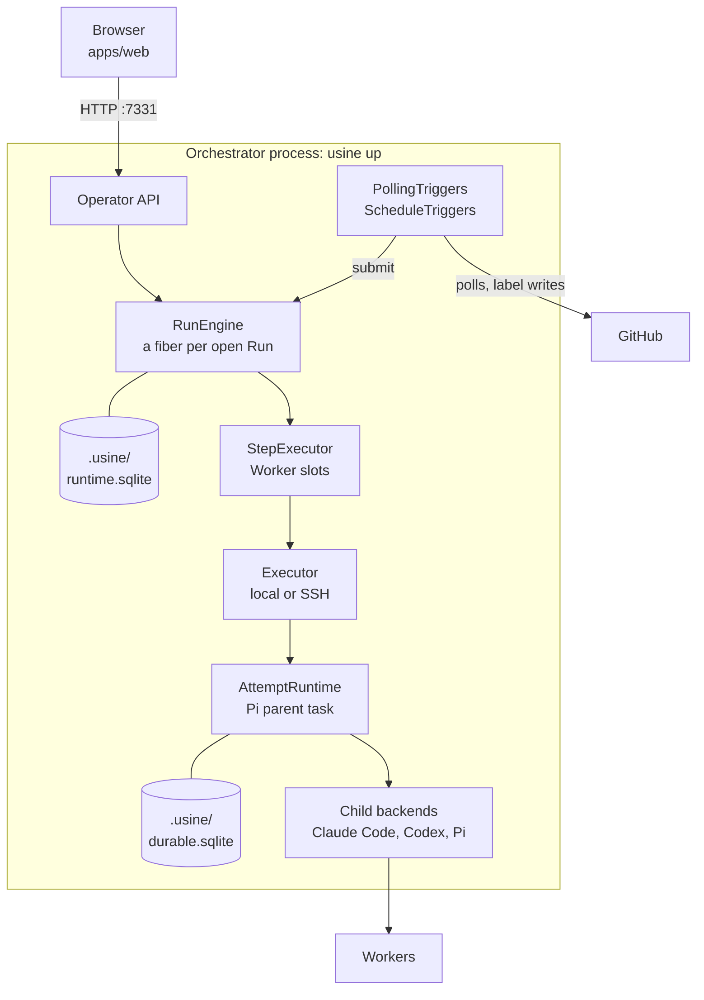
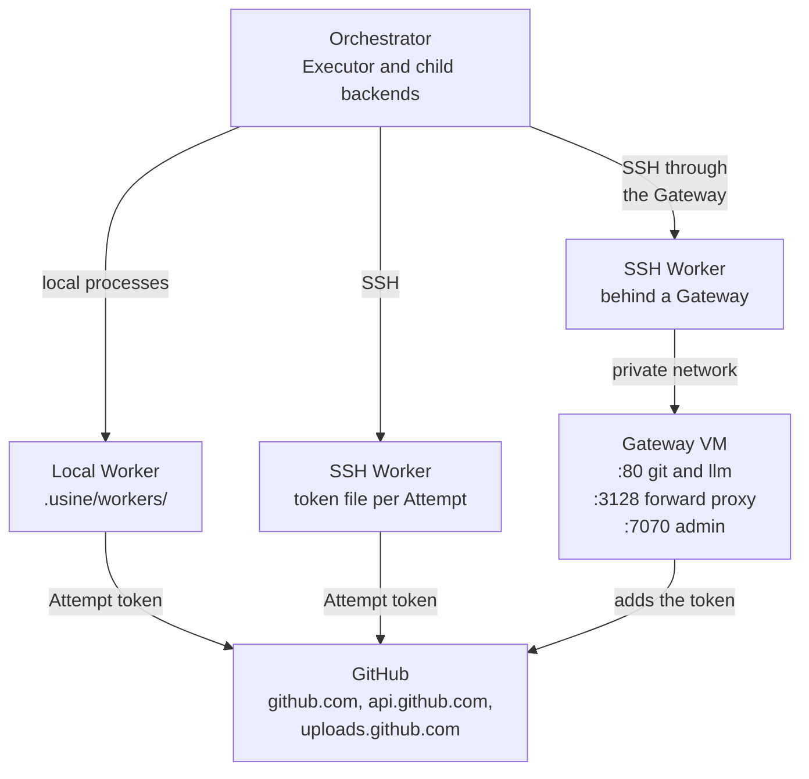
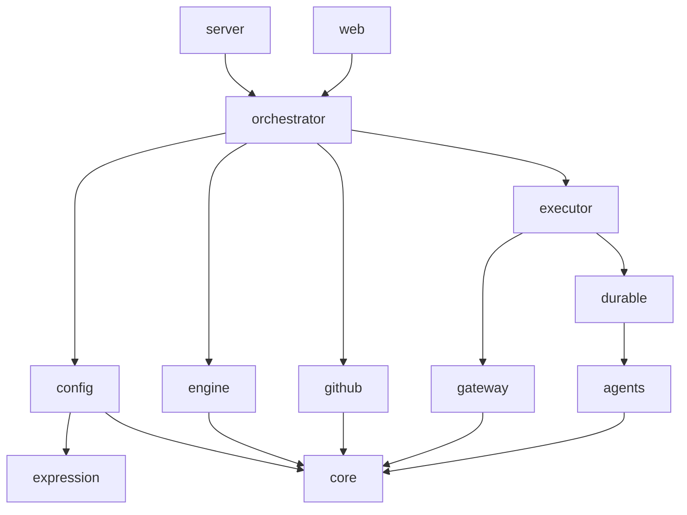
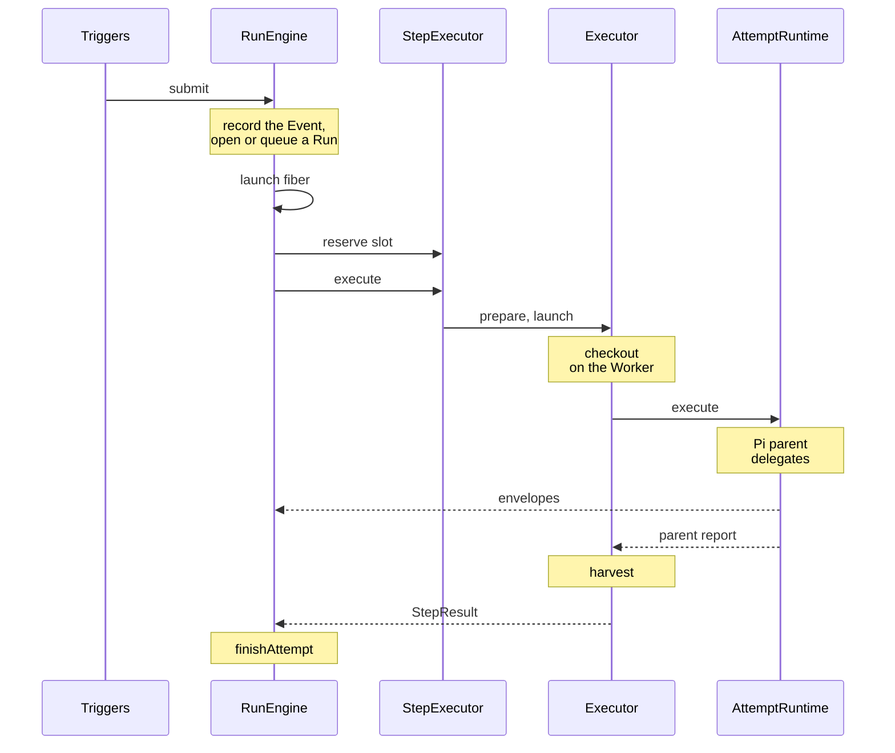

import { CardGrid, LinkCard, Steps } from "@astrojs/starlight/components";

:::note
This page describes commit [`7c0c3d3`](https://github.com/basaltbytes/usine/tree/7c0c3d3696123d11e3d5b9cc3d27e18bb21e84e9) of basaltbytes/usine as it was on 2026-10-16. Code links point at that commit.
:::

usine is one long-running Node process, the orchestrator, that polls the GitHub issues and pull requests of the repositories that an operator registers. When an issue or pull request matches a Loop, the orchestrator opens a Run and has a coding agent work on it. Loops and Agents are Markdown files in the operator's instance folder; the engine has no built-in Loop. The same process serves a web UI on `127.0.0.1`, where the operator approves and steers the work and follows its progress.

Each try of a Run is an Attempt. The Attempt's Pi parent runs inside the orchestrator as a pi-durable task and delegates the coding to Claude Code, Codex, or Pi children. The children run on a Worker: the orchestrator's own machine, or a Linux machine the orchestrator connects to over SSH. An SSH Worker can be on a private network behind a Gateway VM, which adds the GitHub token to the Worker's requests so that no token is on the Worker. [`CONTEXT.md`](https://github.com/basaltbytes/usine/blob/main/CONTEXT.md) defines the vocabulary, and [`docs/adr/`](https://github.com/basaltbytes/usine/tree/main/docs/adr) explains the design decisions.

## The system

### Inside the orchestrator process

The orchestrator serves `/api/*` and the built web assets on `127.0.0.1:7331` ([cli.ts:10](https://github.com/basaltbytes/usine/blob/7c0c3d3696123d11e3d5b9cc3d27e18bb21e84e9/apps/server/src/cli.ts#L10), [http.ts:243](https://github.com/basaltbytes/usine/blob/7c0c3d3696123d11e3d5b9cc3d27e18bb21e84e9/apps/server/src/http.ts#L243)). Inside the process, the operator API is in [`packages/orchestrator/src/operator`](https://github.com/basaltbytes/usine/tree/7c0c3d3696123d11e3d5b9cc3d27e18bb21e84e9/packages/orchestrator/src/operator), the polling triggers are in [`packages/orchestrator/src/polling`](https://github.com/basaltbytes/usine/tree/7c0c3d3696123d11e3d5b9cc3d27e18bb21e84e9/packages/orchestrator/src/polling), the schedule triggers in [schedule-triggers.ts](https://github.com/basaltbytes/usine/blob/7c0c3d3696123d11e3d5b9cc3d27e18bb21e84e9/packages/orchestrator/src/schedule-triggers.ts), and the Worker scheduler in [scheduler.ts](https://github.com/basaltbytes/usine/blob/7c0c3d3696123d11e3d5b9cc3d27e18bb21e84e9/packages/orchestrator/src/scheduler.ts). The same process creates the GitHub App installation tokens that the polls and the Attempts use ([github-app.ts:185](https://github.com/basaltbytes/usine/blob/7c0c3d3696123d11e3d5b9cc3d27e18bb21e84e9/packages/github/src/github-app.ts#L185)).

### Workers, the Gateway, and GitHub

One executor handles every Worker of an instance: the SSH executor when every Worker in `usine.yaml` is `ssh`, the local executor otherwise ([worker-engine.ts:13](https://github.com/basaltbytes/usine/blob/7c0c3d3696123d11e3d5b9cc3d27e18bb21e84e9/packages/orchestrator/src/worker-engine.ts#L13)). With a Worker of another kind, startup fails with `UnsupportedWorkerError` ([scheduler.ts:76](https://github.com/basaltbytes/usine/blob/7c0c3d3696123d11e3d5b9cc3d27e18bb21e84e9/packages/orchestrator/src/scheduler.ts#L76)), so `usine up` can't use the exe.dev executor in `@usine/executor`. An SSH Worker without a Gateway receives a token file per Attempt ([credentials.ts:51](https://github.com/basaltbytes/usine/blob/7c0c3d3696123d11e3d5b9cc3d27e18bb21e84e9/packages/executor/src/ssh/credentials.ts#L51)). For a Worker behind a Gateway, the executor sends the caller token with `SendEnv` ([commands.ts:101](https://github.com/basaltbytes/usine/blob/7c0c3d3696123d11e3d5b9cc3d27e18bb21e84e9/packages/executor/src/remote/commands.ts#L101)). The SSH hop through the Gateway comes from a `ProxyJump` entry in the operator's `~/.ssh/config`, because the executor passes only the port and identity file to `ssh` ([ssh.ts:22](https://github.com/basaltbytes/usine/blob/7c0c3d3696123d11e3d5b9cc3d27e18bb21e84e9/packages/executor/src/ssh/ssh.ts#L22)).

The second diagram doesn't show three paths. The executor calls the Gateway's admin API on `127.0.0.1:7070` through an SSH local forward that the operator keeps open ([admin.ts:79](https://github.com/basaltbytes/usine/blob/7c0c3d3696123d11e3d5b9cc3d27e18bb21e84e9/packages/executor/src/ssh/gateway/admin.ts#L79)). The Gateway's `llm.<domain>` host forwards to Anthropic or OpenAI when the Gateway has a credential for that provider ([proxy.ts:206](https://github.com/basaltbytes/usine/blob/7c0c3d3696123d11e3d5b9cc3d27e18bb21e84e9/packages/gateway/src/proxy/proxy.ts#L206)). The forward proxy on port 3128 opens tunnels to package hosts and to the hosts of the harness logins ([egress-proxy.ts:241](https://github.com/basaltbytes/usine/blob/7c0c3d3696123d11e3d5b9cc3d27e18bb21e84e9/packages/gateway/src/node/egress-proxy.ts#L241)). The Gateway's listeners are in [environment.ts:121](https://github.com/basaltbytes/usine/blob/7c0c3d3696123d11e3d5b9cc3d27e18bb21e84e9/packages/gateway/src/node/environment.ts#L121), and [Workers and the Gateway](/architecture/workers-and-gateway/) describes each path.

The run host of ADR 0006 no longer exists. [#176](https://github.com/basaltbytes/usine/issues/176) deleted the `@usine/run-host` package and its byte protocol ([ADR 0006](https://github.com/basaltbytes/usine/blob/main/docs/adr/0006-executor-contract-run-host-attempt-channel.md), amendment of 2026-10-11), so no usine package is installed on a Worker. The Attempt channel envelopes are still the transcript format.

## Packages and apps

The last column lists workspace dependencies only. `effect` is a peer dependency of every published library and a direct dependency of `apps/server` and `apps/web`.

| Package                                              | Responsibility                                                                                                                                                               | Depends on                                                      |
| ---------------------------------------------------- | ---------------------------------------------------------------------------------------------------------------------------------------------------------------------------- | --------------------------------------------------------------- |
| `@usine/core` 0.3.0, `packages/core`                 | Domain model: Event, Run and its state machine, Step, Attempt, failures, salvage, the Attempt channel envelopes, Worker and repository identities.                           | none                                                            |
| `@usine/expression` 0.2.0, `packages/expression`     | Checks and evaluates CEL expressions with `@marcbachmann/cel-js` 8.0.0.                                                                                                      | none                                                            |
| `@usine/config` 0.2.1, `packages/config`             | Parses and validates `usine.yaml`, Loop files, and Agent files, and loads an instance folder with per-file quarantine. Contains a YAML writer that no production code calls. | core, expression                                                |
| `@usine/github` 0.1.2, `packages/github`             | GitHub App authentication and token minting, change detection, GraphQL payload slices, label writes.                                                                         | core                                                            |
| `@usine/engine` 0.3.0, `packages/engine`             | Event ledger, the claim of a Run for each Event, supersede and revoke, one fiber per open Run, cycle budgets, Attempt admission and drain, the SQLite store.                 | core                                                            |
| `@usine/agents` 0.3.0, `packages/agents`             | The Claude Code, Codex, and Pi child backends, where children run (`ChildHost`), prompt assembly, harness preflight.                                                         | core                                                            |
| `@usine/durable` 0.0.0, `packages/durable`           | Runs each Attempt's Pi parent as a pi-durable task in the orchestrator, forwards its activity as envelopes, resumes it after a restart.                                      | agents, core                                                    |
| `@usine/executor` 0.2.1, `packages/executor`         | The Worker contract for local, SSH, and exe.dev Workers: preflight, checkout, credentials, launch, cancel, interventions, salvage, harvest, recovery.                        | agents, core, durable, gateway                                  |
| `@usine/gateway` 0.0.0, `packages/gateway`           | The Gateway service: reverse proxy for GitHub and LLM providers, forward proxy with an allowlist, admin API for attachments. Binary `usine-gateway`.                         | core                                                            |
| `@usine/orchestrator` 0.2.1, `packages/orchestrator` | The composition: polling and schedule triggers, Worker scheduling, the operator service and its HTTP contract, the Board projection, the runtime layer.                      | config, core, durable, engine, executor, expression, github     |
| `@usine/server` 0.2.1, `apps/server`                 | The `usine` CLI (`up`, `backup`, `export-run`); serves the operator API and the web build.                                                                                   | config, core, durable, engine, expression, github, orchestrator |
| `@usine/web`, `apps/web`, private                    | The React web UI: projects, Boards, the Run drawer, Loop pause controls.                                                                                                     | core, orchestrator                                              |

The public subpaths are the `exports` of each package's `package.json`:

| Package               | Public subpaths                                                                                                                                                                                                                                                                                                 |
| --------------------- | --------------------------------------------------------------------------------------------------------------------------------------------------------------------------------------------------------------------------------------------------------------------------------------------------------------- |
| `@usine/core`         | `/agent`, `/agent/brain`, `/agent/capability`, `/agent/session`, `/attempt`, `/attempt/channel`, `/attempt/failure`, `/attempt/outcome`, `/attempt/salvage`, `/cycle-budget`, `/event`, `/instance`, `/item`, `/loop`, `/repository`, `/run`, `/run/state`, `/step`, `/step/harvest`, `/step/result`, `/worker` |
| `@usine/expression`   | `/expression-engine`, `/marcbachmann-cel`                                                                                                                                                                                                                                                                       |
| `@usine/config`       | `/agent`, `/board`, `/factory`, `/file`, `/instance`, `/instance-folder`, `/label`, `/loop`, `/parser`, `/payload-slices`, `/selector`, `/trigger`, `/yaml/writer`                                                                                                                                              |
| `@usine/github`       | `/github-app`, `/item-writer`, `/label-writer`, `/local-secrets`, `/polling`                                                                                                                                                                                                                                    |
| `@usine/engine`       | `/cursor`, `/cycle-budget`, `/database`, `/engine`, `/item-projection`, `/local-sqlite`, `/loop-control`, `/repository-label-projection`, `/run-reader`, `/step-executor`, `/transcript`, `/trigger-condition`                                                                                                  |
| `@usine/agents`       | `/child-host`, `/children`, `/claude`, `/codex`, `/pi`, `/pi/authentication`, `/preflight`, `/prompt`, `/runtime`                                                                                                                                                                                               |
| `@usine/durable`      | `/attempt-runtime`, `/backup`, `/harness`, `/live`, `/testing`                                                                                                                                                                                                                                                  |
| `@usine/executor`     | `.`, `/local`, `/ssh`, `/exe-dev`                                                                                                                                                                                                                                                                               |
| `@usine/gateway`      | `.`, `/admin`, `/node`                                                                                                                                                                                                                                                                                          |
| `@usine/orchestrator` | `/board/projection`, `/credentials`, `/current-instance`, `/exe-dev`, `/idle-triggers`, `/label-reconciler`, `/local`, `/operator`, `/operator/http`, `/orchestrator`, `/polling-triggers`, `/runtime`, `/schedule-triggers`, `/scheduler`, `/ssh`                                                              |
| `@usine/server`       | none, binary `usine`                                                                                                                                                                                                                                                                                            |
| `@usine/web`          | none                                                                                                                                                                                                                                                                                                            |

`packages/run-host` doesn't exist at this commit.

The graph below shows the same dependencies, with an arrow from each package to the packages it imports. It omits an arrow when a longer path already implies it: `@usine/orchestrator` also depends on `core` directly, for example.

## How one change moves through the tree

<Steps>

1. `usine up` ([up.ts:104](https://github.com/basaltbytes/usine/blob/7c0c3d3696123d11e3d5b9cc3d27e18bb21e84e9/apps/server/src/up.ts#L104)) loads the instance folder and the GitHub App credentials, then builds `runtimeLayer` ([runtime.ts:37](https://github.com/basaltbytes/usine/blob/7c0c3d3696123d11e3d5b9cc3d27e18bb21e84e9/packages/orchestrator/src/runtime.ts#L37)). Without GitHub App credentials, it serves the setup page and doesn't build the runtime layer.

2. `PollingTriggers` and `ScheduleTriggers` turn GitHub state and clock ticks into `Submission`s and call `RunEngine.submit` ([engine.ts:52](https://github.com/basaltbytes/usine/blob/7c0c3d3696123d11e3d5b9cc3d27e18bb21e84e9/packages/engine/src/engine/engine.ts#L52)).

3. The engine records the Event and opens or queues a Run in one transaction (`recordAndClaim`, [store.ts:103](https://github.com/basaltbytes/usine/blob/7c0c3d3696123d11e3d5b9cc3d27e18bb21e84e9/packages/engine/src/store/store.ts#L103)), then starts the Run's fiber (`RunDriver.launch`, [run-driver.ts:131](https://github.com/basaltbytes/usine/blob/7c0c3d3696123d11e3d5b9cc3d27e18bb21e84e9/packages/engine/src/engine/run-driver.ts#L131)), which runs `drive` ([run-driver.ts:341](https://github.com/basaltbytes/usine/blob/7c0c3d3696123d11e3d5b9cc3d27e18bb21e84e9/packages/engine/src/engine/run-driver.ts#L341)).

4. The fiber reserves a Worker slot from `StepExecutor` ([scheduler.ts:131](https://github.com/basaltbytes/usine/blob/7c0c3d3696123d11e3d5b9cc3d27e18bb21e84e9/packages/orchestrator/src/scheduler.ts#L131)), begins the Attempt, and calls `StepExecutor.execute` ([scheduler.ts:163](https://github.com/basaltbytes/usine/blob/7c0c3d3696123d11e3d5b9cc3d27e18bb21e84e9/packages/orchestrator/src/scheduler.ts#L163)), which calls `Executor.prepare`, then `launch`.

5. The executor prepares a checkout on the Worker. Its durable session ([durable-session.ts:120](https://github.com/basaltbytes/usine/blob/7c0c3d3696123d11e3d5b9cc3d27e18bb21e84e9/packages/executor/src/durable-session.ts#L120)) passes the Attempt to `AttemptRuntime.execute` ([durable-session.ts:145](https://github.com/basaltbytes/usine/blob/7c0c3d3696123d11e3d5b9cc3d27e18bb21e84e9/packages/executor/src/durable-session.ts#L145)).

6. The Pi parent delegates to children with its `subagent` tool ([subagent.ts:31](https://github.com/basaltbytes/usine/blob/7c0c3d3696123d11e3d5b9cc3d27e18bb21e84e9/packages/durable/src/attempt/subagent.ts#L31)). The engine appends their activity, as envelopes, to the transcript.

7. When the parent finishes, the executor harvests commits and pull requests from the checkout ([harvest.ts:135](https://github.com/basaltbytes/usine/blob/7c0c3d3696123d11e3d5b9cc3d27e18bb21e84e9/packages/core/src/step/harvest.ts#L135)), and the engine closes the Attempt and the Run (`finishAttempt`, [store.ts:362](https://github.com/basaltbytes/usine/blob/7c0c3d3696123d11e3d5b9cc3d27e18bb21e84e9/packages/engine/src/store/store.ts#L362)).

</Steps>

## Pages in this folder

<CardGrid>
  <LinkCard
    title="Run lifecycle"
    href="/architecture/run-lifecycle/"
    description="Polling and content-hashed Events, Run and Attempt states, approval, retry, cancel, revoke, cycle budgets, drain, one Run from trigger to pull request."
  />
  <LinkCard
    title="How an Attempt runs"
    href="/architecture/execution/"
    description="The executor contract, the durable layer, the live channel for interventions, transcripts, the three harnesses."
  />
  <LinkCard
    title="Workers and the Gateway"
    href="/architecture/workers-and-gateway/"
    description="Worker kinds in usine.yaml, preflight, the Hetzner Gateway VM, how credentials are passed, cloud-init."
  />
  <LinkCard
    title="Storage and configuration"
    href="/architecture/storage-and-config/"
    description="The SQLite runtime store and its tables, the durable storage, usine.yaml, Loop and Agent files, files on disk."
  />
  <LinkCard
    title="Operator surfaces"
    href="/architecture/operator-surfaces/"
    description="Every HTTP endpoint, the web UI pages, the CLI, logs and spans."
  />
  <LinkCard
    title="The dogfood instance's Loops"
    href="/architecture/loops-shipped/"
    description="The five Loops and three Agents of the dogfood instance, with their labels."
  />
  <LinkCard
    title="Gaps"
    href="/architecture/gaps/"
    description="What the code doesn't do yet, grouped by area, with the open issues."
  />
</CardGrid>
