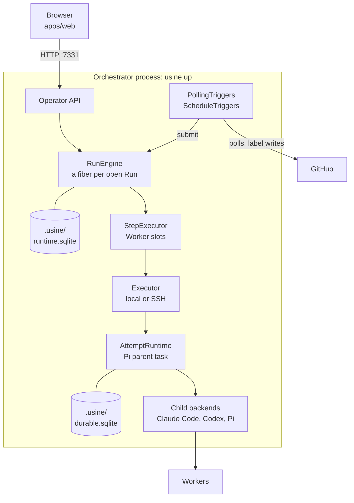
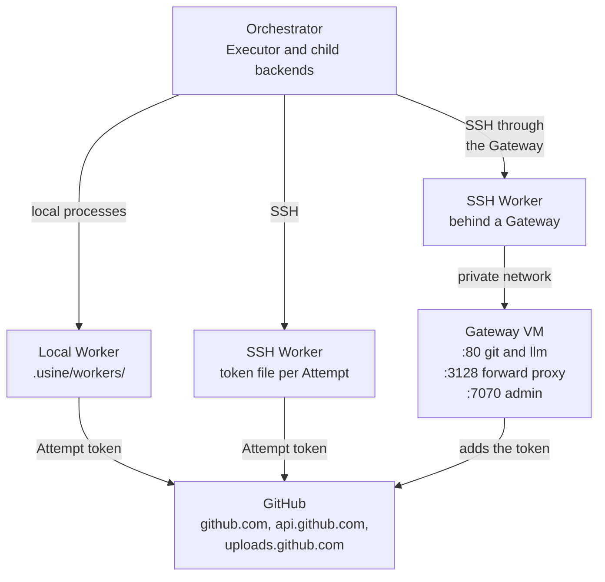
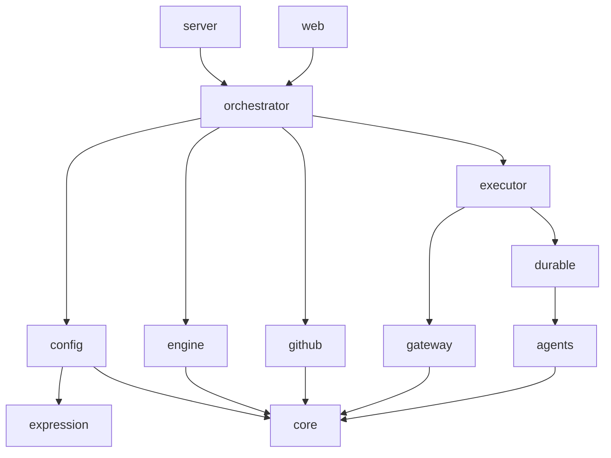
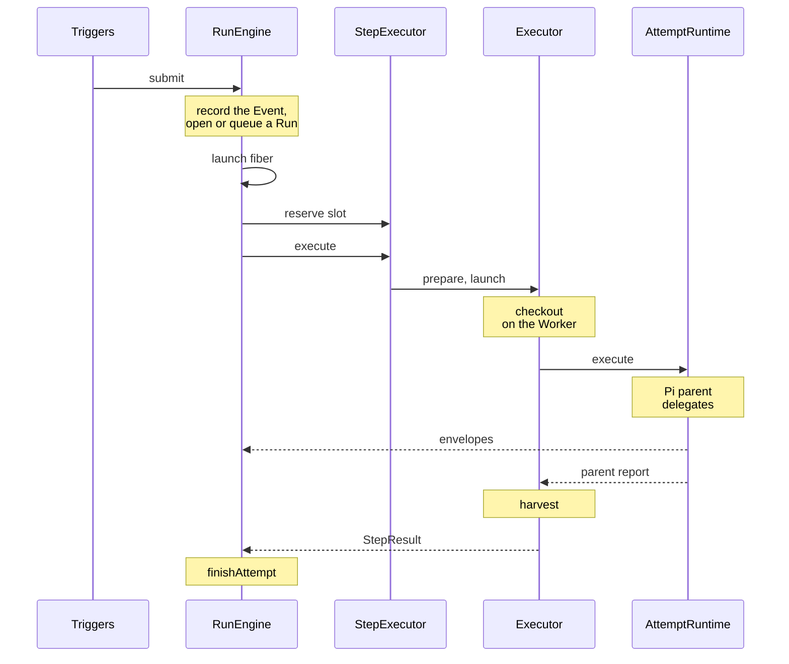

import { CardGrid, LinkCard, Steps } from "@astrojs/starlight/components";

:::note
This page describes commit [`7c0c3d3`](https://github.com/basaltbytes/usine/tree/7c0c3d3696123d11e3d5b9cc3d27e18bb21e84e9) of basaltbytes/usine as it was on 2026-10-16. Code links point at that commit.
Configuration storage and revision behavior on this page describe commit [`06a10bf`](https://github.com/basaltbytes/usine/tree/06a10bf04c2c7cb366ec6ad912ae7c0b0a5c268b) (2026-10-29). See [Storage and configuration](/architecture/storage-and-config/#configuration-store). Other sections retain the source versions cited above.
:::

usine is one long-running Node process, the orchestrator. It polls the issues and pull requests of the operator's repositories and, when one matches a loop, opens a run in which a coding agent works on it. The runtime database stores loops and agents with configuration revisions. Markdown files are their import and export format. The process also serves the web UI on `127.0.0.1`.

Each try of a run is an attempt. Its Pi parent runs in the orchestrator as a pi-durable task and delegates the coding to Claude Code, Codex, or Pi children on a worker: the orchestrator's machine, or an SSH machine, optionally behind a gateway VM that adds the GitHub token to its requests. See [`CONTEXT.md`](https://github.com/basaltbytes/usine/blob/main/CONTEXT.md) for the vocabulary and [`docs/adr/`](https://github.com/basaltbytes/usine/tree/main/docs/adr) for the decisions.

## System

### Orchestrator process

The orchestrator serves `/api/*` and the web assets on `127.0.0.1:7331` ([cli.ts:10](https://github.com/basaltbytes/usine/blob/7c0c3d3696123d11e3d5b9cc3d27e18bb21e84e9/apps/server/src/cli.ts#L10), [http.ts:243](https://github.com/basaltbytes/usine/blob/7c0c3d3696123d11e3d5b9cc3d27e18bb21e84e9/apps/server/src/http.ts#L243)). The operator API is in [`packages/orchestrator/src/operator`](https://github.com/basaltbytes/usine/tree/7c0c3d3696123d11e3d5b9cc3d27e18bb21e84e9/packages/orchestrator/src/operator), the polling triggers in [`packages/orchestrator/src/polling`](https://github.com/basaltbytes/usine/tree/7c0c3d3696123d11e3d5b9cc3d27e18bb21e84e9/packages/orchestrator/src/polling), the schedule triggers in [schedule-triggers.ts](https://github.com/basaltbytes/usine/blob/7c0c3d3696123d11e3d5b9cc3d27e18bb21e84e9/packages/orchestrator/src/schedule-triggers.ts), and the worker scheduler in [scheduler.ts](https://github.com/basaltbytes/usine/blob/7c0c3d3696123d11e3d5b9cc3d27e18bb21e84e9/packages/orchestrator/src/scheduler.ts). The process also creates the GitHub App installation tokens for polls and attempts ([github-app.ts:185](https://github.com/basaltbytes/usine/blob/7c0c3d3696123d11e3d5b9cc3d27e18bb21e84e9/packages/github/src/github-app.ts#L185)).

### Workers, the gateway, and GitHub

[Workers and the gateway](/architecture/workers-and-gateway/) describes each path, including three that the diagram omits: the admin API forward ([#249](https://github.com/basaltbytes/usine/issues/249)), the `llm.<domain>` host ([proxy.ts:206](https://github.com/basaltbytes/usine/blob/7c0c3d3696123d11e3d5b9cc3d27e18bb21e84e9/packages/gateway/src/proxy/proxy.ts#L206)), and the forward proxy on port 3128. The gateway's listeners are in [environment.ts:121](https://github.com/basaltbytes/usine/blob/7c0c3d3696123d11e3d5b9cc3d27e18bb21e84e9/packages/gateway/src/node/environment.ts#L121).

ADR 0006's run host is gone: [#176](https://github.com/basaltbytes/usine/issues/176) deleted `@usine/run-host` and its byte protocol ([ADR 0006](https://github.com/basaltbytes/usine/blob/main/docs/adr/0006-executor-contract-run-host-attempt-channel.md), amendment of 2026-10-11), so no usine package is installed on a worker. Attempt channel envelopes remain the transcript format.

## Packages and apps

Dependencies are workspace packages only. `effect` is a peer dependency of every published library and a direct one of `apps/server` and `apps/web`.

| Package                                              | Responsibility                                                                                                                                    | Depends on                                                      |
| ---------------------------------------------------- | ------------------------------------------------------------------------------------------------------------------------------------------------- | --------------------------------------------------------------- |
| `@usine/core` 0.3.0, `packages/core`                 | Domain model: event, run state machine, step, attempt, failures, salvage, attempt channel envelopes, worker and repository identities.            | none                                                            |
| `@usine/expression` 0.2.0, `packages/expression`     | Checks and evaluates CEL with `@marcbachmann/cel-js` 8.0.0.                                                                                       | none                                                            |
| `@usine/config` 0.2.1, `packages/config`             | Validates configuration, stores entities and revisions, and imports and exports YAML and Markdown files.                                          | core, expression                                                |
| `@usine/github` 0.1.2, `packages/github`             | GitHub App authentication and token minting, change detection, GraphQL payload slices, label writes.                                              | core                                                            |
| `@usine/engine` 0.3.0, `packages/engine`             | Event ledger, run claims, supersede and revoke, one fiber per open run, cycle budgets, attempt admission and drain, the SQLite store.             | core                                                            |
| `@usine/agents` 0.3.0, `packages/agents`             | Claude Code, Codex, and Pi child backends, where children run (`ChildHost`), prompt assembly, harness preflight.                                  | core                                                            |
| `@usine/durable` 0.0.0, `packages/durable`           | Runs each attempt's Pi parent as a pi-durable task, forwards its activity as envelopes, resumes it after a restart.                               | agents, core                                                    |
| `@usine/executor` 0.2.1, `packages/executor`         | Worker contract for local, SSH, and exe.dev workers: preflight, checkout, credentials, launch, cancel, interventions, salvage, harvest, recovery. | agents, core, durable, gateway                                  |
| `@usine/gateway` 0.0.0, `packages/gateway`           | Gateway service: reverse proxy for GitHub and LLM providers, allowlisted forward proxy, admin API for attachments. Binary `usine-gateway`.        | core                                                            |
| `@usine/orchestrator` 0.2.1, `packages/orchestrator` | Polling and schedule triggers, worker scheduling, the operator service and HTTP contract, the board projection, the runtime layer.                | config, core, durable, engine, executor, expression, github     |
| `@usine/server` 0.2.1, `apps/server`                 | The `usine` CLI (`up`, `backup`, `export-run`); serves the operator API and the web build.                                                        | config, core, durable, engine, expression, github, orchestrator |
| `@usine/web`, `apps/web`, private                    | React web UI: projects, boards, the run drawer, loop pause controls.                                                                              | core, orchestrator                                              |

The public subpaths are the `exports` of each `package.json`:

| Package               | Public subpaths                                                                                                                                                                                                                                                                                                 |
| --------------------- | --------------------------------------------------------------------------------------------------------------------------------------------------------------------------------------------------------------------------------------------------------------------------------------------------------------- |
| `@usine/core`         | `/agent`, `/agent/brain`, `/agent/capability`, `/agent/session`, `/attempt`, `/attempt/channel`, `/attempt/failure`, `/attempt/outcome`, `/attempt/salvage`, `/cycle-budget`, `/event`, `/instance`, `/item`, `/loop`, `/repository`, `/run`, `/run/state`, `/step`, `/step/harvest`, `/step/result`, `/worker` |
| `@usine/expression`   | `/expression-engine`, `/marcbachmann-cel`                                                                                                                                                                                                                                                                       |
| `@usine/config`       | `/agent`, `/board`, `/factory`, `/file`, `/instance`, `/instance-folder`, `/label`, `/loop`, `/parser`, `/payload-slices`, `/selector`, `/trigger`, `/yaml/writer`                                                                                                                                              |
| `@usine/github`       | `/github-app`, `/item-writer`, `/label-writer`, `/local-secrets`, `/polling`                                                                                                                                                                                                                                    |
| `@usine/engine`       | `/cursor`, `/cycle-budget`, `/database`, `/engine`, `/item-projection`, `/local-sqlite`, `/loop-control`, `/repository-label-projection`, `/run-reader`, `/step-executor`, `/transcript`, `/trigger-condition`                                                                                                  |
| `@usine/agents`       | `/child-host`, `/children`, `/claude`, `/codex`, `/pi`, `/pi/authentication`, `/preflight`, `/prompt`, `/runtime`                                                                                                                                                                                               |
| `@usine/durable`      | `/attempt-runtime`, `/backup`, `/harness`, `/live`, `/testing`                                                                                                                                                                                                                                                  |
| `@usine/executor`     | `.`, `/local`, `/ssh`, `/exe-dev`                                                                                                                                                                                                                                                                               |
| `@usine/gateway`      | `.`, `/admin`, `/node`                                                                                                                                                                                                                                                                                          |
| `@usine/orchestrator` | `/board/projection`, `/credentials`, `/current-instance`, `/exe-dev`, `/idle-triggers`, `/label-reconciler`, `/local`, `/operator`, `/operator/http`, `/orchestrator`, `/polling-triggers`, `/runtime`, `/schedule-triggers`, `/scheduler`, `/ssh`                                                              |
| `@usine/server`       | none, binary `usine`                                                                                                                                                                                                                                                                                            |
| `@usine/web`          | none                                                                                                                                                                                                                                                                                                            |

Arrows point from a package to its imports; arrows that a longer path implies are omitted.

## Path of one change through the code

<Steps>

1. `usine up` ([up.ts:104](https://github.com/basaltbytes/usine/blob/7c0c3d3696123d11e3d5b9cc3d27e18bb21e84e9/apps/server/src/up.ts#L104)) reads stored configuration (importing bootstrap files only when the tables are empty) and the GitHub App credentials, then builds `runtimeLayer` ([runtime.ts:37](https://github.com/basaltbytes/usine/blob/7c0c3d3696123d11e3d5b9cc3d27e18bb21e84e9/packages/orchestrator/src/runtime.ts#L37)); without credentials, it serves the setup page.

2. `PollingTriggers` and `ScheduleTriggers` submit GitHub state and clock ticks to `RunEngine.submit` ([engine.ts:52](https://github.com/basaltbytes/usine/blob/7c0c3d3696123d11e3d5b9cc3d27e18bb21e84e9/packages/engine/src/engine/engine.ts#L52)).

3. The engine records the event and opens or queues a run in one transaction (`recordAndClaim`, [store.ts:103](https://github.com/basaltbytes/usine/blob/7c0c3d3696123d11e3d5b9cc3d27e18bb21e84e9/packages/engine/src/store/store.ts#L103)), then starts the run's fiber (`RunDriver.launch`, [run-driver.ts:131](https://github.com/basaltbytes/usine/blob/7c0c3d3696123d11e3d5b9cc3d27e18bb21e84e9/packages/engine/src/engine/run-driver.ts#L131)), which runs `drive` ([run-driver.ts:341](https://github.com/basaltbytes/usine/blob/7c0c3d3696123d11e3d5b9cc3d27e18bb21e84e9/packages/engine/src/engine/run-driver.ts#L341)).

4. The fiber reserves a worker slot from `StepExecutor` ([scheduler.ts:131](https://github.com/basaltbytes/usine/blob/7c0c3d3696123d11e3d5b9cc3d27e18bb21e84e9/packages/orchestrator/src/scheduler.ts#L131)), begins the attempt, and calls `StepExecutor.execute` ([scheduler.ts:163](https://github.com/basaltbytes/usine/blob/7c0c3d3696123d11e3d5b9cc3d27e18bb21e84e9/packages/orchestrator/src/scheduler.ts#L163)), which calls `Executor.prepare`, then `launch`.

5. The executor prepares a checkout on the worker, and its durable session ([durable-session.ts:120](https://github.com/basaltbytes/usine/blob/7c0c3d3696123d11e3d5b9cc3d27e18bb21e84e9/packages/executor/src/durable-session.ts#L120)) passes the attempt to `AttemptRuntime.execute` ([durable-session.ts:145](https://github.com/basaltbytes/usine/blob/7c0c3d3696123d11e3d5b9cc3d27e18bb21e84e9/packages/executor/src/durable-session.ts#L145)).

6. The Pi parent delegates to children with its `subagent` tool ([subagent.ts:31](https://github.com/basaltbytes/usine/blob/7c0c3d3696123d11e3d5b9cc3d27e18bb21e84e9/packages/durable/src/attempt/subagent.ts#L31)), and the engine appends their activity to the transcript as envelopes.

7. When the parent finishes, the executor harvests commits and pull requests from the checkout ([harvest.ts:135](https://github.com/basaltbytes/usine/blob/7c0c3d3696123d11e3d5b9cc3d27e18bb21e84e9/packages/core/src/step/harvest.ts#L135)), and the engine closes the attempt and the run (`finishAttempt`, [store.ts:362](https://github.com/basaltbytes/usine/blob/7c0c3d3696123d11e3d5b9cc3d27e18bb21e84e9/packages/engine/src/store/store.ts#L362)).

</Steps>

## Pages in this section

<CardGrid>
  <LinkCard
    title="Run lifecycle"
    href="/architecture/run-lifecycle/"
    description="Events, run and attempt states, operator actions, cycle budgets, and drain."
  />
  <LinkCard
    title="Attempt execution"
    href="/architecture/execution/"
    description="Executor contract, durable layer, interventions, transcripts, and harnesses."
  />
  <LinkCard
    title="Workers and the gateway"
    href="/architecture/workers-and-gateway/"
    description="Worker kinds, preflight, the gateway VM, and credentials."
  />
  <LinkCard
    title="Storage and configuration"
    href="/architecture/storage-and-config/"
    description="Runtime store, durable storage, configuration revisions, and export files."
  />
  <LinkCard
    title="Operator surfaces"
    href="/architecture/operator-surfaces/"
    description="HTTP endpoints, web UI, CLI, and logs."
  />
  <LinkCard
    title="Dogfood instance loops"
    href="/architecture/loops-shipped/"
    description="The dogfood instance's loops and agents."
  />
  <LinkCard title="Gaps" href="/architecture/gaps/" description="What the code doesn't do yet." />
</CardGrid>
