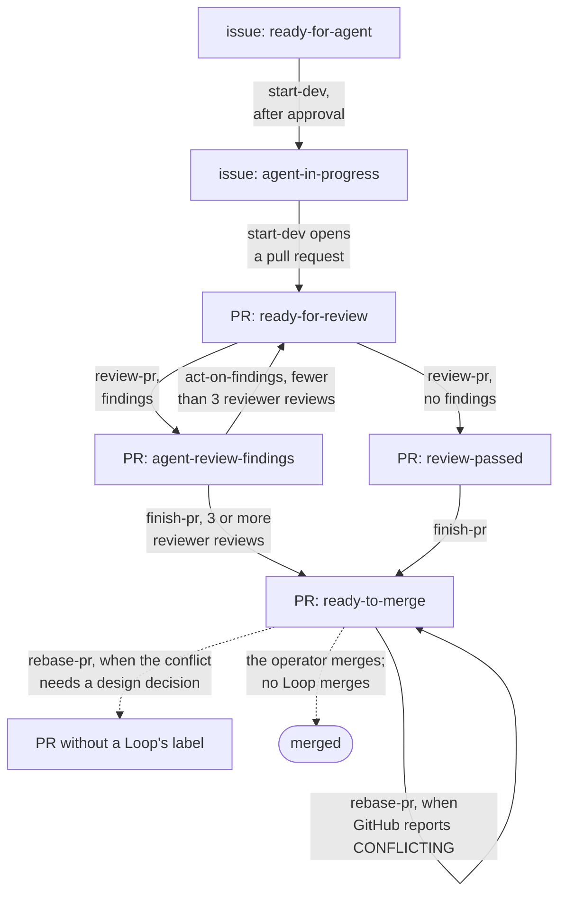

:::note
This page describes commit [`7c0c3d3`](https://github.com/basaltbytes/usine/tree/7c0c3d3696123d11e3d5b9cc3d27e18bb21e84e9) of basaltbytes/usine and the dogfood instance as they were on 2026-10-16.
:::

usine has no built-in Loop. The engine runs whatever `loops/*.md` the instance folder contains ([ADR 0001](https://github.com/basaltbytes/usine/blob/main/docs/adr/0001-loops-live-in-the-instance-repo.md)). This repository has Loop files only as parser test fixtures ([`packages/config/test/fixtures/acceptance/loops/`][fixtures]) and as an example in [Bounded review and fix Loops](/guides/review-fix-loops/). The Loops below are from the dogfood instance at `~/Code/usine-factory`, copied unchanged on 2026-10-16. That folder is outside this repository, so its files can differ from this page after that date.

## The instance

`~/Code/usine-factory/usine.yaml` registers one repository, `basaltbytes/usine` with tag `dogfood`, and maps its Board lanes to labels and states:

| Lane | Sources |
| --- | --- |
| Ready | label `ready-for-agent` |
| In progress | label `agent-in-progress` |
| Review | label `ready-for-review` |
| Findings | label `agent-review-findings` |
| Passed | label `review-passed` |
| Merge | label `ready-to-merge` |
| Pull requests | state `pr-open` |
| Done | states `pr-merged`, `pr-closed`, `issue-closed` |

It has no `labels` list, so the orchestrator creates no labels, and it logs a warning for every lane label and trigger label because none of them is declared ([parser.ts:256][]).

Settings: `poll_interval: 60`, `parent_model: openai-codex/gpt-5.6-terra` (the ChatGPT plan pool), `parent_effort: medium`, no ceilings. One Worker, `usine-worker-1`, of kind `ssh` with `max_concurrent_attempts: 1`, behind the Gateway with domain `gw.internal` and the admin API on the local forward `http://127.0.0.1:7070`. Webhooks are off and the operator login is `PhilDL`.

| Agent | Harness | Model | Effort | Persona in short |
| --- | --- | --- | --- | --- |
| `developer` | codex | `gpt-6-astra` | medium | One task at a time; when a tool called `subagent` exists, delegate the whole task to it once; run the required checks; record blockers. |
| `reviewer` | codex | `gpt-6-astra` | high | Delegate the whole review to one child; grade each observation P0 to P3; only P0, P1, and P2 are findings, with file and line references; P3 goes in one ungraded comment. |
| `finisher` | claude | `claude-fable-5-1` | xhigh | Finish one pull request with the repository's `finish-pr` skill, inside the PR's scope, without merging; delegate the whole task to one child. |

## How the Loops pass work to each other

The engine doesn't change labels itself: every label change below is an instruction in a Loop's prompt, which the agent performs with `gh`. Each Loop's trigger checks the labels that the previous Loop set, so the labels pass an Item from one Loop to the next.



`start-dev` changes the issue's labels and adds `ready-for-review` to the pull request it opens, so the rest of the flow happens on the pull request. A `finish-pr` or `rebase-pr` Attempt that hits a blocker records it; `finish-pr` then leaves the labels as they are.

## The Loops

Every Loop has `selector: { repos: [basaltbytes/usine] }` and no `max_cycles`, so each can open three Runs per Item between resets ([Run lifecycle](/architecture/run-lifecycle/)).

| Loop | Stream | Fires when | Approval | Step | Agent |
| --- | --- | --- | --- | --- | --- |
| `start-dev` | issue | open, has `ready-for-agent`, and no open pull request in `closedByPullRequestsReferences` | `required` | `implement` | developer |
| `review-pr` | pr | open, not draft, has `ready-for-review`, has neither `review-passed` nor `ready-to-merge` | `none` | `review` | reviewer |
| `act-on-findings` | pr | open, has `agent-review-findings`, fewer than three reviews whose body contains `usine agent: reviewer` | `none` | `act-on-findings` | developer |
| `finish-pr` | pr | open, not draft, no `ready-to-merge`, and either `review-passed` or `agent-review-findings` with three or more reviewer reviews | `none` | `finish` | finisher |
| `rebase-pr` | pr | open, not draft, `mergeable == "CONFLICTING"`, has `ready-to-merge` | `none` | `rebase` | finisher |

### start-dev

The task asks the developer to complete issue #N with the repository's `tackle-issue` skill. Before editing, it removes `ready-for-agent` from the issue and adds `agent-in-progress`. It opens a non-draft pull request whose body closes the issue and does not merge it. When the pull request is ready, it removes `agent-in-progress` and adds `ready-for-review` to the pull request. It reports a blocker as a comment on the issue. This is the only Loop with `approval: required`: each Run stays in `Waiting` until the operator approves it in the Run drawer. The instance's README describes this approval as the way to start work.

```markdown title="loops/start-dev.md"
---
trigger:
  on: issue
  if: >-
    item.state == "OPEN" &&
    item.labels.nodes.exists(label, label.name == "ready-for-agent") &&
    !item.closedByPullRequestsReferences.nodes.exists(pr, pr.state == "OPEN")
selector:
  repos: [basaltbytes/usine]
approval: required
step: implement
agent: developer
---
Use the repository's `tackle-issue` skill to complete issue #{{ item.number }}: {{ item.title }}.

Before editing, remove `ready-for-agent` from the issue and add `agent-in-progress`. Complete the issue through a non-draft pull request whose body closes the issue. Do not merge it. Once the pull request is ready, remove `agent-in-progress` from the issue and add `ready-for-review` to the pull request.

If work cannot continue, add a comment to the issue that states the exact blocker. Do not add a workaround that changes the issue's scope.
```

### review-pr

The reviewer removes `ready-for-review`, reviews the pull request with the repository's `code-review` skill, and posts the review. If there are actionable findings, it adds `agent-review-findings`. If there are none, it makes sure `agent-review-findings` is absent and adds `review-passed`. It must not edit the branch; [#226][] reports a review Run that pushed a commit anyway.

The prompt says the Attempt starts from the default branch, and `act-on-findings` has the same sentence. In the code, the checkout of a pr Run is the pull request's head commit ([loop-evaluation.ts:78][]), so the prompt's fetch of `refs/pull/<n>/head` and its check against `headRefOid` resolve to the commit that is already checked out.

```markdown title="loops/review-pr.md"
---
trigger:
  on: pr
  if: >-
    item.state == "OPEN" &&
    !item.isDraft &&
    item.labels.nodes.exists(label, label.name == "ready-for-review") &&
    !item.labels.nodes.exists(label, label.name == "review-passed") &&
    !item.labels.nodes.exists(label, label.name == "ready-to-merge")
selector:
  repos: [basaltbytes/usine]
approval: none
step: review
agent: reviewer
---
Review pull request #{{ item.number }} at commit {{ item.headRefOid }} with the repository's `code-review` skill.

The Attempt starts from the default branch. Before reading the diff, fetch `refs/pull/{{ item.number }}/head`, verify that it resolves to {{ item.headRefOid }}, and check out that commit. Remove `ready-for-review` from the pull request before starting the review.

Post the review on GitHub. If you find any actionable issue, explain it with file and line references and add `agent-review-findings` to the pull request. If there are no actionable findings, post a short review result, make sure `agent-review-findings` is absent, and add `review-passed` so the finishing pass can start. Do not edit the branch or merge the pull request.
```

### act-on-findings

The developer removes `agent-review-findings`, checks out the pull request branch after the same head check, and fixes each finding graded P0, P1, or P2 in reviews signed `usine agent: reviewer`. It runs the checks, pushes to the branch, replies to each finding, and adds `ready-for-review`, which sends the pull request back to `review-pr`. An Attempt that ends with a question for the operator used to repeat until the cycle budget was used up ([#241][]); usine now holds the pull request until the operator answers or the pull request changes ([Operator questions and blockers](/architecture/run-lifecycle/#operator-questions-and-blockers)).

```markdown title="loops/act-on-findings.md"
---
trigger:
  on: pr
  if: >-
    item.state == "OPEN" &&
    item.labels.nodes.exists(label, label.name == "agent-review-findings") &&
    size(item.reviews.nodes.filter(review, review.body.contains("usine agent: reviewer"))) < 3
selector:
  repos: [basaltbytes/usine]
approval: none
step: act-on-findings
agent: developer
---
Address the review findings on pull request #{{ item.number }}. Do not merge the pull request.

The Attempt starts from the default branch. First remove `agent-review-findings` from the pull request. Fetch `refs/pull/{{ item.number }}/head`, verify that it resolves to {{ item.headRefOid }}, and check out the pull request branch `{{ item.headRefName }}` before editing.

Read every review comment signed `usine agent: reviewer`. Act only on findings graded P0, P1, or P2; leave P3 observations alone. Fix each such finding in the branch, run the required checks, commit the changes, and push them to `{{ item.headRefName }}`. Reply to each finding with what changed or why it was left as is, then add `ready-for-review` so the updated commit receives another review.
```

### finish-pr

The finisher runs the repository's `finish-pr` skill on the current head. When the branch is green and pushed and the outcome is recorded, it removes `review-passed` and `agent-review-findings` and adds `ready-to-merge`. If it hits a blocker, it records the blocker and leaves the labels. [#242][] reports that a `finish-pr` commit on the local Worker was authored as the operator rather than the App.

```markdown title="loops/finish-pr.md"
---
trigger:
  on: pr
  if: >-
    item.state == "OPEN" &&
    !item.isDraft &&
    !item.labels.nodes.exists(label, label.name == "ready-to-merge") &&
    (
      item.labels.nodes.exists(label, label.name == "review-passed") ||
      (
        item.labels.nodes.exists(label, label.name == "agent-review-findings") &&
        size(item.reviews.nodes.filter(review, review.body.contains("usine agent: reviewer"))) >= 3
      )
    )
selector:
  repos: [basaltbytes/usine]
approval: none
step: finish
agent: finisher
---

Run the repository's `finish-pr` skill on pull request #{{ item.number }}. Complete the pass through fixing the latest actionable findings yourself, inspecting the final diff, passing the required checks, pushing fixes, and recording the outcome. Do not merge the pull request.

Fetch `refs/pull/{{ item.number }}/head`, verify that it resolves to {{ item.headRefOid }}, and check out the pull request branch `{{ item.headRefName }}` before editing. If the head changed, report the mismatch and stop. This pull request reached you because review passed or three review rounds did not converge; use the latest reviews and unresolved findings against the current code as your starting point.

When the final branch is green and pushed and the outcome is recorded, remove `review-passed` and `agent-review-findings` from the pull request and add `ready-to-merge`, then report completion. If a blocker prevents completion, record it and leave the labels as they are.
```

### rebase-pr

When GitHub reports a `ready-to-merge` pull request as conflicting, the finisher merges `origin/<base>` into the branch and resolves the conflicts within the pull request's scope. It then runs `pnpm check && pnpm test && pnpm format:check && pnpm lint && pnpm knip`, pushes, and posts a `COMMENT` review that says what conflicted. It leaves `ready-to-merge` in place. If a conflict needs a design decision, it records the blocker and removes `ready-to-merge` instead.

```markdown title="loops/rebase-pr.md"
---
trigger:
  on: pr
  if: >-
    item.state == "OPEN" &&
    !item.isDraft &&
    item.mergeable == "CONFLICTING" &&
    item.labels.nodes.exists(label, label.name == "ready-to-merge")
selector:
  repos: [basaltbytes/usine]
approval: none
step: rebase
agent: finisher
---

Pull request #{{ item.number }} is marked `ready-to-merge` but GitHub reports its branch `{{ item.headRefName }}` as conflicting with `{{ item.baseRefName }}`. Bring it back to a mergeable state. Do not merge the pull request.

Fetch `refs/pull/{{ item.number }}/head`, verify that it resolves to {{ item.headRefOid }}, and check out `{{ item.headRefName }}` before editing. If the head changed, report the mismatch and stop. Merge `origin/{{ item.baseRefName }}` into the branch and resolve every conflict within the pull request's own scope, keeping the intent of both sides. If a conflict needs a design decision you cannot settle from the issue and the reviews, record the blocker on the pull request, remove `ready-to-merge`, and stop.

Once the branch merges cleanly, run the repository gate from the root (`pnpm check && pnpm test && pnpm format:check && pnpm lint && pnpm knip`), fix what the merge broke, commit, and push to `{{ item.headRefName }}`. Post a short COMMENT review on the new head that states what conflicted and how it was resolved. Leave `ready-to-merge` in place.
```

## Where the Loops differ from the guide

The guide and [ADR 0022](https://github.com/basaltbytes/usine/blob/main/docs/adr/0022-item-cycle-budgets-and-comment-reviews.md) say to drop the CEL review counts from fix and finishing Loops, because the cycle budget limits the rounds. `act-on-findings` (`< 3`) and `finish-pr` (`>= 3`) still count reviewer reviews in `if:`. The count uses the `reviews(last: 20)` connection of the payload slice ([queries.ts:84][]). It matches the signature line that `githubSignature` asks every agent to add, which ends in `usine agent: reviewer` ([prompt.ts:28][]).

[fixtures]: https://github.com/basaltbytes/usine/tree/7c0c3d3696123d11e3d5b9cc3d27e18bb21e84e9/packages/config/test/fixtures/acceptance/loops
[parser.ts:256]: https://github.com/basaltbytes/usine/blob/7c0c3d3696123d11e3d5b9cc3d27e18bb21e84e9/packages/config/src/parser.ts#L256
[loop-evaluation.ts:78]: https://github.com/basaltbytes/usine/blob/7c0c3d3696123d11e3d5b9cc3d27e18bb21e84e9/packages/orchestrator/src/polling/loop-evaluation.ts#L78
[queries.ts:84]: https://github.com/basaltbytes/usine/blob/7c0c3d3696123d11e3d5b9cc3d27e18bb21e84e9/packages/github/src/polling/queries.ts#L84
[prompt.ts:28]: https://github.com/basaltbytes/usine/blob/7c0c3d3696123d11e3d5b9cc3d27e18bb21e84e9/packages/agents/src/prompt.ts#L28
[#226]: https://github.com/basaltbytes/usine/issues/226
[#241]: https://github.com/basaltbytes/usine/issues/241
[#242]: https://github.com/basaltbytes/usine/issues/242
