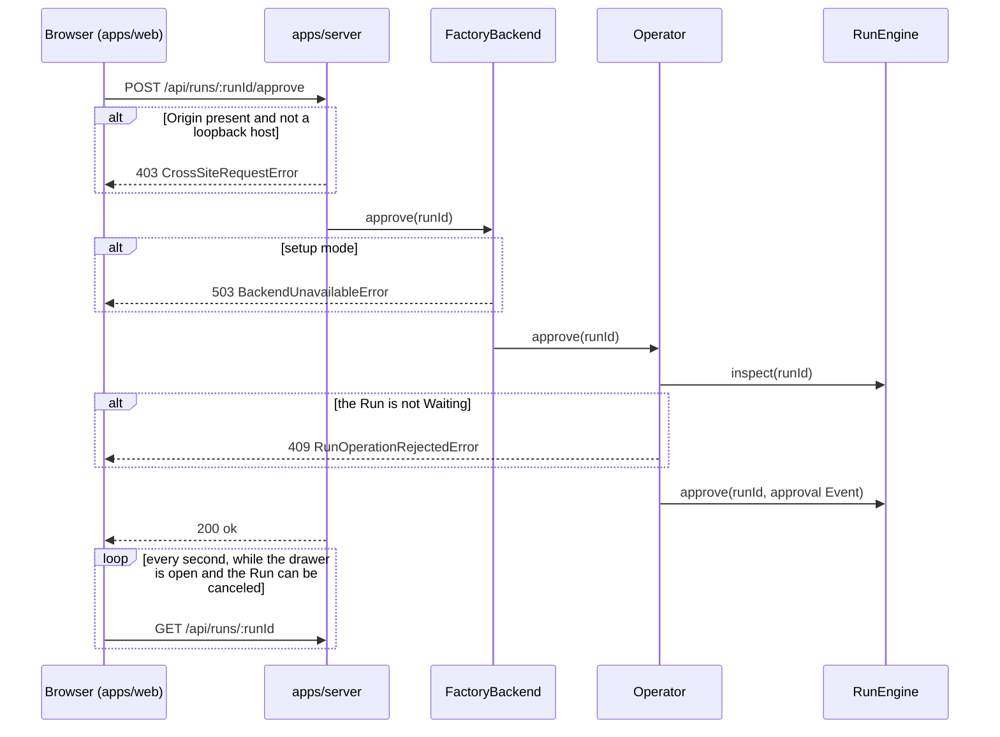

import { Steps } from "@astrojs/starlight/components";

:::note
This page describes commit [`a386108`](https://github.com/basaltbytes/usine/tree/a38610863e1d43adaaba85f49b90c69c1beaed53) of basaltbytes/usine as it was on 2026-10-20, and the follow-ups of the same day: a refused reload's typed fields ([#404](https://github.com/basaltbytes/usine/issues/404)), comment times and the comments of failed and canceled Attempts ([#405](https://github.com/basaltbytes/usine/issues/405), [#406](https://github.com/basaltbytes/usine/issues/406)), Last outcomes by close time ([#410](https://github.com/basaltbytes/usine/issues/410)), the run detail's usage reads ([#413](https://github.com/basaltbytes/usine/issues/413)), how each attempt's worker is reached ([#423](https://github.com/basaltbytes/usine/issues/423)), and the Tasks list ([#422](https://github.com/basaltbytes/usine/issues/422)) with only the tasks usine ran, ordered by activity, with each task's time, tokens, and cost and a Run's recorded close time ([#426](https://github.com/basaltbytes/usine/issues/426)), whose in-flight group leaves out a stall that holds nothing open since 2026-10-21 ([#443](https://github.com/basaltbytes/usine/issues/443)), and whose status gives the last Run's time and figure columns show each figure alone since the same day ([#457](https://github.com/basaltbytes/usine/issues/457)). It describes the Board without its header filters, which a separate change removes.
:::

The operator works with usine through a local HTTP API, the web UI built on it, the `usine` CLI, and the process logs. Apart from what the agents write, usine writes to a repository only to create the labels that `usine.yaml` declares, to apply Board moves, and to push salvage branches `usine/salvage/<run>/<number>`.

## The HTTP server

`usine up` serves on `127.0.0.1`, port 7331 unless `--port` or `USINE_PORT` sets another ([cli.ts:10][]). The server ([http.ts:277][]) has three kinds of routes:

- `/api/*`: the operator API below.
- `GET /` and `GET /assets/*`: the built web UI, from the `web` folder next to the server's `main.js`.
- Any other `GET` path without a file extension and outside `/api` and `/assets`: `index.html`, so client routes load on refresh ([http.ts:254][]).

There is no authentication. If a request has an `Origin` header that isn't a loopback host, the server refuses it with 403 `CrossSiteRequestError` before its handler runs ([http.ts:81][]). The server accepts JSON bodies with any `Content-Type`. Without GitHub App credentials, the server runs in setup mode: the overview, the roster, Run detail, the configuration, and the reload work, and every other action returns 503 `BackendUnavailableError` ([backend.ts:131][]).

A request from the web UI goes through the same layers for every action. Approving a Run, for example:



The browser and the server share one contract. `OperatorApi` ([operator/http.ts:166][]) is an Effect `HttpApi`; the web client builds its typed client from it ([api.ts:6][]), and the server attaches a handler to each endpoint ([http.ts:156][]) behind `OperatorHttpPolicy`, which applies the cross-site check. `FactoryBackend` is either the live backend, which calls the `Operator` service, or the setup-mode backend ([backend.ts:92][]).

## Endpoints

Every action except the reload returns `{ "ok": true }` once accepted; the result appears in later reads. The API refuses request bodies with unknown properties. The definitions, trimmed:

```ts title="packages/orchestrator/src/operator/http.ts"
export const OperatorApi = HttpApi.make("OperatorApi").add(
  HttpApiGroup.make("operator")
    .add(
      HttpApiEndpoint.get("overview", "/api/overview", { success: FactoryOverview }),
      HttpApiEndpoint.get("agents", "/api/agents", { success: Schema.Array(AgentName) }),
      // ...
      HttpApiEndpoint.post("intervene", "/api/runs/:runId/intervene", {
        params: runParams,
        payload: SessionIntervention.annotate({ parseOptions: { onExcessProperty: "error" } }),
        success: acknowledged,
      }),
      // ...
      HttpApiEndpoint.get("detail", "/api/runs/:runId", {
        params: runParams,
        query: transcriptQuery,
        success: RunDetailView,
      }),
      HttpApiEndpoint.post("approve", "/api/runs/:runId/approve", {
        params: runParams,
        success: acknowledged,
      }),
      // ...
    )
    .middleware(OperatorHttpPolicy),
);
```

### Reads

| Method | Path                                           | Query                                               | Returns                                                                                                                                                                                                                                                                                                                                                                                                                                                                                                                                                                                                                                                                                                                                                                                                                                                                                                                                                                                                                                                                                                                                                                                                                                                                                                                                                                                         |
| ------ | ---------------------------------------------- | --------------------------------------------------- | ----------------------------------------------------------------------------------------------------------------------------------------------------------------------------------------------------------------------------------------------------------------------------------------------------------------------------------------------------------------------------------------------------------------------------------------------------------------------------------------------------------------------------------------------------------------------------------------------------------------------------------------------------------------------------------------------------------------------------------------------------------------------------------------------------------------------------------------------------------------------------------------------------------------------------------------------------------------------------------------------------------------------------------------------------------------------------------------------------------------------------------------------------------------------------------------------------------------------------------------------------------------------------------------------------------------------------------------------------------------------------------------------- |
| GET    | `/api/overview`                                |                                                     | `Ready` or `NeedsSetup` overview: each Project's status, Runs, Board, labels, and label preflight findings; each Loop's trigger, Agent, and paused flag; the Needs you list ([overview.ts:35][]). Each Board card names the Loops whose trigger matches one of its Items now, evaluated by `LoopMatches` as the poll evaluates a changed Item ([loop-matches.ts][]), its open pull request or, without one, its newest merged one, and what its Runs used: the ended Attempts' wall time, when each Attempt at work started, and the tokens and dollars per billing pool that `RunUsageReader` reads for each Run on the Board's Items ([tasks.ts][], [usage.ts][]). A card's pool adds up the priced sessions' dollars, and `unpriced` says a session in a pool with a dollar rate has no price yet, such as a Claude session before its first result, so the card's cost is a lower bound and a run at work keeps the dollars already spent. `RunUsageReader` keeps an ended Attempt's reports for the life of the process, so a later projection reads only the Attempts at work. The overview is kept until the projection revision changes, and a token report adds a transcript row, not a revision, so each read of a kept overview reads the Attempts at work again and adds up again the cards whose runs used more. A Run's `closedAt` is when it last closed, null while it is open. |
| GET    | `/api/desk`                                    |                                                     | The desk: each Attempt in flight with its Run, Item, last activity, and open connectivity warnings; each Item a Loop's trigger matches with no Attempt running on it and the typed reason; the 10 Runs that closed last, whenever they opened; each Worker's slots and last preflight; when each repository was last polled ([desk.ts][]).                                                                                                                                                                                                                                                                                                                                                                                                                                                                                                                                                                                                                                                                                                                                                                                                                                                                                                                                                                                                                                                      |
| GET    | `/api/agents`                                  |                                                     | The roster's Agent names.                                                                                                                                                                                                                                                                                                                                                                                                                                                                                                                                                                                                                                                                                                                                                                                                                                                                                                                                                                                                                                                                                                                                                                                                                                                                                                                                                                       |
| GET    | `/api/configuration`                           |                                                     | The instance folder as the orchestrator parsed it, beside its runtime state ([configuration.ts][]): each Loop's trigger, condition, selector, approval, cycle limit, permissions, Step, Agent, prompt, and paused flag; each Agent's brain, persona, resolved parent model and effort, and Loops; each Worker's settings, Gateway (the admin token's variable name, never its value), slots in use, and last preflight per harness; each repository's lanes and labels as polling last read them; `settings`, `operator`, and the webhooks mode; and every quarantined Loop and invalid Agent with its error.                                                                                                                                                                                                                                                                                                                                                                                                                                                                                                                                                                                                                                                                                                                                                                                   |
| GET    | `/api/runs/:runId`                             | none, `after=<seq>`, or `before=<seq>&attempt=<id>` | The Run with its Attempts, Event dedup key and payload, and a transcript window: the newest 500 rows of each Attempt, the rows after a sequence (at most 500 across all Attempts), or one earlier page of an Attempt ([projection.ts:39][]). Each Attempt says why it began (`start`), when a restart last reattached it, and how its Worker is reached (`workerAccess`: `Local`, `Ssh` with the `destination` and `port` of the Worker's `usine.yaml` entry, or null when `usine.yaml` no longer declares the Worker). The response also has the newest Attempt's `worker`, the Attempts' `duration`, and `usage`: each session's highest `SessionTokensUpdated` report, summed per session, per billing pool, and for the Run, with a price where the pool has a dollar rate ([usage.ts][]). An ended Attempt's token reports are read once and kept in memory, so a poll reads only the Attempt in flight.                                                                                                                                                                                                                                                                                                                                                                                                                                                                                   |
| GET    | `/api/projects/:owner/:repository/tasks/:item` |                                                     | The Task that holds Item `item`, found from any of its Items ([task.ts][]): its originating Item's number and title, its lane and current Item, its Items with their state, labels, and whether a pull request conflicts with its base, every saved Run on those Items newest first, and the comments and reviews the Runs' Attempts posted, newest first within a Run: a succeeded Attempt's `Comment` facts and the comments a failed or canceled Attempt recorded, each with the time GitHub says it was posted and the end of the Attempt that recorded it. Membership and lane come from the Board projection over the Project's 500 newest Items; Runs come from `RunReader.forItems`, not the overview's window. 404 `BoardItemNotFoundError` for an Item outside that window.                                                                                                                                                                                                                                                                                                                                                                                                                                                                                                                                                                                                           |

### Run actions

Each action calls the `Operator` service, which calls `RunEngine` ([operator.ts:520][]).

| Method | Path                               | Body                            | Does                                                                                                                                                                                                                                                                                                                              |
| ------ | ---------------------------------- | ------------------------------- | --------------------------------------------------------------------------------------------------------------------------------------------------------------------------------------------------------------------------------------------------------------------------------------------------------------------------------- |
| POST   | `/api/runs/:runId/approve`         |                                 | Records the approval Event; `Waiting` becomes `Queued`. 409 in any other state.                                                                                                                                                                                                                                                   |
| POST   | `/api/runs/:runId/retry`           |                                 | `Failed` becomes `Running`; a new Attempt starts when a Worker slot is free and records the retry, with the `operator` login, as why it began.                                                                                                                                                                                    |
| POST   | `/api/runs/:runId/edit-and-retry`  | `{ task, agent }`               | Replaces the Run's task text and Agent, then retries; the new Attempt records an edit and retry. 404 for an Agent outside the roster.                                                                                                                                                                                             |
| POST   | `/api/runs/:runId/run-again`       | `{ task, agent }`               | Opens a new Run for the Item state of a `Succeeded` or `Canceled` Run with that task and Agent, and answers `Claimed` with the new Run's id, or `CycleBlocked` with the Item's Ask. 409 for another state or while another Run of the Loop is open on the Item; 404 for an Agent outside the roster or a Loop that is not loaded. |
| POST   | `/api/runs/:runId/cancel`          |                                 | Cancels an open Run and stops its Attempt; a closed Run is unchanged.                                                                                                                                                                                                                                                             |
| POST   | `/api/runs/:runId/resolve-failure` | `{ attemptId }`                 | Marks the latest failed Attempt as handled, which removes it from Needs you. For a `QuestionFailure` or a `BlockedFailure`, it also ends the Loop's hold on the Item and gives the Item's newest queued Event its turn ([Operator questions and blockers](/architecture/run-lifecycle/#operator-questions-and-blockers)).         |
| POST   | `/api/runs/:runId/intervene`       | `{ attemptId, target, action }` | Sends `Steer`, `Interrupt`, `OperatorMessage`, or `Release` to the parent or a child ([How an Attempt runs](/architecture/execution/)).                                                                                                                                                                                           |

### Board, Loops, cycle budgets, and Workers

| Method | Path                                                | Body         | Does                                                                                                                                                                                                                                                                                                                         |
| ------ | --------------------------------------------------- | ------------ | ---------------------------------------------------------------------------------------------------------------------------------------------------------------------------------------------------------------------------------------------------------------------------------------------------------------------------- |
| POST   | `/api/projects/:owner/:repository/items/:item/lane` | `{ toLane }` | Writes the label swap of a Board move to GitHub, then queues a Hint for that Item, even when the write fails ([operator.ts:740][]). 409 for a read-only lane.                                                                                                                                                                |
| POST   | `/api/loops/:loop/pause`                            |              | Sets the Loop's paused flag; its existing Runs continue.                                                                                                                                                                                                                                                                     |
| POST   | `/api/loops/:loop/unpause`                          |              | Clears it.                                                                                                                                                                                                                                                                                                                   |
| POST   | `/api/cycle-budgets/reset`                          | `{ askId }`  | Answers a cycle-budget Ask and gives the Item a new allowance.                                                                                                                                                                                                                                                               |
| POST   | `/api/workers/:worker/discard-leftovers`            |              | Answers an `UnconfiguredWorkerNeed`: startup stops reconciling the Attempts recorded on that Worker, and nothing on the Worker changes. A Worker that `usine.yaml` declares, or a removed one that still runs Attempts, is left as it is: 409 `LeftoversDiscardRejectedError` names the Worker and counts its open Attempts. |

### Instance folder

`CurrentInstance` ([current-instance.ts][]) holds the instance folder the orchestrator runs. Polling, schedules, queued-Event checks, GitHub App project discovery, Attempt settings, and the backend read it when they act, so a reload applies from their next cycle, check, or Attempt.

| Method | Path                   | Body | Does                                                                                                                                                                                                                                                                                                                                                                                                                                                                                                                                                                                                                                          |
| ------ | ---------------------- | ---- | --------------------------------------------------------------------------------------------------------------------------------------------------------------------------------------------------------------------------------------------------------------------------------------------------------------------------------------------------------------------------------------------------------------------------------------------------------------------------------------------------------------------------------------------------------------------------------------------------------------------------------------------- |
| POST   | `/api/instance/reload` |      | Loads `usine.yaml`, `agents/`, and `loops/` again with the startup loader and replaces the running configuration. Returns an `InstanceReload`: the Loops, Agents, labels, repositories, and Workers added, removed, or changed, whether `settings` or `operator` changed, and the files left out. 422 `FactoryConfigError`, 409 `RestartRequiredError`, or 409 `ReloadPreflightError` keep the running configuration, and each carries what it names: the file and stage, the changed `usine.yaml` fields and their blocks, or the Agents and Workers the failed preflight covered with the capability, operation, or repository that failed. |

### Errors

Failures return `{ error, message }`, where `error` is the domain error's tag ([operator/http.ts:26][]). A refused reload adds its typed fields to that envelope (`RestartRequiredRefusal`, `ReloadPreflightRefusal`, `FactoryConfigRefusal`).

| Status | `error`                                                                                                                                                                                                                                                                                                                                                                                   |
| ------ | ----------------------------------------------------------------------------------------------------------------------------------------------------------------------------------------------------------------------------------------------------------------------------------------------------------------------------------------------------------------------------------------- |
| 400    | `SchemaError`, `InvalidRequestError`: the request didn't decode                                                                                                                                                                                                                                                                                                                           |
| 403    | `CrossSiteRequestError`                                                                                                                                                                                                                                                                                                                                                                   |
| 404    | `RunNotFoundError`, `TranscriptAttemptNotFoundError`, `BoardProjectNotFoundError`, `BoardItemNotFoundError`, `BoardLaneNotFoundError`, `RosterAgentNotFoundError`                                                                                                                                                                                                                         |
| 409    | `RunOperationRejectedError`, `RunInterventionRejectedError`, `CycleBudgetResetRejectedError`, `BoardLaneReadOnlyError`, `RestartRequiredError` (a reload changed `webhooks` or made a `workers` change that only a restart applies), `ReloadPreflightError` (what a reload adds failed Worker preflight), `LeftoversDiscardRejectedError` (the Worker is declared or still runs Attempts) |
| 422    | `FactoryConfigError`: a reload found `usine.yaml` invalid or a folder missing                                                                                                                                                                                                                                                                                                             |
| 500    | `EnginePersistenceError`, `AttemptCancellationError`, `HttpBodyError` (the response didn't encode)                                                                                                                                                                                                                                                                                        |
| 502    | `GitHubApiError`, `InvalidGitHubResponseError`                                                                                                                                                                                                                                                                                                                                            |
| 503    | `BackendUnavailableError` (setup mode), `InstallationDiscoveryError`, `AppPermissionError`, `GitHubRateLimitError`                                                                                                                                                                                                                                                                        |

### Calling the API by hand

`curl` sends no `Origin` header, so the cross-site check allows it. The bodies below follow the request schemas ([run.ts:25][]); they weren't tested against a live server for this page.

```sh
curl -s http://127.0.0.1:7331/api/overview
curl -s -X POST http://127.0.0.1:7331/api/runs/<runId>/approve
curl -s -X POST http://127.0.0.1:7331/api/loops/review-pr/pause
curl -s -X POST http://127.0.0.1:7331/api/instance/reload
curl -s -X POST http://127.0.0.1:7331/api/runs/<runId>/intervene \
  -d '{"attemptId":"<runId>/<step>/<n>","action":{"_tag":"OperatorMessage","message":"Stop after the tests pass."}}'
```

Without `target`, an intervention goes to the parent ([run.ts:35][]); to send it to a child, set `target` to `{"_tag":"Child","sessionId":"<id>"}`.

### Needs you

The Needs you list has nine kinds of entries ([need.ts][]): `ApprovalNeed`, `RunFailureNeed`, `PollFailureNeed`, `PreflightFindingNeed`, `BoardProjectionNeed`, `ScheduleFailureNeed`, `CycleBudgetNeed`, `ConfigFileNeed`, and `UnconfiguredWorkerNeed`. An `UnconfiguredWorkerNeed` names a Worker that `usine.yaml` no longer declares and counts the Attempts recorded on it that startup doesn't reconcile, with how many of them are still open as `running`. While `running` is above 0, the entry says how many Attempts still run on the Worker and offers no Discard leftovers. A `RunFailureNeed` whose failure is a `QuestionFailure` shows the Agent's question under the title **\<loop\> asks a question**.

### The desk

`GET /api/desk` answers what the desk at `/` shows besides Needs you ([desk.ts][]).

- **Running now** lists every Run in `Running` with an Attempt in flight. Its last activity and open warnings come from the Attempt's newest 200 transcript rows: a `WorkerUnresponsive` without a later `WorkerResponsive`, and a session's `ProviderRetrying` without a later `ProviderRecovered`, `SessionIdle`, or `SessionFinished`. Worker notices, pool meters, and provider retries are not activity.
- **Not moving** matches each issue and pull-request Loop against the newest 500 stored Items of every repository, with the poll's own evaluation of the stream, the selector, and `if:` (`LoopMatches`, [loop-matches.ts][]). An Item the trigger matches with no Attempt running on it gets one reason, in the order the engine applies its rules: `AwaitingApproval` or `QueuedForWorker` for an open Run of the Loop on the Item; `LoopPaused`; `HeldForOperator` while a question or blocker holds the Loop on the Item; `CycleBudgetUsedUp` while the Item's cycle-budget Ask is open; `RunFailed` or `ClosedUnchanged` when the Event of the Item's current state owns a closed Run, so dedup opens no other ([ADR 0007](https://github.com/basaltbytes/usine/blob/main/docs/adr/0007-polling-triggers-content-hashed-events.md)); and `AwaitingPoll` when no Event of the Loop owns a Run for that state yet. The engine's `RunReader.sightings` reads the Loop's last sighting of each Item, the Run that owns it, and the hold.
- **Last outcomes** are the 10 Runs that closed last, by the close time the store records, whenever they opened: the desk reads them from `RunReader.closed`, which orders settled Runs by that close. A Run canceled before any Attempt closed when the cancel landed. A Run the engine superseded or revoked before any Attempt is left out.
- **Workers** come from the scheduler's `WorkerStatus` ([worker-status.ts][]): each Worker's slots and leased slots, and where its last preflight stands, the newest failed check among its own prerequisites and its harnesses when one stands failed, else the newest passed check. In setup mode no Worker runs Attempts, so each declared Worker shows its slots with none in use and no preflight.
- **Polls** give each repository's last completed poll in this process, kept across a cycle that fails for it (`PollCycle.repositoryPolls`).

## The web UI

`apps/web` is a React app with TanStack Router and Query, built with Vite. `apps/web/README.md` describes each screen's behaviour in detail.

| Route                                                                     | Page                                                                                                                                                                                                                                                                                                                                                                                                                                                                                                                                                                                                                                                                                                                                                                                                                                                                                                                                                                                                                                                           |
| ------------------------------------------------------------------------- | -------------------------------------------------------------------------------------------------------------------------------------------------------------------------------------------------------------------------------------------------------------------------------------------------------------------------------------------------------------------------------------------------------------------------------------------------------------------------------------------------------------------------------------------------------------------------------------------------------------------------------------------------------------------------------------------------------------------------------------------------------------------------------------------------------------------------------------------------------------------------------------------------------------------------------------------------------------------------------------------------------------------------------------------------------------- |
| `/`                                                                       | Overview: Needs attention, Running, Stalled, Recent runs, and the Workers line ([desk/desk.tsx][]). The sidebar lists the Projects.                                                                                                                                                                                                                                                                                                                                                                                                                                                                                                                                                                                                                                                                                                                                                                                                                                                                                                                            |
| `/projects/$owner/$name`                                                  | The Board of one Project: lanes of Task cards, drag-and-drop moves on authored label lanes, each card's Run history ([routes/projects/$owner/$name/index.tsx][], [board.tsx][]). Every lane sits in one row: the lanes that accept moves first, in their configured order, then the read-only lanes, with Done (the lanes of closed Items) and Unmapped at the end, folded into rails until opened. Every Task the overview returns is on the Board. A click on a card opens its Task page. The page also reads `GET /api/desk`: a stalled card shows the stall reason and its action. The arrow between two authored lanes names the Loops that match a Task of the left lane. The sidebar shows Board and Tasks under each Project.                                                                                                                                                                                                                                                                                                                          |
| `/projects/$owner/$name/runs/$run`                                        | The Run page ([run-page/page.tsx][]): the Run's header with its facts, Worker, duration, and tokens, and the actions that apply; the outline of the Task, the Event, and the Attempts beside the conversation reader; and the message composer while an Attempt runs.                                                                                                                                                                                                                                                                                                                                                                                                                                                                                                                                                                                                                                                                                                                                                                                          |
| `/projects/$owner/$name/tasks`                                            | The Tasks list of one Project ([task/list.tsx][]): the Board's Tasks that have at least one Run, finished ones included, as rows with a status and the last Run's time, the Loops that ran with their last Run's state, the Run count, the pull request, and the elapsed time, tokens, and estimated cost the Board card's usage holds, a `*` on lower bounds, with the tokens per billing pool on hover; a line under the heading adds them up over the listed Tasks. A status is the first that applies: Running with the Loop, Waiting for approval, a pending or queued Run with the stall reason from `GET /api/desk` that names that Run, Done when the current Item is merged or closed and no Run is open, the stall reason, Needs attention, else the last Run's outcome. Tasks in flight come first: running, waiting for approval, then pending, queued, and stalled on an open Run or the operator, each by when its Run opened; the rest by last Run close. It reads the overview's Board, so it holds the same Tasks. A row opens the Task page. |
| `/projects/$owner/$name/tasks/$number`                                    | The Task page of the Task whose originating Item is `$number`: its header with Move to, every Run on its Items with the actions that apply, its pull requests, and the comments and reviews its Runs posted ([task/page.tsx][]). Any Item's number opens it and the address then names the originating Item.                                                                                                                                                                                                                                                                                                                                                                                                                                                                                                                                                                                                                                                                                                                                                   |
| `/configuration`                                                          | Redirects to `/configuration/loops`. Every page of the section reads `GET /api/configuration`, fills the panel, and has **Reload configuration** in its heading; the reload's result, or why it was refused, stays under the heading while the operator moves between the section's pages ([routes/configuration][]).                                                                                                                                                                                                                                                                                                                                                                                                                                                                                                                                                                                                                                                                                                                                          |
| `/configuration/loops`, `/configuration/loops/$loop`                      | Loops, the files that did not load first, with Pause or Resume; a Loop's trigger and selector as written, its Agent and repositories, approval, cycle limit, permissions, Step, and prompt as Markdown with its `{{ }}` expressions outlined, or the error that quarantined it.                                                                                                                                                                                                                                                                                                                                                                                                                                                                                                                                                                                                                                                                                                                                                                                |
| `/configuration/agents`, `/configuration/agents/$agent`                   | The roster with each brain; an Agent's persona, its parent model and effort with where each comes from, and the Loops that name it, or why its file did not load.                                                                                                                                                                                                                                                                                                                                                                                                                                                                                                                                                                                                                                                                                                                                                                                                                                                                                              |
| `/configuration/workers`, `/configuration/workers/$worker`                | Workers with their slots in use and last preflight; a Worker's connection and Gateway settings, and the last preflight of its own prerequisites and of each harness, with the time and result.                                                                                                                                                                                                                                                                                                                                                                                                                                                                                                                                                                                                                                                                                                                                                                                                                                                                 |
| `/configuration/repositories`, `/configuration/repositories/$owner/$name` | Registered repositories; a repository's lanes in Board order with each label as GitHub has it, the labels usine creates there, and the Loops that select it.                                                                                                                                                                                                                                                                                                                                                                                                                                                                                                                                                                                                                                                                                                                                                                                                                                                                                                   |
| `/configuration/settings`                                                 | `settings`, `operator`, and the webhooks mode, each with what its value does.                                                                                                                                                                                                                                                                                                                                                                                                                                                                                                                                                                                                                                                                                                                                                                                                                                                                                                                                                                                  |
| any route with `?run=<runId>`                                             | The Run drawer over the current page ([open-run.ts][]).                                                                                                                                                                                                                                                                                                                                                                                                                                                                                                                                                                                                                                                                                                                                                                                                                                                                                                                                                                                                        |

The root layout ([`__root.tsx`][root-layout]) has the sidebar, the Needs you strip on every page but the desk, which lists Needs you as its first block, and, in setup mode, a notice that lists the credential variables to set and says to restart `usine up`. The drawer is a short summary of one Run ([run-drawer.tsx][]): its header with the Run's facts, the Worker and duration line, and the actions; then one summary, a sentence for a Run that waits, the current activity and latest message for a running one, or the outcome for a finished one; then **Open Run page**, which an expand button beside Close repeats. The actions, on the drawer and the Run page alike, are Approve, Mark resolved (Mark answered when the latest Attempt asked a question), Retry, Cancel Run (with a confirmation), Edit and retry, and for a succeeded or canceled Run, Run again and Edit and run again, which open the new Run ([actions.tsx][]).

The conversation lives on the Run page. Its message composer, under the reader while an Attempt runs ([workspace.tsx][]), sends `OperatorMessage` to the parent or a child; Pause session sends `Interrupt`, and Release child or Release parent sends `Release`; Release parent shows only while the parent is held or paused ([session-composer.tsx][]). The Run page keeps each reader's position in browser storage ([remember.tsx][], [ADR 0025](https://github.com/basaltbytes/usine/blob/main/docs/adr/0025-run-conversation-reader-bookmarks.md)).

The UI polls. The overview refreshes every 2 seconds while a Run can be canceled and every 15 seconds otherwise, and stops in setup mode ([overview.ts:25][]). The desk, which the Board and the Tasks list read too, refreshes every 3 seconds while an Attempt runs or a Run waits for a Worker, and every 15 seconds otherwise ([desk/query.ts][]). The Run page and an open drawer refresh the run detail every second while the Run can be canceled ([run-transcript/query.ts:46][]); the Run page reads the Item's GitHub changes when it opens, when an Attempt starts or ends, and every 30 seconds while one runs ([run-page/github-changes.ts:6][]). The Board refreshes every second while a move is pending ([moves.ts:61][]). A Task page refreshes every 2 seconds while one of its Runs can be canceled and every 15 seconds otherwise, and again whenever a Run action or a Board move refreshes the overview ([task/query.ts][]).

The scheduler records each Worker's last preflight in memory ([worker-status.ts][]): the startup preflight, then each preflight a reload runs, a refused reload's included. A harness that reports itself unavailable fails that harness and passes the ones checked before it; any other failure fails the Worker's own prerequisites.

The Run page and the drawer show, under the Run's facts, the newest Attempt's Worker and the Attempts' total duration, which counts on while one runs; the Run page adds the tokens, opening to the breakdown per pool and per session ([header.tsx][], [usage.tsx][]). Each Attempt in the outline says why it began. The outline folds consecutive turns of one session into one entry and keeps blockers, questions, operator input, connectivity notices, and outcomes as entries of their own ([outline.tsx][]). Its red error count steps through what the Run ended with or the operator must read, and a grey count through the tool failures the Agent recovered from ([navigation/model.ts][], [ADR 0025](https://github.com/basaltbytes/usine/blob/main/docs/adr/0025-run-conversation-reader-bookmarks.md)).

There is no page for editing configuration, for usage and cost, for Worker preflight on demand, or for creating the GitHub App.

## The CLI

`apps/server` provides the `usine` binary ([main.ts][]). Its usage text:

```txt title="apps/server/src/cli.ts"
Usage:
  usine up [--port <port>] [--allow-volatile-instance]
  usine backup <path>
  usine export-run <runId> [--output <path>]
  usine --help
  usine --version

Options:
  -p, --port <port>            Listen on this port (default: 7331)
  --allow-volatile-instance    Start even when the instance folder is in a temporary directory
  -o, --output <path>          Write Run evidence here (default: run-<encoded-runId>.json)
  -h, --help                   Print this usage
  -v, --version                Print the pinned @usine/server version

Environment:
  USINE_PORT                     Listen on this port when --port is absent
  USINE_ALLOW_VOLATILE_INSTANCE  Same as --allow-volatile-instance when set to 1
```

| Command                           | Does                                                                                                                                                                                                                                                                   |
| --------------------------------- | ---------------------------------------------------------------------------------------------------------------------------------------------------------------------------------------------------------------------------------------------------------------------- |
| `usine up`                        | Runs the orchestrator in the foreground from the instance folder. `--port` also takes the form `--port=<port>`.                                                                                                                                                        |
| `usine backup <path>`             | Copies the durable storage, then the runtime store, to new files: the runtime store to `<path>` and the durable storage next to it (`backup.sqlite` gives `backup.durable.sqlite`) ([backup.ts:19][], [Storage and configuration](/architecture/storage-and-config/)). |
| `usine export-run <runId>`        | Writes the Run's snapshot and its whole transcript as JSON, by default to `run-<encoded runId>.json` ([export-run.ts][]).                                                                                                                                              |
| `usine --help`, `usine --version` | Usage, and the installed `@usine/server` version. `usine up --help`, `usine backup --help`, and `usine export-run --help` print the same usage.                                                                                                                        |

`usine up` ([up.ts:110][]) runs these steps in order:

<Steps>

1. Refuse a volatile instance folder.
2. Take the instance lock: an exclusive SQLite transaction on `.usine/instance.lock`, which the OS releases when the process exits ([instance-lock.ts:44][]).
3. Refuse a port that another process listens on, and print that process's pid when `lsof` finds it ([cli.ts:318][]).
4. Load the instance folder, then reload it on each SIGHUP ([reload-signal.ts][]).
5. Load the GitHub App credentials. When they are missing, start in setup mode and open the browser ([up.ts:129][]).
6. Otherwise, build the runtime and run the HTTP server and the trigger streams together under graceful shutdown. The first SIGINT or SIGTERM drains the open Attempts, for at most `max_attempt_minutes` when it is set; a second signal ends the drain ([shutdown.ts:29][]).

</Steps>

`@usine/gateway` provides a second binary, `usine-gateway`, which runs on the Gateway VM ([Workers and the Gateway](/architecture/workers-and-gateway/)).

## Logs and spans

Every service method is an `Effect.fn` span annotated with its domain ids (`runId`, `attemptId`, `repository`, `loop`, `worker`), and decision points log with `Effect.logInfo`, `logWarning`, or `logError` and structured fields. `apps/server` installs no logger or tracer layer, so logs go to the console through Effect's default logger and spans aren't exported anywhere ([#279][]). This page doesn't verify the console format. The Gateway installs `Logger.consoleJson`, one JSON object per line for journald ([node/main.ts:7][]).

These log messages answer common questions:

| Question                               | Message                                                                                                                                   | Code                                                             |
| -------------------------------------- | ----------------------------------------------------------------------------------------------------------------------------------------- | ---------------------------------------------------------------- |
| Did the poll run?                      | `Poll cycle complete`                                                                                                                     | [polling.ts:703][]                                               |
| Did an Item match a Loop?              | `Submitted matching item state`                                                                                                           | [loop-evaluation.ts:180][]                                       |
| What did the engine do with the Event? | `Event claim decided`, `Event joined its existing Run`, `Event remains ignored`                                                           | [store.ts:207][], [store.ts:258][], [store.ts:265][]             |
| Why doesn't a Run start?               | `Run waits for a worker slot`, `Run waits for its approval`, `Attempt deferred until restart; the engine is draining`                     | [scheduler.ts:423][], [run-driver.ts:391][], [admission.ts:37][] |
| Did an Attempt start and end?          | `Attempt started`, `Attempt completion decided`                                                                                           | [store.ts:490][], [store.ts:324][]                               |
| Is a Worker ready?                     | `Worker preflight verified`, `SSH Worker preflight verified`, `Worker preflight failed`                                                   | [local.ts:293][], [ssh/preflight.ts:103][], [executor.ts:112][]  |
| Did operator input arrive?             | `Operator input applied`, `Session refused operator input`                                                                                | [runtime.ts:444][], [runtime.ts:420][]                           |
| What happened at restart?              | `Runs recovered from the run tables`, `The open Attempt's parent task is live; reattaching it`                                            | [run-driver.ts:449][], [run-driver.ts:290][]                     |
| Did a reload apply?                    | `Instance folder reloaded; new Runs use the new configuration`, `Instance folder reload rejected; the running configuration is unchanged` | [current-instance.ts][]                                          |

[cli.ts:10]: https://github.com/basaltbytes/usine/blob/a38610863e1d43adaaba85f49b90c69c1beaed53/apps/server/src/cli.ts#L10
[cli.ts:318]: https://github.com/basaltbytes/usine/blob/a38610863e1d43adaaba85f49b90c69c1beaed53/apps/server/src/cli.ts#L318
[http.ts:81]: https://github.com/basaltbytes/usine/blob/a38610863e1d43adaaba85f49b90c69c1beaed53/apps/server/src/http.ts#L81
[http.ts:156]: https://github.com/basaltbytes/usine/blob/a38610863e1d43adaaba85f49b90c69c1beaed53/apps/server/src/http.ts#L156
[http.ts:254]: https://github.com/basaltbytes/usine/blob/a38610863e1d43adaaba85f49b90c69c1beaed53/apps/server/src/http.ts#L254
[http.ts:277]: https://github.com/basaltbytes/usine/blob/a38610863e1d43adaaba85f49b90c69c1beaed53/apps/server/src/http.ts#L277
[backend.ts:92]: https://github.com/basaltbytes/usine/blob/a38610863e1d43adaaba85f49b90c69c1beaed53/apps/server/src/backend.ts#L92
[backend.ts:131]: https://github.com/basaltbytes/usine/blob/a38610863e1d43adaaba85f49b90c69c1beaed53/apps/server/src/backend.ts#L131
[backup.ts:19]: https://github.com/basaltbytes/usine/blob/a38610863e1d43adaaba85f49b90c69c1beaed53/apps/server/src/backup.ts#L19
[export-run.ts]: https://github.com/basaltbytes/usine/blob/a38610863e1d43adaaba85f49b90c69c1beaed53/apps/server/src/export-run.ts
[instance-lock.ts:44]: https://github.com/basaltbytes/usine/blob/a38610863e1d43adaaba85f49b90c69c1beaed53/apps/server/src/instance-lock.ts#L44
[main.ts]: https://github.com/basaltbytes/usine/blob/a38610863e1d43adaaba85f49b90c69c1beaed53/apps/server/src/main.ts
[shutdown.ts:29]: https://github.com/basaltbytes/usine/blob/a38610863e1d43adaaba85f49b90c69c1beaed53/apps/server/src/shutdown.ts#L29
[up.ts:110]: https://github.com/basaltbytes/usine/blob/a38610863e1d43adaaba85f49b90c69c1beaed53/apps/server/src/up.ts#L110
[up.ts:129]: https://github.com/basaltbytes/usine/blob/a38610863e1d43adaaba85f49b90c69c1beaed53/apps/server/src/up.ts#L129
[operator/http.ts:26]: https://github.com/basaltbytes/usine/blob/a38610863e1d43adaaba85f49b90c69c1beaed53/packages/orchestrator/src/operator/http.ts#L26
[operator/http.ts:166]: https://github.com/basaltbytes/usine/blob/a38610863e1d43adaaba85f49b90c69c1beaed53/packages/orchestrator/src/operator/http.ts#L166
[overview.ts:35]: https://github.com/basaltbytes/usine/blob/a38610863e1d43adaaba85f49b90c69c1beaed53/packages/orchestrator/src/operator/overview.ts#L35
[projection.ts:39]: https://github.com/basaltbytes/usine/blob/a38610863e1d43adaaba85f49b90c69c1beaed53/packages/orchestrator/src/operator/projection.ts#L39
[usage.ts]: https://github.com/basaltbytes/usine/blob/main/packages/orchestrator/src/operator/usage.ts
[header.tsx]: https://github.com/basaltbytes/usine/blob/main/apps/web/src/run-page/header.tsx
[usage.tsx]: https://github.com/basaltbytes/usine/blob/main/apps/web/src/run-page/usage.tsx
[outline.tsx]: https://github.com/basaltbytes/usine/blob/main/apps/web/src/run-page/outline.tsx
[navigation/model.ts]: https://github.com/basaltbytes/usine/blob/main/apps/web/src/run-transcript/navigation/model.ts
[operator.ts:520]: https://github.com/basaltbytes/usine/blob/a38610863e1d43adaaba85f49b90c69c1beaed53/packages/orchestrator/src/operator/operator.ts#L520
[operator.ts:740]: https://github.com/basaltbytes/usine/blob/a38610863e1d43adaaba85f49b90c69c1beaed53/packages/orchestrator/src/operator/operator.ts#L740
[run.ts:25]: https://github.com/basaltbytes/usine/blob/a38610863e1d43adaaba85f49b90c69c1beaed53/packages/orchestrator/src/operator/run.ts#L25
[run.ts:35]: https://github.com/basaltbytes/usine/blob/a38610863e1d43adaaba85f49b90c69c1beaed53/packages/orchestrator/src/operator/run.ts#L35
[need.ts]: https://github.com/basaltbytes/usine/blob/a38610863e1d43adaaba85f49b90c69c1beaed53/packages/orchestrator/src/operator/need.ts
[api.ts:6]: https://github.com/basaltbytes/usine/blob/a38610863e1d43adaaba85f49b90c69c1beaed53/apps/web/src/api.ts#L6
[desk/desk.tsx]: https://github.com/basaltbytes/usine/blob/main/apps/web/src/desk/desk.tsx
[desk/query.ts]: https://github.com/basaltbytes/usine/blob/main/apps/web/src/desk/query.ts
[desk.ts]: https://github.com/basaltbytes/usine/blob/main/packages/orchestrator/src/operator/desk.ts
[loop-matches.ts]: https://github.com/basaltbytes/usine/blob/main/packages/orchestrator/src/loop-matches.ts
[tasks.ts]: https://github.com/basaltbytes/usine/blob/main/packages/orchestrator/src/board/tasks.ts
[routes/projects/$owner/$name/index.tsx]: https://github.com/basaltbytes/usine/blob/a38610863e1d43adaaba85f49b90c69c1beaed53/apps/web/src/routes/projects/$owner/$name/index.tsx
[board.tsx]: https://github.com/basaltbytes/usine/blob/a38610863e1d43adaaba85f49b90c69c1beaed53/apps/web/src/board/board.tsx
[routes/configuration]: https://github.com/basaltbytes/usine/tree/main/apps/web/src/routes/configuration
[configuration.ts]: https://github.com/basaltbytes/usine/blob/main/packages/orchestrator/src/operator/configuration.ts
[worker-status.ts]: https://github.com/basaltbytes/usine/blob/main/packages/orchestrator/src/worker-status.ts
[run-drawer.tsx]: https://github.com/basaltbytes/usine/blob/a38610863e1d43adaaba85f49b90c69c1beaed53/apps/web/src/run-drawer.tsx
[actions.tsx]: https://github.com/basaltbytes/usine/blob/a38610863e1d43adaaba85f49b90c69c1beaed53/apps/web/src/run-intervention/actions.tsx
[workspace.tsx]: https://github.com/basaltbytes/usine/blob/a38610863e1d43adaaba85f49b90c69c1beaed53/apps/web/src/run-page/workspace.tsx
[remember.tsx]: https://github.com/basaltbytes/usine/blob/a38610863e1d43adaaba85f49b90c69c1beaed53/apps/web/src/run-transcript/reader/remember.tsx
[run-page/page.tsx]: https://github.com/basaltbytes/usine/blob/a38610863e1d43adaaba85f49b90c69c1beaed53/apps/web/src/run-page/page.tsx
[run-transcript/query.ts:46]: https://github.com/basaltbytes/usine/blob/a38610863e1d43adaaba85f49b90c69c1beaed53/apps/web/src/run-transcript/query.ts#L46
[run-page/github-changes.ts:6]: https://github.com/basaltbytes/usine/blob/a38610863e1d43adaaba85f49b90c69c1beaed53/apps/web/src/run-page/github-changes.ts#L6
[open-run.ts]: https://github.com/basaltbytes/usine/blob/a38610863e1d43adaaba85f49b90c69c1beaed53/apps/web/src/open-run.ts
[task.ts]: https://github.com/basaltbytes/usine/blob/main/packages/orchestrator/src/operator/task.ts
[task/list.tsx]: https://github.com/basaltbytes/usine/blob/main/apps/web/src/task/list.tsx
[task/page.tsx]: https://github.com/basaltbytes/usine/blob/main/apps/web/src/task/page.tsx
[task/query.ts]: https://github.com/basaltbytes/usine/blob/main/apps/web/src/task/query.ts
[root-layout]: https://github.com/basaltbytes/usine/blob/a38610863e1d43adaaba85f49b90c69c1beaed53/apps/web/src/routes/__root.tsx
[session-composer.tsx]: https://github.com/basaltbytes/usine/blob/a38610863e1d43adaaba85f49b90c69c1beaed53/apps/web/src/run-intervention/session-composer.tsx
[overview.ts:25]: https://github.com/basaltbytes/usine/blob/a38610863e1d43adaaba85f49b90c69c1beaed53/apps/web/src/overview.ts#L25
[moves.ts:61]: https://github.com/basaltbytes/usine/blob/a38610863e1d43adaaba85f49b90c69c1beaed53/apps/web/src/board/moves.ts#L61
[node/main.ts:7]: https://github.com/basaltbytes/usine/blob/a38610863e1d43adaaba85f49b90c69c1beaed53/packages/gateway/src/node/main.ts#L7
[polling.ts:703]: https://github.com/basaltbytes/usine/blob/a38610863e1d43adaaba85f49b90c69c1beaed53/packages/orchestrator/src/polling/polling.ts#L703
[loop-evaluation.ts:180]: https://github.com/basaltbytes/usine/blob/a38610863e1d43adaaba85f49b90c69c1beaed53/packages/orchestrator/src/polling/loop-evaluation.ts#L180
[scheduler.ts:423]: https://github.com/basaltbytes/usine/blob/a38610863e1d43adaaba85f49b90c69c1beaed53/packages/orchestrator/src/scheduler.ts#L423
[store.ts:258]: https://github.com/basaltbytes/usine/blob/a38610863e1d43adaaba85f49b90c69c1beaed53/packages/engine/src/store/store.ts#L258
[store.ts:265]: https://github.com/basaltbytes/usine/blob/a38610863e1d43adaaba85f49b90c69c1beaed53/packages/engine/src/store/store.ts#L265
[store.ts:207]: https://github.com/basaltbytes/usine/blob/a38610863e1d43adaaba85f49b90c69c1beaed53/packages/engine/src/store/store.ts#L207
[store.ts:324]: https://github.com/basaltbytes/usine/blob/a38610863e1d43adaaba85f49b90c69c1beaed53/packages/engine/src/store/store.ts#L324
[store.ts:490]: https://github.com/basaltbytes/usine/blob/a38610863e1d43adaaba85f49b90c69c1beaed53/packages/engine/src/store/store.ts#L490
[run-driver.ts:290]: https://github.com/basaltbytes/usine/blob/a38610863e1d43adaaba85f49b90c69c1beaed53/packages/engine/src/engine/run-driver.ts#L290
[run-driver.ts:391]: https://github.com/basaltbytes/usine/blob/a38610863e1d43adaaba85f49b90c69c1beaed53/packages/engine/src/engine/run-driver.ts#L391
[run-driver.ts:449]: https://github.com/basaltbytes/usine/blob/a38610863e1d43adaaba85f49b90c69c1beaed53/packages/engine/src/engine/run-driver.ts#L449
[admission.ts:37]: https://github.com/basaltbytes/usine/blob/a38610863e1d43adaaba85f49b90c69c1beaed53/packages/engine/src/engine/admission.ts#L37
[local.ts:293]: https://github.com/basaltbytes/usine/blob/a38610863e1d43adaaba85f49b90c69c1beaed53/packages/executor/src/local/local.ts#L293
[ssh/preflight.ts:103]: https://github.com/basaltbytes/usine/blob/a38610863e1d43adaaba85f49b90c69c1beaed53/packages/executor/src/ssh/preflight.ts#L103
[executor.ts:112]: https://github.com/basaltbytes/usine/blob/a38610863e1d43adaaba85f49b90c69c1beaed53/packages/executor/src/executor.ts#L112
[runtime.ts:420]: https://github.com/basaltbytes/usine/blob/a38610863e1d43adaaba85f49b90c69c1beaed53/packages/durable/src/attempt/runtime.ts#L420
[runtime.ts:444]: https://github.com/basaltbytes/usine/blob/a38610863e1d43adaaba85f49b90c69c1beaed53/packages/durable/src/attempt/runtime.ts#L444
[#279]: https://github.com/basaltbytes/usine/issues/279
[current-instance.ts]: https://github.com/basaltbytes/usine/blob/main/packages/orchestrator/src/current-instance/current-instance.ts
[reload-signal.ts]: https://github.com/basaltbytes/usine/blob/main/apps/server/src/reload-signal.ts
