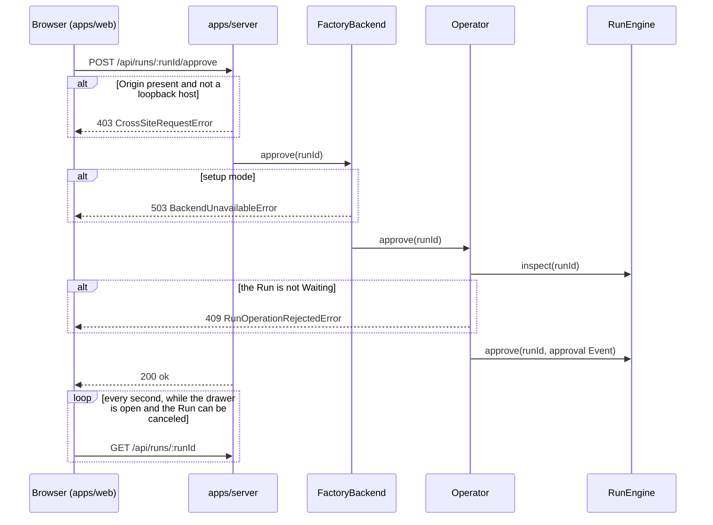

:::note
This page describes commit [`a386108`](https://github.com/basaltbytes/usine/tree/a38610863e1d43adaaba85f49b90c69c1beaed53) of basaltbytes/usine as it was on 2026-10-20, with later changes: from 2026-10-20, refused-reload fields, attempt comments and their times, last outcomes by close time, run usage reads, worker access, and the Tasks list with run close times ([#404](https://github.com/basaltbytes/usine/issues/404), [#405](https://github.com/basaltbytes/usine/issues/405), [#406](https://github.com/basaltbytes/usine/issues/406), [#410](https://github.com/basaltbytes/usine/issues/410), [#413](https://github.com/basaltbytes/usine/issues/413), [#423](https://github.com/basaltbytes/usine/issues/423), [#422](https://github.com/basaltbytes/usine/issues/422), [#426](https://github.com/basaltbytes/usine/issues/426)); from 2026-10-21, the Tasks list's in-flight group, status, and figure columns, and card lanes during a run ([#443](https://github.com/basaltbytes/usine/issues/443), [#457](https://github.com/basaltbytes/usine/issues/457), [#467](https://github.com/basaltbytes/usine/issues/467)); from 2026-10-23, the rename of `HeldForOperator` to `SuppressedForOperator` ([#489](https://github.com/basaltbytes/usine/issues/489)). The board is described without its header filters, which a separate change removes.
:::

The operator uses a local HTTP API, the web UI on it, the `usine` CLI, and logs. Besides what agents write, usine writes to a repository only to create the labels that `usine.yaml` declares, apply board moves, and push salvage branches `usine/salvage/<run>/<number>`.

## HTTP server

`usine up` serves on `127.0.0.1`, port 7331 unless `--port` or `USINE_PORT` sets another ([cli.ts:10][]). The server ([http.ts:277][]) serves `/api/*`, the operator API; `GET /` and `GET /assets/*`, the web build from the `web` folder beside the server's `main.js`; and `index.html` for any other `GET` path without a file extension outside `/api` and `/assets`, so client routes load on refresh ([http.ts:254][]).

There is no authentication. A request whose `Origin` header isn't a loopback host gets 403 `CrossSiteRequestError` before its handler runs ([http.ts:81][]). JSON bodies are accepted with any `Content-Type`. In setup mode, without GitHub App credentials, only the overview, roster, run detail, configuration, and reload work; other actions return 503 `BackendUnavailableError` ([backend.ts:131][]). Every UI action takes the same path, here an approval:



`OperatorApi` ([operator/http.ts:166][]), an Effect `HttpApi`, is the shared contract: the web client derives its typed client from it ([api.ts:6][]), and the server attaches a handler to each endpoint ([http.ts:156][]) behind `OperatorHttpPolicy`, which applies the cross-site check. `FactoryBackend` is the live backend, which calls the `Operator` service, or the setup-mode backend ([backend.ts:92][]).

## Endpoints

Actions except the reload return `{ "ok": true }` once accepted, and later reads show the result. Bodies with unknown properties are refused. Some definitions:

```ts title="packages/orchestrator/src/operator/http.ts"
export const OperatorApi = HttpApi.make("OperatorApi").add(
  HttpApiGroup.make("operator")
    .add(
      HttpApiEndpoint.get("overview", "/api/overview", { success: FactoryOverview }),
      HttpApiEndpoint.get("agents", "/api/agents", { success: Schema.Array(AgentName) }),
      // ...
      HttpApiEndpoint.post("intervene", "/api/runs/:runId/intervene", {
        params: runParams,
        payload: SessionIntervention.annotate({ parseOptions: { onExcessProperty: "error" } }),
        success: acknowledged,
      }),
      // ...
      HttpApiEndpoint.get("detail", "/api/runs/:runId", {
        params: runParams,
        query: transcriptQuery,
        success: RunDetailView,
      }),
      HttpApiEndpoint.post("approve", "/api/runs/:runId/approve", {
        params: runParams,
        success: acknowledged,
      }),
      // ...
    )
    .middleware(OperatorHttpPolicy),
);
```

### Reads

| Method | Path                                           | Query                                               | Returns                                                                                                                                                                                                                                                                                                                                                                                                                                                                                                                                                                                                                                                                                                                               |
| ------ | ---------------------------------------------- | --------------------------------------------------- | ------------------------------------------------------------------------------------------------------------------------------------------------------------------------------------------------------------------------------------------------------------------------------------------------------------------------------------------------------------------------------------------------------------------------------------------------------------------------------------------------------------------------------------------------------------------------------------------------------------------------------------------------------------------------------------------------------------------------------------- |
| GET    | `/api/overview`                                |                                                     | `Ready` or `NeedsSetup`: each project's status, runs, board, labels, and label preflight findings; each loop's trigger, agent, and paused flag; the Needs you list ([overview.ts:35][]). See [Board cards](#board-cards).                                                                                                                                                                                                                                                                                                                                                                                                                                                                                                             |
| GET    | `/api/desk`                                    |                                                     | Attempts in flight, items that a trigger matches with no attempt running, the 10 runs that closed last, worker slots and preflights, and repository poll times ([desk.ts][]); see [Desk](#desk).                                                                                                                                                                                                                                                                                                                                                                                                                                                                                                                                      |
| GET    | `/api/agents`                                  |                                                     | The roster's agent names.                                                                                                                                                                                                                                                                                                                                                                                                                                                                                                                                                                                                                                                                                                             |
| GET    | `/api/configuration`                           |                                                     | The parsed instance folder with runtime state ([configuration.ts][]): loops (trigger, condition, selector, approval, cycle limit, permissions, step, agent, prompt, paused flag); agents (brain, persona, resolved parent model and effort, loops); workers (settings, gateway with only the admin token's variable name, slots in use, last preflight per harness); repositories (lanes and labels as last polled); `settings`, `operator`, the webhooks mode; and quarantined loops and invalid agents with their errors.                                                                                                                                                                                                           |
| GET    | `/api/runs/:runId`                             | none, `after=<seq>`, or `before=<seq>&attempt=<id>` | The run with its attempts, event dedup key and payload, and a transcript window: the newest 500 rows per attempt, the rows after a sequence (at most 500 in all), or an earlier page of one attempt ([projection.ts:39][]). Each attempt has its `start` reason, last reattach time, and `workerAccess`: `Local`, `Ssh` with the worker entry's `destination` and `port`, or null for an undeclared worker. Also the newest attempt's `worker`, the attempts' `duration`, and `usage`: each session's highest `SessionTokensUpdated` report, summed per session, pool, and run, priced where the pool has a dollar rate ([usage.ts][]). Ended attempts' reports are read once and cached, so a poll reads only the attempt in flight. |
| GET    | `/api/projects/:owner/:repository/tasks/:item` |                                                     | The task that contains `item`, from any of its items ([task.ts][]): its originating item's number and title; lane and current item; items with state, labels, and pull request base conflicts; saved runs on them, newest first; and the comments and reviews that attempts posted, newest first per run (a succeeded attempt's `Comment` facts, a failed or canceled attempt's recorded comments), each with GitHub's post time and its attempt's end. Membership and lane come from the board projection over the project's 500 newest items, runs from `RunReader.forItems`. 404 `BoardItemNotFoundError` outside that window.                                                                                                     |

#### Board cards

A board card has the loops whose trigger matches one of its items now, evaluated by `LoopMatches` like a polled item ([loop-matches.ts][]); its open pull request, or else its newest merged one; and its runs' usage: ended attempts' wall time, each working attempt's start, and tokens and dollars per billing pool from `RunUsageReader` ([tasks.ts][], [usage.ts][]). A pool sums its priced sessions; `unpriced` marks a session in a priced pool that has no price yet, such as a Claude session before its first result, making the cost a lower bound, and a working run keeps the dollars already spent. `RunUsageReader` keeps ended attempts' reports for the process's life. The overview is cached until the projection revision changes, but a token report adds a transcript row, not a revision, so each read rereads the working attempts and updates the cards whose runs used more. A run's `closedAt` is its last close time, null while open.

### Actions

Each action calls the `Operator` service, which calls `RunEngine` ([operator.ts:520][]). [Operator actions](/architecture/run-lifecycle/#operator-actions) gives each effect.

| Method | Path                                                 | Body                            | Result                                                                                                                                                                                                                                                                                                                                                                                                                                                                        |
| ------ | ---------------------------------------------------- | ------------------------------- | ----------------------------------------------------------------------------------------------------------------------------------------------------------------------------------------------------------------------------------------------------------------------------------------------------------------------------------------------------------------------------------------------------------------------------------------------------------------------------- |
| POST   | `/api/runs/:runId/approve`                           |                                 | 409 unless `Waiting`.                                                                                                                                                                                                                                                                                                                                                                                                                                                         |
| POST   | `/api/runs/:runId/retry`                             |                                 | The new attempt records the retry and the `operator` login as its start reason.                                                                                                                                                                                                                                                                                                                                                                                               |
| POST   | `/api/runs/:runId/edit-and-retry`                    | `{ task, agent }`               | The new attempt records an edit-and-retry; 404 for an agent outside the roster.                                                                                                                                                                                                                                                                                                                                                                                               |
| POST   | `/api/runs/:runId/run-again`                         | `{ task, agent }`               | `Claimed` with the new run's id, or `CycleBlocked` with the item's ask; 409 for another state or while the loop has another run open on the item; 404 for an agent outside the roster or an unloaded loop.                                                                                                                                                                                                                                                                    |
| POST   | `/api/runs/:runId/cancel`                            |                                 | A closed run is unchanged.                                                                                                                                                                                                                                                                                                                                                                                                                                                    |
| POST   | `/api/runs/:runId/resolve-failure`                   | `{ attemptId }`                 | Removes the failure from Needs you.                                                                                                                                                                                                                                                                                                                                                                                                                                           |
| POST   | `/api/runs/:runId/intervene`                         | `{ attemptId, target, action }` | Sends `Steer`, `Interrupt`, `OperatorMessage`, or `Release` to the parent or a child.                                                                                                                                                                                                                                                                                                                                                                                         |
| POST   | `/api/projects/:owner/:repository/items/:item/lane`  | `{ toLane }`                    | Writes a board move's label swap to GitHub, then queues a hint for the item, even if the write fails ([operator.ts:740][]); 409 for a read-only lane.                                                                                                                                                                                                                                                                                                                         |
| POST   | `/api/loops/:loop/pause`, `/api/loops/:loop/unpause` |                                 | Sets or clears the loop's paused flag.                                                                                                                                                                                                                                                                                                                                                                                                                                        |
| POST   | `/api/cycle-budgets/reset`                           | `{ askId }`                     | Answers a cycle-budget ask with a new allowance.                                                                                                                                                                                                                                                                                                                                                                                                                              |
| POST   | `/api/workers/:worker/discard-leftovers`             |                                 | Answers an `UnconfiguredWorkerNeed`; 409 `LeftoversDiscardRejectedError` for a declared worker or one still running attempts.                                                                                                                                                                                                                                                                                                                                                 |
| POST   | `/api/instance/reload`                               |                                 | Returns an `InstanceReload`: loops, agents, labels, repositories, and workers added, removed, or changed; whether `settings` or `operator` changed; the files left out. 422 `FactoryConfigError`, 409 `RestartRequiredError`, and 409 `ReloadPreflightError` keep the running configuration and give the file and stage, the changed `usine.yaml` fields and blocks, or the agents and workers of the failed preflight with the failing capability, operation, or repository. |

`CurrentInstance` ([current-instance.ts][]) has the running instance folder. Polling, schedules, queued-event checks, GitHub App project discovery, attempt settings, and the backend read it when they act, so a reload applies from their next cycle, check, or attempt ([`usine up`](/reference/configuration/cli/)).

### Errors

Failures return `{ error, message }`, with the domain error's tag as `error` ([operator/http.ts:26][]); a refused reload adds `RestartRequiredRefusal`, `ReloadPreflightRefusal`, or `FactoryConfigRefusal` fields.

| Status | `error`                                                                                                                                                                                                                                                                                                                                                         |
| ------ | --------------------------------------------------------------------------------------------------------------------------------------------------------------------------------------------------------------------------------------------------------------------------------------------------------------------------------------------------------------- |
| 400    | `SchemaError`, `InvalidRequestError`: the request didn't decode                                                                                                                                                                                                                                                                                                 |
| 403    | `CrossSiteRequestError`                                                                                                                                                                                                                                                                                                                                         |
| 404    | `RunNotFoundError`, `TranscriptAttemptNotFoundError`, `BoardProjectNotFoundError`, `BoardItemNotFoundError`, `BoardLaneNotFoundError`, `RosterAgentNotFoundError`                                                                                                                                                                                               |
| 409    | `RunOperationRejectedError`, `RunInterventionRejectedError`, `CycleBudgetResetRejectedError`, `BoardLaneReadOnlyError`, `RestartRequiredError` (a `webhooks` change, or a `workers` change that needs a restart), `ReloadPreflightError` (an added worker or brain failed preflight), `LeftoversDiscardRejectedError` (the worker is declared or runs attempts) |
| 422    | `FactoryConfigError`: invalid `usine.yaml` or a missing folder                                                                                                                                                                                                                                                                                                  |
| 500    | `EnginePersistenceError`, `AttemptCancellationError`, `HttpBodyError` (the response didn't encode)                                                                                                                                                                                                                                                              |
| 502    | `GitHubApiError`, `InvalidGitHubResponseError`                                                                                                                                                                                                                                                                                                                  |
| 503    | `BackendUnavailableError` (setup mode), `InstallationDiscoveryError`, `AppPermissionError`, `GitHubRateLimitError`                                                                                                                                                                                                                                              |

### Call the API by hand

`curl` sends no `Origin` header, so the cross-site check allows it. These bodies follow the request schemas ([run.ts:25][]), untested against a live server:

```sh
curl -s http://127.0.0.1:7331/api/overview
curl -s -X POST http://127.0.0.1:7331/api/runs/<runId>/approve
curl -s -X POST http://127.0.0.1:7331/api/loops/review-pr/pause
curl -s -X POST http://127.0.0.1:7331/api/instance/reload
curl -s -X POST http://127.0.0.1:7331/api/runs/<runId>/intervene \
  -d '{"attemptId":"<runId>/<step>/<n>","action":{"_tag":"OperatorMessage","message":"Stop after the tests pass."}}'
```

Without `target`, an intervention goes to the parent ([run.ts:35][]); for a child, set `target` to `{"_tag":"Child","sessionId":"<id>"}`.

### Needs you

The list has nine entry kinds ([need.ts][]): `ApprovalNeed`, `RunFailureNeed`, `PollFailureNeed`, `PreflightFindingNeed`, `BoardProjectionNeed`, `ScheduleFailureNeed`, `CycleBudgetNeed`, `ConfigFileNeed`, and `UnconfiguredWorkerNeed`. An `UnconfiguredWorkerNeed` identifies a worker that `usine.yaml` no longer declares and counts its attempts that startup doesn't reconcile, with the open ones as `running`; while `running` is above 0, it shows how many still run and offers no Discard leftovers. A `RunFailureNeed` for a `QuestionFailure` shows the agent's question under **\<loop\> asks a question**.

### Desk

`GET /api/desk` returns what the overview page at `/` shows besides Needs you ([desk.ts][]):

- `running`: every `Running` run with an attempt in flight, with last activity and open warnings from the attempt's newest 200 transcript rows: a `WorkerUnresponsive` without a later `WorkerResponsive`, or a session's `ProviderRetrying` without a later `ProviderRecovered`, `SessionIdle`, or `SessionFinished`. Worker notices, pool meters, and provider retries aren't activity.
- `notMoving`: each issue and pull request loop matched against every repository's newest 500 stored items with the poll's evaluation of stream, selector, and `if:` (`LoopMatches`, [loop-matches.ts][]). A matched item with no running attempt gets the first reason that applies: `AwaitingApproval` or `QueuedForWorker` for an open run of the loop; `LoopPaused`; `SuppressedForOperator` while a question or blocker suppresses it; `CycleBudgetUsedUp` while its ask is open; `RunFailed` or `ClosedUnchanged` if its current state's event has a closed run, so dedup opens no other ([ADR 0007](https://github.com/basaltbytes/usine/blob/main/docs/adr/0007-polling-triggers-content-hashed-events.md)); `AwaitingPoll` if the loop has no run for that state yet. `RunReader.sightings` reads each item's last sighting, its run, and the run that suppresses it.
- `lastOutcomes`: the 10 runs with the latest recorded close times, whenever they opened (`RunReader.closed`). A run canceled before any attempt closes when canceled; one superseded or revoked before any attempt is left out.
- `workers`: each worker's slots, leased slots, and last preflight result from the scheduler's `WorkerStatus` ([worker-status.ts][]): the newest failed check of its prerequisites and harnesses, else the newest passed one. In setup mode, declared workers show their slots, none in use, and no preflight.
- `polls`: each repository's last completed poll in this process, kept across a cycle that fails for it (`PollCycle.repositoryPolls`).

## Web UI

`apps/web` is a React app with TanStack Router and Query, built with Vite, and `apps/web/README.md` describes each screen.

| Route                                                                     | Page                                                                                                                                                                                                                                                                                                                                                                                                                                                                                                                                                                                                                                                                                                                                                                                                                                                                           |
| ------------------------------------------------------------------------- | ------------------------------------------------------------------------------------------------------------------------------------------------------------------------------------------------------------------------------------------------------------------------------------------------------------------------------------------------------------------------------------------------------------------------------------------------------------------------------------------------------------------------------------------------------------------------------------------------------------------------------------------------------------------------------------------------------------------------------------------------------------------------------------------------------------------------------------------------------------------------------ |
| `/`                                                                       | Overview: Needs attention, Running, Stalled, Recent runs, and the Workers line ([desk/desk.tsx][]). The sidebar lists projects.                                                                                                                                                                                                                                                                                                                                                                                                                                                                                                                                                                                                                                                                                                                                                |
| `/projects/$owner/$name`                                                  | A project's board: lanes of task cards, drag-and-drop moves on authored label lanes, and each card's run history ([routes/projects/$owner/$name/index.tsx][], [board.tsx][]). All lanes are in one row: lanes that accept moves in configured order, then read-only lanes, then Done (closed-item lanes) and Unmapped, folded into rails until opened. Every task that the overview returns is on the board. A `Running` run's card stays in the lane whose label triggered the run, read from its event, until the run ends. A card opens its task page. Stalled cards show the stall reason and action from `GET /api/desk`. The arrow between two authored lanes lists the loops that match a task of the left lane. The sidebar shows Board and Tasks per project.                                                                                                         |
| `/projects/$owner/$name/runs/$run`                                        | The run page ([run-page/page.tsx][]): a header with the run's facts, worker, duration, tokens, and actions; the outline of the task, event, and attempts beside the conversation reader; and the message composer while an attempt runs.                                                                                                                                                                                                                                                                                                                                                                                                                                                                                                                                                                                                                                       |
| `/projects/$owner/$name/tasks`                                            | The Tasks list ([task/list.tsx][]): the board's tasks with at least one run, finished ones included. Each row has a status and the last run's time, the loops that ran with their last run's state, the run count, the pull request, and the card's elapsed time, tokens, and estimated cost, with `*` on lower bounds and per-pool tokens on hover; a line under the heading totals them. The status is the first that applies: Running with the loop; Waiting for approval; a pending or queued run's stall reason from `GET /api/desk`; Done if the current item is merged or closed with no open run; the stall reason; Needs attention; or the last run's outcome. In-flight tasks come first (running, waiting for approval, then pending, queued, and stalled on an open run or the operator), by run open time; the rest by last run close. A row opens the task page. |
| `/projects/$owner/$name/tasks/$number`                                    | The page of the task whose originating item is `$number` ([task/page.tsx][]): a header with Move to, every run on its items with its actions, its pull requests, and its runs' comments and reviews. Any of its items' numbers opens it, and the address then shows the originating item.                                                                                                                                                                                                                                                                                                                                                                                                                                                                                                                                                                                      |
| `/configuration`                                                          | Redirects to `/configuration/loops`. Each page of the section reads `GET /api/configuration` and has **Reload configuration** in its heading; the result, or the refusal reason, stays under the heading across the section's pages ([routes/configuration][]).                                                                                                                                                                                                                                                                                                                                                                                                                                                                                                                                                                                                                |
| `/configuration/loops`, `/configuration/loops/$loop`                      | Loops, with unloaded files first, and Pause or Resume. For a loop: trigger and selector as written, agent and repositories, approval, cycle limit, permissions, step, and the prompt as Markdown with `{{ }}` expressions outlined, or its quarantine error.                                                                                                                                                                                                                                                                                                                                                                                                                                                                                                                                                                                                                   |
| `/configuration/agents`, `/configuration/agents/$agent`                   | The roster with each brain. For an agent: persona, parent model and effort with their sources, and the loops that reference it, or why its file didn't load.                                                                                                                                                                                                                                                                                                                                                                                                                                                                                                                                                                                                                                                                                                                   |
| `/configuration/workers`, `/configuration/workers/$worker`                | Workers with slots in use and last preflight. For a worker: connection and gateway settings, and the last preflight of its prerequisites and each harness, with time and result.                                                                                                                                                                                                                                                                                                                                                                                                                                                                                                                                                                                                                                                                                               |
| `/configuration/repositories`, `/configuration/repositories/$owner/$name` | Registered repositories. For a repository: lanes in board order with each label as on GitHub, the labels usine creates there, and the loops that select it.                                                                                                                                                                                                                                                                                                                                                                                                                                                                                                                                                                                                                                                                                                                    |
| `/configuration/settings`                                                 | `settings`, `operator`, and the webhooks mode, each with its effect.                                                                                                                                                                                                                                                                                                                                                                                                                                                                                                                                                                                                                                                                                                                                                                                                           |
| any route with `?run=<runId>`                                             | The run drawer over the page ([open-run.ts][]).                                                                                                                                                                                                                                                                                                                                                                                                                                                                                                                                                                                                                                                                                                                                                                                                                                |

The root layout ([`__root.tsx`][root-layout]) has the sidebar; the Needs you strip, on every page but the overview, where Needs you is the first block; and, in setup mode, a notice that lists the credential variables to set and says to restart `usine up`.

The drawer summarizes one run ([run-drawer.tsx][]): a header with facts, worker and duration, and actions; one summary (a sentence for a waiting run, current activity and latest message for a running one, or the outcome); and **Open run page**, repeated by an expand button beside Close. The drawer and run page share the actions Approve, Mark resolved (Mark answered after a question), Retry, Cancel run (confirmed), Edit and retry, and, for succeeded or canceled runs, Run again and Edit and run again, which open the new run ([actions.tsx][]).

On the run page, the composer under the reader while an attempt runs ([workspace.tsx][]) sends `OperatorMessage` to the parent or a child. Pause session sends `Interrupt`; Release child and Release parent send `Release`, and Release parent appears only while the parent is held or paused ([session-composer.tsx][]). The run page stores each reader's position in browser storage ([remember.tsx][], [ADR 0025](https://github.com/basaltbytes/usine/blob/main/docs/adr/0025-run-conversation-reader-bookmarks.md)).

The UI polls:

- The overview every 2 seconds while a run can be canceled, else every 15, and not in setup mode ([overview.ts:25][]).
- The desk, which the board and Tasks list also read, every 3 seconds while an attempt runs or a run waits for a worker, else every 15 ([desk/query.ts][]).
- The run detail, on the run page and in an open drawer, every second while the run can be canceled ([run-transcript/query.ts:46][]). The run page reads the item's GitHub changes on open, when an attempt starts or ends, and every 30 seconds while one runs ([run-page/github-changes.ts:6][]).
- The board every second while a move is pending ([moves.ts:61][]).
- A task page every 2 seconds while one of its runs can be canceled, else every 15, and whenever a run action or board move refreshes the overview ([task/query.ts][]).

The scheduler keeps each worker's last preflight in memory ([worker-status.ts][]), from startup or any reload, refused or not. A harness that reports itself unavailable fails that harness and passes the ones checked before it; any other failure fails the worker's prerequisites.

Under the run's facts, the run page and drawer show the newest attempt's worker and the attempts' total duration, counting while one runs; the run page adds tokens, expandable per pool and session ([header.tsx][], [usage.tsx][]). The outline shows each attempt's start reason, folds a session's consecutive turns into one entry, and keeps blockers, questions, operator input, connectivity notices, and outcomes separate ([outline.tsx][]). A red count steps through what the run ended with or the operator must read, a grey one through tool failures the agent recovered from ([navigation/model.ts][], [ADR 0025](https://github.com/basaltbytes/usine/blob/main/docs/adr/0025-run-conversation-reader-bookmarks.md)).

The UI has no page for editing configuration, usage and cost, worker preflight on demand, or GitHub App creation.

## CLI

`apps/server` provides the `usine` binary ([main.ts][]), which [the CLI reference](/reference/configuration/cli/) documents. Its usage text:

```txt title="apps/server/src/cli.ts"
Usage:
  usine up [--port <port>] [--allow-volatile-instance]
  usine backup <path>
  usine export-run <runId> [--output <path>]
  usine --help
  usine --version

Options:
  -p, --port <port>            Listen on this port (default: 7331)
  --allow-volatile-instance    Start even when the instance folder is in a temporary directory
  -o, --output <path>          Write the run evidence to this file (default: run-<encoded-runId>.json)
  -h, --help                   Print this help
  -v, --version                Print the installed @usine/server version

Environment:
  USINE_PORT                     Listen on this port if --port is not set
  USINE_ALLOW_VOLATILE_INSTANCE  Set to 1 for the same effect as --allow-volatile-instance
```

`usine up` ([up.ts:110][]) refuses a volatile instance folder, takes the instance lock ([instance-lock.ts:44][]), refuses a port in use and prints its process's pid if `lsof` finds it ([cli.ts:318][]), loads the instance folder and reloads it on SIGHUP ([reload-signal.ts][]), and then starts setup mode and opens the browser without credentials ([up.ts:129][]), or runs the HTTP server and trigger streams under [graceful shutdown](/architecture/run-lifecycle/#drain) ([shutdown.ts:29][]). `usine backup` is described in [Runtime store](/architecture/storage-and-config/#runtime-store) ([backup.ts:19][]), and `usine export-run` writes a run's snapshot and transcript as JSON ([export-run.ts][]). Each subcommand's `--help` prints the same usage. `@usine/gateway` provides `usine-gateway`, which runs on the gateway VM ([Workers and the gateway](/architecture/workers-and-gateway/)).

## Logs and spans

Every service method is an `Effect.fn` span annotated with domain ids (`runId`, `attemptId`, `repository`, `loop`, `worker`), and decision points log structured fields with `Effect.logInfo`, `logWarning`, or `logError`. `apps/server` installs no logger or tracer layer, so logs go to the console through Effect's default logger and spans aren't exported ([#279][]). The gateway uses `Logger.consoleJson`, one JSON object per line for journald ([node/main.ts:7][]). These messages answer common questions:

| Question                               | Message                                                                                                                                   | Code                                                             |
| -------------------------------------- | ----------------------------------------------------------------------------------------------------------------------------------------- | ---------------------------------------------------------------- |
| Did the poll run?                      | `Poll cycle complete`                                                                                                                     | [polling.ts:703][]                                               |
| Did an item match a loop?              | `Submitted matching item state`                                                                                                           | [loop-evaluation.ts:180][]                                       |
| What did the engine do with the event? | `Event claim decided`, `Event joined its existing Run`, `Event remains ignored`                                                           | [store.ts:207][], [store.ts:258][], [store.ts:265][]             |
| Why doesn't a run start?               | `Run waits for a worker slot`, `Run waits for its approval`, `Attempt deferred until restart; the engine is draining`                     | [scheduler.ts:423][], [run-driver.ts:391][], [admission.ts:37][] |
| Did an attempt start and end?          | `Attempt started`, `Attempt completion decided`                                                                                           | [store.ts:490][], [store.ts:324][]                               |
| Is a worker ready?                     | `Worker preflight verified`, `SSH Worker preflight verified`, `Worker preflight failed`                                                   | [local.ts:293][], [ssh/preflight.ts:103][], [executor.ts:112][]  |
| Did operator input arrive?             | `Operator input applied`, `Session refused operator input`                                                                                | [runtime.ts:444][], [runtime.ts:420][]                           |
| What happened at restart?              | `Runs recovered from the run tables`, `The open Attempt's parent task is live; reattaching it`                                            | [run-driver.ts:449][], [run-driver.ts:290][]                     |
| Did a reload apply?                    | `Instance folder reloaded; new Runs use the new configuration`, `Instance folder reload rejected; the running configuration is unchanged` | [current-instance.ts][]                                          |

[cli.ts:10]: https://github.com/basaltbytes/usine/blob/a38610863e1d43adaaba85f49b90c69c1beaed53/apps/server/src/cli.ts#L10
[cli.ts:318]: https://github.com/basaltbytes/usine/blob/a38610863e1d43adaaba85f49b90c69c1beaed53/apps/server/src/cli.ts#L318
[http.ts:81]: https://github.com/basaltbytes/usine/blob/a38610863e1d43adaaba85f49b90c69c1beaed53/apps/server/src/http.ts#L81
[http.ts:156]: https://github.com/basaltbytes/usine/blob/a38610863e1d43adaaba85f49b90c69c1beaed53/apps/server/src/http.ts#L156
[http.ts:254]: https://github.com/basaltbytes/usine/blob/a38610863e1d43adaaba85f49b90c69c1beaed53/apps/server/src/http.ts#L254
[http.ts:277]: https://github.com/basaltbytes/usine/blob/a38610863e1d43adaaba85f49b90c69c1beaed53/apps/server/src/http.ts#L277
[backend.ts:92]: https://github.com/basaltbytes/usine/blob/a38610863e1d43adaaba85f49b90c69c1beaed53/apps/server/src/backend.ts#L92
[backend.ts:131]: https://github.com/basaltbytes/usine/blob/a38610863e1d43adaaba85f49b90c69c1beaed53/apps/server/src/backend.ts#L131
[backup.ts:19]: https://github.com/basaltbytes/usine/blob/a38610863e1d43adaaba85f49b90c69c1beaed53/apps/server/src/backup.ts#L19
[export-run.ts]: https://github.com/basaltbytes/usine/blob/a38610863e1d43adaaba85f49b90c69c1beaed53/apps/server/src/export-run.ts
[instance-lock.ts:44]: https://github.com/basaltbytes/usine/blob/a38610863e1d43adaaba85f49b90c69c1beaed53/apps/server/src/instance-lock.ts#L44
[main.ts]: https://github.com/basaltbytes/usine/blob/a38610863e1d43adaaba85f49b90c69c1beaed53/apps/server/src/main.ts
[shutdown.ts:29]: https://github.com/basaltbytes/usine/blob/a38610863e1d43adaaba85f49b90c69c1beaed53/apps/server/src/shutdown.ts#L29
[up.ts:110]: https://github.com/basaltbytes/usine/blob/a38610863e1d43adaaba85f49b90c69c1beaed53/apps/server/src/up.ts#L110
[up.ts:129]: https://github.com/basaltbytes/usine/blob/a38610863e1d43adaaba85f49b90c69c1beaed53/apps/server/src/up.ts#L129
[operator/http.ts:26]: https://github.com/basaltbytes/usine/blob/a38610863e1d43adaaba85f49b90c69c1beaed53/packages/orchestrator/src/operator/http.ts#L26
[operator/http.ts:166]: https://github.com/basaltbytes/usine/blob/a38610863e1d43adaaba85f49b90c69c1beaed53/packages/orchestrator/src/operator/http.ts#L166
[overview.ts:35]: https://github.com/basaltbytes/usine/blob/a38610863e1d43adaaba85f49b90c69c1beaed53/packages/orchestrator/src/operator/overview.ts#L35
[projection.ts:39]: https://github.com/basaltbytes/usine/blob/a38610863e1d43adaaba85f49b90c69c1beaed53/packages/orchestrator/src/operator/projection.ts#L39
[usage.ts]: https://github.com/basaltbytes/usine/blob/main/packages/orchestrator/src/operator/usage.ts
[header.tsx]: https://github.com/basaltbytes/usine/blob/main/apps/web/src/run-page/header.tsx
[usage.tsx]: https://github.com/basaltbytes/usine/blob/main/apps/web/src/run-page/usage.tsx
[outline.tsx]: https://github.com/basaltbytes/usine/blob/main/apps/web/src/run-page/outline.tsx
[navigation/model.ts]: https://github.com/basaltbytes/usine/blob/main/apps/web/src/run-transcript/navigation/model.ts
[operator.ts:520]: https://github.com/basaltbytes/usine/blob/a38610863e1d43adaaba85f49b90c69c1beaed53/packages/orchestrator/src/operator/operator.ts#L520
[operator.ts:740]: https://github.com/basaltbytes/usine/blob/a38610863e1d43adaaba85f49b90c69c1beaed53/packages/orchestrator/src/operator/operator.ts#L740
[run.ts:25]: https://github.com/basaltbytes/usine/blob/a38610863e1d43adaaba85f49b90c69c1beaed53/packages/orchestrator/src/operator/run.ts#L25
[run.ts:35]: https://github.com/basaltbytes/usine/blob/a38610863e1d43adaaba85f49b90c69c1beaed53/packages/orchestrator/src/operator/run.ts#L35
[need.ts]: https://github.com/basaltbytes/usine/blob/a38610863e1d43adaaba85f49b90c69c1beaed53/packages/orchestrator/src/operator/need.ts
[api.ts:6]: https://github.com/basaltbytes/usine/blob/a38610863e1d43adaaba85f49b90c69c1beaed53/apps/web/src/api.ts#L6
[desk/desk.tsx]: https://github.com/basaltbytes/usine/blob/main/apps/web/src/desk/desk.tsx
[desk/query.ts]: https://github.com/basaltbytes/usine/blob/main/apps/web/src/desk/query.ts
[desk.ts]: https://github.com/basaltbytes/usine/blob/main/packages/orchestrator/src/operator/desk.ts
[loop-matches.ts]: https://github.com/basaltbytes/usine/blob/main/packages/orchestrator/src/loop-matches.ts
[tasks.ts]: https://github.com/basaltbytes/usine/blob/main/packages/orchestrator/src/board/tasks.ts
[routes/projects/$owner/$name/index.tsx]: https://github.com/basaltbytes/usine/blob/a38610863e1d43adaaba85f49b90c69c1beaed53/apps/web/src/routes/projects/$owner/$name/index.tsx
[board.tsx]: https://github.com/basaltbytes/usine/blob/a38610863e1d43adaaba85f49b90c69c1beaed53/apps/web/src/board/board.tsx
[routes/configuration]: https://github.com/basaltbytes/usine/tree/main/apps/web/src/routes/configuration
[configuration.ts]: https://github.com/basaltbytes/usine/blob/main/packages/orchestrator/src/operator/configuration.ts
[worker-status.ts]: https://github.com/basaltbytes/usine/blob/main/packages/orchestrator/src/worker-status.ts
[run-drawer.tsx]: https://github.com/basaltbytes/usine/blob/a38610863e1d43adaaba85f49b90c69c1beaed53/apps/web/src/run-drawer.tsx
[actions.tsx]: https://github.com/basaltbytes/usine/blob/a38610863e1d43adaaba85f49b90c69c1beaed53/apps/web/src/run-intervention/actions.tsx
[workspace.tsx]: https://github.com/basaltbytes/usine/blob/a38610863e1d43adaaba85f49b90c69c1beaed53/apps/web/src/run-page/workspace.tsx
[remember.tsx]: https://github.com/basaltbytes/usine/blob/a38610863e1d43adaaba85f49b90c69c1beaed53/apps/web/src/run-transcript/reader/remember.tsx
[run-page/page.tsx]: https://github.com/basaltbytes/usine/blob/a38610863e1d43adaaba85f49b90c69c1beaed53/apps/web/src/run-page/page.tsx
[run-transcript/query.ts:46]: https://github.com/basaltbytes/usine/blob/a38610863e1d43adaaba85f49b90c69c1beaed53/apps/web/src/run-transcript/query.ts#L46
[run-page/github-changes.ts:6]: https://github.com/basaltbytes/usine/blob/a38610863e1d43adaaba85f49b90c69c1beaed53/apps/web/src/run-page/github-changes.ts#L6
[open-run.ts]: https://github.com/basaltbytes/usine/blob/a38610863e1d43adaaba85f49b90c69c1beaed53/apps/web/src/open-run.ts
[task.ts]: https://github.com/basaltbytes/usine/blob/main/packages/orchestrator/src/operator/task.ts
[task/list.tsx]: https://github.com/basaltbytes/usine/blob/main/apps/web/src/task/list.tsx
[task/page.tsx]: https://github.com/basaltbytes/usine/blob/main/apps/web/src/task/page.tsx
[task/query.ts]: https://github.com/basaltbytes/usine/blob/main/apps/web/src/task/query.ts
[root-layout]: https://github.com/basaltbytes/usine/blob/a38610863e1d43adaaba85f49b90c69c1beaed53/apps/web/src/routes/__root.tsx
[session-composer.tsx]: https://github.com/basaltbytes/usine/blob/a38610863e1d43adaaba85f49b90c69c1beaed53/apps/web/src/run-intervention/session-composer.tsx
[overview.ts:25]: https://github.com/basaltbytes/usine/blob/a38610863e1d43adaaba85f49b90c69c1beaed53/apps/web/src/overview.ts#L25
[moves.ts:61]: https://github.com/basaltbytes/usine/blob/a38610863e1d43adaaba85f49b90c69c1beaed53/apps/web/src/board/moves.ts#L61
[node/main.ts:7]: https://github.com/basaltbytes/usine/blob/a38610863e1d43adaaba85f49b90c69c1beaed53/packages/gateway/src/node/main.ts#L7
[polling.ts:703]: https://github.com/basaltbytes/usine/blob/a38610863e1d43adaaba85f49b90c69c1beaed53/packages/orchestrator/src/polling/polling.ts#L703
[loop-evaluation.ts:180]: https://github.com/basaltbytes/usine/blob/a38610863e1d43adaaba85f49b90c69c1beaed53/packages/orchestrator/src/polling/loop-evaluation.ts#L180
[scheduler.ts:423]: https://github.com/basaltbytes/usine/blob/a38610863e1d43adaaba85f49b90c69c1beaed53/packages/orchestrator/src/scheduler.ts#L423
[store.ts:258]: https://github.com/basaltbytes/usine/blob/a38610863e1d43adaaba85f49b90c69c1beaed53/packages/engine/src/store/store.ts#L258
[store.ts:265]: https://github.com/basaltbytes/usine/blob/a38610863e1d43adaaba85f49b90c69c1beaed53/packages/engine/src/store/store.ts#L265
[store.ts:207]: https://github.com/basaltbytes/usine/blob/a38610863e1d43adaaba85f49b90c69c1beaed53/packages/engine/src/store/store.ts#L207
[store.ts:324]: https://github.com/basaltbytes/usine/blob/a38610863e1d43adaaba85f49b90c69c1beaed53/packages/engine/src/store/store.ts#L324
[store.ts:490]: https://github.com/basaltbytes/usine/blob/a38610863e1d43adaaba85f49b90c69c1beaed53/packages/engine/src/store/store.ts#L490
[run-driver.ts:290]: https://github.com/basaltbytes/usine/blob/a38610863e1d43adaaba85f49b90c69c1beaed53/packages/engine/src/engine/run-driver.ts#L290
[run-driver.ts:391]: https://github.com/basaltbytes/usine/blob/a38610863e1d43adaaba85f49b90c69c1beaed53/packages/engine/src/engine/run-driver.ts#L391
[run-driver.ts:449]: https://github.com/basaltbytes/usine/blob/a38610863e1d43adaaba85f49b90c69c1beaed53/packages/engine/src/engine/run-driver.ts#L449
[admission.ts:37]: https://github.com/basaltbytes/usine/blob/a38610863e1d43adaaba85f49b90c69c1beaed53/packages/engine/src/engine/admission.ts#L37
[local.ts:293]: https://github.com/basaltbytes/usine/blob/a38610863e1d43adaaba85f49b90c69c1beaed53/packages/executor/src/local/local.ts#L293
[ssh/preflight.ts:103]: https://github.com/basaltbytes/usine/blob/a38610863e1d43adaaba85f49b90c69c1beaed53/packages/executor/src/ssh/preflight.ts#L103
[executor.ts:112]: https://github.com/basaltbytes/usine/blob/a38610863e1d43adaaba85f49b90c69c1beaed53/packages/executor/src/executor.ts#L112
[runtime.ts:420]: https://github.com/basaltbytes/usine/blob/a38610863e1d43adaaba85f49b90c69c1beaed53/packages/durable/src/attempt/runtime.ts#L420
[runtime.ts:444]: https://github.com/basaltbytes/usine/blob/a38610863e1d43adaaba85f49b90c69c1beaed53/packages/durable/src/attempt/runtime.ts#L444
[#279]: https://github.com/basaltbytes/usine/issues/279
[current-instance.ts]: https://github.com/basaltbytes/usine/blob/main/packages/orchestrator/src/current-instance/current-instance.ts
[reload-signal.ts]: https://github.com/basaltbytes/usine/blob/main/apps/server/src/reload-signal.ts
