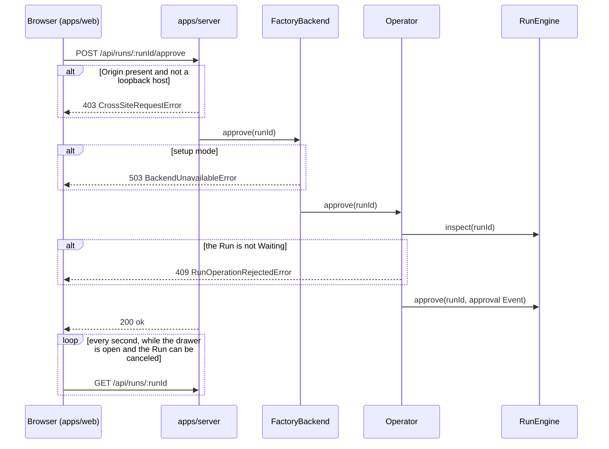

import { Steps } from "@astrojs/starlight/components";

:::note
This page describes commit [`7c0c3d3`](https://github.com/basaltbytes/usine/tree/7c0c3d3696123d11e3d5b9cc3d27e18bb21e84e9) of basaltbytes/usine as it was on 2026-10-16, and the later operator questions and blockers ([#241](https://github.com/basaltbytes/usine/issues/241), [#341](https://github.com/basaltbytes/usine/issues/341)).
:::

The operator works with usine through a local HTTP API, the web UI built on it, the `usine` CLI, and the process logs. Apart from what the agents write, usine writes to a repository only to create the labels that `usine.yaml` declares, to apply Board moves, and to push salvage branches `usine/salvage/<run>/<number>`.

## The HTTP server

`usine up` serves on `127.0.0.1`, port 7331 unless `--port` or `USINE_PORT` sets another ([cli.ts:10][]). The server ([http.ts:243][]) has three kinds of routes:

- `/api/*`: the operator API below.
- `GET /` and `GET /assets/*`: the built web UI, from the `web` folder next to the server's `main.js`.
- Any other `GET` path without a file extension and outside `/api` and `/assets`: `index.html`, so client routes load on refresh ([http.ts:220][]).

There is no authentication. If a request has an `Origin` header that isn't a loopback host, the server refuses it with 403 `CrossSiteRequestError` before its handler runs ([http.ts:68][]). The server accepts JSON bodies with any `Content-Type`. Without GitHub App credentials, the server runs in setup mode: the overview, the roster, Run detail, and the reload work, and every other action returns 503 `BackendUnavailableError` ([backend.ts:77][]).

A request from the web UI goes through the same layers for every action. Approving a Run, for example:



The browser and the server share one contract. `OperatorApi` ([operator/http.ts:149][]) is an Effect `HttpApi`; the web client builds its typed client from it ([api.ts:6][]), and the server attaches a handler to each endpoint ([http.ts:132][]) behind `OperatorHttpPolicy`, which applies the cross-site check. `FactoryBackend` is either the live backend, which calls the `Operator` service, or the setup-mode backend ([backend.ts:57][]).

## Endpoints

Every action except the reload returns `{ "ok": true }` once accepted; the result appears in later reads. The API refuses request bodies with unknown properties. The definitions, trimmed:

```ts title="packages/orchestrator/src/operator/http.ts"
export const OperatorApi = HttpApi.make("OperatorApi").add(
  HttpApiGroup.make("operator")
    .add(
      HttpApiEndpoint.get("overview", "/api/overview", { success: FactoryOverview }),
      HttpApiEndpoint.get("agents", "/api/agents", { success: Schema.Array(AgentName) }),
      // ...
      HttpApiEndpoint.post("intervene", "/api/runs/:runId/intervene", {
        params: runParams,
        payload: SessionIntervention.annotate({ parseOptions: { onExcessProperty: "error" } }),
        success: acknowledged,
      }),
      // ...
      HttpApiEndpoint.get("detail", "/api/runs/:runId", {
        params: runParams,
        query: transcriptQuery,
        success: RunDetailView,
      }),
      HttpApiEndpoint.post("approve", "/api/runs/:runId/approve", {
        params: runParams,
        success: acknowledged,
      }),
      // ...
    )
    .middleware(OperatorHttpPolicy),
);
```

### Reads

| Method | Path               | Query                                               | Returns                                                                                                                                                                                                                                      |
| ------ | ------------------ | --------------------------------------------------- | -------------------------------------------------------------------------------------------------------------------------------------------------------------------------------------------------------------------------------------------- |
| GET    | `/api/overview`    |                                                     | `Ready` or `NeedsSetup` overview: each Project's status, Runs, Board, labels, and label preflight findings; each Loop's trigger, Agent, and paused flag; the Needs you list ([overview.ts:35][]).                                            |
| GET    | `/api/agents`      |                                                     | The roster's Agent names.                                                                                                                                                                                                                    |
| GET    | `/api/runs/:runId` | none, `after=<seq>`, or `before=<seq>&attempt=<id>` | The Run with its Attempts, Event dedup key and payload, and a transcript window: the newest 500 rows of each Attempt, the rows after a sequence (at most 500 across all Attempts), or one earlier page of an Attempt ([projection.ts:37][]). |

### Run actions

Each action calls the `Operator` service, which calls `RunEngine` ([operator.ts:411][]).

| Method | Path                               | Body                            | Does                                                                                                                                                                                                                                                                                                                              |
| ------ | ---------------------------------- | ------------------------------- | --------------------------------------------------------------------------------------------------------------------------------------------------------------------------------------------------------------------------------------------------------------------------------------------------------------------------------- |
| POST   | `/api/runs/:runId/approve`         |                                 | Records the approval Event; `Waiting` becomes `Queued`. 409 in any other state.                                                                                                                                                                                                                                                   |
| POST   | `/api/runs/:runId/retry`           |                                 | `Failed` becomes `Running`; a new Attempt starts when a Worker slot is free.                                                                                                                                                                                                                                                      |
| POST   | `/api/runs/:runId/edit-and-retry`  | `{ task, agent }`               | Replaces the Run's task text and Agent, then retries. 404 for an Agent outside the roster.                                                                                                                                                                                                                                        |
| POST   | `/api/runs/:runId/run-again`       | `{ task, agent }`               | Opens a new Run for the Item state of a `Succeeded` or `Canceled` Run with that task and Agent, and answers `Claimed` with the new Run's id, or `CycleBlocked` with the Item's Ask. 409 for another state or while another Run of the Loop is open on the Item; 404 for an Agent outside the roster or a Loop that is not loaded. |
| POST   | `/api/runs/:runId/cancel`          |                                 | Cancels an open Run and stops its Attempt; a closed Run is unchanged.                                                                                                                                                                                                                                                             |
| POST   | `/api/runs/:runId/resolve-failure` | `{ attemptId }`                 | Marks the latest failed Attempt as handled, which removes it from Needs you. For a `QuestionFailure` or a `BlockedFailure`, it also ends the Loop's hold on the Item and gives the Item's newest queued Event its turn ([Operator questions and blockers](/architecture/run-lifecycle/#operator-questions-and-blockers)).         |
| POST   | `/api/runs/:runId/intervene`       | `{ attemptId, target, action }` | Sends `Steer`, `Interrupt`, `OperatorMessage`, or `Release` to the parent or a child ([How an Attempt runs](/architecture/execution/)).                                                                                                                                                                                           |

### Board, Loops, cycle budgets, and Workers

| Method | Path                                                | Body         | Does                                                                                                                                                                                          |
| ------ | --------------------------------------------------- | ------------ | --------------------------------------------------------------------------------------------------------------------------------------------------------------------------------------------- |
| POST   | `/api/projects/:owner/:repository/items/:item/lane` | `{ toLane }` | Writes the label swap of a Board move to GitHub, then queues a Hint for that Item, even when the write fails ([operator.ts:556][]). 409 for a read-only lane.                                 |
| POST   | `/api/loops/:loop/pause`                            |              | Sets the Loop's paused flag; its existing Runs continue.                                                                                                                                      |
| POST   | `/api/loops/:loop/unpause`                          |              | Clears it.                                                                                                                                                                                    |
| POST   | `/api/cycle-budgets/reset`                          | `{ askId }`  | Answers a cycle-budget Ask and gives the Item a new allowance.                                                                                                                                |
| POST   | `/api/workers/:worker/discard-leftovers`            |              | Answers an `UnconfiguredWorkerNeed`: startup stops reconciling the Attempts recorded on that Worker, and nothing on the Worker changes. A Worker that `usine.yaml` declares is left as it is. |

### Instance folder

`CurrentInstance` ([current-instance.ts][]) holds the instance folder the orchestrator runs. Polling, schedules, queued-Event checks, GitHub App project discovery, Attempt settings, and the backend read it when they act, so a reload applies from their next cycle, check, or Attempt.

| Method | Path                   | Body | Does                                                                                                                                                                                                                                                                                                                                                                            |
| ------ | ---------------------- | ---- | ------------------------------------------------------------------------------------------------------------------------------------------------------------------------------------------------------------------------------------------------------------------------------------------------------------------------------------------------------------------------------- |
| POST   | `/api/instance/reload` |      | Loads `usine.yaml`, `agents/`, and `loops/` again with the startup loader and replaces the running configuration. Returns an `InstanceReload`: the Loops, Agents, labels, and repositories added, removed, or changed, whether `settings` or `operator` changed, and the files left out. 422 `FactoryConfigError` or 409 `RestartRequiredError` keep the running configuration. |

### Errors

Failures return `{ error, message }`, where `error` is the domain error's tag ([operator/http.ts:19][]).

| Status | `error`                                                                                                                                                                                   |
| ------ | ----------------------------------------------------------------------------------------------------------------------------------------------------------------------------------------- |
| 400    | `SchemaError`, `InvalidRequestError`: the request didn't decode                                                                                                                           |
| 403    | `CrossSiteRequestError`                                                                                                                                                                   |
| 404    | `RunNotFoundError`, `TranscriptAttemptNotFoundError`, `BoardProjectNotFoundError`, `BoardItemNotFoundError`, `BoardLaneNotFoundError`, `RosterAgentNotFoundError`                         |
| 409    | `RunOperationRejectedError`, `RunInterventionRejectedError`, `CycleBudgetResetRejectedError`, `BoardLaneReadOnlyError`, `RestartRequiredError` (a reload changed `workers` or `webhooks`) |
| 422    | `FactoryConfigError`: a reload found `usine.yaml` invalid or a folder missing                                                                                                             |
| 500    | `EnginePersistenceError`, `AttemptCancellationError`, `HttpBodyError` (the response didn't encode)                                                                                        |
| 502    | `GitHubApiError`, `InvalidGitHubResponseError`                                                                                                                                            |
| 503    | `BackendUnavailableError` (setup mode), `InstallationDiscoveryError`, `AppPermissionError`, `GitHubRateLimitError`                                                                        |

### Calling the API by hand

`curl` sends no `Origin` header, so the cross-site check allows it. The bodies below follow the request schemas ([run.ts:20][]); they weren't tested against a live server for this page.

```sh
curl -s http://127.0.0.1:7331/api/overview
curl -s -X POST http://127.0.0.1:7331/api/runs/<runId>/approve
curl -s -X POST http://127.0.0.1:7331/api/loops/review-pr/pause
curl -s -X POST http://127.0.0.1:7331/api/instance/reload
curl -s -X POST http://127.0.0.1:7331/api/runs/<runId>/intervene \
  -d '{"attemptId":"<runId>/<step>/<n>","action":{"_tag":"OperatorMessage","message":"Stop after the tests pass."}}'
```

Without `target`, an intervention goes to the parent ([run.ts:30][]); to send it to a child, set `target` to `{"_tag":"Child","sessionId":"<id>"}`.

### Needs you

The Needs you list has nine kinds of entries ([need.ts][]): `ApprovalNeed`, `RunFailureNeed`, `PollFailureNeed`, `PreflightFindingNeed`, `BoardProjectionNeed`, `ScheduleFailureNeed`, `CycleBudgetNeed`, `ConfigFileNeed`, and `UnconfiguredWorkerNeed`. An `UnconfiguredWorkerNeed` names a Worker that `usine.yaml` no longer declares and counts the Attempts recorded on it that startup doesn't reconcile. A `RunFailureNeed` whose failure is a `QuestionFailure` shows the Agent's question under the title **\<loop\> asks a question**.

## The web UI

`apps/web` is a React app with TanStack Router and Query, built with Vite. `apps/web/README.md` describes each screen's behaviour in detail.

| Route                         | Page                                                                                                                                                                       |
| ----------------------------- | -------------------------------------------------------------------------------------------------------------------------------------------------------------------------- |
| `/`                           | Projects: one row per registered repository with Item and lane counts and a status ([routes/index.tsx][]).                                                                 |
| `/projects/$owner/$name`      | The Board of one Project: lanes of Task cards, drag-and-drop moves on authored label lanes, each card's Run history ([routes/projects/$owner/$name.tsx][], [board.tsx][]). |
| `/configuration`              | Redirects to `/configuration/loops`.                                                                                                                                       |
| `/configuration/loops`        | Loops with their trigger, Agent, and a pause toggle, and **Reload configuration**, which shows what the reload changed ([configuration/loops.tsx][]).                      |
| any route with `?run=<runId>` | The Run drawer over the current page ([open-run.ts][]).                                                                                                                    |

The root layout ([`__root.tsx`][root-layout]) has the sidebar, the Needs you strip, and, in setup mode, a notice that lists the credential variables to set and says to restart `usine up`. The drawer has the conversation, plus Task, Event, and Attempts tabs. Its actions are Approve, Mark resolved (Mark answered when the latest Attempt asked a question), Retry, Cancel Run (with a confirmation), Edit and retry, and for a succeeded or canceled Run, Run again and Edit and run again, which open the new Run ([run-drawer.tsx:154][]). Its message box sends `OperatorMessage` to the parent or a child, Pause session sends `Interrupt`, and Release child sends `Release` ([session-composer.tsx][]). The drawer keeps each reader's position in browser storage ([ADR 0025](https://github.com/basaltbytes/usine/blob/main/docs/adr/0025-run-conversation-reader-bookmarks.md)).

The UI polls. The overview refreshes every 2 seconds while a Run can be canceled and every 15 seconds otherwise, and stops in setup mode ([overview.ts:12][]). An open drawer refreshes every second while its Run can be canceled ([run-drawer.tsx:91][]). The Board refreshes every second while a move is pending ([moves.ts:61][]).

There is no page for editing configuration, for usage and cost, for Worker preflight on demand, or for creating the GitHub App.

## The CLI

`apps/server` provides the `usine` binary ([main.ts][]). Its usage text:

```txt title="apps/server/src/cli.ts"
Usage:
  usine up [--port <port>] [--allow-volatile-instance]
  usine backup <path>
  usine export-run <runId> [--output <path>]
  usine --help
  usine --version

Options:
  -p, --port <port>            Listen on this port (default: 7331)
  --allow-volatile-instance    Start even when the instance folder is in a temporary directory
  -o, --output <path>          Write Run evidence here (default: run-<encoded-runId>.json)
  -h, --help                   Print this usage
  -v, --version                Print the pinned @usine/server version

Environment:
  USINE_PORT                     Listen on this port when --port is absent
  USINE_ALLOW_VOLATILE_INSTANCE  Same as --allow-volatile-instance when set to 1
```

| Command                           | Does                                                                                                                                                                                                                                                                   |
| --------------------------------- | ---------------------------------------------------------------------------------------------------------------------------------------------------------------------------------------------------------------------------------------------------------------------- |
| `usine up`                        | Runs the orchestrator in the foreground from the instance folder. `--port` also takes the form `--port=<port>`.                                                                                                                                                        |
| `usine backup <path>`             | Copies the durable storage, then the runtime store, to new files: the runtime store to `<path>` and the durable storage next to it (`backup.sqlite` gives `backup.durable.sqlite`) ([backup.ts:19][], [Storage and configuration](/architecture/storage-and-config/)). |
| `usine export-run <runId>`        | Writes the Run's snapshot and its whole transcript as JSON, by default to `run-<encoded runId>.json` ([export-run.ts][]).                                                                                                                                              |
| `usine --help`, `usine --version` | Usage, and the installed `@usine/server` version. `usine up --help`, `usine backup --help`, and `usine export-run --help` print the same usage.                                                                                                                        |

`usine up` ([up.ts:104][]) runs these steps in order:

<Steps>

1. Refuse a volatile instance folder.
2. Take the instance lock: an exclusive SQLite transaction on `.usine/instance.lock`, which the OS releases when the process exits ([instance-lock.ts:44][]).
3. Refuse a port that another process listens on, and print that process's pid when `lsof` finds it ([cli.ts:318][]).
4. Load the instance folder, then reload it on each SIGHUP ([reload-signal.ts][]).
5. Load the GitHub App credentials. When they are missing, start in setup mode and open the browser ([up.ts:122][]).
6. Otherwise, build the runtime and run the HTTP server and the trigger streams together under graceful shutdown. The first SIGINT or SIGTERM drains the open Attempts, for at most `max_attempt_minutes` when it is set; a second signal ends the drain ([shutdown.ts:25][]).

</Steps>

`@usine/gateway` provides a second binary, `usine-gateway`, which runs on the Gateway VM ([Workers and the Gateway](/architecture/workers-and-gateway/)).

## Logs and spans

Every service method is an `Effect.fn` span annotated with its domain ids (`runId`, `attemptId`, `repository`, `loop`, `worker`), and decision points log with `Effect.logInfo`, `logWarning`, or `logError` and structured fields. `apps/server` installs no logger or tracer layer, so logs go to the console through Effect's default logger and spans aren't exported anywhere ([#279][]). This page doesn't verify the console format. The Gateway installs `Logger.consoleJson`, one JSON object per line for journald ([node/main.ts:7][]).

These log messages answer common questions:

| Question                               | Message                                                                                                                                   | Code                                                             |
| -------------------------------------- | ----------------------------------------------------------------------------------------------------------------------------------------- | ---------------------------------------------------------------- |
| Did the poll run?                      | `Poll cycle complete`                                                                                                                     | [polling.ts:491][]                                               |
| Did an Item match a Loop?              | `Submitted matching item state`                                                                                                           | [loop-evaluation.ts:163][]                                       |
| What did the engine do with the Event? | `Event claim decided`, `Event joined its existing Run`, `Event remains ignored`                                                           | [store.ts:152][], [store.ts:119][], [store.ts:130][]             |
| Why doesn't a Run start?               | `Run waits for a worker slot`, `Run waits for its approval`, `Attempt deferred until restart; the engine is draining`                     | [scheduler.ts:142][], [run-driver.ts:356][], [admission.ts:37][] |
| Did an Attempt start and end?          | `Attempt started`, `Attempt completion decided`                                                                                           | [store.ts:326][], [store.ts:204][]                               |
| Is a Worker ready?                     | `Worker preflight verified`, `SSH Worker preflight verified`, `Worker preflight failed`                                                   | [local.ts:271][], [ssh/preflight.ts:95][], [executor.ts:80][]    |
| Did operator input arrive?             | `Operator input applied`, `Session refused operator input`                                                                                | [runtime.ts:363][], [runtime.ts:339][]                           |
| What happened at restart?              | `Runs recovered from the run tables`, `The open Attempt's parent task is live; reattaching it`                                            | [run-driver.ts:414][], [run-driver.ts:255][]                     |
| Did a reload apply?                    | `Instance folder reloaded; new Runs use the new configuration`, `Instance folder reload rejected; the running configuration is unchanged` | [current-instance.ts][]                                          |

[cli.ts:10]: https://github.com/basaltbytes/usine/blob/7c0c3d3696123d11e3d5b9cc3d27e18bb21e84e9/apps/server/src/cli.ts#L10
[cli.ts:318]: https://github.com/basaltbytes/usine/blob/7c0c3d3696123d11e3d5b9cc3d27e18bb21e84e9/apps/server/src/cli.ts#L318
[http.ts:68]: https://github.com/basaltbytes/usine/blob/7c0c3d3696123d11e3d5b9cc3d27e18bb21e84e9/apps/server/src/http.ts#L68
[http.ts:132]: https://github.com/basaltbytes/usine/blob/7c0c3d3696123d11e3d5b9cc3d27e18bb21e84e9/apps/server/src/http.ts#L132
[http.ts:220]: https://github.com/basaltbytes/usine/blob/7c0c3d3696123d11e3d5b9cc3d27e18bb21e84e9/apps/server/src/http.ts#L220
[http.ts:243]: https://github.com/basaltbytes/usine/blob/7c0c3d3696123d11e3d5b9cc3d27e18bb21e84e9/apps/server/src/http.ts#L243
[backend.ts:57]: https://github.com/basaltbytes/usine/blob/7c0c3d3696123d11e3d5b9cc3d27e18bb21e84e9/apps/server/src/backend.ts#L57
[backend.ts:77]: https://github.com/basaltbytes/usine/blob/7c0c3d3696123d11e3d5b9cc3d27e18bb21e84e9/apps/server/src/backend.ts#L77
[backup.ts:19]: https://github.com/basaltbytes/usine/blob/7c0c3d3696123d11e3d5b9cc3d27e18bb21e84e9/apps/server/src/backup.ts#L19
[export-run.ts]: https://github.com/basaltbytes/usine/blob/7c0c3d3696123d11e3d5b9cc3d27e18bb21e84e9/apps/server/src/export-run.ts
[instance-lock.ts:44]: https://github.com/basaltbytes/usine/blob/7c0c3d3696123d11e3d5b9cc3d27e18bb21e84e9/apps/server/src/instance-lock.ts#L44
[main.ts]: https://github.com/basaltbytes/usine/blob/7c0c3d3696123d11e3d5b9cc3d27e18bb21e84e9/apps/server/src/main.ts
[shutdown.ts:25]: https://github.com/basaltbytes/usine/blob/7c0c3d3696123d11e3d5b9cc3d27e18bb21e84e9/apps/server/src/shutdown.ts#L25
[up.ts:104]: https://github.com/basaltbytes/usine/blob/7c0c3d3696123d11e3d5b9cc3d27e18bb21e84e9/apps/server/src/up.ts#L104
[up.ts:122]: https://github.com/basaltbytes/usine/blob/7c0c3d3696123d11e3d5b9cc3d27e18bb21e84e9/apps/server/src/up.ts#L122
[operator/http.ts:19]: https://github.com/basaltbytes/usine/blob/7c0c3d3696123d11e3d5b9cc3d27e18bb21e84e9/packages/orchestrator/src/operator/http.ts#L19
[operator/http.ts:149]: https://github.com/basaltbytes/usine/blob/7c0c3d3696123d11e3d5b9cc3d27e18bb21e84e9/packages/orchestrator/src/operator/http.ts#L149
[overview.ts:35]: https://github.com/basaltbytes/usine/blob/7c0c3d3696123d11e3d5b9cc3d27e18bb21e84e9/packages/orchestrator/src/operator/overview.ts#L35
[projection.ts:37]: https://github.com/basaltbytes/usine/blob/7c0c3d3696123d11e3d5b9cc3d27e18bb21e84e9/packages/orchestrator/src/operator/projection.ts#L37
[operator.ts:411]: https://github.com/basaltbytes/usine/blob/7c0c3d3696123d11e3d5b9cc3d27e18bb21e84e9/packages/orchestrator/src/operator/operator.ts#L411
[operator.ts:556]: https://github.com/basaltbytes/usine/blob/7c0c3d3696123d11e3d5b9cc3d27e18bb21e84e9/packages/orchestrator/src/operator/operator.ts#L556
[run.ts:20]: https://github.com/basaltbytes/usine/blob/7c0c3d3696123d11e3d5b9cc3d27e18bb21e84e9/packages/orchestrator/src/operator/run.ts#L20
[run.ts:30]: https://github.com/basaltbytes/usine/blob/7c0c3d3696123d11e3d5b9cc3d27e18bb21e84e9/packages/orchestrator/src/operator/run.ts#L30
[need.ts]: https://github.com/basaltbytes/usine/blob/7c0c3d3696123d11e3d5b9cc3d27e18bb21e84e9/packages/orchestrator/src/operator/need.ts
[api.ts:6]: https://github.com/basaltbytes/usine/blob/7c0c3d3696123d11e3d5b9cc3d27e18bb21e84e9/apps/web/src/api.ts#L6
[routes/index.tsx]: https://github.com/basaltbytes/usine/blob/7c0c3d3696123d11e3d5b9cc3d27e18bb21e84e9/apps/web/src/routes/index.tsx
[routes/projects/$owner/$name.tsx]: https://github.com/basaltbytes/usine/blob/7c0c3d3696123d11e3d5b9cc3d27e18bb21e84e9/apps/web/src/routes/projects/$owner/$name.tsx
[board.tsx]: https://github.com/basaltbytes/usine/blob/7c0c3d3696123d11e3d5b9cc3d27e18bb21e84e9/apps/web/src/board/board.tsx
[configuration/loops.tsx]: https://github.com/basaltbytes/usine/blob/7c0c3d3696123d11e3d5b9cc3d27e18bb21e84e9/apps/web/src/routes/configuration/loops.tsx
[open-run.ts]: https://github.com/basaltbytes/usine/blob/7c0c3d3696123d11e3d5b9cc3d27e18bb21e84e9/apps/web/src/open-run.ts
[root-layout]: https://github.com/basaltbytes/usine/blob/7c0c3d3696123d11e3d5b9cc3d27e18bb21e84e9/apps/web/src/routes/__root.tsx
[run-drawer.tsx:91]: https://github.com/basaltbytes/usine/blob/7c0c3d3696123d11e3d5b9cc3d27e18bb21e84e9/apps/web/src/run-drawer.tsx#L91
[run-drawer.tsx:154]: https://github.com/basaltbytes/usine/blob/7c0c3d3696123d11e3d5b9cc3d27e18bb21e84e9/apps/web/src/run-drawer.tsx#L154
[session-composer.tsx]: https://github.com/basaltbytes/usine/blob/7c0c3d3696123d11e3d5b9cc3d27e18bb21e84e9/apps/web/src/run-intervention/session-composer.tsx
[overview.ts:12]: https://github.com/basaltbytes/usine/blob/7c0c3d3696123d11e3d5b9cc3d27e18bb21e84e9/apps/web/src/overview.ts#L12
[moves.ts:61]: https://github.com/basaltbytes/usine/blob/7c0c3d3696123d11e3d5b9cc3d27e18bb21e84e9/apps/web/src/board/moves.ts#L61
[node/main.ts:7]: https://github.com/basaltbytes/usine/blob/7c0c3d3696123d11e3d5b9cc3d27e18bb21e84e9/packages/gateway/src/node/main.ts#L7
[polling.ts:491]: https://github.com/basaltbytes/usine/blob/7c0c3d3696123d11e3d5b9cc3d27e18bb21e84e9/packages/orchestrator/src/polling/polling.ts#L491
[loop-evaluation.ts:163]: https://github.com/basaltbytes/usine/blob/7c0c3d3696123d11e3d5b9cc3d27e18bb21e84e9/packages/orchestrator/src/polling/loop-evaluation.ts#L163
[scheduler.ts:142]: https://github.com/basaltbytes/usine/blob/7c0c3d3696123d11e3d5b9cc3d27e18bb21e84e9/packages/orchestrator/src/scheduler.ts#L142
[store.ts:119]: https://github.com/basaltbytes/usine/blob/7c0c3d3696123d11e3d5b9cc3d27e18bb21e84e9/packages/engine/src/store/store.ts#L119
[store.ts:130]: https://github.com/basaltbytes/usine/blob/7c0c3d3696123d11e3d5b9cc3d27e18bb21e84e9/packages/engine/src/store/store.ts#L130
[store.ts:152]: https://github.com/basaltbytes/usine/blob/7c0c3d3696123d11e3d5b9cc3d27e18bb21e84e9/packages/engine/src/store/store.ts#L152
[store.ts:204]: https://github.com/basaltbytes/usine/blob/7c0c3d3696123d11e3d5b9cc3d27e18bb21e84e9/packages/engine/src/store/store.ts#L204
[store.ts:326]: https://github.com/basaltbytes/usine/blob/7c0c3d3696123d11e3d5b9cc3d27e18bb21e84e9/packages/engine/src/store/store.ts#L326
[run-driver.ts:255]: https://github.com/basaltbytes/usine/blob/7c0c3d3696123d11e3d5b9cc3d27e18bb21e84e9/packages/engine/src/engine/run-driver.ts#L255
[run-driver.ts:356]: https://github.com/basaltbytes/usine/blob/7c0c3d3696123d11e3d5b9cc3d27e18bb21e84e9/packages/engine/src/engine/run-driver.ts#L356
[run-driver.ts:414]: https://github.com/basaltbytes/usine/blob/7c0c3d3696123d11e3d5b9cc3d27e18bb21e84e9/packages/engine/src/engine/run-driver.ts#L414
[admission.ts:37]: https://github.com/basaltbytes/usine/blob/7c0c3d3696123d11e3d5b9cc3d27e18bb21e84e9/packages/engine/src/engine/admission.ts#L37
[local.ts:271]: https://github.com/basaltbytes/usine/blob/7c0c3d3696123d11e3d5b9cc3d27e18bb21e84e9/packages/executor/src/local/local.ts#L271
[ssh/preflight.ts:95]: https://github.com/basaltbytes/usine/blob/7c0c3d3696123d11e3d5b9cc3d27e18bb21e84e9/packages/executor/src/ssh/preflight.ts#L95
[executor.ts:80]: https://github.com/basaltbytes/usine/blob/7c0c3d3696123d11e3d5b9cc3d27e18bb21e84e9/packages/executor/src/executor.ts#L80
[runtime.ts:339]: https://github.com/basaltbytes/usine/blob/7c0c3d3696123d11e3d5b9cc3d27e18bb21e84e9/packages/durable/src/attempt/runtime.ts#L339
[runtime.ts:363]: https://github.com/basaltbytes/usine/blob/7c0c3d3696123d11e3d5b9cc3d27e18bb21e84e9/packages/durable/src/attempt/runtime.ts#L363
[#279]: https://github.com/basaltbytes/usine/issues/279
[current-instance.ts]: https://github.com/basaltbytes/usine/blob/main/packages/orchestrator/src/current-instance/current-instance.ts
[reload-signal.ts]: https://github.com/basaltbytes/usine/blob/main/apps/server/src/reload-signal.ts
