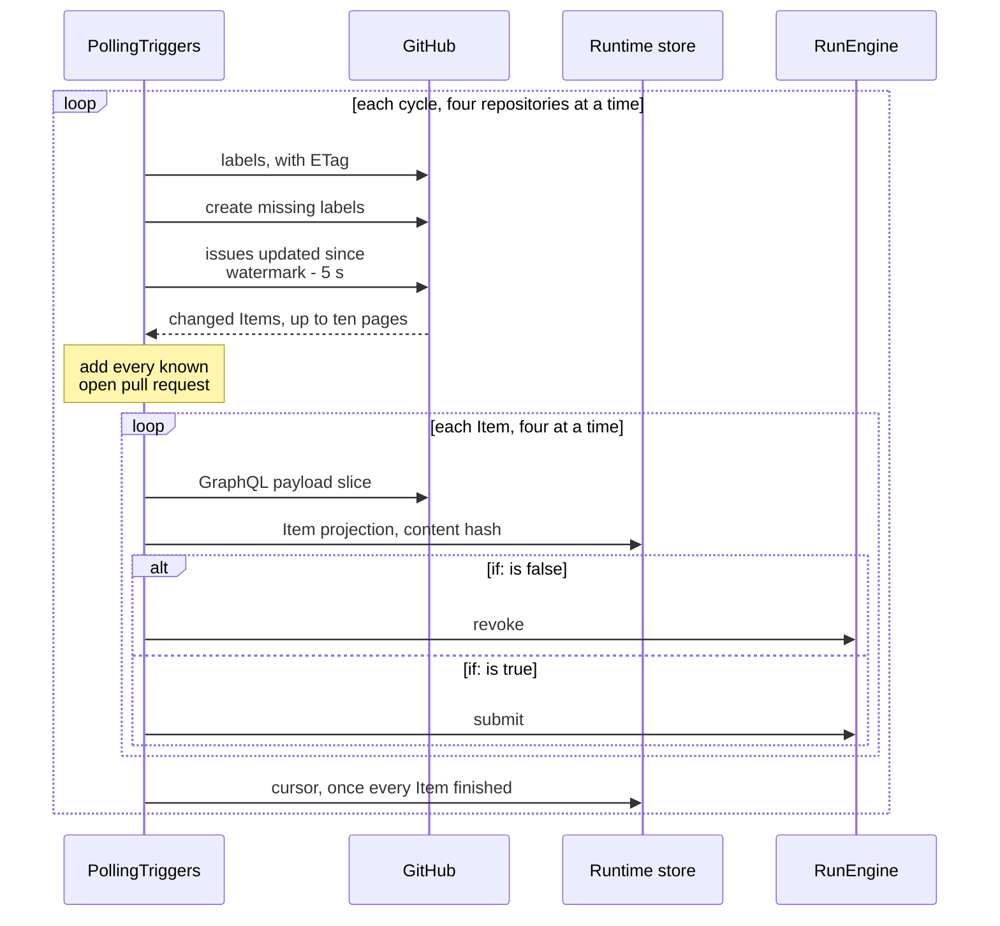
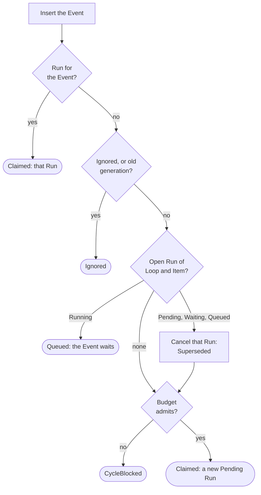
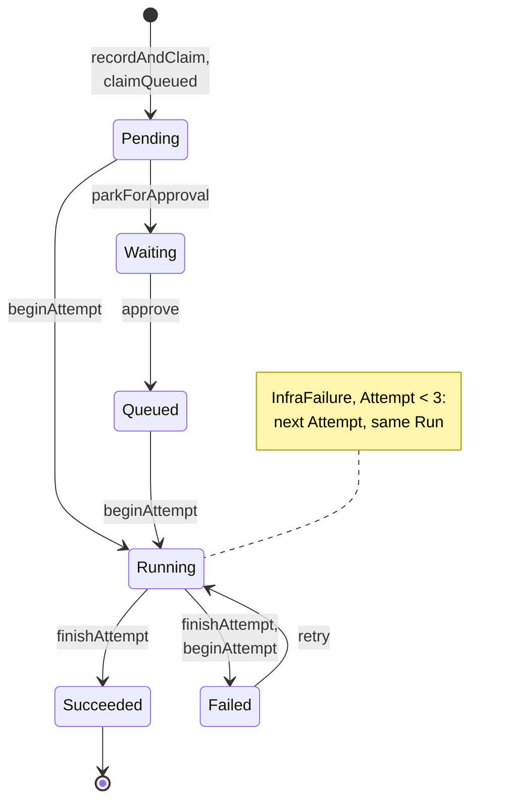
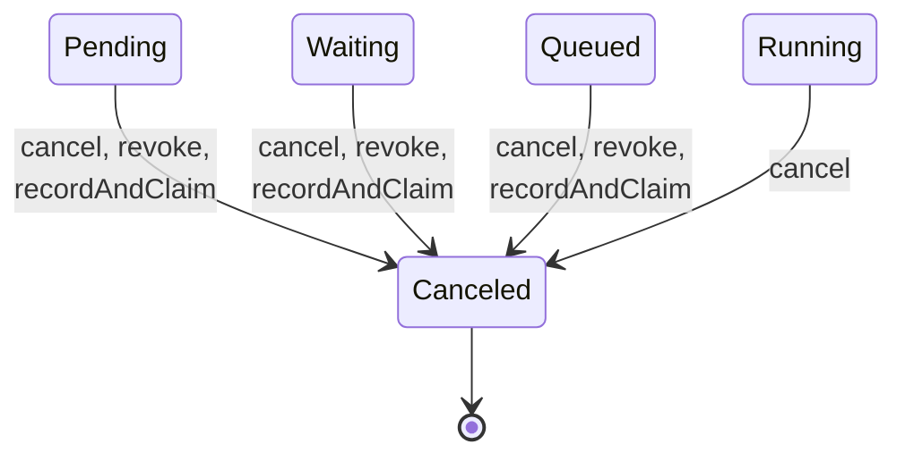
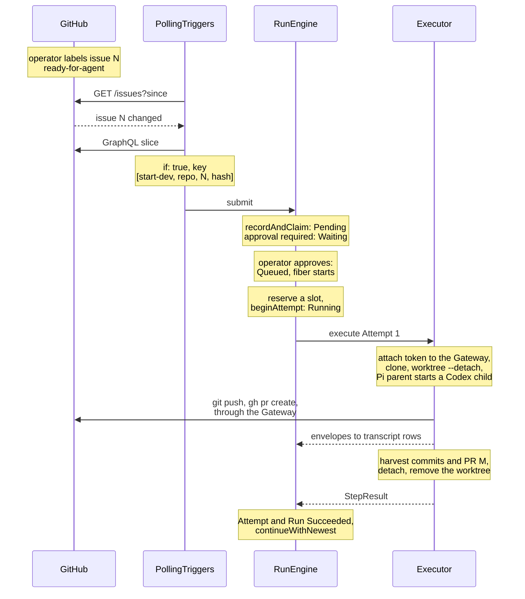

import { Steps } from "@astrojs/starlight/components";

:::note
This page describes commit [`7c0c3d3`](https://github.com/basaltbytes/usine/tree/7c0c3d3696123d11e3d5b9cc3d27e18bb21e84e9) of basaltbytes/usine as it was on 2026-10-16. Code links point at that commit.
:::

Polling fetches a changed Item and hashes its payload. A Loop whose `if:` matches creates an Event from that hash, the engine opens a Run for the Event, and the Run's fiber runs the Run's one Step as Attempts until the Run closes.

## From a GitHub change to an Event



`PollingTriggers.run` ([polling.ts:468](https://github.com/basaltbytes/usine/blob/7c0c3d3696123d11e3d5b9cc3d27e18bb21e84e9/packages/orchestrator/src/polling/polling.ts#L468)) repeats `poll` ([polling.ts:312](https://github.com/basaltbytes/usine/blob/7c0c3d3696123d11e3d5b9cc3d27e18bb21e84e9/packages/orchestrator/src/polling/polling.ts#L312)) every `poll_interval` seconds, or later when GitHub asks for a longer wait. Each cycle reads the paused Loops from `LoopControl` ([polling.ts:315](https://github.com/basaltbytes/usine/blob/7c0c3d3696123d11e3d5b9cc3d27e18bb21e84e9/packages/orchestrator/src/polling/polling.ts#L315)), resolves every Loop to its roster Agent, and keeps the issue and pull request Loops whose selector matches each repository. It polls up to four repositories at once ([polling.ts:56](https://github.com/basaltbytes/usine/blob/7c0c3d3696123d11e3d5b9cc3d27e18bb21e84e9/packages/orchestrator/src/polling/polling.ts#L56)), and up to four Items of a repository at once ([polling.ts:58](https://github.com/basaltbytes/usine/blob/7c0c3d3696123d11e3d5b9cc3d27e18bb21e84e9/packages/orchestrator/src/polling/polling.ts#L58)). It polls every registered repository, even one without an active Loop, because the Board reads the same projection.

`pollRepository` ([polling.ts:191](https://github.com/basaltbytes/usine/blob/7c0c3d3696123d11e3d5b9cc3d27e18bb21e84e9/packages/orchestrator/src/polling/polling.ts#L191)) does this for one repository:

<Steps>

1. Label preflight: `synchronizeLabels` ([repository-sync.ts:162](https://github.com/basaltbytes/usine/blob/7c0c3d3696123d11e3d5b9cc3d27e18bb21e84e9/packages/orchestrator/src/polling/repository-sync.ts#L162)) reads the label catalog with its ETag and creates the labels that `usine.yaml` declares and the repository doesn't have.

2. Change detection: `GitHubPolling.changes` ([polling.ts:333](https://github.com/basaltbytes/usine/blob/7c0c3d3696123d11e3d5b9cc3d27e18bb21e84e9/packages/github/src/polling/polling.ts#L333)) sends `GET /repos/{owner}/{repo}/issues?state=all&sort=updated&direction=asc&per_page=100` with `If-None-Match`, and with `since=<watermark - 5 s>` once a watermark exists. [ADR 0007](https://github.com/basaltbytes/usine/blob/main/docs/adr/0007-polling-triggers-content-hashed-events.md) relies on GitHub not counting an authenticated 304 against the rate limit. The listing stops after ten pages ([polling.ts:48](https://github.com/basaltbytes/usine/blob/7c0c3d3696123d11e3d5b9cc3d27e18bb21e84e9/packages/github/src/polling/polling.ts#L48)) and the next cycle continues from the watermark.

3. Every cycle fetches again every open pull request in the stored cursor, changed or not, because mergeability can change without an `updated_at` change ([ADR 0007](https://github.com/basaltbytes/usine/blob/main/docs/adr/0007-polling-triggers-content-hashed-events.md), [#155](https://github.com/basaltbytes/usine/issues/155)). When GitHub no longer has an Item that only the cursor kept, such as an open pull request or an Item whose Loop failed, because it was deleted, transferred, or is out of the App's reach, the poll logs a warning, drops the Item from the cursor, and revokes its unstarted Runs as it does for an Item that stops matching. The other Items and the cursor continue.

4. `observeItem` ([repository-sync.ts:215](https://github.com/basaltbytes/usine/blob/7c0c3d3696123d11e3d5b9cc3d27e18bb21e84e9/packages/orchestrator/src/polling/repository-sync.ts#L215)) reads the Item's cycle generation, fetches its GraphQL payload slice (`GitHubPolling.snapshot`, [polling.ts:442](https://github.com/basaltbytes/usine/blob/7c0c3d3696123d11e3d5b9cc3d27e18bb21e84e9/packages/github/src/polling/polling.ts#L442)), and stores it as the Item's projection. The content hash is the SHA-256 of the payload as canonical JSON with `createdAt`, `updatedAt`, `closedAt`, `mergedAt`, and `submittedAt` removed ([content.ts:7](https://github.com/basaltbytes/usine/blob/7c0c3d3696123d11e3d5b9cc3d27e18bb21e84e9/packages/github/src/polling/content.ts#L7), [polling.ts:549](https://github.com/basaltbytes/usine/blob/7c0c3d3696123d11e3d5b9cc3d27e18bb21e84e9/packages/github/src/polling/polling.ts#L549)).

5. `evaluateItem` ([loop-evaluation.ts:52](https://github.com/basaltbytes/usine/blob/7c0c3d3696123d11e3d5b9cc3d27e18bb21e84e9/packages/orchestrator/src/polling/loop-evaluation.ts#L52)) evaluates each Loop of the Item's stream. When `if:` is false it calls `RunEngine.revoke` ([loop-evaluation.ts:109](https://github.com/basaltbytes/usine/blob/7c0c3d3696123d11e3d5b9cc3d27e18bb21e84e9/packages/orchestrator/src/polling/loop-evaluation.ts#L109)). When it is true it renders the prompt ([loop-evaluation.ts:128](https://github.com/basaltbytes/usine/blob/7c0c3d3696123d11e3d5b9cc3d27e18bb21e84e9/packages/orchestrator/src/polling/loop-evaluation.ts#L128)) and submits ([loop-evaluation.ts:148](https://github.com/basaltbytes/usine/blob/7c0c3d3696123d11e3d5b9cc3d27e18bb21e84e9/packages/orchestrator/src/polling/loop-evaluation.ts#L148)).

6. The poll writes the cursor only after every Item of the cycle has finished ([polling.ts:265](https://github.com/basaltbytes/usine/blob/7c0c3d3696123d11e3d5b9cc3d27e18bb21e84e9/packages/orchestrator/src/polling/polling.ts#L265)). If the repository poll itself fails (in change detection, an Item fetch, an `if:` evaluation, or a submission), the old cursor stays, so the next cycle fetches the same Items again. A prompt that fails to render affects only its Loop ([loop-evaluation.ts:125](https://github.com/basaltbytes/usine/blob/7c0c3d3696123d11e3d5b9cc3d27e18bb21e84e9/packages/orchestrator/src/polling/loop-evaluation.ts#L125)): Needs you reports it as a poll failure, the other Loops still run, and the cursor still advances.

</Steps>

The dedup key of an issue or pull request Event is the JSON array `[loop, repository, number, contentHash]`, with the cycle generation appended once it is above zero ([loop-evaluation.ts:29](https://github.com/basaltbytes/usine/blob/7c0c3d3696123d11e3d5b9cc3d27e18bb21e84e9/packages/orchestrator/src/polling/loop-evaluation.ts#L29)). The Event id is the dedup key ([trigger-submission.ts:101](https://github.com/basaltbytes/usine/blob/7c0c3d3696123d11e3d5b9cc3d27e18bb21e84e9/packages/orchestrator/src/trigger-submission.ts#L101)). The ledger keeps every key forever, so the same Loop never acts twice on the same Item content.

A Board move sends a Hint: `Operator.moveBoardItem` calls `PollingTriggers.hint` after its label write ([operator.ts:556](https://github.com/basaltbytes/usine/blob/7c0c3d3696123d11e3d5b9cc3d27e18bb21e84e9/packages/orchestrator/src/operator/operator.ts#L556)). `refreshHint` ([polling.ts:395](https://github.com/basaltbytes/usine/blob/7c0c3d3696123d11e3d5b9cc3d27e18bb21e84e9/packages/orchestrator/src/polling/polling.ts#L395)) fetches that one Item through the same `observeItem` and `evaluateItem` path and never advances the cursor. The Hint queue has room for 128 entries, drops the rest, and merges duplicates that are still pending ([hints.ts:14](https://github.com/basaltbytes/usine/blob/7c0c3d3696123d11e3d5b9cc3d27e18bb21e84e9/packages/orchestrator/src/polling/hints.ts#L14)). Board moves are the only Hint source in the code.

Schedule Loops have their own service. `ScheduleTriggers` ([schedule-triggers.ts:203](https://github.com/basaltbytes/usine/blob/7c0c3d3696123d11e3d5b9cc3d27e18bb21e84e9/packages/orchestrator/src/schedule-triggers.ts#L203)) runs a loop ([schedule-triggers.ts:483](https://github.com/basaltbytes/usine/blob/7c0c3d3696123d11e3d5b9cc3d27e18bb21e84e9/packages/orchestrator/src/schedule-triggers.ts#L483)) that wakes at the next due Tick or after 60 seconds ([schedule-triggers.ts:50](https://github.com/basaltbytes/usine/blob/7c0c3d3696123d11e3d5b9cc3d27e18bb21e84e9/packages/orchestrator/src/schedule-triggers.ts#L50)). At each wake, it takes the latest Tick at or before the current time ([schedule-triggers.ts:159](https://github.com/basaltbytes/usine/blob/7c0c3d3696123d11e3d5b9cc3d27e18bb21e84e9/packages/orchestrator/src/schedule-triggers.ts#L159)), evaluates `if:` with the Tick as the Item (expressions read `item.tick.scheduledAt`, `item.tick.scheduledAtLocal`, `item.tick.cron`, and `item.tick.tz`), and submits one Event per selected repository. Its dedup key is `[loop, repository, scheduledAt]` ([schedule-triggers.ts:184](https://github.com/basaltbytes/usine/blob/7c0c3d3696123d11e3d5b9cc3d27e18bb21e84e9/packages/orchestrator/src/schedule-triggers.ts#L184)) and its Item key is `["github", repository]` ([schedule-triggers.ts:181](https://github.com/basaltbytes/usine/blob/7c0c3d3696123d11e3d5b9cc3d27e18bb21e84e9/packages/orchestrator/src/schedule-triggers.ts#L181)). The map of fired Ticks is in memory ([schedule-triggers.ts:229](https://github.com/basaltbytes/usine/blob/7c0c3d3696123d11e3d5b9cc3d27e18bb21e84e9/packages/orchestrator/src/schedule-triggers.ts#L229)), so after a restart the latest missed Tick fires once and the ledger discards repeats.

## Identities

| Identity          | Value                                                                          | Code                                                                                                                                                                 |
| ----------------- | ------------------------------------------------------------------------------ | -------------------------------------------------------------------------------------------------------------------------------------------------------------------- |
| Item key          | JSON `["github", "<owner/name>", number]`, lowercase repository                | [repository-sync.ts:41](https://github.com/basaltbytes/usine/blob/7c0c3d3696123d11e3d5b9cc3d27e18bb21e84e9/packages/orchestrator/src/polling/repository-sync.ts#L41) |
| Event id          | the dedup key                                                                  | [trigger-submission.ts:101](https://github.com/basaltbytes/usine/blob/7c0c3d3696123d11e3d5b9cc3d27e18bb21e84e9/packages/orchestrator/src/trigger-submission.ts#L101) |
| Run id            | hex of the first 16 bytes of SHA-256 of `@usine/engine/DurableRun-<dedup key>` | [submission.ts:50](https://github.com/basaltbytes/usine/blob/7c0c3d3696123d11e3d5b9cc3d27e18bb21e84e9/packages/engine/src/engine/submission.ts#L50)                  |
| Attempt id        | `<runId>/<step>/<number>`                                                      | [store.ts:308](https://github.com/basaltbytes/usine/blob/7c0c3d3696123d11e3d5b9cc3d27e18bb21e84e9/packages/engine/src/store/store.ts#L308)                           |
| Approval Event    | dedup key `["operator-approval", runId]`                                       | [operator.ts:426](https://github.com/basaltbytes/usine/blob/7c0c3d3696123d11e3d5b9cc3d27e18bb21e84e9/packages/orchestrator/src/operator/operator.ts#L426)            |
| Cycle reset Event | dedup key `cycle-budget-reset:<askId>`                                         | [operator.ts:587](https://github.com/basaltbytes/usine/blob/7c0c3d3696123d11e3d5b9cc3d27e18bb21e84e9/packages/orchestrator/src/operator/operator.ts#L587)            |

## Submission and the claim

`RunEngine.submit` ([engine.ts:52](https://github.com/basaltbytes/usine/blob/7c0c3d3696123d11e3d5b9cc3d27e18bb21e84e9/packages/engine/src/engine/engine.ts#L52)) calls `RunStore.recordAndClaim` ([store.ts:103](https://github.com/basaltbytes/usine/blob/7c0c3d3696123d11e3d5b9cc3d27e18bb21e84e9/packages/engine/src/store/store.ts#L103)), one transaction:



1. Insert the Event, ignoring a duplicate dedup key.
2. If a Run already exists for the Event, return `Claimed` with that Run, whatever its state. A canceled Run keeps its Event, so the same content can't open a new Run ([#267](https://github.com/basaltbytes/usine/issues/267)).
3. If the Event is in `usine_ignored_events`, or belongs to an older cycle generation, return `Ignored`.
4. Find the open Run of the same Loop and Item and decide with `claimRun` ([lifecycle.ts:225](https://github.com/basaltbytes/usine/blob/7c0c3d3696123d11e3d5b9cc3d27e18bb21e84e9/packages/engine/src/engine/lifecycle.ts#L225)). If that Run is `Running`, queue the Event. If it's `Pending`, `Waiting`, or `Queued`, supersede it: it becomes `Canceled` with reason `Superseded`, and a new Run opens. If there is no open Run, open a new one.
5. Before opening a Run, check the Item's cycle budget ([queries.ts:84](https://github.com/basaltbytes/usine/blob/7c0c3d3696123d11e3d5b9cc3d27e18bb21e84e9/packages/engine/src/cycle-budget/queries.ts#L84)). If the budget is used up, return `CycleBlocked` and open nothing. A supersede decided in step 4 still commits, so the older Run ends `Canceled` and no Run replaces it.

```ts title="packages/engine/src/engine/lifecycle.ts"
/**
 * Decides what to do with an Event that no Run has claimed: open a Run, queue the Event
 * while the Item's Run is running, or supersede the Item's unstarted Run. The ledger handles
 * duplicate and ignored Events before this decision; a running Attempt always finishes (ADR 0007).
 */
export const claimRun = (blocking: Option.Option<Run>, eventId: EventId): ClaimDecision => {
  if (Option.isNone(blocking)) return { _tag: "OpenRun" };
  const run = blocking.value;
  if (run.state._tag === "Running") return { _tag: "QueueEvent" };
  if (RunState.isUnstarted(run.state)) {
    return { _tag: "SupersedeRun", runId: run.id, state: RunState.supersede(run.state, eventId) };
  }
  return { _tag: "OpenRun" };
};
```

A queued Event opens no Run and adds no row except the Event itself. It's different from the `Queued` Run state below, which a Run enters only after an approval.

After the transaction, `submit` stops the superseded Run's fiber and starts the new one.

## States

Run states are tagged classes in [state.ts](https://github.com/basaltbytes/usine/blob/7c0c3d3696123d11e3d5b9cc3d27e18bb21e84e9/packages/core/src/run/state.ts). Each transition function accepts only its legal source states, so an illegal transition fails to compile. The two diagrams below split the transitions, and label each transition with the `RunStore` function that writes it.



A cancel moves a Run to `Canceled` from every open state. A supersede, which `recordAndClaim` writes, and a revoke apply only to states where no Attempt has started.



```ts title="packages/core/src/run/state.ts"
/** Moves a pending Run to the waiting state until its Loop's required approval arrives. */
export const awaitApproval = (_state: Pending): Waiting => new Waiting();

/** Returns the approved state; the Run still waits for a Worker slot before execution. */
export const approve = (_state: Waiting): Queued => new Queued();

/** Returns the running state for a first Attempt after any required approval has been granted. */
export const start = (_state: Startable): Running => new Running();

/** Closes the run after a successful attempt. */
export const succeed = (_state: Running): Succeeded => new Succeeded();

/** Closes the run after a failed attempt when no auto-retry applies; `shouldAutoRetry` decides that. */
export const fail = (_state: Running): Failed => new Failed();

/** Returns the reopened state for operator retry; attempt N+1 belongs to the same Run and Step. */
export const retry = (_state: Failed): Running => new Running();

/** Cancels from any open state. */
export const cancelByOperator = (_state: Open): Canceled =>
  new Canceled({ reason: new OperatorCanceled() });

/**
 * Cancels an unstarted run because a newer Event for the same Item replaced it.
 * A running Attempt always finishes, and the engine evaluates the newer Event after it ends (ADR 0007).
 */
export const supersede = (_state: Unstarted, by: EventId): Canceled =>
  new Canceled({ reason: new Superseded({ by }) });

/** Cancels an unstarted run because its Item stopped matching the loop's trigger. */
export const revoke = (_state: Unstarted): Canceled => new Canceled({ reason: new Revoked() });
```

`Open` is `Pending`, `Waiting`, `Queued`, or `Running`; `Unstarted` is `Pending`, `Waiting`, or `Queued`; `Startable` is `Pending` or `Queued` ([state.ts:65](https://github.com/basaltbytes/usine/blob/7c0c3d3696123d11e3d5b9cc3d27e18bb21e84e9/packages/core/src/run/state.ts#L65)).

| State       | Meaning                                                    | Set by                                                                                                                                                                                                                                                                                                                                                                   |
| ----------- | ---------------------------------------------------------- | ------------------------------------------------------------------------------------------------------------------------------------------------------------------------------------------------------------------------------------------------------------------------------------------------------------------------------------------------------------------------ |
| `Pending`   | created, no Attempt, no gate passed                        | `createRun` ([queries.ts:471](https://github.com/basaltbytes/usine/blob/7c0c3d3696123d11e3d5b9cc3d27e18bb21e84e9/packages/engine/src/store/queries.ts#L471)), through `openRun` from `recordAndClaim` or from `claimQueued` ([store.ts:519](https://github.com/basaltbytes/usine/blob/7c0c3d3696123d11e3d5b9cc3d27e18bb21e84e9/packages/engine/src/store/store.ts#L519)) |
| `Waiting`   | waiting on `approval: required`                            | `parkForApproval` ([store.ts:169](https://github.com/basaltbytes/usine/blob/7c0c3d3696123d11e3d5b9cc3d27e18bb21e84e9/packages/engine/src/store/store.ts#L169))                                                                                                                                                                                                           |
| `Queued`    | approved, waiting for a Worker slot                        | `approve` ([store.ts:414](https://github.com/basaltbytes/usine/blob/7c0c3d3696123d11e3d5b9cc3d27e18bb21e84e9/packages/engine/src/store/store.ts#L414))                                                                                                                                                                                                                   |
| `Running`   | an Attempt is running, or the next one is about to start   | `beginAttempt` ([store.ts:249](https://github.com/basaltbytes/usine/blob/7c0c3d3696123d11e3d5b9cc3d27e18bb21e84e9/packages/engine/src/store/store.ts#L249)), operator `retry`                                                                                                                                                                                            |
| `Succeeded` | the Step result is stored                                  | `finishAttempt` ([store.ts:362](https://github.com/basaltbytes/usine/blob/7c0c3d3696123d11e3d5b9cc3d27e18bb21e84e9/packages/engine/src/store/store.ts#L362))                                                                                                                                                                                                             |
| `Failed`    | the last Attempt failed and no auto-retry applies          | `finishAttempt`, or `beginAttempt` when a restart finds an open Attempt numbered three or higher that is no longer live                                                                                                                                                                                                                                                  |
| `Canceled`  | with reason `OperatorCanceled`, `Superseded`, or `Revoked` | `cancel`, `recordAndClaim`, `revoke`                                                                                                                                                                                                                                                                                                                                     |

An Attempt ends as `Succeeded`, `Failed` with a typed failure, or `Canceled` ([outcome.ts](https://github.com/basaltbytes/usine/blob/7c0c3d3696123d11e3d5b9cc3d27e18bb21e84e9/packages/core/src/attempt/outcome.ts)). The failures are `InfraFailure`, `DefectFailure`, `AgentFailure`, `RunawayFailure`, and `ChildSessionBudgetFailure` ([failure.ts](https://github.com/basaltbytes/usine/blob/7c0c3d3696123d11e3d5b9cc3d27e18bb21e84e9/packages/core/src/attempt/failure.ts)). The engine retries only an `InfraFailure` without the operator, up to three Attempts in total ([lifecycle.ts:12](https://github.com/basaltbytes/usine/blob/7c0c3d3696123d11e3d5b9cc3d27e18bb21e84e9/packages/engine/src/engine/lifecycle.ts#L12)). The cap uses the Attempt number rather than a count since the last operator retry ([attempt.ts:64](https://github.com/basaltbytes/usine/blob/7c0c3d3696123d11e3d5b9cc3d27e18bb21e84e9/packages/core/src/attempt/attempt.ts#L64)), so after an operator retry of a third or later Attempt, an `InfraFailure` fails the Run again. An Attempt that a restart finds no longer live counts as an `InfraFailure`. A Worker capability error at preparation becomes an `AgentFailure` ([scheduler.ts:51](https://github.com/basaltbytes/usine/blob/7c0c3d3696123d11e3d5b9cc3d27e18bb21e84e9/packages/orchestrator/src/scheduler.ts#L51)), so a Run whose harness is logged out waits for the operator.

## The Run fiber

`RunDriver` ([run-driver.ts](https://github.com/basaltbytes/usine/blob/7c0c3d3696123d11e3d5b9cc3d27e18bb21e84e9/packages/engine/src/engine/run-driver.ts)) keeps one fiber per open Run in a `FiberMap`, except for `Waiting` Runs, which have none until an approval. `drive` ([run-driver.ts:341](https://github.com/basaltbytes/usine/blob/7c0c3d3696123d11e3d5b9cc3d27e18bb21e84e9/packages/engine/src/engine/run-driver.ts#L341)) does this:

<Steps>

1. Read the Run's Submission. With `approval: required`, put the Run in `Waiting` and end the fiber. The approval starts a new fiber.

2. Reserve a Worker slot. `StepExecutor.reserve` ([scheduler.ts:131](https://github.com/basaltbytes/usine/blob/7c0c3d3696123d11e3d5b9cc3d27e18bb21e84e9/packages/orchestrator/src/scheduler.ts#L131)) serves reservations in order of Event receipt time, one slot per `max_concurrent_attempts`.

3. Enter Attempt admission ([admission.ts:58](https://github.com/basaltbytes/usine/blob/7c0c3d3696123d11e3d5b9cc3d27e18bb21e84e9/packages/engine/src/engine/admission.ts#L58)) and run `executeAttempt` ([run-driver.ts:288](https://github.com/basaltbytes/usine/blob/7c0c3d3696123d11e3d5b9cc3d27e18bb21e84e9/packages/engine/src/engine/run-driver.ts#L288)): ask the executor whether an open Attempt is still live (`openAttempt`, [run-driver.ts:234](https://github.com/basaltbytes/usine/blob/7c0c3d3696123d11e3d5b9cc3d27e18bb21e84e9/packages/engine/src/engine/run-driver.ts#L234)), then `beginAttempt` starts a new Attempt or reattaches the live one, then `execute`, then `finishAttempt`.

4. Repeat while the decision is `RetryAttempt`. Each retry reserves a new Worker slot.

5. Process the newest queued Event of the same Loop and Item (`continueWithNewest`, [run-driver.ts:179](https://github.com/basaltbytes/usine/blob/7c0c3d3696123d11e3d5b9cc3d27e18bb21e84e9/packages/engine/src/engine/run-driver.ts#L179)). `TriggerCondition.holds` ([trigger-condition.ts:87](https://github.com/basaltbytes/usine/blob/7c0c3d3696123d11e3d5b9cc3d27e18bb21e84e9/packages/orchestrator/src/trigger-condition.ts#L87)) fetches the Item again and evaluates `if:`; a failure or a five-second timeout counts as true ([trigger-condition.ts:96](https://github.com/basaltbytes/usine/blob/7c0c3d3696123d11e3d5b9cc3d27e18bb21e84e9/packages/orchestrator/src/trigger-condition.ts#L96)). A false result marks the queued Events as revoked.

</Steps>

`RunDriver` retries a failed store write four times, with exponential backoff starting at 100 ms ([run-driver.ts:47](https://github.com/basaltbytes/usine/blob/7c0c3d3696123d11e3d5b9cc3d27e18bb21e84e9/packages/engine/src/engine/run-driver.ts#L47)). `reconcile` restarts a fiber that stopped on an engine failure; it runs at engine start and every three minutes ([engine.ts:37](https://github.com/basaltbytes/usine/blob/7c0c3d3696123d11e3d5b9cc3d27e18bb21e84e9/packages/engine/src/engine/engine.ts#L37), [engine.ts:181](https://github.com/basaltbytes/usine/blob/7c0c3d3696123d11e3d5b9cc3d27e18bb21e84e9/packages/engine/src/engine/engine.ts#L181)). Before the first reconcile, `recoverWorkspaces` ([engine.ts:286](https://github.com/basaltbytes/usine/blob/7c0c3d3696123d11e3d5b9cc3d27e18bb21e84e9/packages/engine/src/engine/engine.ts#L286)) asks the executor to salvage or remove every checkout an earlier process left. It runs once per start, in the engine layer, so the executor sees each persisted Attempt once.

## Operator actions

Each action is an HTTP endpoint ([Operator surfaces](/architecture/operator-surfaces/)) that calls `Operator`, then `RunEngine`.

| Action             | Code                                                                                                                                                                                                                                                                                                                     | Effect                                                                                                                                                                                                                                                                                                                                                                                                                                                                                                                            |
| ------------------ | ------------------------------------------------------------------------------------------------------------------------------------------------------------------------------------------------------------------------------------------------------------------------------------------------------------------------ | --------------------------------------------------------------------------------------------------------------------------------------------------------------------------------------------------------------------------------------------------------------------------------------------------------------------------------------------------------------------------------------------------------------------------------------------------------------------------------------------------------------------------------- |
| Approve            | [operator.ts:411](https://github.com/basaltbytes/usine/blob/7c0c3d3696123d11e3d5b9cc3d27e18bb21e84e9/packages/orchestrator/src/operator/operator.ts#L411), [store.ts:414](https://github.com/basaltbytes/usine/blob/7c0c3d3696123d11e3d5b9cc3d27e18bb21e84e9/packages/engine/src/store/store.ts#L414)                    | Records the approval Event in `usine_approvals`, moves `Waiting` to `Queued`, starts the fiber. For any other state, it returns 409.                                                                                                                                                                                                                                                                                                                                                                                              |
| Retry              | [operator.ts:439](https://github.com/basaltbytes/usine/blob/7c0c3d3696123d11e3d5b9cc3d27e18bb21e84e9/packages/orchestrator/src/operator/operator.ts#L439), [store.ts:435](https://github.com/basaltbytes/usine/blob/7c0c3d3696123d11e3d5b9cc3d27e18bb21e84e9/packages/engine/src/store/store.ts#L435)                    | Moves `Failed` to `Running` with no limit on the Attempt count. The next Attempt starts from the newest pushed salvage, if there is one.                                                                                                                                                                                                                                                                                                                                                                                          |
| Edit and retry     | [operator.ts:445](https://github.com/basaltbytes/usine/blob/7c0c3d3696123d11e3d5b9cc3d27e18bb21e84e9/packages/orchestrator/src/operator/operator.ts#L445), [queries.ts:400](https://github.com/basaltbytes/usine/blob/7c0c3d3696123d11e3d5b9cc3d27e18bb21e84e9/packages/engine/src/store/queries.ts#L400)                | The same retry, after replacing the Run's task text, Agent, and parent model. Every later Attempt uses the amendment ([ADR 0018](https://github.com/basaltbytes/usine/blob/main/docs/adr/0018-takeover-and-edit-and-retry.md)).                                                                                                                                                                                                                                                                                                   |
| Cancel             | [engine.ts:92](https://github.com/basaltbytes/usine/blob/7c0c3d3696123d11e3d5b9cc3d27e18bb21e84e9/packages/engine/src/engine/engine.ts#L92), [store.ts:471](https://github.com/basaltbytes/usine/blob/7c0c3d3696123d11e3d5b9cc3d27e18bb21e84e9/packages/engine/src/store/store.ts#L471)                                  | Any open state becomes `Canceled`; an open Attempt closes as `Canceled`. Then the executor stops the Attempt, the fiber stops, and the engine processes the queued Events.                                                                                                                                                                                                                                                                                                                                                        |
| Resolve failure    | [store.ts:378](https://github.com/basaltbytes/usine/blob/7c0c3d3696123d11e3d5b9cc3d27e18bb21e84e9/packages/engine/src/store/store.ts#L378)                                                                                                                                                                               | Marks the latest failed Attempt as handled in `resolved_failure_attempt_id`. The state doesn't change.                                                                                                                                                                                                                                                                                                                                                                                                                            |
| Intervene          | [engine.ts:120](https://github.com/basaltbytes/usine/blob/7c0c3d3696123d11e3d5b9cc3d27e18bb21e84e9/packages/engine/src/engine/engine.ts#L120)                                                                                                                                                                            | Requires a `Running` Run whose latest Attempt is the one addressed and has no outcome; the action goes to the live session ([How an Attempt runs](/architecture/execution/)).                                                                                                                                                                                                                                                                                                                                                     |
| Pause, unpause     | [operator.ts:498](https://github.com/basaltbytes/usine/blob/7c0c3d3696123d11e3d5b9cc3d27e18bb21e84e9/packages/orchestrator/src/operator/operator.ts#L498)                                                                                                                                                                | Writes `usine_loop_runtime`. The polling and schedule triggers skip a paused Loop, so it submits no Event and revokes nothing. Existing Runs continue, and an Event already queued behind a `Running` Run still opens its Run when that Run closes. Pausing or unpausing changes the set of active Loops for a repository, so its next poll starts from an empty cursor ([polling.ts:172](https://github.com/basaltbytes/usine/blob/7c0c3d3696123d11e3d5b9cc3d27e18bb21e84e9/packages/orchestrator/src/polling/polling.ts#L172)). |
| Reset cycle budget | [operator.ts:583](https://github.com/basaltbytes/usine/blob/7c0c3d3696123d11e3d5b9cc3d27e18bb21e84e9/packages/orchestrator/src/operator/operator.ts#L583), [cycle-budget.ts:83](https://github.com/basaltbytes/usine/blob/7c0c3d3696123d11e3d5b9cc3d27e18bb21e84e9/packages/engine/src/cycle-budget/cycle-budget.ts#L83) | See below.                                                                                                                                                                                                                                                                                                                                                                                                                                                                                                                        |

The engine also revokes Runs without an operator action: when an Item no longer matches a Loop's `if:`, `revoke` ([store.ts:497](https://github.com/basaltbytes/usine/blob/7c0c3d3696123d11e3d5b9cc3d27e18bb21e84e9/packages/engine/src/store/store.ts#L497)) cancels that Loop's unstarted Runs on the Item with reason `Revoked` and marks its queued Events as ignored. The engine never revokes or supersedes a running Attempt.

## Cycle budgets

A Loop can open `max_cycles` Runs on one Item between operator resets, three by default ([cycle-budget.ts:20](https://github.com/basaltbytes/usine/blob/7c0c3d3696123d11e3d5b9cc3d27e18bb21e84e9/packages/core/src/cycle-budget.ts#L20)). Schedule Loops have no budget ([trigger-submission.ts:111](https://github.com/basaltbytes/usine/blob/7c0c3d3696123d11e3d5b9cc3d27e18bb21e84e9/packages/orchestrator/src/trigger-submission.ts#L111)). `admit` ([queries.ts:84](https://github.com/basaltbytes/usine/blob/7c0c3d3696123d11e3d5b9cc3d27e18bb21e84e9/packages/engine/src/cycle-budget/queries.ts#L84)) counts the Loop's reserved Runs in the current generation. When the count is at the limit, it stores a `CycleBudgetAsk` in `usine_item_cycle_budgets.ask_json`. From then on no Loop opens a Run on that Item: every submission that would open one returns `CycleBlocked`. A Run canceled before its first Attempt gives its reservation back.

The Ask appears only in the UI's Needs you list; usine posts nothing to GitHub ([#36](https://github.com/basaltbytes/usine/issues/36)). The reset ([cycle-budget.ts:83](https://github.com/basaltbytes/usine/blob/7c0c3d3696123d11e3d5b9cc3d27e18bb21e84e9/packages/engine/src/cycle-budget/cycle-budget.ts#L83)) records the answer Event, increments the generation, clears the Ask, moves unstarted Runs' reservations into the new generation, and sets `reset_pending`. The next poll of that repository starts from an empty cursor ([polling.ts:195](https://github.com/basaltbytes/usine/blob/7c0c3d3696123d11e3d5b9cc3d27e18bb21e84e9/packages/orchestrator/src/polling/polling.ts#L195)), so the Item's current state produces new Events whose dedup key includes the new generation. [ADR 0022](https://github.com/basaltbytes/usine/blob/main/docs/adr/0022-item-cycle-budgets-and-comment-reviews.md) explains why the budget is per Item.

## Drain

The first SIGINT or SIGTERM completes the `RunEngineShutdown` latch ([shutdown.ts:5](https://github.com/basaltbytes/usine/blob/7c0c3d3696123d11e3d5b9cc3d27e18bb21e84e9/apps/server/src/shutdown.ts#L5)), which immediately closes Attempt admission. The process then waits for admitted Attempts to record their outcome: for at most `max_attempt_minutes` when it's set, and with no limit otherwise ([up.ts:171](https://github.com/basaltbytes/usine/blob/7c0c3d3696123d11e3d5b9cc3d27e18bb21e84e9/apps/server/src/up.ts#L171)). A second signal stops the wait. An Attempt interrupted this way keeps its parent task live in durable storage, and the next `usine up` reattaches it ([durable-session.ts:193](https://github.com/basaltbytes/usine/blob/7c0c3d3696123d11e3d5b9cc3d27e18bb21e84e9/packages/executor/src/durable-session.ts#L193)). [ADR 0023](https://github.com/basaltbytes/usine/blob/main/docs/adr/0023-graceful-attempt-drain.md) explains why the engine controls admission.

## One Run from trigger to pull request

The `start-dev` Loop of the dogfood instance ([The dogfood instance's Loops](/architecture/loops-shipped/)), on an SSH Worker behind a Gateway:



The Codex child also adds `ready-for-review` to pull request M. The next poll detects that M changed, `review-pr` matches it, and a new Run opens for the pull request.
