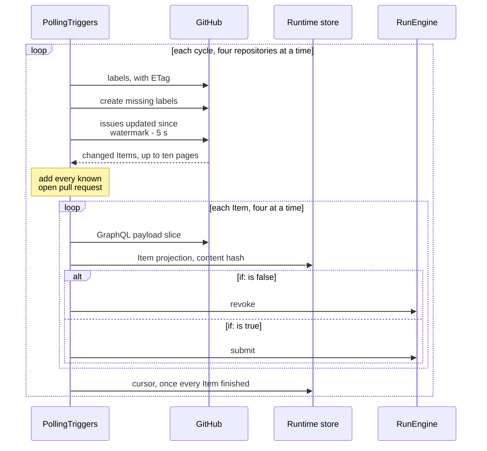
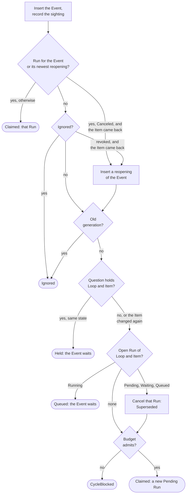
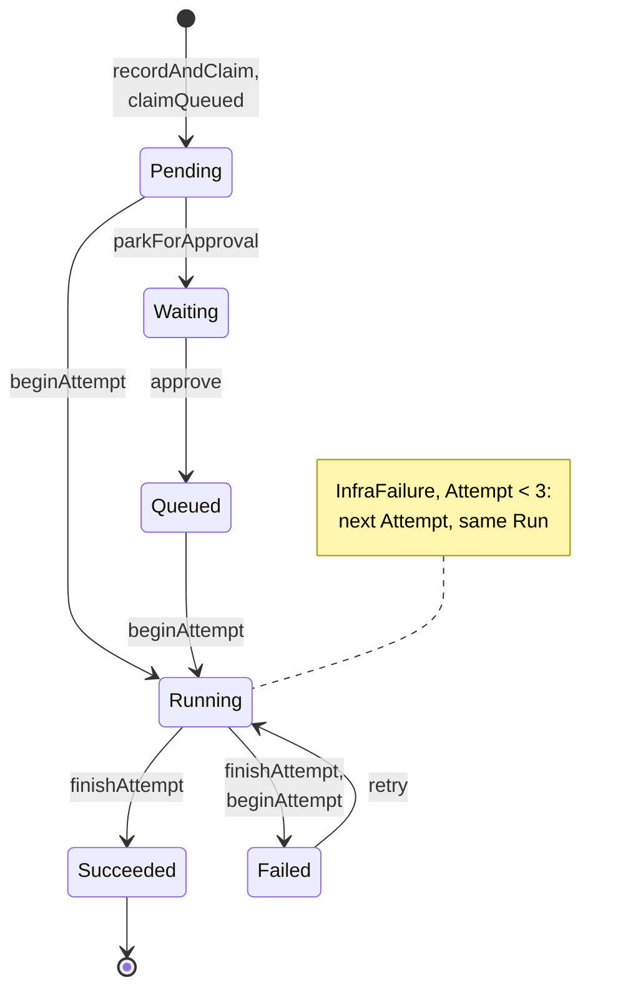
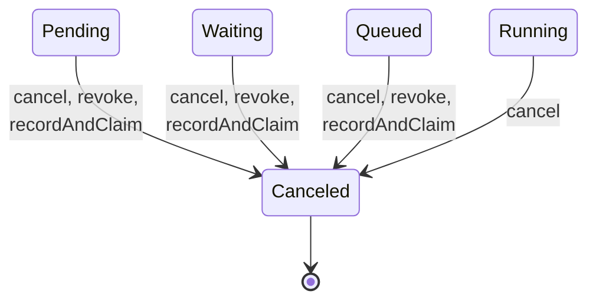
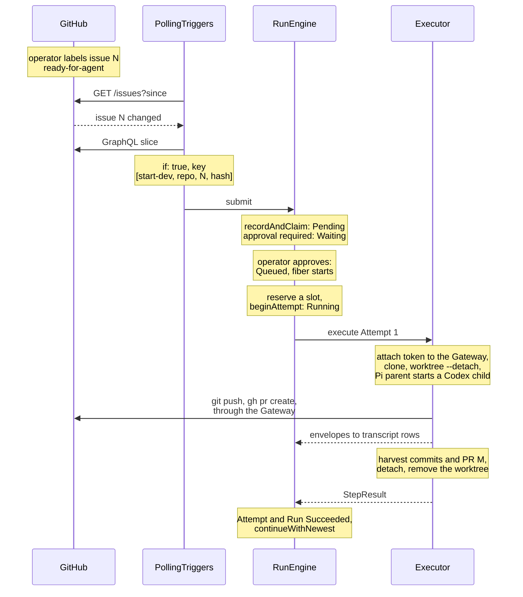

import { Steps } from "@astrojs/starlight/components";

:::note
This page describes commit [`7c0c3d3`](https://github.com/basaltbytes/usine/tree/7c0c3d3696123d11e3d5b9cc3d27e18bb21e84e9) of basaltbytes/usine as it was on 2026-10-16, and the later changes to canceled runs, operator questions, blockers, retries, items that GitHub no longer has, run again, and the checkouts that a restart keeps for a reattachment ([#267](https://github.com/basaltbytes/usine/issues/267), [#241](https://github.com/basaltbytes/usine/issues/241), [#341](https://github.com/basaltbytes/usine/issues/341), [#282](https://github.com/basaltbytes/usine/issues/282), [#329](https://github.com/basaltbytes/usine/issues/329), [#328](https://github.com/basaltbytes/usine/issues/328), [#363](https://github.com/basaltbytes/usine/issues/363), [#391](https://github.com/basaltbytes/usine/issues/391), [#364](https://github.com/basaltbytes/usine/issues/364), [#152](https://github.com/basaltbytes/usine/issues/152), [#180](https://github.com/basaltbytes/usine/issues/180)). Code links point at that commit.
:::

## From a GitHub change to an event



`PollingTriggers.run` ([polling.ts:468](https://github.com/basaltbytes/usine/blob/7c0c3d3696123d11e3d5b9cc3d27e18bb21e84e9/packages/orchestrator/src/polling/polling.ts#L468)) repeats `poll` ([polling.ts:312](https://github.com/basaltbytes/usine/blob/7c0c3d3696123d11e3d5b9cc3d27e18bb21e84e9/packages/orchestrator/src/polling/polling.ts#L312)) every `poll_interval` seconds, or later if GitHub asks. Each cycle reads paused loops from `LoopControl` ([polling.ts:315](https://github.com/basaltbytes/usine/blob/7c0c3d3696123d11e3d5b9cc3d27e18bb21e84e9/packages/orchestrator/src/polling/polling.ts#L315)), resolves each loop's agent, and keeps per repository the issue and pull request loops whose selector matches. It polls four repositories ([polling.ts:56](https://github.com/basaltbytes/usine/blob/7c0c3d3696123d11e3d5b9cc3d27e18bb21e84e9/packages/orchestrator/src/polling/polling.ts#L56)) and four items per repository ([polling.ts:58](https://github.com/basaltbytes/usine/blob/7c0c3d3696123d11e3d5b9cc3d27e18bb21e84e9/packages/orchestrator/src/polling/polling.ts#L58)) at a time, including those without an active loop, for the board.

`pollRepository` ([polling.ts:191](https://github.com/basaltbytes/usine/blob/7c0c3d3696123d11e3d5b9cc3d27e18bb21e84e9/packages/orchestrator/src/polling/polling.ts#L191)) runs these steps:

<Steps>

1. `synchronizeLabels` ([repository-sync.ts:162](https://github.com/basaltbytes/usine/blob/7c0c3d3696123d11e3d5b9cc3d27e18bb21e84e9/packages/orchestrator/src/polling/repository-sync.ts#L162)) reads the label catalog with its ETag and creates the labels that `usine.yaml` declares and the repository lacks.

2. `GitHubPolling.changes` ([polling.ts:333](https://github.com/basaltbytes/usine/blob/7c0c3d3696123d11e3d5b9cc3d27e18bb21e84e9/packages/github/src/polling/polling.ts#L333)) sends `GET /repos/{owner}/{repo}/issues?state=all&sort=updated&direction=asc&per_page=100` with `If-None-Match`, plus `since=<watermark - 5 s>` once a watermark exists. [ADR 0007](https://github.com/basaltbytes/usine/blob/main/docs/adr/0007-polling-triggers-content-hashed-events.md) relies on GitHub not counting an authenticated 304 against the rate limit. The listing stops after ten pages ([polling.ts:48](https://github.com/basaltbytes/usine/blob/7c0c3d3696123d11e3d5b9cc3d27e18bb21e84e9/packages/github/src/polling/polling.ts#L48)); the next cycle continues from the watermark.

3. Every open pull request in the stored cursor is fetched again, changed or not, because mergeability can change without an `updated_at` change ([#155](https://github.com/basaltbytes/usine/issues/155)).

4. `observeItem` ([repository-sync.ts:215](https://github.com/basaltbytes/usine/blob/7c0c3d3696123d11e3d5b9cc3d27e18bb21e84e9/packages/orchestrator/src/polling/repository-sync.ts#L215)) reads the item's cycle generation, fetches its payload slice (`GitHubPolling.snapshot`, [polling.ts:442](https://github.com/basaltbytes/usine/blob/7c0c3d3696123d11e3d5b9cc3d27e18bb21e84e9/packages/github/src/polling/polling.ts#L442)), and stores it as the item's projection. The content hash is the SHA-256 of the payload as canonical JSON without `createdAt`, `updatedAt`, `closedAt`, `mergedAt`, and `submittedAt` ([content.ts:7](https://github.com/basaltbytes/usine/blob/7c0c3d3696123d11e3d5b9cc3d27e18bb21e84e9/packages/github/src/polling/content.ts#L7), [polling.ts:549](https://github.com/basaltbytes/usine/blob/7c0c3d3696123d11e3d5b9cc3d27e18bb21e84e9/packages/github/src/polling/polling.ts#L549)).

5. `evaluateItem` ([loop-evaluation.ts:52](https://github.com/basaltbytes/usine/blob/7c0c3d3696123d11e3d5b9cc3d27e18bb21e84e9/packages/orchestrator/src/polling/loop-evaluation.ts#L52)) evaluates each loop of the item's stream: if `if:` is false, it calls `RunEngine.revoke` ([loop-evaluation.ts:109](https://github.com/basaltbytes/usine/blob/7c0c3d3696123d11e3d5b9cc3d27e18bb21e84e9/packages/orchestrator/src/polling/loop-evaluation.ts#L109)); if true, it renders the prompt ([loop-evaluation.ts:128](https://github.com/basaltbytes/usine/blob/7c0c3d3696123d11e3d5b9cc3d27e18bb21e84e9/packages/orchestrator/src/polling/loop-evaluation.ts#L128)) and submits ([loop-evaluation.ts:148](https://github.com/basaltbytes/usine/blob/7c0c3d3696123d11e3d5b9cc3d27e18bb21e84e9/packages/orchestrator/src/polling/loop-evaluation.ts#L148)).

6. The cursor is written after every item of the cycle finishes ([polling.ts:265](https://github.com/basaltbytes/usine/blob/7c0c3d3696123d11e3d5b9cc3d27e18bb21e84e9/packages/orchestrator/src/polling/polling.ts#L265)); if change detection, an item fetch, an `if:` evaluation, or a submission fails, the old cursor stays for the next cycle. A prompt that fails to render affects only its loop ([loop-evaluation.ts:125](https://github.com/basaltbytes/usine/blob/7c0c3d3696123d11e3d5b9cc3d27e18bb21e84e9/packages/orchestrator/src/polling/loop-evaluation.ts#L125)): Needs attention shows a poll failure, and the rest go on.

</Steps>

### Gone items

If GitHub no longer has an item that only the cursor kept (an open pull request, or an item whose loop failed) because it was deleted, transferred, or inaccessible to the App, the poll logs a warning, drops it from the cursor, revokes its unstarted runs, and sets `gone_at` on its `usine_item_projections` row, which keeps the last payload. The board then places the item by its closed state, outside the open lanes, until a poll sees it again and clears `gone_at`.

The cursor doesn't keep open issues, so at most every 10 minutes per repository, the cycle checks each stored open issue, 50 per GraphQL request as aliased `issue(number:)` fields; a null result, for a deleted or transferred issue, is handled the same way ([#391](https://github.com/basaltbytes/usine/issues/391)). A queued event's recheck also marks an issue gone (step 5 of [Run fiber](#run-fiber)).

### Dedup keys, hints, and schedules

The dedup key of an issue or pull request event is `[loop, repository, number, contentHash]`, plus the cycle generation once it's above zero ([loop-evaluation.ts:29](https://github.com/basaltbytes/usine/blob/7c0c3d3696123d11e3d5b9cc3d27e18bb21e84e9/packages/orchestrator/src/polling/loop-evaluation.ts#L29)). The ledger keeps every key, so a loop acts once on the same item content, except when the item leaves a canceled run's content and comes back ([Submission and the claim](#submission-and-the-claim)) or the operator uses [run again](#run-again).

A board move sends a hint: `Operator.moveBoardItem` calls `PollingTriggers.hint` after its label write ([operator.ts:556](https://github.com/basaltbytes/usine/blob/7c0c3d3696123d11e3d5b9cc3d27e18bb21e84e9/packages/orchestrator/src/operator/operator.ts#L556)), the only hint source. `refreshHint` ([polling.ts:395](https://github.com/basaltbytes/usine/blob/7c0c3d3696123d11e3d5b9cc3d27e18bb21e84e9/packages/orchestrator/src/polling/polling.ts#L395)) fetches that item through `observeItem` and `evaluateItem` without advancing the cursor. The hint queue has 128 slots, drops the rest, and merges pending duplicates ([hints.ts:14](https://github.com/basaltbytes/usine/blob/7c0c3d3696123d11e3d5b9cc3d27e18bb21e84e9/packages/orchestrator/src/polling/hints.ts#L14)).

`ScheduleTriggers` ([schedule-triggers.ts:203](https://github.com/basaltbytes/usine/blob/7c0c3d3696123d11e3d5b9cc3d27e18bb21e84e9/packages/orchestrator/src/schedule-triggers.ts#L203)) runs schedule loops. It wakes ([schedule-triggers.ts:483](https://github.com/basaltbytes/usine/blob/7c0c3d3696123d11e3d5b9cc3d27e18bb21e84e9/packages/orchestrator/src/schedule-triggers.ts#L483)) at the next due tick or after 60 seconds ([schedule-triggers.ts:50](https://github.com/basaltbytes/usine/blob/7c0c3d3696123d11e3d5b9cc3d27e18bb21e84e9/packages/orchestrator/src/schedule-triggers.ts#L50)), takes the latest tick at or before now ([schedule-triggers.ts:159](https://github.com/basaltbytes/usine/blob/7c0c3d3696123d11e3d5b9cc3d27e18bb21e84e9/packages/orchestrator/src/schedule-triggers.ts#L159)), evaluates `if:` with the tick as the item (`item.tick.scheduledAt`, `item.tick.scheduledAtLocal`, `item.tick.cron`, `item.tick.tz`), and submits one event per selected repository, with dedup key `[loop, repository, scheduledAt]` ([schedule-triggers.ts:184](https://github.com/basaltbytes/usine/blob/7c0c3d3696123d11e3d5b9cc3d27e18bb21e84e9/packages/orchestrator/src/schedule-triggers.ts#L184)) and item key `["github", repository]` ([schedule-triggers.ts:181](https://github.com/basaltbytes/usine/blob/7c0c3d3696123d11e3d5b9cc3d27e18bb21e84e9/packages/orchestrator/src/schedule-triggers.ts#L181)). Fired ticks are kept in memory ([schedule-triggers.ts:229](https://github.com/basaltbytes/usine/blob/7c0c3d3696123d11e3d5b9cc3d27e18bb21e84e9/packages/orchestrator/src/schedule-triggers.ts#L229)), so after a restart the latest missed tick fires once and the ledger discards repeats.

## Identities

| Identity          | Value                                                                          | Code                                                                                                                                                                 |
| ----------------- | ------------------------------------------------------------------------------ | -------------------------------------------------------------------------------------------------------------------------------------------------------------------- |
| Item key          | JSON `["github", "<owner/name>", number]`, lowercase repository                | [repository-sync.ts:41](https://github.com/basaltbytes/usine/blob/7c0c3d3696123d11e3d5b9cc3d27e18bb21e84e9/packages/orchestrator/src/polling/repository-sync.ts#L41) |
| Event id          | the dedup key                                                                  | [trigger-submission.ts:101](https://github.com/basaltbytes/usine/blob/7c0c3d3696123d11e3d5b9cc3d27e18bb21e84e9/packages/orchestrator/src/trigger-submission.ts#L101) |
| Run id            | hex of the first 16 bytes of SHA-256 of `@usine/engine/DurableRun-<dedup key>` | [submission.ts:50](https://github.com/basaltbytes/usine/blob/7c0c3d3696123d11e3d5b9cc3d27e18bb21e84e9/packages/engine/src/engine/submission.ts#L50)                  |
| Reopened event    | event id and dedup key `["reopened", n, <original dedup key>]`, n from 1       | `reopeningOf` in `packages/engine/src/engine/submission.ts`                                                                                                          |
| Run again event   | event id and dedup key `["operator-run-again", n, <trigger dedup key>]`        | `runAgainSubmission` in `packages/engine/src/engine/run-again.ts`                                                                                                    |
| Attempt id        | `<runId>/<step>/<number>`                                                      | [store.ts:308](https://github.com/basaltbytes/usine/blob/7c0c3d3696123d11e3d5b9cc3d27e18bb21e84e9/packages/engine/src/store/store.ts#L308)                           |
| Approval event    | dedup key `["operator-approval", runId]`                                       | [operator.ts:426](https://github.com/basaltbytes/usine/blob/7c0c3d3696123d11e3d5b9cc3d27e18bb21e84e9/packages/orchestrator/src/operator/operator.ts#L426)            |
| Cycle reset event | dedup key `cycle-budget-reset:<askId>`                                         | [operator.ts:587](https://github.com/basaltbytes/usine/blob/7c0c3d3696123d11e3d5b9cc3d27e18bb21e84e9/packages/orchestrator/src/operator/operator.ts#L587)            |

## Submission and the claim

`RunEngine.submit` ([engine.ts:52](https://github.com/basaltbytes/usine/blob/7c0c3d3696123d11e3d5b9cc3d27e18bb21e84e9/packages/engine/src/engine/engine.ts#L52)) calls `RunStore.recordAndClaim` ([store.ts:103](https://github.com/basaltbytes/usine/blob/7c0c3d3696123d11e3d5b9cc3d27e18bb21e84e9/packages/engine/src/store/store.ts#L103)), one transaction:



1. Insert the event, ignoring a duplicate dedup key, and record it in `usine_loop_items` as the loop's last sighting of the item, keeping the earlier one. `RunStore.revoke` records non-matching sightings. The recheck of a queued event records nothing, because the trigger can still submit that event from a fetch made before the closing run changed the item.

2. Return `Claimed` with the run of the event, its newest reopening, or its [run again](#run-again), or `Ignored` if the event is in `usine_ignored_events`, unless the item came back to a state no attempt worked on ([#267](https://github.com/basaltbytes/usine/issues/267)): the event's run is `Canceled` (by the operator, a supersede, or a revoke) or a revoke ignored the queued event, and the loop has since seen the item not matching or another event. Then the engine inserts a reopening with the new sighting's payload, task, and agent, and continues from step 3; the reopening's run id hashes its own key, so existing runs keep their ids.

   A `Succeeded` or `Failed` run always keeps its event, and a failed run waits for an operator retry. An event superseded in the queue stays ignored. A run canceled before the loop ever saw its item, such as before the upgrade that added this rule, keeps its event until the loop sees the item leave and come back.

3. Return `Ignored` for an older cycle generation, and `Held` while an operator question or blocker holds the loop on the item ([Operator questions and blockers](#operator-questions-and-blockers)), unless the event shows the item changed again.

4. Decide with `claimRun` ([lifecycle.ts:225](https://github.com/basaltbytes/usine/blob/7c0c3d3696123d11e3d5b9cc3d27e18bb21e84e9/packages/engine/src/engine/lifecycle.ts#L225)) against the open run of the same loop and item: queue the event behind a `Running` run, supersede a `Pending`, `Waiting`, or `Queued` run (`Canceled` with reason `Superseded`) and open a new one, or open a new run if none is open.

5. Before opening a run, check the item's cycle budget ([queries.ts:84](https://github.com/basaltbytes/usine/blob/7c0c3d3696123d11e3d5b9cc3d27e18bb21e84e9/packages/engine/src/cycle-budget/queries.ts#L84)). If it's used up, return `CycleBlocked` and open nothing; a supersede from step 4 still commits, so no run replaces the canceled one.

```ts title="packages/engine/src/engine/lifecycle.ts"
/**
 * Decides what to do with an Event that no Run has claimed: open a Run, queue the Event
 * while the Item's Run is running, or supersede the Item's unstarted Run. The ledger handles
 * duplicate and ignored Events before this decision; a running Attempt always finishes (ADR 0007).
 */
export const claimRun = (blocking: Option.Option<Run>, eventId: EventId): ClaimDecision => {
  if (Option.isNone(blocking)) return { _tag: "OpenRun" };
  const run = blocking.value;
  if (run.state._tag === "Running") return { _tag: "QueueEvent" };
  if (RunState.isUnstarted(run.state)) {
    return { _tag: "SupersedeRun", runId: run.id, state: RunState.supersede(run.state, eventId) };
  }
  return { _tag: "OpenRun" };
};
```

A queued event adds no row besides itself, unlike the `Queued` run state, which a run enters only after an approval. After the transaction, `submit` stops the superseded run's fiber and starts the new one.

## States

Run states are tagged classes in [state.ts](https://github.com/basaltbytes/usine/blob/7c0c3d3696123d11e3d5b9cc3d27e18bb21e84e9/packages/core/src/run/state.ts); each transition function accepts only legal source states, so illegal transitions don't compile. The diagram labels are the `RunStore` functions that write each transition.



A cancel works from every open state; a supersede, which `recordAndClaim` writes, and a revoke only where no attempt has started.



```ts title="packages/core/src/run/state.ts"
/** Moves a pending Run to the waiting state until its Loop's required approval arrives. */
export const awaitApproval = (_state: Pending): Waiting => new Waiting();

/** Returns the approved state; the Run still waits for a Worker slot before execution. */
export const approve = (_state: Waiting): Queued => new Queued();

/** Returns the running state for a first Attempt after any required approval has been granted. */
export const start = (_state: Startable): Running => new Running();

/** Closes the run after a successful attempt. */
export const succeed = (_state: Running): Succeeded => new Succeeded();

/** Closes the run after a failed attempt when no auto-retry applies; `shouldAutoRetry` decides that. */
export const fail = (_state: Running): Failed => new Failed();

/** Returns the reopened state for operator retry; attempt N+1 belongs to the same Run and Step. */
export const retry = (_state: Failed): Running => new Running();

/** Cancels from any open state. */
export const cancelByOperator = (_state: Open): Canceled =>
  new Canceled({ reason: new OperatorCanceled() });

/**
 * Cancels an unstarted run because a newer Event for the same Item replaced it.
 * A running Attempt always finishes, and the engine evaluates the newer Event after it ends (ADR 0007).
 */
export const supersede = (_state: Unstarted, by: EventId): Canceled =>
  new Canceled({ reason: new Superseded({ by }) });

/** Cancels an unstarted run because its Item stopped matching the loop's trigger. */
export const revoke = (_state: Unstarted): Canceled => new Canceled({ reason: new Revoked() });
```

`Open` is `Pending`, `Waiting`, `Queued`, or `Running`; `Unstarted` is `Pending`, `Waiting`, or `Queued`; `Startable` is `Pending` or `Queued` ([state.ts:65](https://github.com/basaltbytes/usine/blob/7c0c3d3696123d11e3d5b9cc3d27e18bb21e84e9/packages/core/src/run/state.ts#L65)).

| State       | Meaning                                               | Set by                                                                                                                                                                                                                                                                                                                                                              |
| ----------- | ----------------------------------------------------- | ------------------------------------------------------------------------------------------------------------------------------------------------------------------------------------------------------------------------------------------------------------------------------------------------------------------------------------------------------------------- |
| `Pending`   | created, no attempt, no gate passed                   | `createRun` ([queries.ts:471](https://github.com/basaltbytes/usine/blob/7c0c3d3696123d11e3d5b9cc3d27e18bb21e84e9/packages/engine/src/store/queries.ts#L471)), through `openRun` from `recordAndClaim` or `claimQueued` ([store.ts:519](https://github.com/basaltbytes/usine/blob/7c0c3d3696123d11e3d5b9cc3d27e18bb21e84e9/packages/engine/src/store/store.ts#L519)) |
| `Waiting`   | waiting for `approval: required`                      | `parkForApproval` ([store.ts:169](https://github.com/basaltbytes/usine/blob/7c0c3d3696123d11e3d5b9cc3d27e18bb21e84e9/packages/engine/src/store/store.ts#L169))                                                                                                                                                                                                      |
| `Queued`    | approved, waiting for a worker slot                   | `approve` ([store.ts:414](https://github.com/basaltbytes/usine/blob/7c0c3d3696123d11e3d5b9cc3d27e18bb21e84e9/packages/engine/src/store/store.ts#L414))                                                                                                                                                                                                              |
| `Running`   | an attempt is running or about to start               | `beginAttempt` ([store.ts:249](https://github.com/basaltbytes/usine/blob/7c0c3d3696123d11e3d5b9cc3d27e18bb21e84e9/packages/engine/src/store/store.ts#L249)), operator `retry`                                                                                                                                                                                       |
| `Succeeded` | the step result is stored                             | `finishAttempt` ([store.ts:362](https://github.com/basaltbytes/usine/blob/7c0c3d3696123d11e3d5b9cc3d27e18bb21e84e9/packages/engine/src/store/store.ts#L362))                                                                                                                                                                                                        |
| `Failed`    | the last attempt failed, with no auto-retry           | `finishAttempt`, or `beginAttempt` if a restart finds an open attempt numbered three or higher that is no longer live                                                                                                                                                                                                                                               |
| `Canceled`  | reason `OperatorCanceled`, `Superseded`, or `Revoked` | `cancel`, `recordAndClaim`, `revoke`                                                                                                                                                                                                                                                                                                                                |

An attempt ends `Succeeded`, `Canceled`, or `Failed` with a typed failure ([outcome.ts](https://github.com/basaltbytes/usine/blob/7c0c3d3696123d11e3d5b9cc3d27e18bb21e84e9/packages/core/src/attempt/outcome.ts)): `InfraFailure`, `DefectFailure`, `AgentFailure`, `BlockedFailure`, `QuestionFailure`, `RunawayFailure`, or `ChildSessionBudgetFailure` ([failure.ts](https://github.com/basaltbytes/usine/blob/7c0c3d3696123d11e3d5b9cc3d27e18bb21e84e9/packages/core/src/attempt/failure.ts)). Only an `InfraFailure` retries automatically, up to three attempts counted by attempt number ([lifecycle.ts:12](https://github.com/basaltbytes/usine/blob/7c0c3d3696123d11e3d5b9cc3d27e18bb21e84e9/packages/engine/src/engine/lifecycle.ts#L12), [attempt.ts:64](https://github.com/basaltbytes/usine/blob/7c0c3d3696123d11e3d5b9cc3d27e18bb21e84e9/packages/core/src/attempt/attempt.ts#L64)), so after an operator retry of a third or later attempt, an `InfraFailure` fails the run again. An attempt that a restart finds no longer live is an `InfraFailure`; a worker capability error at preparation is an `AgentFailure` ([scheduler.ts:51](https://github.com/basaltbytes/usine/blob/7c0c3d3696123d11e3d5b9cc3d27e18bb21e84e9/packages/orchestrator/src/scheduler.ts#L51)), so a run with a logged-out harness waits for the operator.

## Run fiber

`RunDriver` ([run-driver.ts](https://github.com/basaltbytes/usine/blob/7c0c3d3696123d11e3d5b9cc3d27e18bb21e84e9/packages/engine/src/engine/run-driver.ts)) keeps one fiber per open run in a `FiberMap`, except `Waiting` runs, which get one at approval. `drive` ([run-driver.ts:341](https://github.com/basaltbytes/usine/blob/7c0c3d3696123d11e3d5b9cc3d27e18bb21e84e9/packages/engine/src/engine/run-driver.ts#L341)) runs these steps:

<Steps>

1. Read the run's `Submission`. With `approval: required`, put the run in `Waiting` and end the fiber; the approval starts a new one.

2. Reserve a worker slot. `StepExecutor.reserve` ([scheduler.ts:131](https://github.com/basaltbytes/usine/blob/7c0c3d3696123d11e3d5b9cc3d27e18bb21e84e9/packages/orchestrator/src/scheduler.ts#L131)) serves reservations in event receipt order, with `max_concurrent_attempts` slots per worker. First, the fiber asks the executor whether the run's open attempt is live (`openAttempt`). A run that reattaches a live attempt takes the slot that startup occupied for it (`StepExecutor.occupy`); one that doesn't first stops the attempt's parent task and reconciles its checkout, then releases that slot and reserves another; one that reattaches an attempt without such a slot reserves on that attempt's worker only, ahead of reservations without a worker ([#177](https://github.com/basaltbytes/usine/issues/177)).

3. Enter attempt admission ([admission.ts:58](https://github.com/basaltbytes/usine/blob/7c0c3d3696123d11e3d5b9cc3d27e18bb21e84e9/packages/engine/src/engine/admission.ts#L58)) and run `executeAttempt` ([run-driver.ts:288](https://github.com/basaltbytes/usine/blob/7c0c3d3696123d11e3d5b9cc3d27e18bb21e84e9/packages/engine/src/engine/run-driver.ts#L288)): after waiting for a named worker's slot, check again that the open attempt is live (`openAttempt`, [run-driver.ts:234](https://github.com/basaltbytes/usine/blob/7c0c3d3696123d11e3d5b9cc3d27e18bb21e84e9/packages/engine/src/engine/run-driver.ts#L234)), since its parent task can stop meanwhile; then `beginAttempt` starts or reattaches an attempt, followed by `execute` and `finishAttempt`.

4. Repeat, with a new slot, while the decision is `RetryAttempt`.

5. Process the newest queued event of the same loop and item (`continueWithNewest`, [run-driver.ts:179](https://github.com/basaltbytes/usine/blob/7c0c3d3696123d11e3d5b9cc3d27e18bb21e84e9/packages/engine/src/engine/run-driver.ts#L179)), unless an operator question or blocker holds them. `TriggerCondition.recheck` ([trigger-condition.ts:87](https://github.com/basaltbytes/usine/blob/7c0c3d3696123d11e3d5b9cc3d27e18bb21e84e9/packages/orchestrator/src/trigger-condition.ts#L87)) fetches the item, evaluates `if:`, and returns `matches` or `no-longer-matches`, `item-gone` on `GitHubItemNotFoundError`, and `matches` on any other failure or a five-second timeout ([trigger-condition.ts:96](https://github.com/basaltbytes/usine/blob/7c0c3d3696123d11e3d5b9cc3d27e18bb21e84e9/packages/orchestrator/src/trigger-condition.ts#L96)). `no-longer-matches` revokes the queued events; `item-gone` also sets the item's `gone_at`.

</Steps>

`RunDriver` retries a failed store write four times, with exponential backoff from 100 ms ([run-driver.ts:47](https://github.com/basaltbytes/usine/blob/7c0c3d3696123d11e3d5b9cc3d27e18bb21e84e9/packages/engine/src/engine/run-driver.ts#L47)). `reconcile`, at engine start and every three minutes, restarts fibers that stopped on an engine failure ([engine.ts:37](https://github.com/basaltbytes/usine/blob/7c0c3d3696123d11e3d5b9cc3d27e18bb21e84e9/packages/engine/src/engine/engine.ts#L37), [engine.ts:181](https://github.com/basaltbytes/usine/blob/7c0c3d3696123d11e3d5b9cc3d27e18bb21e84e9/packages/engine/src/engine/engine.ts#L181)).

### Checkout recovery at startup

Before the first reconcile, `recoverWorkspaces` ([engine.ts:286](https://github.com/basaltbytes/usine/blob/7c0c3d3696123d11e3d5b9cc3d27e18bb21e84e9/packages/engine/src/engine/engine.ts#L286)) asks the executor, once per start in the engine layer, to salvage or remove each checkout an earlier process left. It skips attempts on a worker missing from `StepExecutor.workers`, that is, no longer declared in `usine.yaml`, with one warning per start giving their count and workers; their checkouts stay until the worker is declared again or the operator discards their leftovers.

An open attempt with a live parent task keeps its checkout for reattachment, and startup occupies a slot of its worker (`StepExecutor.occupy`) before any fiber starts, so no other run takes it ([#177](https://github.com/basaltbytes/usine/issues/177)). `RunDriver` owns that checkout until the reattaching preparation acquires it (`ExecutionSink.checkoutAcquired`, before launch). If the run closes the attempt first (the parent task stopped, liveness is unreadable, the reattachment failed, or the operator canceled), `RunDriver` stops a still-live parent task, and the executor salvages the checkout for the next attempt to resume from ([#180](https://github.com/basaltbytes/usine/issues/180)). If the stop can't be confirmed, the checkout and slot stay and the fiber stops, so the next reconcile drives the run again; for a canceled run, each reconcile retries the stop and frees the slot once it's confirmed.

A cancel closes the attempt before stopping its parent task, so after another restart, `recoverWorkspaces` stops each closed attempt's parent task before salvaging; if that stop can't be confirmed, the checkout stays, startup occupies a slot for it, and each reconcile retries ([#177](https://github.com/basaltbytes/usine/issues/177)).

## Operator actions

Each action is an HTTP endpoint ([Operator surfaces](/architecture/operator-surfaces/)) that calls `Operator`, then `RunEngine`.

| Action             | Code                                                                                                                                                                                                                                                                                                                     | Effect                                                                                                                                                                                                                                                                                                                                                                                                     |
| ------------------ | ------------------------------------------------------------------------------------------------------------------------------------------------------------------------------------------------------------------------------------------------------------------------------------------------------------------------ | ---------------------------------------------------------------------------------------------------------------------------------------------------------------------------------------------------------------------------------------------------------------------------------------------------------------------------------------------------------------------------------------------------------- |
| Approve            | [operator.ts:411](https://github.com/basaltbytes/usine/blob/7c0c3d3696123d11e3d5b9cc3d27e18bb21e84e9/packages/orchestrator/src/operator/operator.ts#L411), [store.ts:414](https://github.com/basaltbytes/usine/blob/7c0c3d3696123d11e3d5b9cc3d27e18bb21e84e9/packages/engine/src/store/store.ts#L414)                    | Records the approval event in `usine_approvals`, moves `Waiting` to `Queued`, and starts the fiber; 409 in any other state.                                                                                                                                                                                                                                                                                |
| Retry              | [operator.ts:439](https://github.com/basaltbytes/usine/blob/7c0c3d3696123d11e3d5b9cc3d27e18bb21e84e9/packages/orchestrator/src/operator/operator.ts#L439), [store.ts:435](https://github.com/basaltbytes/usine/blob/7c0c3d3696123d11e3d5b9cc3d27e18bb21e84e9/packages/engine/src/store/store.ts#L435)                    | Moves `Failed` to `Running`, with no attempt limit, and ends a question or blocker hold. The next attempt starts from the refetched revision with the newest pushed salvage rebased onto it ([Checkout preparation](/architecture/execution/#checkout-preparation)).                                                                                                                                       |
| Run again          | `Operator.runAgain`, `RunStore.runAgain`                                                                                                                                                                                                                                                                                 | Opens a new run for the item state of a `Succeeded` or `Canceled` run, with an editable task and agent ([Run again](#run-again)); 409 in another state or while another run of the loop is open on the item.                                                                                                                                                                                               |
| Edit and retry     | [operator.ts:445](https://github.com/basaltbytes/usine/blob/7c0c3d3696123d11e3d5b9cc3d27e18bb21e84e9/packages/orchestrator/src/operator/operator.ts#L445), [queries.ts:400](https://github.com/basaltbytes/usine/blob/7c0c3d3696123d11e3d5b9cc3d27e18bb21e84e9/packages/engine/src/store/queries.ts#L400)                | Replaces the run's task text, agent, and parent model for every later attempt, then retries ([ADR 0018](https://github.com/basaltbytes/usine/blob/main/docs/adr/0018-takeover-and-edit-and-retry.md)).                                                                                                                                                                                                     |
| Cancel             | [engine.ts:92](https://github.com/basaltbytes/usine/blob/7c0c3d3696123d11e3d5b9cc3d27e18bb21e84e9/packages/engine/src/engine/engine.ts#L92), [store.ts:471](https://github.com/basaltbytes/usine/blob/7c0c3d3696123d11e3d5b9cc3d27e18bb21e84e9/packages/engine/src/store/store.ts#L471)                                  | Moves any open state, and an open attempt, to `Canceled`. The executor then stops the attempt, the fiber stops, and the engine processes the queued events.                                                                                                                                                                                                                                                |
| Resolve failure    | [store.ts:378](https://github.com/basaltbytes/usine/blob/7c0c3d3696123d11e3d5b9cc3d27e18bb21e84e9/packages/engine/src/store/store.ts#L378)                                                                                                                                                                               | Marks the latest failed attempt as handled in `resolved_failure_attempt_id`, without a state change. For a `QuestionFailure` or `BlockedFailure`, also ends the hold and gives the item's newest queued event its turn.                                                                                                                                                                                    |
| Intervene          | [engine.ts:120](https://github.com/basaltbytes/usine/blob/7c0c3d3696123d11e3d5b9cc3d27e18bb21e84e9/packages/engine/src/engine/engine.ts#L120)                                                                                                                                                                            | Sends the action to the live session of a `Running` run's latest attempt, if it has no outcome ([Live channel for interventions](/architecture/execution/#live-channel-for-interventions)).                                                                                                                                                                                                                |
| Pause, unpause     | [operator.ts:498](https://github.com/basaltbytes/usine/blob/7c0c3d3696123d11e3d5b9cc3d27e18bb21e84e9/packages/orchestrator/src/operator/operator.ts#L498)                                                                                                                                                                | Writes `usine_loop_runtime`. Triggers skip a paused loop, which then submits and revokes nothing; existing runs continue, and an event queued behind a `Running` run still opens its run. The repository's next poll starts from an empty cursor ([polling.ts:172](https://github.com/basaltbytes/usine/blob/7c0c3d3696123d11e3d5b9cc3d27e18bb21e84e9/packages/orchestrator/src/polling/polling.ts#L172)). |
| Reset cycle budget | [operator.ts:583](https://github.com/basaltbytes/usine/blob/7c0c3d3696123d11e3d5b9cc3d27e18bb21e84e9/packages/orchestrator/src/operator/operator.ts#L583), [cycle-budget.ts:83](https://github.com/basaltbytes/usine/blob/7c0c3d3696123d11e3d5b9cc3d27e18bb21e84e9/packages/engine/src/cycle-budget/cycle-budget.ts#L83) | See [Cycle budgets](#cycle-budgets).                                                                                                                                                                                                                                                                                                                                                                       |
| Discard leftovers  | `RunEngine.discardLeftovers`                                                                                                                                                                                                                                                                                             | Sets `leftovers_discarded_at` on every attempt of a worker missing from `StepExecutor.workers`, so startup stops reconciling them; nothing on the worker changes. For a listed worker (declared, or removed with attempts still running), it fails with `LeftoversDiscardRejectedError`, naming the worker and counting its open attempts.                                                                 |

If an item no longer matches a loop's `if:`, `revoke` ([store.ts:497](https://github.com/basaltbytes/usine/blob/7c0c3d3696123d11e3d5b9cc3d27e18bb21e84e9/packages/engine/src/store/store.ts#L497)) records the non-matching sighting, cancels the loop's unstarted runs on the item with reason `Revoked`, and marks its queued events as ignored. The engine never revokes or supersedes a running attempt.

A cancel stays in effect while the item is unchanged: the trigger's resubmissions of the event, at every poll for a pull request, join the canceled run. After the loop sees the item not matching or with other content, the event's next sighting opens a new run, so removing and re-adding a loop's label works if a poll or board refresh sees the item without it. A faster round trip leaves no trace; use [run again](#run-again) instead.

## Run again

`RunStore.runAgain` opens, in one transaction, a new run for the item state that a `Succeeded` or `Canceled` run worked on ([#152](https://github.com/basaltbytes/usine/issues/152), [#342](https://github.com/basaltbytes/usine/issues/342)).

- The event has the run's event payload and revision; the step, approval, and cycle limit of the current loop file; the operator's task and agent; and the item's current cycle generation. `Operator.runAgain` derives the agent's persona, brain, and parent model from the roster, as edit-and-retry does.
- Its dedup key's `n` is the next reopening number of the event that the trigger submitted for that state, so a later sighting of the unchanged item follows it and joins the new run.
- It records no `usine_loop_items` sighting; `usine_run_again_events` records the run and the asking operator login.
- The cycle budget admits it like a polled event: a used-up budget returns `CycleBlocked` and opens the item's ask. An opened run parks for approval if the loop requires it.
- The engine refuses, before recording anything, a run in another state or one whose loop has an open run on the item. A paused loop still runs again.

The next poll that finds the item no longer matching revokes such a run while it's unstarted.

## Operator questions and blockers

An agent starts its final answer with `[usine:question]` after posting a question on the item, or `[usine:blocked]` after recording a blocker ([Durable layer](/architecture/execution/#durable-layer)). The attempt fails with `QuestionFailure` or `BlockedFailure`, neither retried automatically, and the run becomes `Failed`. Needs attention shows the question in a `RunFailureNeed`, or the blocker as **\<loop\>: blocked**. Other agent failures, such as a logged-out harness, stay `AgentFailure` and hold nothing; a child's harness failure, such as a failed Codex turn, also posts nothing on the item.

In the failure's transaction, `RunStore.finishAttempt` starts a hold on the run's loop and item in `usine_loop_items` ([#241](https://github.com/basaltbytes/usine/issues/241), [#341](https://github.com/basaltbytes/usine/issues/341)), unless the loop last saw the item not matching. While the hold lasts:

- The first event the loop sees afterward, or one already queued behind the run, is the held state, whose sightings return `Held`.
- `nextQueued` and `pendingContinuations` skip the loop and item, so neither the closing fiber nor `reconcile` opens their queued events.
- An event with other content, such as after the operator's reply or a pushed commit, ends the hold and is claimed as usual.
- `revoke` ends the hold, and the item's return opens a run as for a canceled run.
- An operator retry or edit-and-retry ends the hold.
- Resolving the failure ends the hold and runs `continueWithNewest`, so the newest queued event gets its turn after the trigger recheck.

The question or blocker stays in Needs attention until the operator resolves the failure or retries.

## Cycle budgets

A loop can open `max_cycles` runs on one item between operator resets, three by default ([cycle-budget.ts:20](https://github.com/basaltbytes/usine/blob/7c0c3d3696123d11e3d5b9cc3d27e18bb21e84e9/packages/core/src/cycle-budget.ts#L20)); schedule loops have no budget ([trigger-submission.ts:111](https://github.com/basaltbytes/usine/blob/7c0c3d3696123d11e3d5b9cc3d27e18bb21e84e9/packages/orchestrator/src/trigger-submission.ts#L111)). `admit` ([queries.ts:84](https://github.com/basaltbytes/usine/blob/7c0c3d3696123d11e3d5b9cc3d27e18bb21e84e9/packages/engine/src/cycle-budget/queries.ts#L84)) counts the loop's reserved runs in the current generation. At the limit, it stores a `CycleBudgetAsk` in `usine_item_cycle_budgets.ask_json`, and from then on every submission that would open a run on that item, for any loop, returns `CycleBlocked`. A run canceled before its first attempt returns its reservation.

The ask appears only in Needs attention; usine posts nothing to GitHub ([#36](https://github.com/basaltbytes/usine/issues/36)). The reset ([cycle-budget.ts:83](https://github.com/basaltbytes/usine/blob/7c0c3d3696123d11e3d5b9cc3d27e18bb21e84e9/packages/engine/src/cycle-budget/cycle-budget.ts#L83)) records the answer event, increments the generation, clears the ask, moves unstarted runs' reservations to the new generation, and sets `reset_pending`, so the repository's next poll starts from an empty cursor ([polling.ts:195](https://github.com/basaltbytes/usine/blob/7c0c3d3696123d11e3d5b9cc3d27e18bb21e84e9/packages/orchestrator/src/polling/polling.ts#L195)) and the item's state produces new events keyed with the new generation. [ADR 0022](https://github.com/basaltbytes/usine/blob/main/docs/adr/0022-item-cycle-budgets-and-comment-reviews.md) explains the per-item budget.

## Drain

The first SIGINT or SIGTERM completes the `RunEngineShutdown` latch ([shutdown.ts:5](https://github.com/basaltbytes/usine/blob/7c0c3d3696123d11e3d5b9cc3d27e18bb21e84e9/apps/server/src/shutdown.ts#L5)), closing attempt admission, and the process waits for admitted attempts' outcomes, up to `max_attempt_minutes` if set ([up.ts:171](https://github.com/basaltbytes/usine/blob/7c0c3d3696123d11e3d5b9cc3d27e18bb21e84e9/apps/server/src/up.ts#L171)). A second signal stops the wait, and the next `usine up` reattaches the interrupted attempts, whose parent tasks stay live in durable storage ([durable-session.ts:193](https://github.com/basaltbytes/usine/blob/7c0c3d3696123d11e3d5b9cc3d27e18bb21e84e9/packages/executor/src/durable-session.ts#L193)). [ADR 0023](https://github.com/basaltbytes/usine/blob/main/docs/adr/0023-graceful-attempt-drain.md) explains why the engine controls admission.

## One run from trigger to pull request

The `start-dev` loop of the dogfood instance ([Dogfood instance loops](/architecture/loops-shipped/)), on an SSH worker behind a gateway:



The Codex child also adds `ready-for-review` to pull request M, so the next poll sees M changed, `review-pr` matches it, and a new run opens for the pull request.
