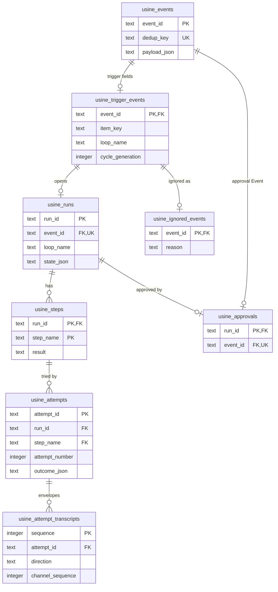
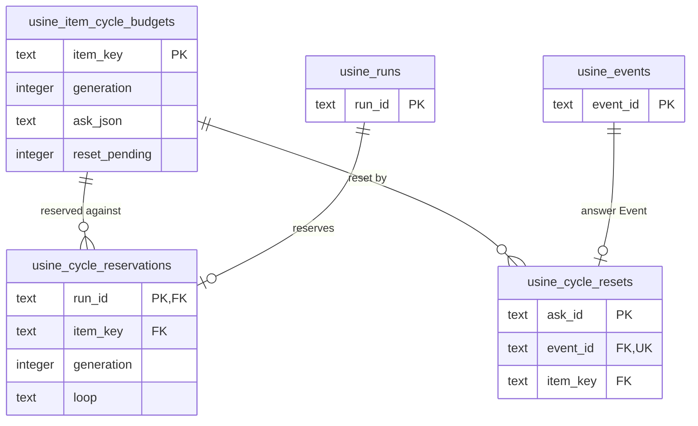

import { FileTree } from "@astrojs/starlight/components";

:::note
This page describes commit [`7c0c3d3`](https://github.com/basaltbytes/usine/tree/7c0c3d3696123d11e3d5b9cc3d27e18bb21e84e9) of basaltbytes/usine as it was on 2026-10-16. Code links point at that commit.
:::

The instance folder contains the whole factory: authored files at its top, and runtime state in `.usine/`. `usine up` uses its working directory as the instance folder ([up.ts:107](https://github.com/basaltbytes/usine/blob/7c0c3d3696123d11e3d5b9cc3d27e18bb21e84e9/apps/server/src/up.ts#L107)).

## Files on disk

This is an instance folder with the default `local` Worker, using two file names from the dogfood instance as examples:

<FileTree>

- usine.yaml registry, labels, settings, Workers, webhooks mode, operator login
- loops/ one Loop per file
  - start-dev.md
- agents/ one Agent per file
  - developer.md
- .usine/
  - runtime.sqlite Events, Runs, Attempts, transcripts, projections, cursors
  - durable.sqlite each Attempt's parent task, conversations, documents
  - instance.lock prevents a second usine up
  - instance.pid the pid of the process that holds the lock
  - github-app.json app_id and private_key, mode 0600
  - workers/
    - local/
      - repos/ bare caches, one per repository
      - attempts/ one worktree per Attempt
      - turbo/ Turbo cache

</FileTree>

| Path                                                                     | Contents                                                                                                        | Written by                                                                                                                                                                                                                                                                            |
| ------------------------------------------------------------------------ | --------------------------------------------------------------------------------------------------------------- | ------------------------------------------------------------------------------------------------------------------------------------------------------------------------------------------------------------------------------------------------------------------------------------- |
| `usine.yaml`                                                             | Registry, labels, settings, Workers, webhooks mode, operator login                                              | the operator                                                                                                                                                                                                                                                                          |
| `loops/<name>.md`                                                        | One Loop per file                                                                                               | the operator                                                                                                                                                                                                                                                                          |
| `agents/<name>.md`                                                       | One Agent per file                                                                                              | the operator                                                                                                                                                                                                                                                                          |
| `.usine/runtime.sqlite`                                                  | The runtime store: Events, Runs, Attempts, transcripts, projections, cursors                                    | [local-sqlite.ts:31](https://github.com/basaltbytes/usine/blob/7c0c3d3696123d11e3d5b9cc3d27e18bb21e84e9/packages/engine/src/database/local-sqlite.ts#L31)                                                                                                                             |
| `.usine/durable.sqlite`                                                  | pi-durable storage: each Attempt's parent task, conversations, documents                                        | [storage-path.ts:5](https://github.com/basaltbytes/usine/blob/7c0c3d3696123d11e3d5b9cc3d27e18bb21e84e9/packages/durable/src/storage-path.ts#L5)                                                                                                                                       |
| `.usine/instance.lock`, `.usine/instance.pid`                            | An exclusive SQLite transaction that prevents a second `usine up`, and the pid of the process that has the lock | [instance-lock.ts:44](https://github.com/basaltbytes/usine/blob/7c0c3d3696123d11e3d5b9cc3d27e18bb21e84e9/apps/server/src/instance-lock.ts#L44)                                                                                                                                        |
| `.usine/github-app.json`                                                 | `app_id` and `private_key`; must be a regular file with mode 0600                                               | the operator; read by [local-secrets.ts:42](https://github.com/basaltbytes/usine/blob/7c0c3d3696123d11e3d5b9cc3d27e18bb21e84e9/packages/github/src/local-secrets.ts#L42)                                                                                                              |
| `.usine/workers/<worker>/repos`, `attempts`, `turbo`                     | Local Worker caches, worktrees, Turbo cache                                                                     | [local.ts:103](https://github.com/basaltbytes/usine/blob/7c0c3d3696123d11e3d5b9cc3d27e18bb21e84e9/packages/executor/src/local/local.ts#L103)                                                                                                                                          |
| OS temp `usine-credentials-*`                                            | One local Attempt's token and gh configuration, removed with the Attempt                                        | [credentials.ts:22](https://github.com/basaltbytes/usine/blob/7c0c3d3696123d11e3d5b9cc3d27e18bb21e84e9/packages/executor/src/local/credentials.ts#L22)                                                                                                                                |
| `<root>/workers/<worker>/repos`, `attempts` on an SSH Worker             | Caches and worktrees                                                                                            | [ssh.ts:53](https://github.com/basaltbytes/usine/blob/7c0c3d3696123d11e3d5b9cc3d27e18bb21e84e9/packages/executor/src/ssh/ssh.ts#L53), [remote.ts:242](https://github.com/basaltbytes/usine/blob/7c0c3d3696123d11e3d5b9cc3d27e18bb21e84e9/packages/executor/src/remote/remote.ts#L242) |
| `<root>/workers/<worker>/credentials` on an SSH Worker without a Gateway | One token directory per Attempt                                                                                 | [credentials.ts:39](https://github.com/basaltbytes/usine/blob/7c0c3d3696123d11e3d5b9cc3d27e18bb21e84e9/packages/executor/src/ssh/credentials.ts#L39)                                                                                                                                  |
| `<root>/workers/<worker>/gh` on an SSH Worker behind a Gateway           | gh configuration without a token                                                                                | [attachments.ts:44](https://github.com/basaltbytes/usine/blob/7c0c3d3696123d11e3d5b9cc3d27e18bb21e84e9/packages/executor/src/ssh/gateway/attachments.ts#L44)                                                                                                                          |

A repository's cache directory is `repos/<owner>_<name>.git`, and a worktree directory is the Attempt id with every character other than letters, digits, `_`, `.`, and `-` replaced by `_`.

The environment variables `USINE_GITHUB_APP_ID` and `USINE_GITHUB_PRIVATE_KEY` take precedence over the secrets file field by field, and usine doesn't read the file when both are set ([local-secrets.ts:69](https://github.com/basaltbytes/usine/blob/7c0c3d3696123d11e3d5b9cc3d27e18bb21e84e9/packages/github/src/local-secrets.ts#L69)). `usine up` refuses an instance folder under `/tmp`, `/private/tmp`, `/var/folders`, `$TMPDIR`, or the OS temporary directory ([cli.ts:214](https://github.com/basaltbytes/usine/blob/7c0c3d3696123d11e3d5b9cc3d27e18bb21e84e9/apps/server/src/cli.ts#L214), [up.ts:83](https://github.com/basaltbytes/usine/blob/7c0c3d3696123d11e3d5b9cc3d27e18bb21e84e9/apps/server/src/up.ts#L83)) unless `--allow-volatile-instance` is given ([cli.ts:132](https://github.com/basaltbytes/usine/blob/7c0c3d3696123d11e3d5b9cc3d27e18bb21e84e9/apps/server/src/cli.ts#L132)) or `USINE_ALLOW_VOLATILE_INSTANCE=1` is set.

## The runtime store

The engine uses Drizzle ORM 1.0.0-rc.4 over `@effect/sql-sqlite-node` ([ADR 0020](https://github.com/basaltbytes/usine/blob/main/docs/adr/0020-drizzle-portable-sqlite-projection.md)). The schema is [schema.ts](https://github.com/basaltbytes/usine/blob/7c0c3d3696123d11e3d5b9cc3d27e18bb21e84e9/packages/engine/src/database/schema.ts). Sixteen migrations are in [`packages/engine/drizzle/`](https://github.com/basaltbytes/usine/tree/7c0c3d3696123d11e3d5b9cc3d27e18bb21e84e9/packages/engine/drizzle) and run at startup, recorded in the table `usine_migrations`, with foreign keys turned off while they run ([local-sqlite.ts:55](https://github.com/basaltbytes/usine/blob/7c0c3d3696123d11e3d5b9cc3d27e18bb21e84e9/packages/engine/src/database/local-sqlite.ts#L55)). Every JSON column except `usine_attempts.salvage_json` has a `json_valid` check, and Effect Schema decodes rows at the boundary ([codec.ts](https://github.com/basaltbytes/usine/blob/7c0c3d3696123d11e3d5b9cc3d27e18bb21e84e9/packages/engine/src/store/codec.ts) for Events, Runs, Attempts, and transcript rows; the cursor, projection, and cycle budget modules decode their own). No code deletes a row ([ADR 0010](https://github.com/basaltbytes/usine/blob/main/docs/adr/0010-single-sqlite-runtime-store.md)): usine keeps Events, Runs, Attempts, and transcript rows, and updates states, outcomes, projections, and cursors in place.

The first diagram shows the tables of Events, Runs, and Attempts with their foreign keys; the second shows the cycle budget tables. Both list the key columns only.





`usine_attempts.run_id` and `step_name` form one foreign key to `usine_steps`; there is no direct foreign key from an Attempt to its Run. `usine_runs.resolved_failure_attempt_id` references an Attempt without a foreign key. The cursor, projection, Loop runtime, and projection revision tables have no foreign keys.

| Table                                | One row is                                                                                                                                                                                                          | Line                                                                                                                                            |
| ------------------------------------ | ------------------------------------------------------------------------------------------------------------------------------------------------------------------------------------------------------------------- | ----------------------------------------------------------------------------------------------------------------------------------------------- |
| `usine_events`                       | an Event: id, unique dedup key, payload JSON, receipt time                                                                                                                                                          | [schema.ts:26](https://github.com/basaltbytes/usine/blob/7c0c3d3696123d11e3d5b9cc3d27e18bb21e84e9/packages/engine/src/database/schema.ts#L26)   |
| `usine_trigger_events`               | the trigger fields of an Event: Item key, Loop, Step, approval, cycle limit and generation, repository, revision, rendered task, Agent JSON, parent model                                                           | [schema.ts:37](https://github.com/basaltbytes/usine/blob/7c0c3d3696123d11e3d5b9cc3d27e18bb21e84e9/packages/engine/src/database/schema.ts#L37)   |
| `usine_item_cycle_budgets`           | an Item's budget generation, its open Ask as JSON, and whether a reset waits for a new poll                                                                                                                         | [schema.ts:72](https://github.com/basaltbytes/usine/blob/7c0c3d3696123d11e3d5b9cc3d27e18bb21e84e9/packages/engine/src/database/schema.ts#L72)   |
| `usine_cycle_reservations`           | a Run's reservation against an Item's cycle budget, for one Loop and generation                                                                                                                                     | [schema.ts:90](https://github.com/basaltbytes/usine/blob/7c0c3d3696123d11e3d5b9cc3d27e18bb21e84e9/packages/engine/src/database/schema.ts#L90)   |
| `usine_cycle_resets`                 | an operator's reset answer, one per Ask                                                                                                                                                                             | [schema.ts:110](https://github.com/basaltbytes/usine/blob/7c0c3d3696123d11e3d5b9cc3d27e18bb21e84e9/packages/engine/src/database/schema.ts#L110) |
| `usine_runs`                         | a Run: state JSON, resolved failure, open time, and the effective context that edit-and-retry amends                                                                                                                | [schema.ts:123](https://github.com/basaltbytes/usine/blob/7c0c3d3696123d11e3d5b9cc3d27e18bb21e84e9/packages/engine/src/database/schema.ts#L123) |
| `usine_steps`                        | the Step of a Run and its result JSON                                                                                                                                                                               | [schema.ts:150](https://github.com/basaltbytes/usine/blob/7c0c3d3696123d11e3d5b9cc3d27e18bb21e84e9/packages/engine/src/database/schema.ts#L150) |
| `usine_attempts`                     | an Attempt: Worker, number, brain, task, Agent, parent model, intervention flag, outcome JSON, salvage JSON. A partial unique index allows one Attempt without outcome per Run                                      | [schema.ts:169](https://github.com/basaltbytes/usine/blob/7c0c3d3696123d11e3d5b9cc3d27e18bb21e84e9/packages/engine/src/database/schema.ts#L169) |
| `usine_attempt_transcripts`          | one envelope, with direction and channel sequence, unique per Attempt, direction, and sequence                                                                                                                      | [schema.ts:204](https://github.com/basaltbytes/usine/blob/7c0c3d3696123d11e3d5b9cc3d27e18bb21e84e9/packages/engine/src/database/schema.ts#L204) |
| `usine_approvals`                    | the approval Event of a Run                                                                                                                                                                                         | [schema.ts:233](https://github.com/basaltbytes/usine/blob/7c0c3d3696123d11e3d5b9cc3d27e18bb21e84e9/packages/engine/src/database/schema.ts#L233) |
| `usine_ignored_events`               | an Event that can no longer open a Run: `superseded` or `revoked`                                                                                                                                                   | [schema.ts:245](https://github.com/basaltbytes/usine/blob/7c0c3d3696123d11e3d5b9cc3d27e18bb21e84e9/packages/engine/src/database/schema.ts#L245) |
| `usine_cursors`                      | a cursor value by key; today only `github-poll:<repository>` ([polling.ts:94](https://github.com/basaltbytes/usine/blob/7c0c3d3696123d11e3d5b9cc3d27e18bb21e84e9/packages/orchestrator/src/polling/polling.ts#L94)) | [schema.ts:260](https://github.com/basaltbytes/usine/blob/7c0c3d3696123d11e3d5b9cc3d27e18bb21e84e9/packages/engine/src/database/schema.ts#L260) |
| `usine_item_projections`             | the latest payload and content hash of each Item, for the Board                                                                                                                                                     | [schema.ts:270](https://github.com/basaltbytes/usine/blob/7c0c3d3696123d11e3d5b9cc3d27e18bb21e84e9/packages/engine/src/database/schema.ts#L270) |
| `usine_repository_label_projections` | the latest label catalog of each repository                                                                                                                                                                         | [schema.ts:289](https://github.com/basaltbytes/usine/blob/7c0c3d3696123d11e3d5b9cc3d27e18bb21e84e9/packages/engine/src/database/schema.ts#L289) |
| `usine_loop_runtime`                 | a Loop's paused flag                                                                                                                                                                                                | [schema.ts:304](https://github.com/basaltbytes/usine/blob/7c0c3d3696123d11e3d5b9cc3d27e18bb21e84e9/packages/engine/src/database/schema.ts#L304) |
| `usine_projection_revision`          | a single row whose revision invalidates cached operator projections                                                                                                                                                 | [schema.ts:310](https://github.com/basaltbytes/usine/blob/7c0c3d3696123d11e3d5b9cc3d27e18bb21e84e9/packages/engine/src/database/schema.ts#L310) |

The revision changes through SQL triggers that the migrations create and `schema.ts` doesn't declare: an insert, update, or delete on `usine_runs`, `usine_steps`, `usine_attempts`, `usine_loop_runtime`, `usine_item_projections`, `usine_repository_label_projections`, or `usine_item_cycle_budgets` increments it ([20260901073233_projection_revision](https://github.com/basaltbytes/usine/blob/7c0c3d3696123d11e3d5b9cc3d27e18bb21e84e9/packages/engine/drizzle/20260901073233_projection_revision/migration.sql) and four later migrations).

```ts title="packages/engine/src/database/schema.ts"
export const attempts = snakeCase.table(
  "usine_attempts",
  {
    attemptId: text().$type<AttemptId>().primaryKey(),
    runId: text().$type<RunId>().notNull(),
    stepName: text().$type<StepName>().notNull(),
    workerName: text().$type<WorkerName>().notNull(),
    attemptNumber: integer({ mode: "number" }).$type<AttemptNumber>().notNull(),
    brainJson: text({ mode: "json" }).$type<unknown>().notNull(),
    task: text().$type<AttemptTask>().notNull(),
    agent: text().$type<AgentName>().notNull(),
    operatorIntervened: integer({ mode: "boolean" }).notNull().default(false),
    parentModel: text().$type<ModelId>(),
    startedAt: text().notNull(),
    outcomeJson: text({ mode: "json" }).$type<unknown>(),
    salvageJson: text({ mode: "json" }).$type<unknown>(),
  },
  (table) => [
    check("usine_attempts_number", sql`${table.attemptNumber} >= 1`),
    check("usine_attempts_brain_json_valid", sql`json_valid(${table.brainJson})`),
    check(
      "usine_attempts_outcome_json_valid",
      sql`${table.outcomeJson} is null or json_valid(${table.outcomeJson})`,
    ),
    uniqueIndex("usine_attempt_number").on(table.runId, table.stepName, table.attemptNumber),
    uniqueIndex("usine_one_in_flight_attempt")
      .on(table.runId)
      .where(sql`${table.outcomeJson} is null`),
    foreignKey({
      columns: [table.runId, table.stepName],
      foreignColumns: [steps.runId, steps.stepName],
    }),
  ],
);
```

`usine_attempts` has no usage column. Token counts and rate-limit windows exist only as transcript envelopes. The drawer computes one meter per billing pool from the latest `PoolRateLimitsUpdated` envelopes (`poolMeters`, [cache.ts:58](https://github.com/basaltbytes/usine/blob/7c0c3d3696123d11e3d5b9cc3d27e18bb21e84e9/apps/web/src/run-transcript/cache.ts#L58)) and shows no token count.

`layerWithDatabase` ([engine.ts:268](https://github.com/basaltbytes/usine/blob/7c0c3d3696123d11e3d5b9cc3d27e18bb21e84e9/packages/engine/src/engine/engine.ts#L268)) assembles the services over these tables: `RunEngine`, `RunReader`, `CursorStore`, `CycleBudgets`, the two projection readers and writers, and `LoopControl`. `RunStore` is internal to the layer, and only `RunEngine` uses it. `observationLayer` ([local-sqlite.ts:91](https://github.com/basaltbytes/usine/blob/7c0c3d3696123d11e3d5b9cc3d27e18bb21e84e9/packages/engine/src/database/local-sqlite.ts#L91)) opens the same file without recovering Runs, for setup mode. `runReaderLayer` ([local-sqlite.ts:139](https://github.com/basaltbytes/usine/blob/7c0c3d3696123d11e3d5b9cc3d27e18bb21e84e9/packages/engine/src/database/local-sqlite.ts#L139)) opens it read-only for `usine export-run`.

`usine backup <path>` copies `durable.sqlite` first, then `runtime.sqlite`, each with SQLite's backup API and a hard link into place, so a copy never overwrites an existing file ([backup.ts:19](https://github.com/basaltbytes/usine/blob/7c0c3d3696123d11e3d5b9cc3d27e18bb21e84e9/apps/server/src/backup.ts#L19)). A path `backup.sqlite` gives `backup.durable.sqlite` next to it.

## The durable storage

pi-durable opens `.usine/durable.sqlite` through its own connection and controls its format ([live.ts:47](https://github.com/basaltbytes/usine/blob/7c0c3d3696123d11e3d5b9cc3d27e18bb21e84e9/packages/durable/src/live.ts#L47)). usine writes two documents there per Attempt ([documents.ts](https://github.com/basaltbytes/usine/blob/7c0c3d3696123d11e3d5b9cc3d27e18bb21e84e9/packages/durable/src/attempt/documents.ts)). `AttemptRecordDoc` has the task id, the parent model and conversation, the child spawn count, the first child blocker, the exceeded child budget, the next outbound and inbound sequences, the relay position and the parent's last relayed token count, whether the terminal envelope was relayed, the harvested result, and a storage failure that explains an aborted task. `HoldDoc` has whether the parent is paused, operator guidance waiting for it, and the held children. pi-durable defines the table layout inside the file, and this page doesn't document it.

## `usine.yaml`

`UsineConfig` ([factory.ts:209](https://github.com/basaltbytes/usine/blob/7c0c3d3696123d11e3d5b9cc3d27e18bb21e84e9/packages/config/src/factory.ts#L209)) decodes the file with `onExcessProperty: "error"` ([parser.ts:186](https://github.com/basaltbytes/usine/blob/7c0c3d3696123d11e3d5b9cc3d27e18bb21e84e9/packages/config/src/parser.ts#L186)). An invalid file stops `usine up` with a `FactoryConfigError`.

| Key                            | Contents                                                                                                                                        | Default                  |
| ------------------------------ | ----------------------------------------------------------------------------------------------------------------------------------------------- | ------------------------ |
| `version`                      | `1`                                                                                                                                             | required                 |
| `labels`                       | labels to create in every managed repository: `name`, optional `color`, `description`                                                           | `[]`                     |
| `repos`                        | `name` (`owner/name`), `tags`, `lanes` (`name`, `sources`: `{ label }` or `{ state: issue-open, issue-closed, pr-open, pr-closed, pr-merged }`) | required                 |
| `settings.poll_interval`       | seconds between poll cycles                                                                                                                     | 60                       |
| `settings.max_children`        | child sessions per Attempt, sequential spawns included                                                                                          | 4                        |
| `settings.max_attempt_minutes` | wall-clock ceiling, also the drain deadline                                                                                                     | none                     |
| `settings.max_attempt_tokens`  | token ceiling across parent and children                                                                                                        | none                     |
| `settings.parent_model`        | Pi parent model when the Agent has none                                                                                                         | none: Pi's default       |
| `settings.parent_effort`       | parent effort when the Agent has none                                                                                                           | the child brain's effort |
| `workers`                      | see [Workers and the Gateway](/architecture/workers-and-gateway/)                                                                               | one `local` Worker       |
| `webhooks.mode`                | `off`, `deliveries`, or `endpoint` with `public_url`                                                                                            | `off`                    |
| `operator`                     | the operator's GitHub login, used to attribute interventions                                                                                    | none: `local operator`   |

```ts title="packages/config/src/factory.ts"
/** Factory-wide polling, Attempt limits, and defaults for the coordinating parent. */
export class Settings extends Schema.Class<Settings>("@usine/config/Settings")({
  /** Seconds between routine GitHub polling cycles; defaults to 60. */
  pollInterval: PositiveInt.pipe(Schema.withDecodingDefaultKey(Effect.succeed(60))),
  /** Total child sessions allowed over one Attempt's lifetime, including sequential spawns; defaults to four. */
  maxChildren: ChildSessionBudget.pipe(Schema.withDecodingDefaultKey(Effect.succeed(4))),
  /** Wall-clock ceiling per Attempt in minutes. Absent by default: the runaway guard's timer is not armed. */
  maxAttemptMinutes: Schema.OptionFromOptionalKey(PositiveInt),
  /** Consumed-token ceiling per Attempt across the parent and every child. Absent by default: the token guard is not armed. */
  maxAttemptTokens: Schema.OptionFromOptionalKey(PositiveInt),
  /** Parent model used when the Agent has no override; an absent default leaves selection to Pi. */
  parentModel: Schema.OptionFromOptionalKey(ModelId),
  /** Default parent reasoning effort; if neither Agent nor factory supplies one, the child's effort applies. */
  parentEffort: Schema.OptionFromOptionalKey(Effort),
}) {}
```

usine parses the webhooks setting, but no code reads it ([#37](https://github.com/basaltbytes/usine/issues/37)). usine picks the parent model when the Event is submitted and stores it with the Event ([trigger-submission.ts:53](https://github.com/basaltbytes/usine/blob/7c0c3d3696123d11e3d5b9cc3d27e18bb21e84e9/packages/orchestrator/src/trigger-submission.ts#L53)), but picks the parent effort from the settings at each Attempt ([scheduler.ts:185](https://github.com/basaltbytes/usine/blob/7c0c3d3696123d11e3d5b9cc3d27e18bb21e84e9/packages/orchestrator/src/scheduler.ts#L185)).

## Loop files

`loops/<name>.md`, kebab-case. `parseLoopFile` ([parser.ts:215](https://github.com/basaltbytes/usine/blob/7c0c3d3696123d11e3d5b9cc3d27e18bb21e84e9/packages/config/src/parser.ts#L215)) splits the YAML frontmatter from the Markdown body ([frontmatter.ts:24](https://github.com/basaltbytes/usine/blob/7c0c3d3696123d11e3d5b9cc3d27e18bb21e84e9/packages/config/src/frontmatter.ts#L24)), parses YAML with unique keys and strict mode ([document.ts:18](https://github.com/basaltbytes/usine/blob/7c0c3d3696123d11e3d5b9cc3d27e18bb21e84e9/packages/config/src/yaml/document.ts#L18)), decodes the frontmatter, then type-checks `if:` as a boolean and each `{{ }}` interpolation as a scalar.

| Frontmatter key              | Values                                                       | Default                       |
| ---------------------------- | ------------------------------------------------------------ | ----------------------------- |
| `trigger.on`                 | `issue`, `pr`, `schedule`                                    | required                      |
| `trigger.if`                 | CEL boolean over `item` and `repo`                           | required, also for `schedule` |
| `trigger.cron`, `trigger.tz` | five-field cron and IANA zone, `schedule` only               | `tz: UTC`                     |
| `selector`                   | `repos` and/or `tags`; both must match when both are present | every repository              |
| `approval`                   | `none`, `required`                                           | `none`                        |
| `step`                       | Step name                                                    | `run`                         |
| `agent`                      | an Agent file name                                           | required                      |
| `max_cycles`                 | Runs per Item between resets                                 | 3                             |

`ExpressionEngine` ([expression-engine.ts:89](https://github.com/basaltbytes/usine/blob/7c0c3d3696123d11e3d5b9cc3d27e18bb21e84e9/packages/expression/src/expression-engine.ts#L89)) uses `@marcbachmann/cel-js` 8.0.0 as its CEL engine. The environment has two variables ([payload-slices.ts:173](https://github.com/basaltbytes/usine/blob/7c0c3d3696123d11e3d5b9cc3d27e18bb21e84e9/packages/config/src/payload-slices.ts#L173)): `repo` with `name`, `owner`, `url`, and `item`, typed as `IssuePayload`, `PullRequestPayload`, or `SchedulePayload`. The payload slices use GitHub's GraphQL names, with fixed connection sizes such as `labels(first: 50)`, `comments(last: 20)`, `reviews(last: 20)`, and `reviewThreads(first: 50)` ([queries.ts](https://github.com/basaltbytes/usine/blob/7c0c3d3696123d11e3d5b9cc3d27e18bb21e84e9/packages/github/src/polling/queries.ts)).

`InstanceFolder.load` ([instance-folder.ts:93](https://github.com/basaltbytes/usine/blob/7c0c3d3696123d11e3d5b9cc3d27e18bb21e84e9/packages/config/src/instance-folder.ts#L93)) quarantines a Loop that fails to parse or references an unknown Agent, repository, or tag, and loads the other Loops. It logs a warning for a label used in a lane or an `if:` that isn't declared in `labels` ([parser.ts:256](https://github.com/basaltbytes/usine/blob/7c0c3d3696123d11e3d5b9cc3d27e18bb21e84e9/packages/config/src/parser.ts#L256)).

## Agent files

`agents/<name>.md`, kebab-case. The frontmatter has `harness` (`claude`, `codex`, `pi`), `model`, `effort` (`off`, `minimal`, `low`, `medium`, `high`, `xhigh`, `max`), and optional `parent_model` and `parent_effort`. The body is the persona ([parser.ts:191](https://github.com/basaltbytes/usine/blob/7c0c3d3696123d11e3d5b9cc3d27e18bb21e84e9/packages/config/src/parser.ts#L191)). usine leaves an Agent file that fails to parse out of the roster, and quarantines every Loop that uses it.

## Key renaming at the boundary

Authored keys are snake_case and domain fields are camelCase. `Schema.encodeKeys` does the rename in `SettingsFromYaml` ([factory.ts:182](https://github.com/basaltbytes/usine/blob/7c0c3d3696123d11e3d5b9cc3d27e18bb21e84e9/packages/config/src/factory.ts#L182)), `WorkerFromYaml` ([factory.ts:193](https://github.com/basaltbytes/usine/blob/7c0c3d3696123d11e3d5b9cc3d27e18bb21e84e9/packages/config/src/factory.ts#L193)), the Worker `gateway` ([factory.ts:140](https://github.com/basaltbytes/usine/blob/7c0c3d3696123d11e3d5b9cc3d27e18bb21e84e9/packages/config/src/factory.ts#L140)), the `endpoint` webhooks mode ([factory.ts:174](https://github.com/basaltbytes/usine/blob/7c0c3d3696123d11e3d5b9cc3d27e18bb21e84e9/packages/config/src/factory.ts#L174)), the Loop frontmatter's `max_cycles` ([parser.ts:40](https://github.com/basaltbytes/usine/blob/7c0c3d3696123d11e3d5b9cc3d27e18bb21e84e9/packages/config/src/parser.ts#L40)), and `github-app.json` ([local-secrets.ts:37](https://github.com/basaltbytes/usine/blob/7c0c3d3696123d11e3d5b9cc3d27e18bb21e84e9/packages/github/src/local-secrets.ts#L37)). `AgentFrontmatter` is the exception: it declares `parent_model` and `parent_effort` as snake_case fields and copies them into `AgentFile` by hand ([parser.ts:44](https://github.com/basaltbytes/usine/blob/7c0c3d3696123d11e3d5b9cc3d27e18bb21e84e9/packages/config/src/parser.ts#L44), [parser.ts:203](https://github.com/basaltbytes/usine/blob/7c0c3d3696123d11e3d5b9cc3d27e18bb21e84e9/packages/config/src/parser.ts#L203)).

## When configuration is read

`usine up` loads the instance once at start ([up.ts:114](https://github.com/basaltbytes/usine/blob/7c0c3d3696123d11e3d5b9cc3d27e18bb21e84e9/apps/server/src/up.ts#L114)). usine doesn't watch the files, so an edit takes effect only after a restart. [writer.ts](https://github.com/basaltbytes/usine/blob/7c0c3d3696123d11e3d5b9cc3d27e18bb21e84e9/packages/config/src/yaml/writer.ts) has `updateYaml` and `updateFrontmatter`, which change one path and keep comments and key order; only tests call them, and the UI has no configuration editor ([#40](https://github.com/basaltbytes/usine/issues/40)).
