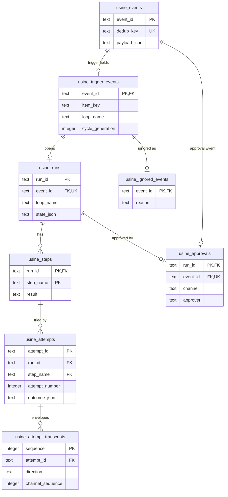
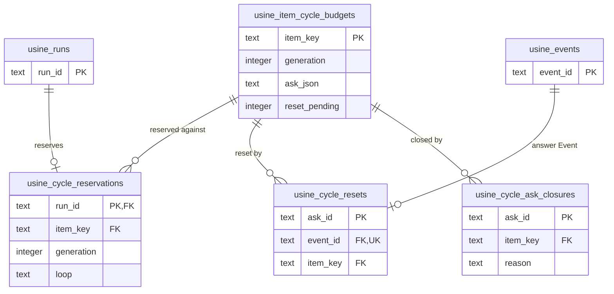

import { FileTree } from "@astrojs/starlight/components";

:::note
This page describes commit [`7c0c3d3`](https://github.com/basaltbytes/usine/tree/7c0c3d3696123d11e3d5b9cc3d27e18bb21e84e9) of basaltbytes/usine as it was on 2026-10-16, the later `usine_loop_items` ([#267](https://github.com/basaltbytes/usine/issues/267)), `usine_board_moves` ([#354](https://github.com/basaltbytes/usine/issues/354)), `usine_run_again_events` ([#152](https://github.com/basaltbytes/usine/issues/152)), and `usine_cycle_ask_closures` ([#476](https://github.com/basaltbytes/usine/issues/476)) tables, the later Drizzle versions ([#336](https://github.com/basaltbytes/usine/issues/336) and [#494](https://github.com/basaltbytes/usine/issues/494)), the later queued operator inputs and parent hold ([#159](https://github.com/basaltbytes/usine/issues/159)), the later run close time ([#426](https://github.com/basaltbytes/usine/issues/426)), the later rename of `held_by_run_id` and `held_event_id` to `suppressed_by_run_id` and `suppressed_event_id` ([#489](https://github.com/basaltbytes/usine/issues/489)), the later `.usine/instance.json` and `.usine/usine.log` ([#154](https://github.com/basaltbytes/usine/issues/154)), the later `.env` ([#547](https://github.com/basaltbytes/usine/issues/547)), and the later `.usine/instance-id` ([#589](https://github.com/basaltbytes/usine/issues/589)). Code links point at that commit.
Configuration storage and revision behavior on this page describe commit [`06a10bf`](https://github.com/basaltbytes/usine/tree/06a10bf04c2c7cb366ec6ad912ae7c0b0a5c268b) (2026-10-29). See [Storage and configuration](/architecture/storage-and-config/#configuration-store). Other sections retain the source versions cited above.
:::

`usine up` uses its working directory as the instance folder ([up.ts:107](https://github.com/basaltbytes/usine/blob/7c0c3d3696123d11e3d5b9cc3d27e18bb21e84e9/apps/server/src/up.ts#L107)): bootstrap and export files at the top, stored configuration and runtime state in `.usine/`. The instance repo is optional and contains files for import and export; configuration changes do not sync with git.

## Files on disk

An instance folder with bootstrap or exported files and the default `local` worker:

<FileTree>

- usine.yaml bootstrap or export format for registry, projects, labels, settings, and workers
- projects/ exported loops by project
  - widgets/
    - loops/
      - start-dev.md
- agents/ one agent per file
  - developer.md
- .env variables that the environment doesn't set, such as tokens
- .usine/
  - runtime.sqlite configuration, revisions, events, runs, attempts, transcripts, projections, cursors
  - durable.sqlite each attempt's parent task, conversations, documents
  - instance.lock prevents a second usine up
  - instance.pid the pid of the process that has the lock
  - instance.json the pid, port, version, start time, and command line of that process
  - instance-id the UUID that labels this instance's attempt containers
  - usine.log the output of a usine up that usine up --detach or usine restart started
  - github-app.json app_id and private_key, mode 0600
  - workers/
    - local/
      - repos/ bare caches, one per repository
      - attempts/ one worktree per attempt
      - turbo/ Turbo cache

</FileTree>

| Path                                                                     | Contents                                                                                                | Written by                                                                                                                                                                                                                                                                            |
| ------------------------------------------------------------------------ | ------------------------------------------------------------------------------------------------------- | ------------------------------------------------------------------------------------------------------------------------------------------------------------------------------------------------------------------------------------------------------------------------------------- |
| `usine.yaml`, `projects/<project>/loops/<name>.md`, `agents/<name>.md`   | bootstrap or exported configuration                                                                     | the operator                                                                                                                                                                                                                                                                          |
| `.env`                                                                   | `KEY=value` lines for the variables that the environment doesn't set, such as tokens                    | the operator; read by `instanceEnvironment` in `apps/server/src/instance/environment.ts` ([#547](https://github.com/basaltbytes/usine/issues/547))                                                                                                                                    |
| `.usine/runtime.sqlite`                                                  | runtime store                                                                                           | [local-sqlite.ts:31](https://github.com/basaltbytes/usine/blob/7c0c3d3696123d11e3d5b9cc3d27e18bb21e84e9/packages/engine/src/database/local-sqlite.ts#L31)                                                                                                                             |
| `.usine/durable.sqlite`                                                  | pi-durable storage                                                                                      | [storage-path.ts:5](https://github.com/basaltbytes/usine/blob/7c0c3d3696123d11e3d5b9cc3d27e18bb21e84e9/packages/durable/src/storage-path.ts#L5)                                                                                                                                       |
| `.usine/instance.lock`, `.usine/instance.pid`                            | an exclusive SQLite transaction that prevents a second `usine up`, and the pid of its process           | [instance-lock.ts:44](https://github.com/basaltbytes/usine/blob/7c0c3d3696123d11e3d5b9cc3d27e18bb21e84e9/apps/server/src/instance-lock.ts#L44)                                                                                                                                        |
| `.usine/instance.json`                                                   | the instance record: pid, port, version, start time, and command line, which `usine restart` runs again | `holdInstance` in `apps/server/src/instance/lock.ts` ([#154](https://github.com/basaltbytes/usine/issues/154))                                                                                                                                                                        |
| `.usine/instance-id`                                                     | the instance ID, a UUID that every `usine up` of the folder reuses, which labels its attempt containers | `instanceIdOf` in `apps/server/src/instance/id.ts` ([#589](https://github.com/basaltbytes/usine/issues/589))                                                                                                                                                                          |
| `.usine/usine.log`                                                       | the output of a background `usine up`, appended, with owner-only permissions                            | `startDetached` in `apps/server/src/detach.ts` ([#154](https://github.com/basaltbytes/usine/issues/154))                                                                                                                                                                              |
| `.usine/github-app.json`                                                 | `app_id` and `private_key`; must be a regular file with mode 0600                                       | the operator; read by [local-secrets.ts:42](https://github.com/basaltbytes/usine/blob/7c0c3d3696123d11e3d5b9cc3d27e18bb21e84e9/packages/github/src/local-secrets.ts#L42)                                                                                                              |
| `.usine/workers/<worker>/repos`, `attempts`, `turbo`                     | local worker caches, worktrees, Turbo cache                                                             | [local.ts:103](https://github.com/basaltbytes/usine/blob/7c0c3d3696123d11e3d5b9cc3d27e18bb21e84e9/packages/executor/src/local/local.ts#L103)                                                                                                                                          |
| OS temp `usine-credentials-*`                                            | one local attempt's token and gh configuration, removed with the attempt                                | [credentials.ts:22](https://github.com/basaltbytes/usine/blob/7c0c3d3696123d11e3d5b9cc3d27e18bb21e84e9/packages/executor/src/local/credentials.ts#L22)                                                                                                                                |
| `<root>/workers/<worker>/repos`, `attempts` on an SSH worker             | caches and worktrees                                                                                    | [ssh.ts:53](https://github.com/basaltbytes/usine/blob/7c0c3d3696123d11e3d5b9cc3d27e18bb21e84e9/packages/executor/src/ssh/ssh.ts#L53), [remote.ts:242](https://github.com/basaltbytes/usine/blob/7c0c3d3696123d11e3d5b9cc3d27e18bb21e84e9/packages/executor/src/remote/remote.ts#L242) |
| `<root>/workers/<worker>/credentials` on an SSH worker without a gateway | one token directory per attempt                                                                         | [credentials.ts:39](https://github.com/basaltbytes/usine/blob/7c0c3d3696123d11e3d5b9cc3d27e18bb21e84e9/packages/executor/src/ssh/credentials.ts#L39)                                                                                                                                  |
| `<root>/workers/<worker>/gh` on an SSH worker behind a gateway           | gh configuration without a token                                                                        | [attachments.ts:44](https://github.com/basaltbytes/usine/blob/7c0c3d3696123d11e3d5b9cc3d27e18bb21e84e9/packages/executor/src/ssh/gateway/attachments.ts#L44)                                                                                                                          |

[Checkout preparation](/architecture/execution/#checkout-preparation) gives the cache and worktree names.

`USINE_GITHUB_APP_ID` and `USINE_GITHUB_PRIVATE_KEY` override the secrets file field by field; with both set, usine doesn't read the file ([local-secrets.ts:69](https://github.com/basaltbytes/usine/blob/7c0c3d3696123d11e3d5b9cc3d27e18bb21e84e9/packages/github/src/local-secrets.ts#L69)). `usine up` refuses an instance folder under `/tmp`, `/private/tmp`, `/var/folders`, `$TMPDIR`, or the OS temporary directory ([cli.ts:214](https://github.com/basaltbytes/usine/blob/7c0c3d3696123d11e3d5b9cc3d27e18bb21e84e9/apps/server/src/cli.ts#L214), [up.ts:83](https://github.com/basaltbytes/usine/blob/7c0c3d3696123d11e3d5b9cc3d27e18bb21e84e9/apps/server/src/up.ts#L83)) unless you pass `--allow-volatile-instance` ([cli.ts:132](https://github.com/basaltbytes/usine/blob/7c0c3d3696123d11e3d5b9cc3d27e18bb21e84e9/apps/server/src/cli.ts#L132)) or set `USINE_ALLOW_VOLATILE_INSTANCE=1`.

## Runtime store

The engine uses Drizzle ORM 1.0.0-rc.5 over `@effect/sql-sqlite-node` ([ADR 0020](https://github.com/basaltbytes/usine/blob/main/docs/adr/0020-drizzle-portable-sqlite-projection.md)), with the schema in [schema.ts](https://github.com/basaltbytes/usine/blob/7c0c3d3696123d11e3d5b9cc3d27e18bb21e84e9/packages/engine/src/database/schema.ts). Sixteen migrations in [`packages/engine/drizzle/`](https://github.com/basaltbytes/usine/tree/7c0c3d3696123d11e3d5b9cc3d27e18bb21e84e9/packages/engine/drizzle) run at startup with foreign keys off, recorded in `usine_migrations` ([local-sqlite.ts:55](https://github.com/basaltbytes/usine/blob/7c0c3d3696123d11e3d5b9cc3d27e18bb21e84e9/packages/engine/src/database/local-sqlite.ts#L55)). Every JSON column except `usine_attempts.salvage_json` has a `json_valid` check. Effect Schema decodes rows at the boundary: [codec.ts](https://github.com/basaltbytes/usine/blob/7c0c3d3696123d11e3d5b9cc3d27e18bb21e84e9/packages/engine/src/store/codec.ts) for events, runs, attempts, and transcript rows, and the cursor, projection, and cycle budget modules for their own. No code deletes a row ([ADR 0010](https://github.com/basaltbytes/usine/blob/main/docs/adr/0010-single-sqlite-runtime-store.md)): states, outcomes, projections, and cursors are updated in place.

The diagrams show the event, run, and attempt tables, then the cycle budget tables, with key columns only.





`usine_attempts.run_id` and `step_name` form one foreign key to `usine_steps`; no direct foreign key links an attempt to its run. `usine_runs.resolved_failure_attempt_id` references an attempt without a foreign key. The cursor, projection, board move, loop runtime, and projection revision tables have no foreign keys.

| Table                                | One row is                                                                                                                                                                                                                                                                                                                                                                                            | Line                                                                                                                                            |
| ------------------------------------ | ----------------------------------------------------------------------------------------------------------------------------------------------------------------------------------------------------------------------------------------------------------------------------------------------------------------------------------------------------------------------------------------------------- | ----------------------------------------------------------------------------------------------------------------------------------------------- |
| `usine_events`                       | an event: id, unique dedup key, payload JSON, receipt time                                                                                                                                                                                                                                                                                                                                            | [schema.ts:26](https://github.com/basaltbytes/usine/blob/7c0c3d3696123d11e3d5b9cc3d27e18bb21e84e9/packages/engine/src/database/schema.ts#L26)   |
| `usine_trigger_events`               | an event's trigger fields: item key, loop, step, approval, cycle limit and generation, repository, revision, rendered task, agent JSON, parent model, and, for a reopening or run again, the event it opens again and its number                                                                                                                                                                      | [schema.ts:37](https://github.com/basaltbytes/usine/blob/7c0c3d3696123d11e3d5b9cc3d27e18bb21e84e9/packages/engine/src/database/schema.ts#L37)   |
| `usine_item_cycle_budgets`           | an item's budget generation, open ask as JSON, and whether a reset waits for a new poll                                                                                                                                                                                                                                                                                                               | [schema.ts:72](https://github.com/basaltbytes/usine/blob/7c0c3d3696123d11e3d5b9cc3d27e18bb21e84e9/packages/engine/src/database/schema.ts#L72)   |
| `usine_cycle_reservations`           | a run's reservation against an item's cycle budget, for one loop and generation                                                                                                                                                                                                                                                                                                                       | [schema.ts:90](https://github.com/basaltbytes/usine/blob/7c0c3d3696123d11e3d5b9cc3d27e18bb21e84e9/packages/engine/src/database/schema.ts#L90)   |
| `usine_cycle_resets`                 | an operator's reset answer, one per ask                                                                                                                                                                                                                                                                                                                                                               | [schema.ts:110](https://github.com/basaltbytes/usine/blob/7c0c3d3696123d11e3d5b9cc3d27e18bb21e84e9/packages/engine/src/database/schema.ts#L110) |
| `usine_cycle_ask_closures`           | an ask closed without a reset: the ask JSON, the reason (`ItemClosed` for a closed or merged item), and the close time                                                                                                                                                                                                                                                                                | `cycleAskClosures` in `schema.ts`                                                                                                               |
| `usine_runs`                         | a run: state JSON, resolved failure, open and close times, and the effective context that edit-and-retry changes                                                                                                                                                                                                                                                                                      | [schema.ts:123](https://github.com/basaltbytes/usine/blob/7c0c3d3696123d11e3d5b9cc3d27e18bb21e84e9/packages/engine/src/database/schema.ts#L123) |
| `usine_steps`                        | a run's step and its result JSON                                                                                                                                                                                                                                                                                                                                                                      | [schema.ts:150](https://github.com/basaltbytes/usine/blob/7c0c3d3696123d11e3d5b9cc3d27e18bb21e84e9/packages/engine/src/database/schema.ts#L150) |
| `usine_attempts`                     | an attempt: worker, number, brain, task, agent, parent model, intervention flag, outcome JSON and time, salvage JSON, and when the operator discarded its leftovers on an unconfigured worker. A partial unique index allows one attempt without outcome per run                                                                                                                                      | [schema.ts:169](https://github.com/basaltbytes/usine/blob/7c0c3d3696123d11e3d5b9cc3d27e18bb21e84e9/packages/engine/src/database/schema.ts#L169) |
| `usine_attempt_transcripts`          | one envelope with direction and channel sequence, unique per attempt, direction, and sequence                                                                                                                                                                                                                                                                                                         | [schema.ts:204](https://github.com/basaltbytes/usine/blob/7c0c3d3696123d11e3d5b9cc3d27e18bb21e84e9/packages/engine/src/database/schema.ts#L204) |
| `usine_approvals`                    | a run's approval event, its channel (`ui` or `github-ask`), and the approving operator login; older approvals have neither                                                                                                                                                                                                                                                                            | [schema.ts:233](https://github.com/basaltbytes/usine/blob/7c0c3d3696123d11e3d5b9cc3d27e18bb21e84e9/packages/engine/src/database/schema.ts#L233) |
| `usine_ignored_events`               | an event that can no longer open a run: `superseded` or `revoked`                                                                                                                                                                                                                                                                                                                                     | [schema.ts:245](https://github.com/basaltbytes/usine/blob/7c0c3d3696123d11e3d5b9cc3d27e18bb21e84e9/packages/engine/src/database/schema.ts#L245) |
| `usine_loop_items`                   | a loop's last sighting of an item: the event a trigger last submitted, or null after a non-matching sighting ([#267](https://github.com/basaltbytes/usine/issues/267)), and the run whose operator question or blocker suppresses the item for the loop, with the suppressed state ([#241](https://github.com/basaltbytes/usine/issues/241), [#341](https://github.com/basaltbytes/usine/issues/341)) | `loopItems` in `schema.ts`                                                                                                                      |
| `usine_cursors`                      | a cursor value by key, only `github-poll:<repository>` at this commit ([polling.ts:94](https://github.com/basaltbytes/usine/blob/7c0c3d3696123d11e3d5b9cc3d27e18bb21e84e9/packages/orchestrator/src/polling/polling.ts#L94))                                                                                                                                                                          | [schema.ts:260](https://github.com/basaltbytes/usine/blob/7c0c3d3696123d11e3d5b9cc3d27e18bb21e84e9/packages/engine/src/database/schema.ts#L260) |
| `usine_item_projections`             | each item's latest payload and content hash, for the board, and `gone_at` once GitHub no longer has the item ([#328](https://github.com/basaltbytes/usine/issues/328), [#363](https://github.com/basaltbytes/usine/issues/363))                                                                                                                                                                       | [schema.ts:270](https://github.com/basaltbytes/usine/blob/7c0c3d3696123d11e3d5b9cc3d27e18bb21e84e9/packages/engine/src/database/schema.ts#L270) |
| `usine_repository_label_projections` | each repository's latest label catalog                                                                                                                                                                                                                                                                                                                                                                | [schema.ts:289](https://github.com/basaltbytes/usine/blob/7c0c3d3696123d11e3d5b9cc3d27e18bb21e84e9/packages/engine/src/database/schema.ts#L289) |
| `usine_run_again_events`             | an operator's run again event: the run it ran again and the asking operator login, null while no operator is configured ([#152](https://github.com/basaltbytes/usine/issues/152))                                                                                                                                                                                                                     | `runAgainEvents` in `schema.ts`                                                                                                                 |
| `usine_board_moves`                  | an operator's board move, recorded before its label swap goes to GitHub: repository, item key, time, source and destination lanes, labels added and removed ([#354](https://github.com/basaltbytes/usine/issues/354))                                                                                                                                                                                 | `boardMoves` in `schema.ts`                                                                                                                     |
| `usine_loop_runtime`                 | a loop's paused flag                                                                                                                                                                                                                                                                                                                                                                                  | [schema.ts:304](https://github.com/basaltbytes/usine/blob/7c0c3d3696123d11e3d5b9cc3d27e18bb21e84e9/packages/engine/src/database/schema.ts#L304) |
| `usine_projection_revision`          | a single row whose revision invalidates cached operator projections                                                                                                                                                                                                                                                                                                                                   | [schema.ts:310](https://github.com/basaltbytes/usine/blob/7c0c3d3696123d11e3d5b9cc3d27e18bb21e84e9/packages/engine/src/database/schema.ts#L310) |

SQL triggers that the migrations create, and `schema.ts` doesn't declare, increment the revision on any insert, update, or delete in `usine_runs`, `usine_steps`, `usine_attempts`, `usine_loop_runtime`, `usine_item_projections`, `usine_repository_label_projections`, or `usine_item_cycle_budgets` ([20260901073233_projection_revision](https://github.com/basaltbytes/usine/blob/7c0c3d3696123d11e3d5b9cc3d27e18bb21e84e9/packages/engine/drizzle/20260901073233_projection_revision/migration.sql) and four later migrations).

```ts title="packages/engine/src/database/schema.ts"
export const attempts = snakeCase.table(
  "usine_attempts",
  {
    attemptId: text().$type<AttemptId>().primaryKey(),
    runId: text().$type<RunId>().notNull(),
    stepName: text().$type<StepName>().notNull(),
    workerName: text().$type<WorkerName>().notNull(),
    attemptNumber: integer({ mode: "number" }).$type<AttemptNumber>().notNull(),
    brainJson: text({ mode: "json" }).$type<unknown>().notNull(),
    task: text().$type<AttemptTask>().notNull(),
    agent: text().$type<AgentName>().notNull(),
    operatorIntervened: integer({ mode: "boolean" }).notNull().default(false),
    parentModel: text().$type<ModelId>(),
    startedAt: text().notNull(),
    outcomeJson: text({ mode: "json" }).$type<unknown>(),
    salvageJson: text({ mode: "json" }).$type<unknown>(),
  },
  (table) => [
    check("usine_attempts_number", sql`${table.attemptNumber} >= 1`),
    check("usine_attempts_brain_json_valid", sql`json_valid(${table.brainJson})`),
    check(
      "usine_attempts_outcome_json_valid",
      sql`${table.outcomeJson} is null or json_valid(${table.outcomeJson})`,
    ),
    uniqueIndex("usine_attempt_number").on(table.runId, table.stepName, table.attemptNumber),
    uniqueIndex("usine_one_in_flight_attempt")
      .on(table.runId)
      .where(sql`${table.outcomeJson} is null`),
    foreignKey({
      columns: [table.runId, table.stepName],
      foreignColumns: [steps.runId, steps.stepName],
    }),
  ],
);
```

`usine_attempts` has no usage column; token counts and rate-limit windows exist only as transcript envelopes. The drawer computes one meter per billing pool from the latest `PoolRateLimitsUpdated` envelopes (`poolMeters`, [cache.ts:58](https://github.com/basaltbytes/usine/blob/7c0c3d3696123d11e3d5b9cc3d27e18bb21e84e9/apps/web/src/run-transcript/cache.ts#L58)) and shows no token count.

`layerWithDatabase` ([engine.ts:268](https://github.com/basaltbytes/usine/blob/7c0c3d3696123d11e3d5b9cc3d27e18bb21e84e9/packages/engine/src/engine/engine.ts#L268)) builds `RunEngine`, `RunReader`, `CursorStore`, `CycleBudgets`, the two projection readers and writers, and `LoopControl` over these tables; the internal `RunStore` serves only `RunEngine`. `observationLayer` ([local-sqlite.ts:91](https://github.com/basaltbytes/usine/blob/7c0c3d3696123d11e3d5b9cc3d27e18bb21e84e9/packages/engine/src/database/local-sqlite.ts#L91)) opens the file without recovering runs, for setup mode, and `runReaderLayer` ([local-sqlite.ts:139](https://github.com/basaltbytes/usine/blob/7c0c3d3696123d11e3d5b9cc3d27e18bb21e84e9/packages/engine/src/database/local-sqlite.ts#L139)) opens it read-only for `usine export-run`.

`usine backup <path>` copies `durable.sqlite`, then `runtime.sqlite`, each with SQLite's backup API and a hard link into place, so it never overwrites an existing file ([backup.ts:19](https://github.com/basaltbytes/usine/blob/7c0c3d3696123d11e3d5b9cc3d27e18bb21e84e9/apps/server/src/backup.ts#L19)). For `backup.sqlite`, the durable copy is `backup.durable.sqlite` beside it.

## Durable storage

pi-durable opens `.usine/durable.sqlite` through its own connection and defines its format and tables, which this page doesn't document ([live.ts:47](https://github.com/basaltbytes/usine/blob/7c0c3d3696123d11e3d5b9cc3d27e18bb21e84e9/packages/durable/src/live.ts#L47)). usine writes two documents per attempt there ([documents.ts](https://github.com/basaltbytes/usine/blob/7c0c3d3696123d11e3d5b9cc3d27e18bb21e84e9/packages/durable/src/attempt/documents.ts)):

- `AttemptRecordDoc`: the task id; the parent model and conversation; the child spawn count, first child blocker, and exceeded child budget; the next outbound and inbound sequences, the relay position, and the parent's last relayed token count; whether the terminal envelope was relayed; the harvested result; a storage failure that explains an aborted task; and the operator inputs queued for the busy parent whose delivery receipt isn't sent yet.
- `HoldDoc`: whether the parent is paused, the operator guidance waiting for it, and the held sessions, the parent included.

## Configuration store

[ADR 0031](https://github.com/basaltbytes/usine/blob/main/docs/adr/0031-authored-configuration-in-the-database.md) makes the runtime database the source of truth for configuration. The server supplies the same SQLite connection to the engine and configuration store. The configuration package owns these tables ([schema.ts](https://github.com/basaltbytes/usine/blob/06a10bf04c2c7cb366ec6ad912ae7c0b0a5c268b/packages/config/src/configuration/sqlite/schema.ts)):

| Table                            | Contents                                                                                                                                                                                                                            |
| -------------------------------- | ----------------------------------------------------------------------------------------------------------------------------------------------------------------------------------------------------------------------------------- |
| `usine_configuration_entities`   | One row per settings, worker, repository, project, label, loop, or agent entity: its key, position, and encoded value. Project values contain their repository membership and lanes. Worker order determines scheduling preference. |
| `usine_configuration_revisions`  | An ordered log of revisions, with the revision number and encoded actor, time, optional message, and changes. Each change records the entity's before and after values.                                                             |
| `usine_configuration_migrations` | The configuration package's SQL migration ledger, separate from the engine's `usine_migrations`.                                                                                                                                    |

[`sqliteConfigurationLayer`](https://github.com/basaltbytes/usine/blob/06a10bf04c2c7cb366ec6ad912ae7c0b0a5c268b/packages/config/src/configuration/sqlite/store.ts) validates a candidate before writing entity rows and its revision in one transaction. The expected revision number prevents concurrent writers from overwriting each other; a mismatch returns `StaleRevision`. Schema, CEL, and reference failures return `ConfigurationInvalid` without saving a revision. An unchanged CLI edit or import saves nothing.

The server's [configuration layer](https://github.com/basaltbytes/usine/blob/06a10bf04c2c7cb366ec6ad912ae7c0b0a5c268b/apps/server/src/configuration/runtime.ts) commits configuration and loop controls together. Loops created after initialization start paused; first-start import preserves pause state. A database backup includes configuration and history. Export includes current configuration only, so it cannot replace a database backup.

## First-start import

[`initializeConfiguration`](https://github.com/basaltbytes/usine/blob/06a10bf04c2c7cb366ec6ad912ae7c0b0a5c268b/apps/server/src/configuration/runtime.ts) reads the store before reading any configuration files. If the configuration tables are empty, it loads the bootstrap folder through `ConfigurationFolder`, then commits revision 1 with the message `Imported from the instance folder` and the bootstrap `operator` as actor, or no actor when unset. Any invalid file or reference rejects the complete import. Later starts ignore the original configuration files. `usine config` commands use the same initialization path.

Version 1 folders convert to version 2 projects during import. For a stored version 1 snapshot, startup commits a revision with the message `Migrated repositories and loops to projects`. Each repository becomes a project, and loops get `project/loop` identities. Configuration and runtime references migrate in the same SQL transaction before execution starts, preserving run and event IDs and pause state ([store.ts](https://github.com/basaltbytes/usine/blob/06a10bf04c2c7cb366ec6ad912ae7c0b0a5c268b/apps/server/src/configuration/store.ts)).

The configuration CLI uses the first stored member as the actor and requires the local admin-token file when members exist; otherwise it uses the stored `operator`. Secrets and bootstrap values remain outside these tables: `.env`, the GitHub App key, and listen options.

## Import and export files

[`usine config export`](/reference/configuration/config/#export) writes `usine.yaml`, `projects/<project>/loops/*.md`, and `agents/*.md`. [`usine config import`](/reference/configuration/config/#import) reads that complete folder, and `edit` uses the same syntax for one entity. The references document every [YAML field](/reference/configuration/usine-yaml/), [loop field](/reference/configuration/loop-files/), and [agent field](/reference/configuration/agent-files/).

`ConfigurationFolder` ([folder.ts](https://github.com/basaltbytes/usine/blob/06a10bf04c2c7cb366ec6ad912ae7c0b0a5c268b/packages/config/src/configuration/folder.ts)) rejects invalid imports as a whole. `InstanceFolder.load` remains a permissive inspection API that reports quarantined loops and invalid agents; the server does not use that quarantine behavior for configuration writes. Export rewrites complete files and does not preserve comments.

## Key renaming at the boundary

Authored YAML keys are snake_case; domain fields are camelCase. The parser uses `Schema.encodeKeys` for settings and worker fields, such as `poll_interval` to `pollInterval`. The import and export codecs preserve the authored names. Markdown documents use strict YAML frontmatter followed by a prompt or persona; loop conditions and prompt expressions pass CEL type checks before a revision is saved.

## Configuration loading and reload

`CurrentInstance` ([current-instance.ts](https://github.com/basaltbytes/usine/blob/06a10bf04c2c7cb366ec6ad912ae7c0b0a5c268b/packages/orchestrator/src/current-instance/current-instance.ts)) observes committed revisions. The SQLite store polls the durable revision log every 500 milliseconds while idle, including writes from another process. An accepted revision replaces the running snapshot and ends the poll's `poll_interval` wait. Polling, schedules, and attempt settings read that snapshot when they act; running attempts continue.

The CLI writes directly to the store. A saved revision that needs a restart or fails worker preflight remains stored, while the running snapshot stays unchanged. The API prepares changes against the running instance before committing, so it can refuse them without saving. See [Live changes and restart requirements](/reference/configuration/config/#live-changes-and-restart-requirements) for the exact fields and recovery steps.

`SIGHUP` explicitly rereads the database. It does not import edited files or reread `.env`. Configuration changes create revisions, not git commits.
