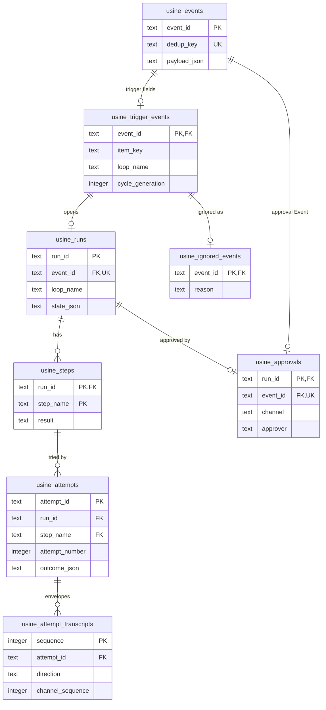
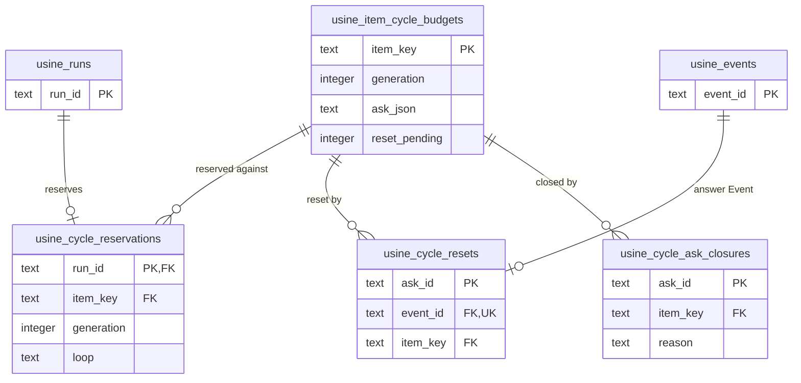

import { FileTree } from "@astrojs/starlight/components";

:::note
This page describes commit [`7c0c3d3`](https://github.com/basaltbytes/usine/tree/7c0c3d3696123d11e3d5b9cc3d27e18bb21e84e9) of basaltbytes/usine as it was on 2026-10-16, the later `usine_loop_items` ([#267](https://github.com/basaltbytes/usine/issues/267)), `usine_board_moves` ([#354](https://github.com/basaltbytes/usine/issues/354)), `usine_run_again_events` ([#152](https://github.com/basaltbytes/usine/issues/152)), and `usine_cycle_ask_closures` ([#476](https://github.com/basaltbytes/usine/issues/476)) tables, the later Drizzle version ([#336](https://github.com/basaltbytes/usine/issues/336)), the later queued operator inputs and parent hold ([#159](https://github.com/basaltbytes/usine/issues/159)), the later run close time ([#426](https://github.com/basaltbytes/usine/issues/426)), and the later rename of `held_by_run_id` and `held_event_id` to `suppressed_by_run_id` and `suppressed_event_id` ([#489](https://github.com/basaltbytes/usine/issues/489)). Code links point at that commit.
:::

`usine up` uses its working directory as the instance folder ([up.ts:107](https://github.com/basaltbytes/usine/blob/7c0c3d3696123d11e3d5b9cc3d27e18bb21e84e9/apps/server/src/up.ts#L107)): authored files at the top, runtime state in `.usine/`.

## Files on disk

An instance folder with the default `local` worker and two dogfood file names:

<FileTree>

- usine.yaml registry, labels, settings, workers, webhooks mode, operator login
- loops/ one loop per file
  - start-dev.md
- agents/ one agent per file
  - developer.md
- .usine/
  - runtime.sqlite events, runs, attempts, transcripts, projections, cursors
  - durable.sqlite each attempt's parent task, conversations, documents
  - instance.lock prevents a second usine up
  - instance.pid the pid of the process that has the lock
  - github-app.json app_id and private_key, mode 0600
  - workers/
    - local/
      - repos/ bare caches, one per repository
      - attempts/ one worktree per attempt
      - turbo/ Turbo cache

</FileTree>

| Path                                                                     | Contents                                                                                      | Written by                                                                                                                                                                                                                                                                            |
| ------------------------------------------------------------------------ | --------------------------------------------------------------------------------------------- | ------------------------------------------------------------------------------------------------------------------------------------------------------------------------------------------------------------------------------------------------------------------------------------- |
| `usine.yaml`, `loops/<name>.md`, `agents/<name>.md`                      | authored configuration                                                                        | the operator                                                                                                                                                                                                                                                                          |
| `.usine/runtime.sqlite`                                                  | runtime store                                                                                 | [local-sqlite.ts:31](https://github.com/basaltbytes/usine/blob/7c0c3d3696123d11e3d5b9cc3d27e18bb21e84e9/packages/engine/src/database/local-sqlite.ts#L31)                                                                                                                             |
| `.usine/durable.sqlite`                                                  | pi-durable storage                                                                            | [storage-path.ts:5](https://github.com/basaltbytes/usine/blob/7c0c3d3696123d11e3d5b9cc3d27e18bb21e84e9/packages/durable/src/storage-path.ts#L5)                                                                                                                                       |
| `.usine/instance.lock`, `.usine/instance.pid`                            | an exclusive SQLite transaction that prevents a second `usine up`, and the pid of its process | [instance-lock.ts:44](https://github.com/basaltbytes/usine/blob/7c0c3d3696123d11e3d5b9cc3d27e18bb21e84e9/apps/server/src/instance-lock.ts#L44)                                                                                                                                        |
| `.usine/github-app.json`                                                 | `app_id` and `private_key`; must be a regular file with mode 0600                             | the operator; read by [local-secrets.ts:42](https://github.com/basaltbytes/usine/blob/7c0c3d3696123d11e3d5b9cc3d27e18bb21e84e9/packages/github/src/local-secrets.ts#L42)                                                                                                              |
| `.usine/workers/<worker>/repos`, `attempts`, `turbo`                     | local worker caches, worktrees, Turbo cache                                                   | [local.ts:103](https://github.com/basaltbytes/usine/blob/7c0c3d3696123d11e3d5b9cc3d27e18bb21e84e9/packages/executor/src/local/local.ts#L103)                                                                                                                                          |
| OS temp `usine-credentials-*`                                            | one local attempt's token and gh configuration, removed with the attempt                      | [credentials.ts:22](https://github.com/basaltbytes/usine/blob/7c0c3d3696123d11e3d5b9cc3d27e18bb21e84e9/packages/executor/src/local/credentials.ts#L22)                                                                                                                                |
| `<root>/workers/<worker>/repos`, `attempts` on an SSH worker             | caches and worktrees                                                                          | [ssh.ts:53](https://github.com/basaltbytes/usine/blob/7c0c3d3696123d11e3d5b9cc3d27e18bb21e84e9/packages/executor/src/ssh/ssh.ts#L53), [remote.ts:242](https://github.com/basaltbytes/usine/blob/7c0c3d3696123d11e3d5b9cc3d27e18bb21e84e9/packages/executor/src/remote/remote.ts#L242) |
| `<root>/workers/<worker>/credentials` on an SSH worker without a gateway | one token directory per attempt                                                               | [credentials.ts:39](https://github.com/basaltbytes/usine/blob/7c0c3d3696123d11e3d5b9cc3d27e18bb21e84e9/packages/executor/src/ssh/credentials.ts#L39)                                                                                                                                  |
| `<root>/workers/<worker>/gh` on an SSH worker behind a gateway           | gh configuration without a token                                                              | [attachments.ts:44](https://github.com/basaltbytes/usine/blob/7c0c3d3696123d11e3d5b9cc3d27e18bb21e84e9/packages/executor/src/ssh/gateway/attachments.ts#L44)                                                                                                                          |

[Checkout preparation](/architecture/execution/#checkout-preparation) gives the cache and worktree names.

`USINE_GITHUB_APP_ID` and `USINE_GITHUB_PRIVATE_KEY` override the secrets file field by field; with both set, usine doesn't read the file ([local-secrets.ts:69](https://github.com/basaltbytes/usine/blob/7c0c3d3696123d11e3d5b9cc3d27e18bb21e84e9/packages/github/src/local-secrets.ts#L69)). `usine up` refuses an instance folder under `/tmp`, `/private/tmp`, `/var/folders`, `$TMPDIR`, or the OS temporary directory ([cli.ts:214](https://github.com/basaltbytes/usine/blob/7c0c3d3696123d11e3d5b9cc3d27e18bb21e84e9/apps/server/src/cli.ts#L214), [up.ts:83](https://github.com/basaltbytes/usine/blob/7c0c3d3696123d11e3d5b9cc3d27e18bb21e84e9/apps/server/src/up.ts#L83)) unless you pass `--allow-volatile-instance` ([cli.ts:132](https://github.com/basaltbytes/usine/blob/7c0c3d3696123d11e3d5b9cc3d27e18bb21e84e9/apps/server/src/cli.ts#L132)) or set `USINE_ALLOW_VOLATILE_INSTANCE=1`.

## Runtime store

The engine uses Drizzle ORM 1.0.0-rc.5-5935859 over `@effect/sql-sqlite-node` ([ADR 0020](https://github.com/basaltbytes/usine/blob/main/docs/adr/0020-drizzle-portable-sqlite-projection.md)), with the schema in [schema.ts](https://github.com/basaltbytes/usine/blob/7c0c3d3696123d11e3d5b9cc3d27e18bb21e84e9/packages/engine/src/database/schema.ts). Sixteen migrations in [`packages/engine/drizzle/`](https://github.com/basaltbytes/usine/tree/7c0c3d3696123d11e3d5b9cc3d27e18bb21e84e9/packages/engine/drizzle) run at startup with foreign keys off, recorded in `usine_migrations` ([local-sqlite.ts:55](https://github.com/basaltbytes/usine/blob/7c0c3d3696123d11e3d5b9cc3d27e18bb21e84e9/packages/engine/src/database/local-sqlite.ts#L55)). Every JSON column except `usine_attempts.salvage_json` has a `json_valid` check. Effect Schema decodes rows at the boundary: [codec.ts](https://github.com/basaltbytes/usine/blob/7c0c3d3696123d11e3d5b9cc3d27e18bb21e84e9/packages/engine/src/store/codec.ts) for events, runs, attempts, and transcript rows, and the cursor, projection, and cycle budget modules for their own. No code deletes a row ([ADR 0010](https://github.com/basaltbytes/usine/blob/main/docs/adr/0010-single-sqlite-runtime-store.md)): states, outcomes, projections, and cursors are updated in place.

The diagrams show the event, run, and attempt tables, then the cycle budget tables, with key columns only.





`usine_attempts.run_id` and `step_name` form one foreign key to `usine_steps`; no direct foreign key links an attempt to its run. `usine_runs.resolved_failure_attempt_id` references an attempt without a foreign key. The cursor, projection, board move, loop runtime, and projection revision tables have no foreign keys.

| Table                                | One row is                                                                                                                                                                                                                                                                                                                                                                                            | Line                                                                                                                                            |
| ------------------------------------ | ----------------------------------------------------------------------------------------------------------------------------------------------------------------------------------------------------------------------------------------------------------------------------------------------------------------------------------------------------------------------------------------------------- | ----------------------------------------------------------------------------------------------------------------------------------------------- |
| `usine_events`                       | an event: id, unique dedup key, payload JSON, receipt time                                                                                                                                                                                                                                                                                                                                            | [schema.ts:26](https://github.com/basaltbytes/usine/blob/7c0c3d3696123d11e3d5b9cc3d27e18bb21e84e9/packages/engine/src/database/schema.ts#L26)   |
| `usine_trigger_events`               | an event's trigger fields: item key, loop, step, approval, cycle limit and generation, repository, revision, rendered task, agent JSON, parent model, and, for a reopening or run again, the event it opens again and its number                                                                                                                                                                      | [schema.ts:37](https://github.com/basaltbytes/usine/blob/7c0c3d3696123d11e3d5b9cc3d27e18bb21e84e9/packages/engine/src/database/schema.ts#L37)   |
| `usine_item_cycle_budgets`           | an item's budget generation, open ask as JSON, and whether a reset waits for a new poll                                                                                                                                                                                                                                                                                                               | [schema.ts:72](https://github.com/basaltbytes/usine/blob/7c0c3d3696123d11e3d5b9cc3d27e18bb21e84e9/packages/engine/src/database/schema.ts#L72)   |
| `usine_cycle_reservations`           | a run's reservation against an item's cycle budget, for one loop and generation                                                                                                                                                                                                                                                                                                                       | [schema.ts:90](https://github.com/basaltbytes/usine/blob/7c0c3d3696123d11e3d5b9cc3d27e18bb21e84e9/packages/engine/src/database/schema.ts#L90)   |
| `usine_cycle_resets`                 | an operator's reset answer, one per ask                                                                                                                                                                                                                                                                                                                                                               | [schema.ts:110](https://github.com/basaltbytes/usine/blob/7c0c3d3696123d11e3d5b9cc3d27e18bb21e84e9/packages/engine/src/database/schema.ts#L110) |
| `usine_cycle_ask_closures`           | an ask closed without a reset: the ask JSON, the reason (`ItemClosed` for a closed or merged item), and the close time                                                                                                                                                                                                                                                                                | `cycleAskClosures` in `schema.ts`                                                                                                               |
| `usine_runs`                         | a run: state JSON, resolved failure, open and close times, and the effective context that edit-and-retry changes                                                                                                                                                                                                                                                                                      | [schema.ts:123](https://github.com/basaltbytes/usine/blob/7c0c3d3696123d11e3d5b9cc3d27e18bb21e84e9/packages/engine/src/database/schema.ts#L123) |
| `usine_steps`                        | a run's step and its result JSON                                                                                                                                                                                                                                                                                                                                                                      | [schema.ts:150](https://github.com/basaltbytes/usine/blob/7c0c3d3696123d11e3d5b9cc3d27e18bb21e84e9/packages/engine/src/database/schema.ts#L150) |
| `usine_attempts`                     | an attempt: worker, number, brain, task, agent, parent model, intervention flag, outcome JSON and time, salvage JSON, and when the operator discarded its leftovers on an unconfigured worker. A partial unique index allows one attempt without outcome per run                                                                                                                                      | [schema.ts:169](https://github.com/basaltbytes/usine/blob/7c0c3d3696123d11e3d5b9cc3d27e18bb21e84e9/packages/engine/src/database/schema.ts#L169) |
| `usine_attempt_transcripts`          | one envelope with direction and channel sequence, unique per attempt, direction, and sequence                                                                                                                                                                                                                                                                                                         | [schema.ts:204](https://github.com/basaltbytes/usine/blob/7c0c3d3696123d11e3d5b9cc3d27e18bb21e84e9/packages/engine/src/database/schema.ts#L204) |
| `usine_approvals`                    | a run's approval event, its channel (`ui` or `github-ask`), and the approving operator login; older approvals have neither                                                                                                                                                                                                                                                                            | [schema.ts:233](https://github.com/basaltbytes/usine/blob/7c0c3d3696123d11e3d5b9cc3d27e18bb21e84e9/packages/engine/src/database/schema.ts#L233) |
| `usine_ignored_events`               | an event that can no longer open a run: `superseded` or `revoked`                                                                                                                                                                                                                                                                                                                                     | [schema.ts:245](https://github.com/basaltbytes/usine/blob/7c0c3d3696123d11e3d5b9cc3d27e18bb21e84e9/packages/engine/src/database/schema.ts#L245) |
| `usine_loop_items`                   | a loop's last sighting of an item: the event a trigger last submitted, or null after a non-matching sighting ([#267](https://github.com/basaltbytes/usine/issues/267)), and the run whose operator question or blocker suppresses the item for the loop, with the suppressed state ([#241](https://github.com/basaltbytes/usine/issues/241), [#341](https://github.com/basaltbytes/usine/issues/341)) | `loopItems` in `schema.ts`                                                                                                                      |
| `usine_cursors`                      | a cursor value by key, only `github-poll:<repository>` at this commit ([polling.ts:94](https://github.com/basaltbytes/usine/blob/7c0c3d3696123d11e3d5b9cc3d27e18bb21e84e9/packages/orchestrator/src/polling/polling.ts#L94))                                                                                                                                                                          | [schema.ts:260](https://github.com/basaltbytes/usine/blob/7c0c3d3696123d11e3d5b9cc3d27e18bb21e84e9/packages/engine/src/database/schema.ts#L260) |
| `usine_item_projections`             | each item's latest payload and content hash, for the board, and `gone_at` once GitHub no longer has the item ([#328](https://github.com/basaltbytes/usine/issues/328), [#363](https://github.com/basaltbytes/usine/issues/363))                                                                                                                                                                       | [schema.ts:270](https://github.com/basaltbytes/usine/blob/7c0c3d3696123d11e3d5b9cc3d27e18bb21e84e9/packages/engine/src/database/schema.ts#L270) |
| `usine_repository_label_projections` | each repository's latest label catalog                                                                                                                                                                                                                                                                                                                                                                | [schema.ts:289](https://github.com/basaltbytes/usine/blob/7c0c3d3696123d11e3d5b9cc3d27e18bb21e84e9/packages/engine/src/database/schema.ts#L289) |
| `usine_run_again_events`             | an operator's run again event: the run it ran again and the asking operator login, null while `usine.yaml` sets no operator ([#152](https://github.com/basaltbytes/usine/issues/152))                                                                                                                                                                                                                 | `runAgainEvents` in `schema.ts`                                                                                                                 |
| `usine_board_moves`                  | an operator's board move, recorded before its label swap goes to GitHub: repository, item key, time, source and destination lanes, labels added and removed ([#354](https://github.com/basaltbytes/usine/issues/354))                                                                                                                                                                                 | `boardMoves` in `schema.ts`                                                                                                                     |
| `usine_loop_runtime`                 | a loop's paused flag                                                                                                                                                                                                                                                                                                                                                                                  | [schema.ts:304](https://github.com/basaltbytes/usine/blob/7c0c3d3696123d11e3d5b9cc3d27e18bb21e84e9/packages/engine/src/database/schema.ts#L304) |
| `usine_projection_revision`          | a single row whose revision invalidates cached operator projections                                                                                                                                                                                                                                                                                                                                   | [schema.ts:310](https://github.com/basaltbytes/usine/blob/7c0c3d3696123d11e3d5b9cc3d27e18bb21e84e9/packages/engine/src/database/schema.ts#L310) |

SQL triggers that the migrations create, and `schema.ts` doesn't declare, increment the revision on any insert, update, or delete in `usine_runs`, `usine_steps`, `usine_attempts`, `usine_loop_runtime`, `usine_item_projections`, `usine_repository_label_projections`, or `usine_item_cycle_budgets` ([20260901073233_projection_revision](https://github.com/basaltbytes/usine/blob/7c0c3d3696123d11e3d5b9cc3d27e18bb21e84e9/packages/engine/drizzle/20260901073233_projection_revision/migration.sql) and four later migrations).

```ts title="packages/engine/src/database/schema.ts"
export const attempts = snakeCase.table(
  "usine_attempts",
  {
    attemptId: text().$type<AttemptId>().primaryKey(),
    runId: text().$type<RunId>().notNull(),
    stepName: text().$type<StepName>().notNull(),
    workerName: text().$type<WorkerName>().notNull(),
    attemptNumber: integer({ mode: "number" }).$type<AttemptNumber>().notNull(),
    brainJson: text({ mode: "json" }).$type<unknown>().notNull(),
    task: text().$type<AttemptTask>().notNull(),
    agent: text().$type<AgentName>().notNull(),
    operatorIntervened: integer({ mode: "boolean" }).notNull().default(false),
    parentModel: text().$type<ModelId>(),
    startedAt: text().notNull(),
    outcomeJson: text({ mode: "json" }).$type<unknown>(),
    salvageJson: text({ mode: "json" }).$type<unknown>(),
  },
  (table) => [
    check("usine_attempts_number", sql`${table.attemptNumber} >= 1`),
    check("usine_attempts_brain_json_valid", sql`json_valid(${table.brainJson})`),
    check(
      "usine_attempts_outcome_json_valid",
      sql`${table.outcomeJson} is null or json_valid(${table.outcomeJson})`,
    ),
    uniqueIndex("usine_attempt_number").on(table.runId, table.stepName, table.attemptNumber),
    uniqueIndex("usine_one_in_flight_attempt")
      .on(table.runId)
      .where(sql`${table.outcomeJson} is null`),
    foreignKey({
      columns: [table.runId, table.stepName],
      foreignColumns: [steps.runId, steps.stepName],
    }),
  ],
);
```

`usine_attempts` has no usage column; token counts and rate-limit windows exist only as transcript envelopes. The drawer computes one meter per billing pool from the latest `PoolRateLimitsUpdated` envelopes (`poolMeters`, [cache.ts:58](https://github.com/basaltbytes/usine/blob/7c0c3d3696123d11e3d5b9cc3d27e18bb21e84e9/apps/web/src/run-transcript/cache.ts#L58)) and shows no token count.

`layerWithDatabase` ([engine.ts:268](https://github.com/basaltbytes/usine/blob/7c0c3d3696123d11e3d5b9cc3d27e18bb21e84e9/packages/engine/src/engine/engine.ts#L268)) builds `RunEngine`, `RunReader`, `CursorStore`, `CycleBudgets`, the two projection readers and writers, and `LoopControl` over these tables; the internal `RunStore` serves only `RunEngine`. `observationLayer` ([local-sqlite.ts:91](https://github.com/basaltbytes/usine/blob/7c0c3d3696123d11e3d5b9cc3d27e18bb21e84e9/packages/engine/src/database/local-sqlite.ts#L91)) opens the file without recovering runs, for setup mode, and `runReaderLayer` ([local-sqlite.ts:139](https://github.com/basaltbytes/usine/blob/7c0c3d3696123d11e3d5b9cc3d27e18bb21e84e9/packages/engine/src/database/local-sqlite.ts#L139)) opens it read-only for `usine export-run`.

`usine backup <path>` copies `durable.sqlite`, then `runtime.sqlite`, each with SQLite's backup API and a hard link into place, so it never overwrites an existing file ([backup.ts:19](https://github.com/basaltbytes/usine/blob/7c0c3d3696123d11e3d5b9cc3d27e18bb21e84e9/apps/server/src/backup.ts#L19)). For `backup.sqlite`, the durable copy is `backup.durable.sqlite` beside it.

## Durable storage

pi-durable opens `.usine/durable.sqlite` through its own connection and defines its format and tables, which this page doesn't document ([live.ts:47](https://github.com/basaltbytes/usine/blob/7c0c3d3696123d11e3d5b9cc3d27e18bb21e84e9/packages/durable/src/live.ts#L47)). usine writes two documents per attempt there ([documents.ts](https://github.com/basaltbytes/usine/blob/7c0c3d3696123d11e3d5b9cc3d27e18bb21e84e9/packages/durable/src/attempt/documents.ts)):

- `AttemptRecordDoc`: the task id; the parent model and conversation; the child spawn count, first child blocker, and exceeded child budget; the next outbound and inbound sequences, the relay position, and the parent's last relayed token count; whether the terminal envelope was relayed; the harvested result; a storage failure that explains an aborted task; and the operator inputs queued for the busy parent whose delivery receipt isn't sent yet.
- `HoldDoc`: whether the parent is paused, the operator guidance waiting for it, and the held sessions, the parent included.

## `usine.yaml`

[`usine.yaml`](/reference/configuration/usine-yaml/) lists every key and default. `UsineConfig` ([factory.ts:209](https://github.com/basaltbytes/usine/blob/7c0c3d3696123d11e3d5b9cc3d27e18bb21e84e9/packages/config/src/factory.ts#L209)) decodes the file with `onExcessProperty: "error"` ([parser.ts:186](https://github.com/basaltbytes/usine/blob/7c0c3d3696123d11e3d5b9cc3d27e18bb21e84e9/packages/config/src/parser.ts#L186)); an invalid file stops `usine up` with a `FactoryConfigError`.

```ts title="packages/config/src/factory.ts"
/** Factory-wide polling, Attempt limits, and defaults for the coordinating parent. */
export class Settings extends Schema.Class<Settings>("@usine/config/Settings")({
  /** Seconds between routine GitHub polling cycles; defaults to 60. */
  pollInterval: PositiveInt.pipe(Schema.withDecodingDefaultKey(Effect.succeed(60))),
  /** Total child sessions allowed over one Attempt's lifetime, including sequential spawns; defaults to four. */
  maxChildren: ChildSessionBudget.pipe(Schema.withDecodingDefaultKey(Effect.succeed(4))),
  /** Wall-clock limit per Attempt in minutes. Absent by default, so the runaway guard sets no time limit. */
  maxAttemptMinutes: Schema.OptionFromOptionalKey(PositiveInt),
  /** Token limit per Attempt, counting the parent and every child. Absent by default, so the runaway guard sets no token limit. */
  maxAttemptTokens: Schema.OptionFromOptionalKey(PositiveInt),
  /** Parent model used when the Agent has no override; when both are absent, Pi selects the model. */
  parentModel: Schema.OptionFromOptionalKey(ModelId),
  /** Default parent reasoning effort; if neither Agent nor factory supplies one, the child's effort applies. */
  parentEffort: Schema.OptionFromOptionalKey(Effort),
}) {}
```

No code reads the webhooks setting ([#37](https://github.com/basaltbytes/usine/issues/37)). The parent model is picked at event submission and stored with the event ([trigger-submission.ts:53](https://github.com/basaltbytes/usine/blob/7c0c3d3696123d11e3d5b9cc3d27e18bb21e84e9/packages/orchestrator/src/trigger-submission.ts#L53)); the parent effort is read from the settings at each attempt ([scheduler.ts:185](https://github.com/basaltbytes/usine/blob/7c0c3d3696123d11e3d5b9cc3d27e18bb21e84e9/packages/orchestrator/src/scheduler.ts#L185)).

## Loop files and agent files

[Loop files](/reference/configuration/loop-files/) and [agent files](/reference/configuration/agent-files/) list the frontmatter fields. `parseLoopFile` ([parser.ts:215](https://github.com/basaltbytes/usine/blob/7c0c3d3696123d11e3d5b9cc3d27e18bb21e84e9/packages/config/src/parser.ts#L215)) splits the YAML frontmatter from the Markdown body ([frontmatter.ts:24](https://github.com/basaltbytes/usine/blob/7c0c3d3696123d11e3d5b9cc3d27e18bb21e84e9/packages/config/src/frontmatter.ts#L24)), parses the YAML with unique keys in strict mode ([document.ts:18](https://github.com/basaltbytes/usine/blob/7c0c3d3696123d11e3d5b9cc3d27e18bb21e84e9/packages/config/src/yaml/document.ts#L18)), decodes the frontmatter, and type-checks `if:` as a boolean and each `{{ }}` interpolation as a scalar. Agent files are parsed by [parser.ts:191](https://github.com/basaltbytes/usine/blob/7c0c3d3696123d11e3d5b9cc3d27e18bb21e84e9/packages/config/src/parser.ts#L191).

`ExpressionEngine` ([expression-engine.ts:89](https://github.com/basaltbytes/usine/blob/7c0c3d3696123d11e3d5b9cc3d27e18bb21e84e9/packages/expression/src/expression-engine.ts#L89)) runs CEL with `@marcbachmann/cel-js` 8.0.0 over two variables ([payload-slices.ts:173](https://github.com/basaltbytes/usine/blob/7c0c3d3696123d11e3d5b9cc3d27e18bb21e84e9/packages/config/src/payload-slices.ts#L173)): `repo`, with `name`, `owner`, and `url`, and `item`, an `IssuePayload`, `PullRequestPayload`, or `SchedulePayload`. Payload slices use GitHub's GraphQL names with fixed connection sizes, such as `labels(first: 50)`, `comments(last: 20)`, `reviews(last: 20)`, and `reviewThreads(first: 50)` ([queries.ts](https://github.com/basaltbytes/usine/blob/7c0c3d3696123d11e3d5b9cc3d27e18bb21e84e9/packages/github/src/polling/queries.ts)).

`InstanceFolder.load` ([instance-folder.ts:93](https://github.com/basaltbytes/usine/blob/7c0c3d3696123d11e3d5b9cc3d27e18bb21e84e9/packages/config/src/instance-folder.ts#L93)) quarantines a loop that fails to parse or references an unknown agent, repository, or tag, and loads the rest. It warns for each lane or `if:` label that `labels` doesn't declare ([parser.ts:256](https://github.com/basaltbytes/usine/blob/7c0c3d3696123d11e3d5b9cc3d27e18bb21e84e9/packages/config/src/parser.ts#L256)).

An agent file that fails to parse is left out of the roster, and every loop that uses it is quarantined.

## Key renaming at the boundary

Authored keys are snake_case and domain fields camelCase. `Schema.encodeKeys` renames them in `SettingsFromYaml` ([factory.ts:182](https://github.com/basaltbytes/usine/blob/7c0c3d3696123d11e3d5b9cc3d27e18bb21e84e9/packages/config/src/factory.ts#L182)), `WorkerFromYaml` ([factory.ts:193](https://github.com/basaltbytes/usine/blob/7c0c3d3696123d11e3d5b9cc3d27e18bb21e84e9/packages/config/src/factory.ts#L193)), the worker `gateway` ([factory.ts:140](https://github.com/basaltbytes/usine/blob/7c0c3d3696123d11e3d5b9cc3d27e18bb21e84e9/packages/config/src/factory.ts#L140)), the `endpoint` webhooks mode ([factory.ts:174](https://github.com/basaltbytes/usine/blob/7c0c3d3696123d11e3d5b9cc3d27e18bb21e84e9/packages/config/src/factory.ts#L174)), loop `max_cycles` ([parser.ts:40](https://github.com/basaltbytes/usine/blob/7c0c3d3696123d11e3d5b9cc3d27e18bb21e84e9/packages/config/src/parser.ts#L40)), and `github-app.json` ([local-secrets.ts:37](https://github.com/basaltbytes/usine/blob/7c0c3d3696123d11e3d5b9cc3d27e18bb21e84e9/packages/github/src/local-secrets.ts#L37)). The exception is `AgentFrontmatter`, which declares `parent_model` and `parent_effort` as snake_case fields and copies them into `AgentFile` by hand ([parser.ts:44](https://github.com/basaltbytes/usine/blob/7c0c3d3696123d11e3d5b9cc3d27e18bb21e84e9/packages/config/src/parser.ts#L44), [parser.ts:203](https://github.com/basaltbytes/usine/blob/7c0c3d3696123d11e3d5b9cc3d27e18bb21e84e9/packages/config/src/parser.ts#L203)).

## Configuration loading and reload

`usine up` loads the instance at start ([up.ts:114](https://github.com/basaltbytes/usine/blob/7c0c3d3696123d11e3d5b9cc3d27e18bb21e84e9/apps/server/src/up.ts#L114)) and doesn't watch the files. [`usine up`](/reference/configuration/cli/) in the CLI reference lists the reload triggers, what a reload applies, and when it's refused. `CurrentInstance.reload` ([current-instance.ts](https://github.com/basaltbytes/usine/blob/main/packages/orchestrator/src/current-instance/current-instance.ts)) reloads with the same quarantine, and an accepted reload ends the poll's `poll_interval` wait. The scheduler ([scheduler.ts](https://github.com/basaltbytes/usine/blob/main/packages/orchestrator/src/scheduler.ts)) applies worker changes once the snapshot is replaced, without touching running attempts.

[writer.ts](https://github.com/basaltbytes/usine/blob/7c0c3d3696123d11e3d5b9cc3d27e18bb21e84e9/packages/config/src/yaml/writer.ts) has `updateYaml` and `updateFrontmatter`, which change one path and keep comments and key order. Only tests call them; the UI has no configuration editor ([#40](https://github.com/basaltbytes/usine/issues/40)).
