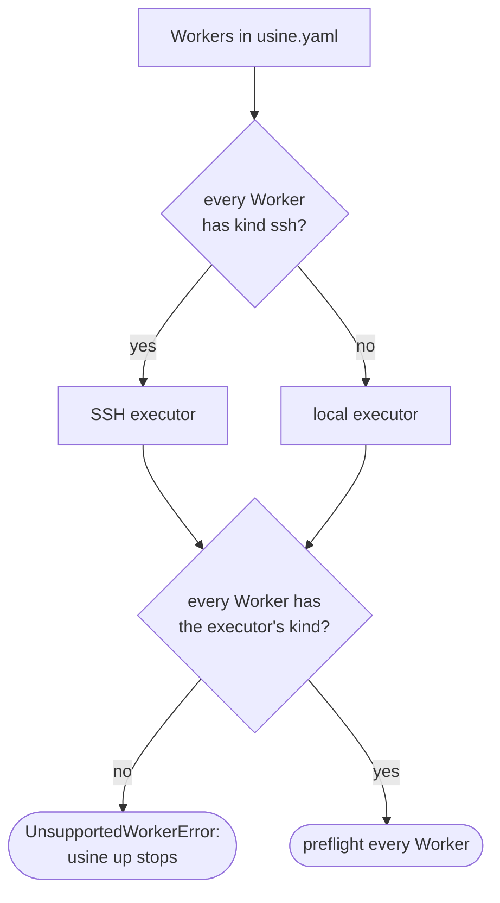
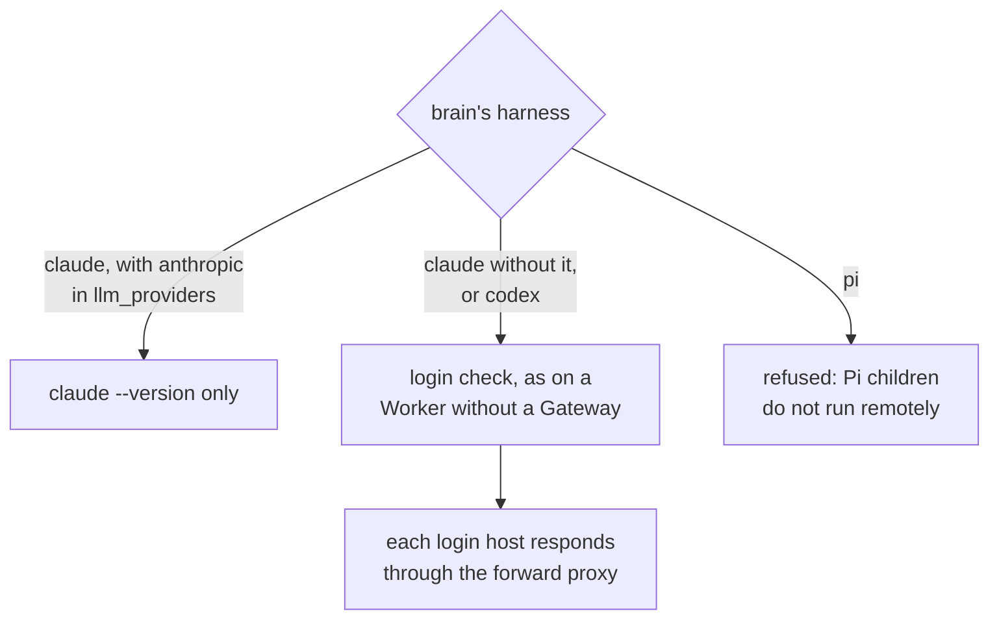
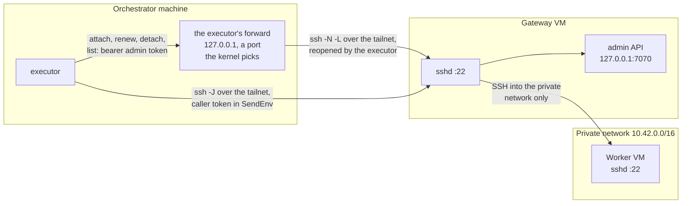
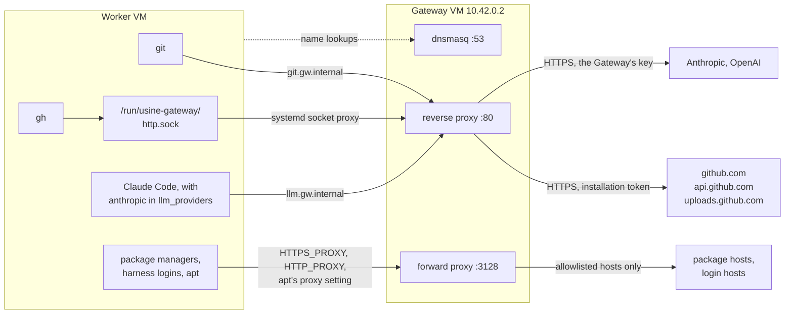
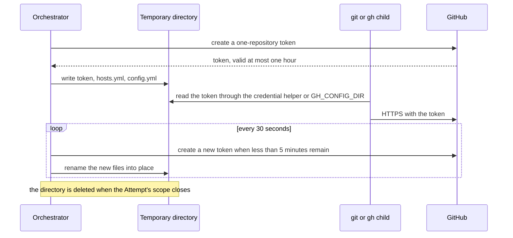
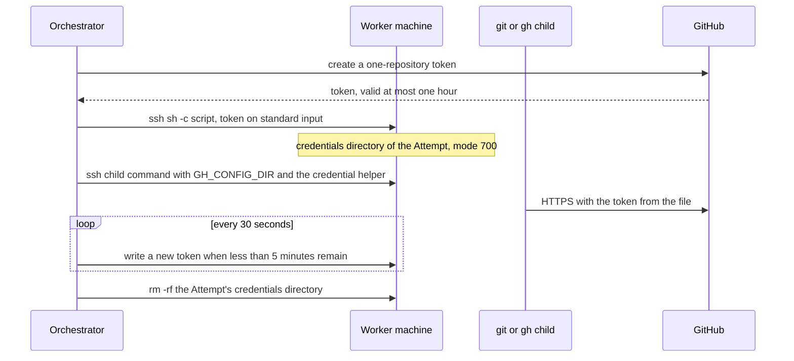
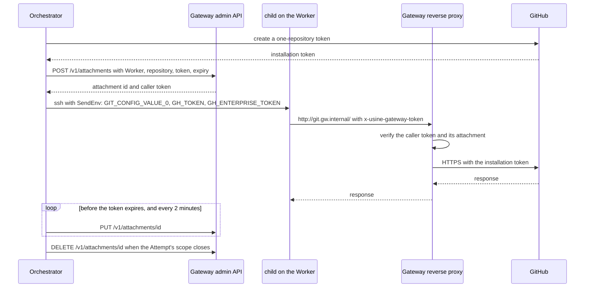
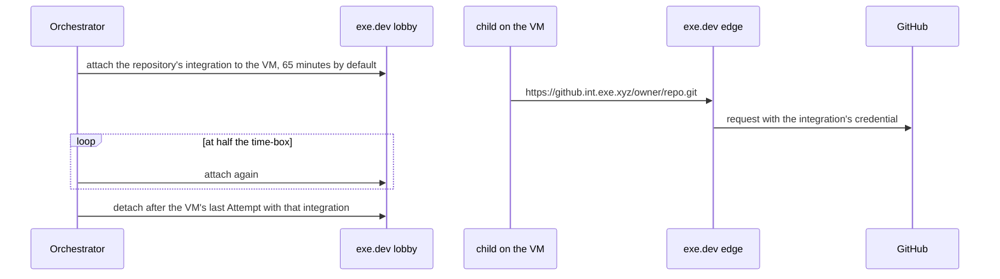

import { FileTree, TabItem, Tabs } from "@astrojs/starlight/components";

:::note
This page describes commit [`7c0c3d3`](https://github.com/basaltbytes/usine/tree/7c0c3d3696123d11e3d5b9cc3d27e18bb21e84e9) of basaltbytes/usine as it was on 2026-10-16, with later changes: the executor's own admin API forward ([#249][], 2026-10-19), refused GitHub tokens ([#431][], 2026-10-20), SSH workers that a reload adds or removes ([#387][], 2026-10-20), the recorded kind of the gateway's Anthropic credential ([#248][], 2026-10-22), and SSH to the gateway over a tailnet ([#492][], 2026-10-24).
:::

A worker has an attempt's checkout and runs its children; the Pi parent runs in the orchestrator. [`infra/hetzner/README.md`](https://github.com/basaltbytes/usine/blob/main/infra/hetzner/README.md) and [`infra/hetzner/gateway/README.md`](https://github.com/basaltbytes/usine/blob/main/infra/hetzner/gateway/README.md) give the operating procedures.

## Worker kinds in `usine.yaml`

`Worker` is a union of three classes ([factory.ts:150][]); without a `workers` key, the factory has one worker named `local` ([factory.ts:214][]). The kinds are `local` ([local.ts][]), whose children run as processes on the orchestrator's machine; `ssh` ([ssh/ssh.ts][]), optionally with a `gateway` (`admin_port` default 7070, `llm_providers` only `anthropic`); and `exe.dev` ([exe-dev.ts][]), whose edge adds the GitHub credential. Remote children run as one SSH command each. [`usine.yaml`](/reference/configuration/usine-yaml/) lists each kind's keys; the Hetzner READMEs use these forms:

<Tabs>
  <TabItem label="ssh">

```yaml title="usine.yaml"
workers:
  - name: eu-one
    kind: ssh
    destination: usine@203.0.113.7
    identity_file: ~/.ssh/usine_worker
    root: /home/usine/.usine
    max_concurrent_attempts: 2
```

  </TabItem>
  <TabItem label="ssh behind a gateway">

```yaml title="usine.yaml"
workers:
  - name: worker-one
    kind: ssh
    destination: worker-one
    root: /home/usine/.usine
    gateway:
      domain: gw.internal
      destination: usine-gateway
      admin_token_env: USINE_GATEWAY_ADMIN_TOKEN
```

Both `destination` keys are `Host` aliases, and the SSH configuration routes the worker connection through the gateway. The gateway's entry has its tailnet address as `HostName` and its public address as `HostKeyAlias`, so `ssh` checks the host key that `known_hosts` has for the public address ([Hetzner gateway VM](#hetzner-gateway-vm)). The executor opens its own [forward to the admin API](#forward-to-the-admin-api) through `gateway.destination`, so the gateway's entry has no `LocalForward`:

```ssh-config title="~/.ssh/config"
Host usine-gateway
  HostName 100.64.0.10
  HostKeyAlias 203.0.113.30
  User root
  IdentityFile ~/.ssh/usine_worker

Host worker-one
  HostName 10.42.0.3
  User usine
  ProxyJump usine-gateway
  IdentityFile ~/.ssh/usine_worker
```

  </TabItem>
</Tabs>

`usine up` uses one executor: SSH if every worker is `ssh`, local otherwise (`workerEngineLayer`, [worker-engine.ts:13][]). `stepExecutorLayer` refuses other kinds with `UnsupportedWorkerError` ([scheduler.ts:76][]), so mixed kinds or an `exe.dev` worker stop startup. The exe.dev executor also needs `githubIntegrations` options that `usine.yaml` can't set ([exe-dev.ts:34][]) and runs only in its integration test (`pnpm --filter @usine/orchestrator test:exe-dev`) ([#228][]).



## Executor behavior by worker kind

### local

State is in `<instance>/.usine/workers/<worker>/`: `repos/` caches, `attempts/` worktrees, and `turbo/` as `TURBO_CACHE_DIR` ([local.ts:103][], [local.ts:290][]). Credentials are in a mode 700 `usine-credentials-*` temporary directory ([local/credentials.ts:22][]), which Git reads through a credential helper and gh through `GH_CONFIG_DIR` ([credential-environment.ts:15][]), so renewals apply without restarting children. Issued tokens are removed from Git output before it goes into an error or log ([local.ts:133][]).

### ssh without a gateway

Every command is `ssh -o BatchMode=yes -o ServerAliveInterval=30 -o ServerAliveCountMax=4 [-p port] [-i key -o IdentitiesOnly=yes] <destination> -- <quoted command>` ([commands.ts:87][], [ssh/ssh.ts:22][], [child-host.ts:85][]), and the client inherits only `HOME`, `LANG`, `LC_ALL`, `PATH`, `SHELL`, `SSH_AGENT_PID`, `SSH_AUTH_SOCK`, `TMPDIR`, and `USER` ([commands.ts:70][]).

A shell script writes the token from standard input, never a command line, to `<root>/workers/<name>/credentials/<attempt>` ([ssh/credentials.ts:25][]), with mode 700 directories and mode 600 files. A process's first attempt on a worker removes earlier processes' credential directories. Attempts on one machine share a user and can read each other's tokens ([ADR 0026](https://github.com/basaltbytes/usine/blob/main/docs/adr/0026-eu-ssh-worker.md), [#231][]).

### ssh behind a gateway

`gatewayAttachmentsFor` ([attachments.ts:58][]) writes gh's configuration, `http_unix_socket: /run/usine-gateway/http.sock` and host `git.<domain>`, to `<worker directory>/gh` without a token ([gateway/environment.ts:42][]), and manages the attachment in [Credential flow](#credential-flow). It stores it again every two minutes, because the gateway keeps attachments only in memory ([attachments.ts:35][]); the caller token never changes. Once per process and worker, it detaches what earlier processes left ([attachments.ts:64][]).

The children's environment has an exported part, on each command line and without secrets, and a sent part, passed with OpenSSH `SendEnv` and accepted by the worker's sshd with `AcceptEnv`, which keeps the caller token off command lines ([gateway/environment.ts:88][], [commands.ts:101][]). The clone URL is `http://git.<domain>/<owner>/<repo>.git` ([gateway/environment.ts:33][]).

| Variable                                                 | Value                                                                | Part     |
| -------------------------------------------------------- | -------------------------------------------------------------------- | -------- |
| `GIT_CONFIG_COUNT`                                       | `3`                                                                  | exported |
| `GIT_CONFIG_KEY_0`                                       | `http.http://git.<domain>/.extraHeader`                              | exported |
| `GIT_CONFIG_VALUE_0`                                     | `x-usine-gateway-token: <caller token>`                              | sent     |
| `GIT_CONFIG_KEY_1`, `GIT_CONFIG_KEY_2`                   | `url.http://git.<domain>/.insteadOf`                                 | exported |
| `GIT_CONFIG_VALUE_1`, `GIT_CONFIG_VALUE_2`               | `https://github.com/`, `https://git.<domain>/`                       | exported |
| `GH_HOST`                                                | `git.<domain>`                                                       | exported |
| `GH_CONFIG_DIR`                                          | `<worker directory>/gh`                                              | exported |
| `GH_PROMPT_DISABLED`                                     | `1`                                                                  | exported |
| `HTTPS_PROXY`, `HTTP_PROXY`, `https_proxy`, `http_proxy` | `http://<domain>:3128`                                               | exported |
| `NO_PROXY`, `no_proxy`                                   | `localhost,127.0.0.1,::1,<domain>`                                   | exported |
| `GH_ENTERPRISE_TOKEN`, `GH_TOKEN`                        | the caller token                                                     | sent     |
| `ANTHROPIC_BASE_URL`                                     | `http://llm.<domain>/anthropic`, with `anthropic` in `llm_providers` | exported |
| `ANTHROPIC_AUTH_TOKEN`                                   | the caller token, with `anthropic` in `llm_providers`                | sent     |

#### Forward to the admin API

The SSH executor opens one forward per gateway (`destination` and `admin_port`) when the first worker behind it is added, at startup or by a reload; its workers share it ([gateway/forward.ts][], [ssh/workers.ts][]):

```sh
ssh -o BatchMode=yes -o ServerAliveInterval=30 -o ServerAliveCountMax=4 -N \
  -o ExitOnForwardFailure=yes -o ControlPath=none \
  -o PermitLocalCommand=yes -o 'LocalCommand=echo usine-gateway-forward-open' \
  -L 127.0.0.1:<port>:127.0.0.1:<admin_port> <gateway.destination>
```

The kernel picks a free `<port>` on 127.0.0.1 per client, so it never conflicts with the operator's forwards. It prints the `LocalCommand` line once listening; `ExitOnForwardFailure` makes it exit if it can't listen, including on a port taken by a `LocalForward` for the gateway's host in the SSH configuration. Log lines identify the gateway by its destination.

| When                                                                    | The executor                                                            | Log                                                                                                  |
| ----------------------------------------------------------------------- | ----------------------------------------------------------------------- | ---------------------------------------------------------------------------------------------------- |
| the client prints the line                                              | sends admin requests to its port                                        | `Opened the forward to the Gateway's admin API`, or `Reopened ...` with `closedSince`                |
| the client exits                                                        | restarts it after a pause of 1, 2, 4 seconds, and so on, up to a minute | `The forward to the Gateway's admin API exited; reopening it after a pause`, with ssh's error output |
| a client exits before the line, or no line comes within 30 seconds      | the same, with the pause doubled                                        | `Could not open the forward to the Gateway's admin API; trying again after a pause`                  |
| an admin request finds the forward closed, or gets no answer through it | restarts the client at once and resends the request once                | `A Gateway admin request did not get through; reopening the forward and sending it once more`        |
| the last worker behind the gateway is removed                           | ends the client                                                         | `Closed the forward to the Gateway's admin API`                                                      |
| the executor's layer closes                                             | ends the client                                                         | `Closed the forward to the Gateway's admin API`                                                      |

A request that fails twice fails as without the forward: an attach fails the attempt with `CredentialUnavailableError`, and a renewal retries after 30 seconds. If the forward is closed, the error gives the time it closed: `the forward through usine-gateway has been closed since <time>: <ssh error>`. If the forward is open but the admin API doesn't answer, for example because `usine-gateway` is stopped, the error and the warning give the time it stopped answering: `the admin API through usine-gateway hasn't responded since <time>: no response (TransportError)`. The warning's `unansweredSince` field has the same time. Each gateway clears this time when a request is answered. The executor reopens the forward while any worker remains behind the gateway.

#### Workers added or removed by a reload

`SshWorkers` ([ssh/workers.ts][]) has the SSH executor's machines, from `usine.yaml` and then each reload ([scheduler.ts][], [orchestrator/src/ssh.ts][]):

- For an added worker, the orchestrator reads its gateway's admin token, `addWorker` gives the executor its machine, and preflight runs; the worker shares its gateway's forward or gets a new one. A failed preflight refuses the reload with `ReloadPreflightError` and removes the worker.
- A removed worker stays until its last attempt ends, since that attempt's credential renewals and cleanup need the machine and forward; `removeWorker` then removes it and closes the forward if no worker remains behind the gateway.
- A worker added back while its attempts run keeps its machine if its settings are unchanged; otherwise, `addWorker` fails with a `machine` capability error, refusing the reload until those attempts end.

### Code shared by remote kinds

`remoteExecutorFor` ([remote.ts:44][]) has the checkout, salvage, recovery, and reattach code of SSH and exe.dev. Before a worktree is kept or removed, `CHILD_KILL_SCRIPT` sends each child in a `<worktree>.child-<n>.pid` file ([child-host.ts:96][]) TERM, then KILL after up to five seconds ([child-host.ts:106][]).

## Preflight

`stepExecutorLayer` preflights every worker with every rostered brain while the runtime layer is built, and a failure stops `usine up` ([scheduler.ts:96][]). `prepare` rechecks the attempt's brain ([local.ts:331][], [remote.ts:236][]): a missing capability is an `AgentFailure`, and a transport failure or timeout a retryable `InfraFailure` ([scheduler.ts:51][]). Checks ([local.ts:256][], [agents/src/preflight/preflight.ts][], [ssh/preflight.ts:31][], [gateway/preflight.ts:47][]):


Behind a gateway, the check for each brain depends on where its harness gets its model credential ([gateway/preflight.ts:162][]):



If the forward doesn't open, the error gives an `ssh` command that shows why. With the Anthropic key on the gateway, the executor records the credential kind that `GET /v1/providers` reports, `api-key` or `subscription` (never the credential, as of the last reload), with the worker, so usage counts its Claude Code children in the billed pool ([#248][], [gateway/preflight.ts:71][], [ADR 0013](https://github.com/basaltbytes/usine/blob/main/docs/adr/0013-cost-accounting-native-meters-guardrails.md)). No Anthropic credential fails the preflight; a gateway too old to answer keeps the Claude plan pool, with a warning once per worker.

Only exe.dev workers have long-lived GitHub credentials, their integrations, which preflight checks (`credentials` capability, [exe-dev/preflight.ts:123][]). Local and SSH attempts get tokens minted in `prepare`: a refusal, because the installation doesn't cover the repository, lacks a permission, or is suspended, fails the attempt once with GitHub's reason ([#431][]), and an unreachable GitHub or a rate limit is a retryable `InfraFailure`.

## Hetzner gateway VM

`infra/hetzner/gateway/gateway.sh create` makes a private network (`10.42.0.0/16`), the gateway VM with a public address, and a Hetzner firewall that allows SSH from the orchestrator's address. On first boot, `gateway-cloud-init.yaml` installs the parts below and writes an admin token and caller key from `openssl rand -hex 32` to `/etc/usine-gateway/secrets.env`.

The orchestrator's public address can change, so the operator puts the gateway on the orchestrator machine's Tailscale tailnet and removes the public SSH rule ([#492][]). cloud-init installs Tailscale from its stable apt repository for the image's Debian release, with the repository's signing key embedded in the file, and doesn't log it in, so the file holds no secret. `gateway.sh tailnet-up` runs `tailscale up --hostname=<NAME> --netfilter-mode=off --accept-dns=false` over SSH, with the auth key in `TAILSCALE_AUTH_KEY` on standard input or else the interactive login, and prints the tailnet address ([gateway.sh][]). `install` and `tailnet-up` connect to `GATEWAY_SSH`, by default root at the public address. nftables accepts SSH on every interface, `tailscale0` included, and no inbound UDP: Tailscale connects directly through replies to the gateway's own packets, or else through a DERP relay. The [gateway README][] gives the steps and the recovery.



A worker has no public address or default route; all outbound traffic goes through the gateway:



| Part                            | Listens on                                                     | Does                                                                                                                                                                                                                                                                                   | Code                                            |
| ------------------------------- | -------------------------------------------------------------- | -------------------------------------------------------------------------------------------------------------------------------------------------------------------------------------------------------------------------------------------------------------------------------------- | ----------------------------------------------- |
| Reverse proxy (`usine-gateway`) | port 80 on the private address (binary default `127.0.0.1:80`) | `git.<domain>` to github.com, api.github.com (paths under `/api/`), and uploads.github.com with the attached installation token; `llm.<domain>` to Anthropic or OpenAI with the gateway's credential. Each request needs a caller token with an active attachment; other hosts get 404 | [proxy.ts][], [github.ts:15][]                  |
| Forward proxy                   | port 3128 on the private address                               | `CONNECT` only to port 443 of an allowlisted host whose name matches the TLS ClientHello and resolves only to public addresses; plain HTTP with caller tokens removed                                                                                                                  | [egress-proxy.ts:241][], [client-hello.ts:88][] |
| Admin API                       | `127.0.0.1:7070`                                               | attachments and providers, with a bearer admin token                                                                                                                                                                                                                                   | [api.ts:92][], [api.ts:161][]                   |
| dnsmasq                         | port 53 on the private address                                 | answers `<domain>` names with the gateway's address and refuses others ([#260][])                                                                                                                                                                                                      | [gateway-cloud-init.yaml:42][]                  |
| nftables                        |                                                                | the firewall rules below                                                                                                                                                                                                                                                               | [gateway-nftables.conf][]                       |
| sshd                            | port 22                                                        | bastion for `ssh -J` to workers and the admin API forward                                                                                                                                                                                                                              | [gateway-cloud-init.yaml:66][]                  |
| Tailscale                       | UDP 41641, which nftables opens only to replies                | the tailnet address on `tailscale0`, which carries the orchestrator's SSH; `gateway.sh tailnet-up` logs it in with netfilter and DNS left to the gateway                                                                                                                               | [gateway.sh][]                                  |

These are the service, DNS, and SSH settings of `gateway-cloud-init.yaml`, whose `@@NAME@@` placeholders `gateway.sh` replaces, and the firewall rules:

<Tabs>
  <TabItem label="settings.env">

```yaml title="infra/hetzner/gateway/gateway-cloud-init.yaml"
write_files:
  # ...
  - path: /etc/usine-gateway/settings.env
    permissions: "0644"
    content: |
      USINE_GATEWAY_DOMAIN=@@DOMAIN@@
      USINE_GATEWAY_PROXY_HOST=@@GATEWAY_IP@@
      USINE_GATEWAY_PROXY_PORT=80
      USINE_GATEWAY_EGRESS_HOST=@@GATEWAY_IP@@
      USINE_GATEWAY_EGRESS_PORT=3128
      USINE_GATEWAY_ADMIN_HOST=127.0.0.1
      USINE_GATEWAY_ADMIN_PORT=7070
      USINE_GATEWAY_EGRESS_ALLOWLIST=/etc/usine-gateway/egress-allowlist
```

  </TabItem>
  <TabItem label="dnsmasq">

```yaml title="infra/hetzner/gateway/gateway-cloud-init.yaml"
write_files:
  # ...
  # dnsmasq answers Worker queries for the gateway's names only. It has no upstream server, so it refuses every other name, and it logs each query to the journal.
  # With local=, an AAAA query for the gateway's names gets an empty answer instead of a refusal, because musl's resolver, which Codex uses, fails the whole lookup on a refusal.
  - path: /etc/dnsmasq.d/usine-gateway.conf
    permissions: "0644"
    content: |
      bind-dynamic
      listen-address=@@GATEWAY_IP@@
      no-resolv
      no-hosts
      log-queries
      address=/@@DOMAIN@@/@@GATEWAY_IP@@
      local=/@@DOMAIN@@/
```

  </TabItem>
  <TabItem label="sshd">

```yaml title="infra/hetzner/gateway/gateway-cloud-init.yaml"
write_files:
  # ...
  - path: /etc/ssh/sshd_config.d/50-usine-gateway.conf
    permissions: "0644"
    content: |
      PasswordAuthentication no
      KbdInteractiveAuthentication no
      PermitRootLogin prohibit-password
      AllowTcpForwarding local
      AllowAgentForwarding no
      AllowStreamLocalForwarding no
      GatewayPorts no
      PermitTunnel no
      X11Forwarding no
```

  </TabItem>
  <TabItem label="nftables">

```txt title="infra/hetzner/gateway/gateway-nftables.conf"
define network = 10.42.0.0/16

flush ruleset

table inet usine_gateway {
	chain input {
		type filter hook input priority filter; policy drop;
		iif lo accept
		ct state established,related accept
		ct state invalid drop
		meta l4proto { icmp, ipv6-icmp } accept
		tcp dport 22 accept
		# DHCP renewals for the private network address.
		udp sport 67 udp dport 68 accept
		ip saddr $network udp dport 53 accept
		ip saddr $network tcp dport { 53, 80, 3128 } accept
	}

	chain forward {
		type filter hook forward priority filter; policy drop;
	}

	chain output {
		type filter hook output priority filter; policy accept;
		# The bastion only opens SSH connections into the private network.
		tcp dport 22 ip daddr != $network reject
	}
}
```

  </TabItem>
</Tabs>

The admin API is an Effect `HttpApi` that the executor's client and the gateway's server share:

```ts title="packages/gateway/src/admin/api.ts"
export const GatewayAdminApi = HttpApi.make("GatewayAdminApi").add(
  HttpApiGroup.make("attachments")
    .add(
      HttpApiEndpoint.post("attach", "/v1/attachments", {
        payload: AttachRequest.annotate(strict),
        success: Attached,
        error: AttachmentAlreadyExpired.annotate({ httpApiStatus: 422 }),
      }),
      HttpApiEndpoint.put("renew", "/v1/attachments/:id", {
        params: { id: AttachmentId },
        payload: AttachRequest.annotate(strict),
        success: Attached,
        error: [
          AttachmentAlreadyExpired.annotate({ httpApiStatus: 422 }),
          AttachmentConflict.annotate({ httpApiStatus: 409 }),
        ],
      }),
      HttpApiEndpoint.delete("detach", "/v1/attachments/:id", {
        params: { id: AttachmentId },
        success: Detached,
      }),
      HttpApiEndpoint.get("list", "/v1/attachments", { success: AttachmentList }),
    )
    .middleware(AdminAuthorization),
  HttpApiGroup.make("llm")
    .add(HttpApiEndpoint.get("providers", "/v1/providers", { success: LlmProviderList }))
    .middleware(AdminAuthorization),
);
```

The caller token, HMAC-signed with the caller key, contains its attachment id, worker, and repository ([caller.ts:93][]). The reverse proxy takes it from `x-usine-gateway-token`, `Authorization`, or `x-api-key`, strips it before forwarding, and refuses it once its attachment is detached, even if the worker and repository have a new one. Refusals give a reason in `x-usine-gateway-refusal` ([proxy.ts:33][]):

| Reason                                                            | Status |
| ----------------------------------------------------------------- | ------ |
| `unknown-host`, `unsupported-path`                                | 404    |
| `missing-caller-token`, `invalid-caller-token`                    | 401    |
| `stale-caller-token`, `attachment-expired`, `repository-mismatch` | 403    |
| `provider-not-configured`                                         | 503    |

The forward proxy's reasons are `host-not-allowed`, `port-not-allowed`, `address-literal`, `private-address`, `not-tls`, `server-name-missing`, and `server-name-mismatch` ([egress.ts:59][]). At start, the service reads ([node/environment.ts:64][]) `USINE_GATEWAY_DOMAIN`, `USINE_GATEWAY_ADMIN_TOKEN`, `USINE_GATEWAY_CALLER_KEY`, the allowlist file (default `/etc/usine-gateway/egress-allowlist`), and optionally `ANTHROPIC_API_KEY` or `USINE_GATEWAY_ANTHROPIC_SUBSCRIPTION_TOKEN` (not both) and `OPENAI_API_KEY`, and logs JSON lines to journald ([node/main.ts:7][]). [ADR 0027](https://github.com/basaltbytes/usine/blob/main/docs/adr/0027-gateway-credential-proxy.md) explains why usine has its own proxy rather than a TLS-intercepting one.

## Credential flow

Only the orchestrator has the GitHub App's private key, from `USINE_GITHUB_PRIVATE_KEY` or `.usine/github-app.json`. `CredentialProvider.issue` ([orchestrator/src/credentials.ts:79][]) calls `GitHubApp.workerToken` ([github-app.ts:294][]), which sends `POST /app/installations/:id/access_tokens` with the attempt's repository id for a token valid at most one hour; `renewableCredential` checks every 30 seconds and renews under five minutes left ([renewable-credential.ts:11][], [renewable-credential.ts:69][]).

<Tabs>
  <TabItem label="local">



  </TabItem>
  <TabItem label="ssh">



  </TabItem>
  <TabItem label="ssh behind a gateway">



  </TabItem>
  <TabItem label="exe.dev">



No token goes through the orchestrator; each repository needs a persistent exe.dev GitHub integration ([exe-dev.ts:34][]).

  </TabItem>
</Tabs>

The orchestrator reads the gateway's admin token from the `admin_token_env` variable, at startup or at the reload that adds the worker. If it's unset, startup stops with a `gateway` capability error ([orchestrator/src/ssh.ts:27][]), and a reload is refused with a `ReloadPreflightError` of that kind. The variable must be in the environment that `usine up` starts with.

## Harness logins on the worker

The operator logs in Claude Code and Codex on the worker as `usine` with `claude auth login` and `codex login --device-auth`. Behind a gateway, logins use the forward proxy, whose allowlist has their hosts:

```txt title="infra/hetzner/gateway/egress-allowlist"
# Claude Code with a Claude subscription: the API, and the OAuth token
# endpoint that claude auth login and token refreshes call.
api.anthropic.com
platform.claude.com

# Codex with a ChatGPT plan: the ChatGPT API, and the device-code login and
# token refreshes.
chatgpt.com
auth.openai.com
```

With `llm_providers: [anthropic]`, Claude Code children call `llm.<domain>/anthropic`, and the gateway sends its own key; its use of a Claude subscription token there is untested against Anthropic ([#234][]), and it has no ChatGPT login ([#235][]). [ADR 0027](https://github.com/basaltbytes/usine/blob/main/docs/adr/0027-gateway-credential-proxy.md), amendment of 2026-10-15, explains why logins stay on the worker.

## cloud-init files

<FileTree>

- infra/hetzner/
  - cloud-init.yaml the worker machine
  - create-worker.sh
  - gateway/
    - egress-allowlist
    - gateway-cloud-init.yaml the gateway VM
    - gateway-nftables.conf
    - gateway.sh
    - worker-cloud-init.yaml added for a worker behind the gateway
    - worker-nftables.conf

</FileTree>

| File                                            | Adds                                                                                                                                                                                                                                                                                                                                                                                                                                                                                                             |
| ----------------------------------------------- | ---------------------------------------------------------------------------------------------------------------------------------------------------------------------------------------------------------------------------------------------------------------------------------------------------------------------------------------------------------------------------------------------------------------------------------------------------------------------------------------------------------------- |
| `infra/hetzner/cloud-init.yaml`                 | Debian 13, user `usine`, key-only SSH (`AllowUsers usine`); `build-essential`, `bubblewrap` for Codex's sandbox ([#269][]), `ca-certificates`, `chromium`, `curl`, `git`, `gnupg`, `jq`; 2 GB swap and `vm.overcommit_memory = 1` for the lint gates' 6 GiB virtual buffer ([#270][]); `DISABLE_AUTOUPDATER=1` and `PLAYWRIGHT_CHROMIUM_EXECUTABLE_PATH=/usr/bin/chromium` in `/etc/environment`; a setup script for gh, Node.js 24, pnpm 11.20.0, Claude Code 2.1.296, Codex 0.153.4, and `/home/usine/.usine`. |
| `infra/hetzner/gateway/worker-cloud-init.yaml`  | For a worker behind the gateway: the gateway as only resolver, apt through the forward proxy, gateway-only nftables, the settings below, and a systemd socket from `/run/usine-gateway/http.sock` to the gateway's port 80.                                                                                                                                                                                                                                                                                      |
| `infra/hetzner/gateway/gateway-cloud-init.yaml` | The gateway VM: nftables, dnsmasq, the bastion sshd settings, Tailscale (not logged in), Node.js, the `usine-gateway` systemd service, the secrets file.                                                                                                                                                                                                                                                                                                                                                         |
| `infra/hetzner/create-worker.sh`                | Creates a server from `cloud-init.yaml`, labels it `usine=worker`, and attaches a firewall that allows SSH from one address.                                                                                                                                                                                                                                                                                                                                                                                     |
| `infra/hetzner/gateway/gateway.sh`              | `create`, `delete`, `tailnet-up`, `install <tarballs>`, and `worker-user-data`, which renders the two worker files as one MIME cloud-init.                                                                                                                                                                                                                                                                                                                                                                       |

Every SSH session reads these `worker-cloud-init.yaml` parts:

```yaml title="infra/hetzner/gateway/worker-cloud-init.yaml"
write_files:
  # ...
  # Every SSH session reads this file, including the harness logins, and so does the setup script of ../cloud-init.yaml.
  - path: /etc/environment
    append: true
    content: |
      GH_HOST=git.@@DOMAIN@@
      HTTPS_PROXY=http://@@GATEWAY_IP@@:3128
      HTTP_PROXY=http://@@GATEWAY_IP@@:3128
      https_proxy=http://@@GATEWAY_IP@@:3128
      http_proxy=http://@@GATEWAY_IP@@:3128
      NO_PROXY=@@DOMAIN@@
      no_proxy=@@DOMAIN@@
      CLAUDE_CODE_DISABLE_NONESSENTIAL_TRAFFIC=1
  # ...
  # The executor sends each Attempt's caller token in these variables over the SSH connection, so the token never appears on a command line.
  - path: /etc/ssh/sshd_config.d/40-usine-gateway.conf
    permissions: "0644"
    content: |
      AcceptEnv GIT_CONFIG_VALUE_0 GH_ENTERPRISE_TOKEN GH_TOKEN ANTHROPIC_AUTH_TOKEN
```

These variables use the gateway's address and serve SSH sessions such as logins; attempt children get the executor's exported values, which use the domain: `http://<domain>:3128`. `gateway.sh` writes the gateway's address into the worker nftables file and the domain into the worker cloud-init, by default `10.42.0.2` and `gw.internal` ([gateway.sh:19][]):

```sh title="infra/hetzner/gateway/gateway.sh"
NAME=${NAME:-usine-gateway}
LOCATION=${LOCATION:-fsn1}
SERVER_TYPE=${SERVER_TYPE:-cx23}
IMAGE=${IMAGE:-debian-13}
NETWORK_ZONE=${NETWORK_ZONE:-eu-central}
NETWORK_CIDR=${NETWORK_CIDR:-10.42.0.0/16}
SUBNET_CIDR=${SUBNET_CIDR:-10.42.0.0/24}
GATEWAY_IP=${GATEWAY_IP:-10.42.0.2}
DOMAIN=${DOMAIN:-gw.internal}
LABEL=${LABEL:-usine=gateway}
GATEWAY_PACKAGE=${GATEWAY_PACKAGE:-@usine/gateway}
```

[Gaps](/architecture/gaps/) lists the open gateway issues, such as [#254][] and [#264][].

[factory.ts:150]: https://github.com/basaltbytes/usine/blob/7c0c3d3696123d11e3d5b9cc3d27e18bb21e84e9/packages/config/src/factory.ts#L150
[factory.ts:214]: https://github.com/basaltbytes/usine/blob/7c0c3d3696123d11e3d5b9cc3d27e18bb21e84e9/packages/config/src/factory.ts#L214
[local.ts]: https://github.com/basaltbytes/usine/blob/7c0c3d3696123d11e3d5b9cc3d27e18bb21e84e9/packages/executor/src/local/local.ts
[local.ts:103]: https://github.com/basaltbytes/usine/blob/7c0c3d3696123d11e3d5b9cc3d27e18bb21e84e9/packages/executor/src/local/local.ts#L103
[local.ts:133]: https://github.com/basaltbytes/usine/blob/7c0c3d3696123d11e3d5b9cc3d27e18bb21e84e9/packages/executor/src/local/local.ts#L133
[local.ts:256]: https://github.com/basaltbytes/usine/blob/7c0c3d3696123d11e3d5b9cc3d27e18bb21e84e9/packages/executor/src/local/local.ts#L256
[local.ts:290]: https://github.com/basaltbytes/usine/blob/7c0c3d3696123d11e3d5b9cc3d27e18bb21e84e9/packages/executor/src/local/local.ts#L290
[local.ts:331]: https://github.com/basaltbytes/usine/blob/7c0c3d3696123d11e3d5b9cc3d27e18bb21e84e9/packages/executor/src/local/local.ts#L331
[local/credentials.ts:22]: https://github.com/basaltbytes/usine/blob/7c0c3d3696123d11e3d5b9cc3d27e18bb21e84e9/packages/executor/src/local/credentials.ts#L22
[credential-environment.ts:15]: https://github.com/basaltbytes/usine/blob/7c0c3d3696123d11e3d5b9cc3d27e18bb21e84e9/packages/executor/src/credential-environment.ts#L15
[ssh/ssh.ts]: https://github.com/basaltbytes/usine/blob/7c0c3d3696123d11e3d5b9cc3d27e18bb21e84e9/packages/executor/src/ssh/ssh.ts
[ssh/ssh.ts:22]: https://github.com/basaltbytes/usine/blob/7c0c3d3696123d11e3d5b9cc3d27e18bb21e84e9/packages/executor/src/ssh/ssh.ts#L22
[ssh/credentials.ts:25]: https://github.com/basaltbytes/usine/blob/7c0c3d3696123d11e3d5b9cc3d27e18bb21e84e9/packages/executor/src/ssh/credentials.ts#L25
[ssh/preflight.ts:31]: https://github.com/basaltbytes/usine/blob/7c0c3d3696123d11e3d5b9cc3d27e18bb21e84e9/packages/executor/src/ssh/preflight.ts#L31
[commands.ts:70]: https://github.com/basaltbytes/usine/blob/7c0c3d3696123d11e3d5b9cc3d27e18bb21e84e9/packages/executor/src/remote/commands.ts#L70
[commands.ts:87]: https://github.com/basaltbytes/usine/blob/7c0c3d3696123d11e3d5b9cc3d27e18bb21e84e9/packages/executor/src/remote/commands.ts#L87
[commands.ts:101]: https://github.com/basaltbytes/usine/blob/7c0c3d3696123d11e3d5b9cc3d27e18bb21e84e9/packages/executor/src/remote/commands.ts#L101
[remote.ts:44]: https://github.com/basaltbytes/usine/blob/7c0c3d3696123d11e3d5b9cc3d27e18bb21e84e9/packages/executor/src/remote/remote.ts#L44
[remote.ts:236]: https://github.com/basaltbytes/usine/blob/7c0c3d3696123d11e3d5b9cc3d27e18bb21e84e9/packages/executor/src/remote/remote.ts#L236
[child-host.ts:85]: https://github.com/basaltbytes/usine/blob/7c0c3d3696123d11e3d5b9cc3d27e18bb21e84e9/packages/agents/src/child-host/child-host.ts#L85
[child-host.ts:96]: https://github.com/basaltbytes/usine/blob/7c0c3d3696123d11e3d5b9cc3d27e18bb21e84e9/packages/agents/src/child-host/child-host.ts#L96
[child-host.ts:106]: https://github.com/basaltbytes/usine/blob/7c0c3d3696123d11e3d5b9cc3d27e18bb21e84e9/packages/agents/src/child-host/child-host.ts#L106
[agents/src/preflight/preflight.ts]: https://github.com/basaltbytes/usine/blob/7c0c3d3696123d11e3d5b9cc3d27e18bb21e84e9/packages/agents/src/preflight/preflight.ts
[attachments.ts:35]: https://github.com/basaltbytes/usine/blob/7c0c3d3696123d11e3d5b9cc3d27e18bb21e84e9/packages/executor/src/ssh/gateway/attachments.ts#L35
[attachments.ts:58]: https://github.com/basaltbytes/usine/blob/7c0c3d3696123d11e3d5b9cc3d27e18bb21e84e9/packages/executor/src/ssh/gateway/attachments.ts#L58
[attachments.ts:64]: https://github.com/basaltbytes/usine/blob/7c0c3d3696123d11e3d5b9cc3d27e18bb21e84e9/packages/executor/src/ssh/gateway/attachments.ts#L64
[gateway/environment.ts:33]: https://github.com/basaltbytes/usine/blob/7c0c3d3696123d11e3d5b9cc3d27e18bb21e84e9/packages/executor/src/ssh/gateway/environment.ts#L33
[gateway/environment.ts:42]: https://github.com/basaltbytes/usine/blob/7c0c3d3696123d11e3d5b9cc3d27e18bb21e84e9/packages/executor/src/ssh/gateway/environment.ts#L42
[gateway/environment.ts:88]: https://github.com/basaltbytes/usine/blob/7c0c3d3696123d11e3d5b9cc3d27e18bb21e84e9/packages/executor/src/ssh/gateway/environment.ts#L88
[gateway/forward.ts]: https://github.com/basaltbytes/usine/blob/main/packages/executor/src/ssh/gateway/forward.ts
[ssh/workers.ts]: https://github.com/basaltbytes/usine/blob/main/packages/executor/src/ssh/workers.ts
[scheduler.ts]: https://github.com/basaltbytes/usine/blob/main/packages/orchestrator/src/scheduler.ts
[orchestrator/src/ssh.ts]: https://github.com/basaltbytes/usine/blob/main/packages/orchestrator/src/ssh.ts
[gateway/preflight.ts:47]: https://github.com/basaltbytes/usine/blob/7c0c3d3696123d11e3d5b9cc3d27e18bb21e84e9/packages/executor/src/ssh/gateway/preflight.ts#L47
[gateway/preflight.ts:162]: https://github.com/basaltbytes/usine/blob/7c0c3d3696123d11e3d5b9cc3d27e18bb21e84e9/packages/executor/src/ssh/gateway/preflight.ts#L162
[gateway/preflight.ts:71]: https://github.com/basaltbytes/usine/blob/40053e4db00141e4d47105773c841c6c2a23b814/packages/executor/src/ssh/gateway/preflight.ts#L71
[exe-dev.ts]: https://github.com/basaltbytes/usine/blob/7c0c3d3696123d11e3d5b9cc3d27e18bb21e84e9/packages/executor/src/exe-dev/exe-dev.ts
[exe-dev.ts:34]: https://github.com/basaltbytes/usine/blob/7c0c3d3696123d11e3d5b9cc3d27e18bb21e84e9/packages/executor/src/exe-dev/exe-dev.ts#L34
[exe-dev/preflight.ts:123]: https://github.com/basaltbytes/usine/blob/7c0c3d3696123d11e3d5b9cc3d27e18bb21e84e9/packages/executor/src/exe-dev/preflight.ts#L123
[renewable-credential.ts:11]: https://github.com/basaltbytes/usine/blob/7c0c3d3696123d11e3d5b9cc3d27e18bb21e84e9/packages/executor/src/renewable-credential.ts#L11
[renewable-credential.ts:69]: https://github.com/basaltbytes/usine/blob/7c0c3d3696123d11e3d5b9cc3d27e18bb21e84e9/packages/executor/src/renewable-credential.ts#L69
[worker-engine.ts:13]: https://github.com/basaltbytes/usine/blob/7c0c3d3696123d11e3d5b9cc3d27e18bb21e84e9/packages/orchestrator/src/worker-engine.ts#L13
[scheduler.ts:51]: https://github.com/basaltbytes/usine/blob/7c0c3d3696123d11e3d5b9cc3d27e18bb21e84e9/packages/orchestrator/src/scheduler.ts#L51
[scheduler.ts:76]: https://github.com/basaltbytes/usine/blob/7c0c3d3696123d11e3d5b9cc3d27e18bb21e84e9/packages/orchestrator/src/scheduler.ts#L76
[scheduler.ts:96]: https://github.com/basaltbytes/usine/blob/7c0c3d3696123d11e3d5b9cc3d27e18bb21e84e9/packages/orchestrator/src/scheduler.ts#L96
[orchestrator/src/credentials.ts:79]: https://github.com/basaltbytes/usine/blob/7c0c3d3696123d11e3d5b9cc3d27e18bb21e84e9/packages/orchestrator/src/credentials.ts#L79
[orchestrator/src/ssh.ts:27]: https://github.com/basaltbytes/usine/blob/7c0c3d3696123d11e3d5b9cc3d27e18bb21e84e9/packages/orchestrator/src/ssh.ts#L27
[github-app.ts:294]: https://github.com/basaltbytes/usine/blob/7c0c3d3696123d11e3d5b9cc3d27e18bb21e84e9/packages/github/src/github-app.ts#L294
[proxy.ts]: https://github.com/basaltbytes/usine/blob/7c0c3d3696123d11e3d5b9cc3d27e18bb21e84e9/packages/gateway/src/proxy/proxy.ts
[proxy.ts:33]: https://github.com/basaltbytes/usine/blob/7c0c3d3696123d11e3d5b9cc3d27e18bb21e84e9/packages/gateway/src/proxy/proxy.ts#L33
[github.ts:15]: https://github.com/basaltbytes/usine/blob/7c0c3d3696123d11e3d5b9cc3d27e18bb21e84e9/packages/gateway/src/github/github.ts#L15
[egress-proxy.ts:241]: https://github.com/basaltbytes/usine/blob/7c0c3d3696123d11e3d5b9cc3d27e18bb21e84e9/packages/gateway/src/node/egress-proxy.ts#L241
[client-hello.ts:88]: https://github.com/basaltbytes/usine/blob/7c0c3d3696123d11e3d5b9cc3d27e18bb21e84e9/packages/gateway/src/egress/client-hello.ts#L88
[egress.ts:59]: https://github.com/basaltbytes/usine/blob/7c0c3d3696123d11e3d5b9cc3d27e18bb21e84e9/packages/gateway/src/egress/egress.ts#L59
[api.ts:92]: https://github.com/basaltbytes/usine/blob/7c0c3d3696123d11e3d5b9cc3d27e18bb21e84e9/packages/gateway/src/admin/api.ts#L92
[api.ts:161]: https://github.com/basaltbytes/usine/blob/40053e4db00141e4d47105773c841c6c2a23b814/packages/gateway/src/admin/api.ts#L161
[caller.ts:93]: https://github.com/basaltbytes/usine/blob/7c0c3d3696123d11e3d5b9cc3d27e18bb21e84e9/packages/gateway/src/caller/caller.ts#L93
[node/environment.ts:64]: https://github.com/basaltbytes/usine/blob/7c0c3d3696123d11e3d5b9cc3d27e18bb21e84e9/packages/gateway/src/node/environment.ts#L64
[node/main.ts:7]: https://github.com/basaltbytes/usine/blob/7c0c3d3696123d11e3d5b9cc3d27e18bb21e84e9/packages/gateway/src/node/main.ts#L7
[gateway-cloud-init.yaml:42]: https://github.com/basaltbytes/usine/blob/7c0c3d3696123d11e3d5b9cc3d27e18bb21e84e9/infra/hetzner/gateway/gateway-cloud-init.yaml#L42
[gateway-cloud-init.yaml:66]: https://github.com/basaltbytes/usine/blob/7c0c3d3696123d11e3d5b9cc3d27e18bb21e84e9/infra/hetzner/gateway/gateway-cloud-init.yaml#L66
[gateway-nftables.conf]: https://github.com/basaltbytes/usine/blob/7c0c3d3696123d11e3d5b9cc3d27e18bb21e84e9/infra/hetzner/gateway/gateway-nftables.conf
[gateway.sh:19]: https://github.com/basaltbytes/usine/blob/7c0c3d3696123d11e3d5b9cc3d27e18bb21e84e9/infra/hetzner/gateway/gateway.sh#L19
[gateway.sh]: https://github.com/basaltbytes/usine/blob/main/infra/hetzner/gateway/gateway.sh
[gateway README]: https://github.com/basaltbytes/usine/blob/main/infra/hetzner/gateway/README.md#join-the-gateway-to-a-tailnet
[#228]: https://github.com/basaltbytes/usine/issues/228
[#231]: https://github.com/basaltbytes/usine/issues/231
[#234]: https://github.com/basaltbytes/usine/issues/234
[#235]: https://github.com/basaltbytes/usine/issues/235
[#249]: https://github.com/basaltbytes/usine/issues/249
[#254]: https://github.com/basaltbytes/usine/issues/254
[#260]: https://github.com/basaltbytes/usine/issues/260
[#264]: https://github.com/basaltbytes/usine/issues/264
[#269]: https://github.com/basaltbytes/usine/issues/269
[#270]: https://github.com/basaltbytes/usine/issues/270
[#431]: https://github.com/basaltbytes/usine/issues/431
[#387]: https://github.com/basaltbytes/usine/issues/387
[#248]: https://github.com/basaltbytes/usine/issues/248
[#492]: https://github.com/basaltbytes/usine/issues/492
