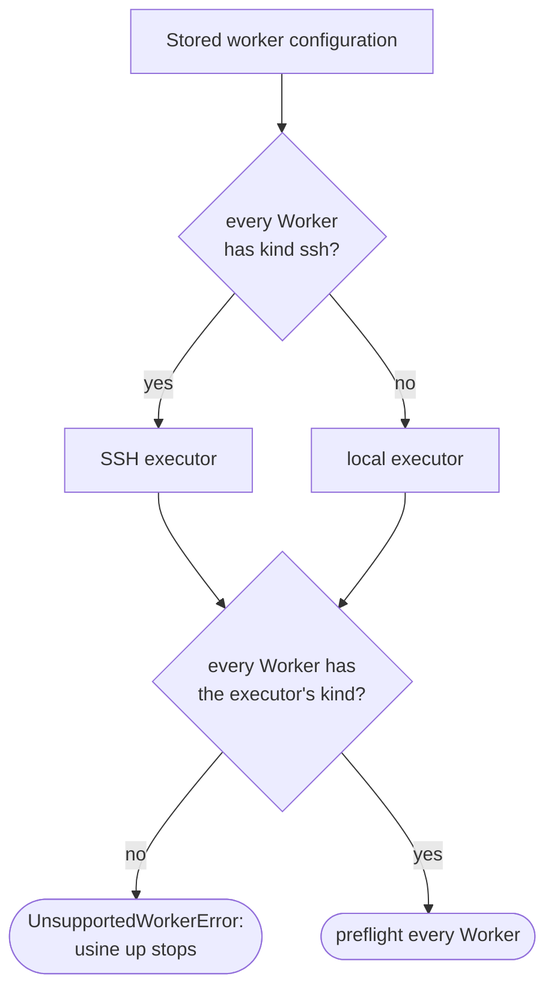
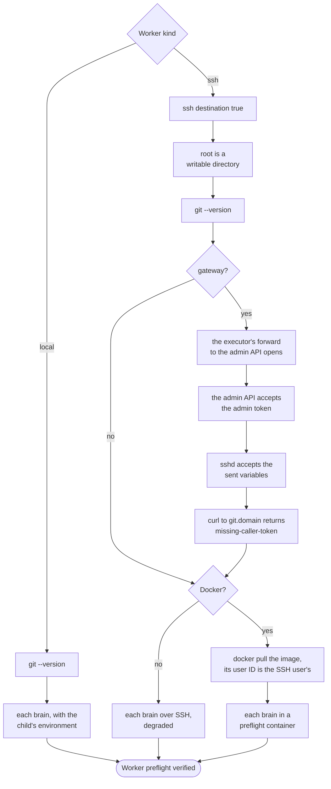
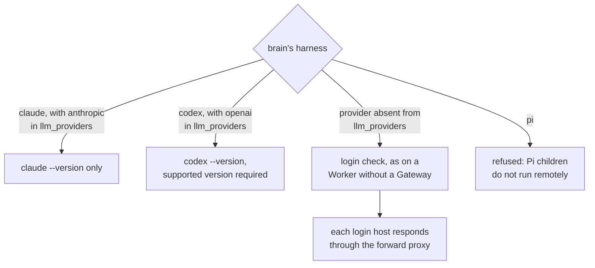
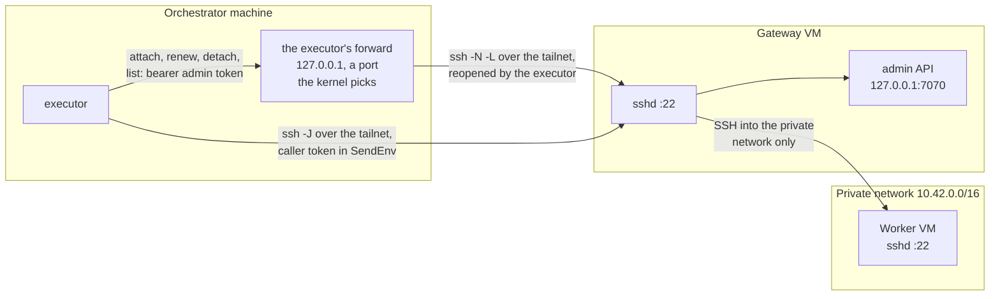
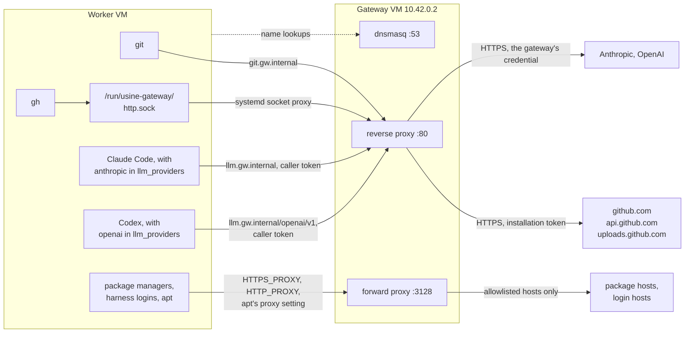
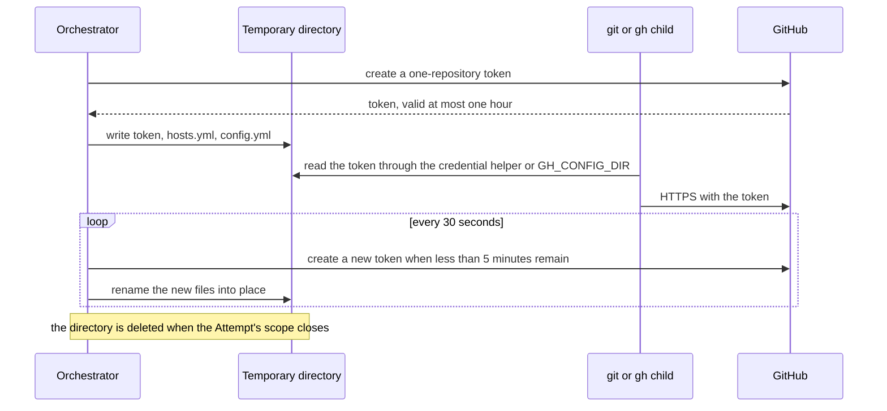
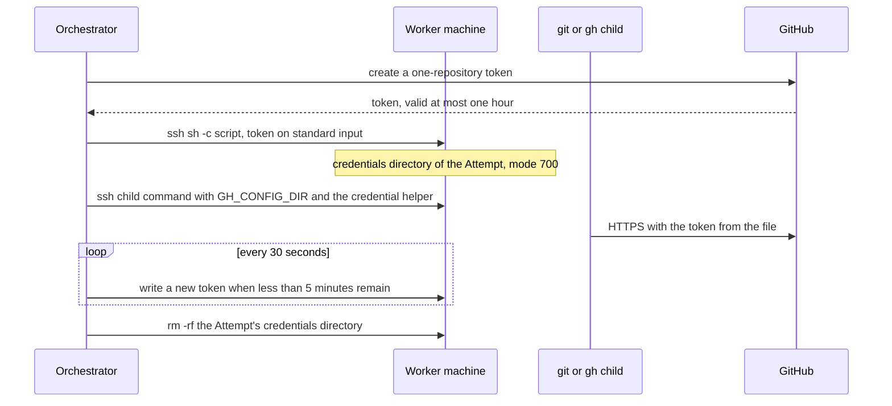
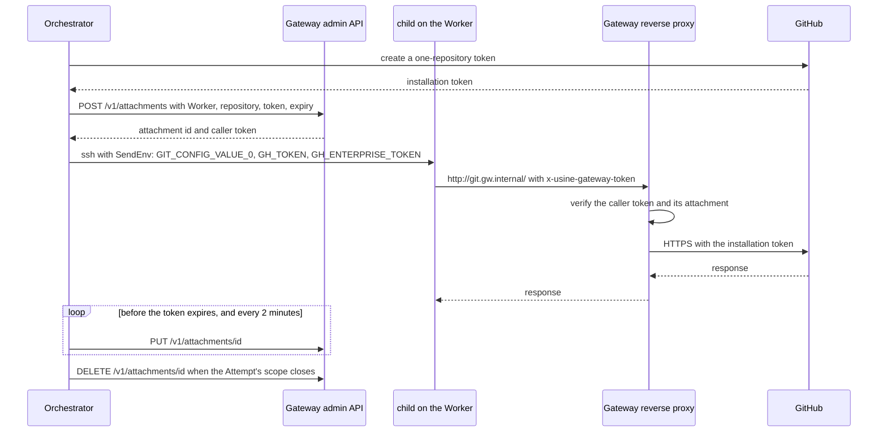
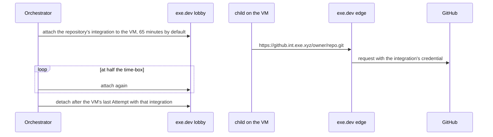

import { FileTree, TabItem, Tabs } from "@astrojs/starlight/components";

:::note
This page describes commit [`7c0c3d3`](https://github.com/basaltbytes/usine/tree/7c0c3d3696123d11e3d5b9cc3d27e18bb21e84e9) of basaltbytes/usine as it was on 2026-10-16, with later changes: the executor's own admin API forward ([#249][], 2026-10-19), refused GitHub tokens ([#431][], 2026-10-20), SSH workers that a reload adds or removes ([#387][], 2026-10-20), the recorded kind of the gateway's Anthropic credential ([#248][], 2026-10-22), SSH to the gateway over a tailnet ([#492][], 2026-10-24), the Claude Code 2.1.308 and Codex 0.159.2 pins in `cloud-init.yaml` ([#229][], 2026-10-24), release downloads and GitHub redirects through `git.<domain>` ([#237][], 2026-10-24), a renamed repository's new name ([#528][], 2026-10-25), a container per attempt on an SSH worker with Docker ([#548](https://github.com/basaltbytes/usine/issues/548), 2026-10-25), a machine per attempt on an SSH worker with a provisioner ([#550][], 2026-10-25), new names learned only from a rename that GitHub's API confirms ([#558][], 2026-10-26), container limits derived from the machine ([#588](https://github.com/basaltbytes/usine/issues/588), 2026-10-26), the instance ID label on attempt containers and one Node.js major version for the attempt image and the worker machine ([#589][], 2026-10-26), the orchestrator's server in the gateway's network ([#609](https://github.com/basaltbytes/usine/issues/609), 2026-10-27), gateway ChatGPT subscriptions ([#560](https://github.com/basaltbytes/usine/pull/560)), and provisioner lifecycle and timing settings ([#564](https://github.com/basaltbytes/usine/issues/564), 2026-10-28). The gateway-held Codex login, attempt home cleanup, and session resume sections reflect [#561](https://github.com/basaltbytes/usine/issues/561) (2026-10-28), building on commit [`80f2eb6`](https://github.com/basaltbytes/usine/commit/80f2eb6).
Configuration storage and revision behavior on this page describe commit [`06a10bf`](https://github.com/basaltbytes/usine/tree/06a10bf04c2c7cb366ec6ad912ae7c0b0a5c268b) (2026-10-29). See [Storage and configuration](/architecture/storage-and-config/#configuration-store). Other sections retain the source versions cited above.
:::

A worker has an attempt's checkout and runs its children; the Pi parent runs in the orchestrator. [`infra/hetzner/README.md`](https://github.com/basaltbytes/usine/blob/main/infra/hetzner/README.md) and [`infra/hetzner/gateway/README.md`](https://github.com/basaltbytes/usine/blob/main/infra/hetzner/gateway/README.md) give the operating procedures.

## Worker configuration

`Worker` is a union of three classes ([factory.ts:150][]); without a `workers` key, the factory has one worker named `local` ([factory.ts:214][]). The kinds are `local` ([local.ts][]), whose children run as processes on the orchestrator's machine; `ssh` ([ssh/ssh.ts][]), optionally with a `gateway` (`admin_port` default 7070, `llm_providers` only `anthropic`) and with a `provisioner` instead of a `destination`; and `exe.dev` ([exe-dev.ts][]), whose edge adds the GitHub credential. Remote children run as one SSH command each. [ADR 0029](https://github.com/basaltbytes/usine/blob/main/docs/adr/0029-worker-kinds-and-adapter-set.md) records why usine has these kinds and what it adds: a container per attempt on an `ssh` worker ([#548][]) and one machine per attempt through an `ssh` provisioner ([#550][]), which are built, and Cloudflare Sandboxes ([#551][]), which aren't. [`usine.yaml`](/reference/configuration/usine-yaml/) documents the export-format keys for each kind; the following YAML fragments show that format:

<Tabs>
  <TabItem label="ssh">

```yaml title="usine.yaml"
workers:
  - name: eu-one
    kind: ssh
    destination: usine@203.0.113.7
    identity_file: ~/.ssh/usine_worker
    root: /home/usine/.usine
    max_concurrent_attempts: 2
```

  </TabItem>
  <TabItem label="ssh behind a gateway">

```yaml title="usine.yaml"
workers:
  - name: worker-one
    kind: ssh
    destination: worker-one
    root: /home/usine/.usine
    gateway:
      domain: gw.internal
      destination: usine-gateway
      admin_token_env: USINE_GATEWAY_ADMIN_TOKEN
```

Both `destination` keys are `Host` aliases, and the SSH configuration routes the worker connection through the gateway. The gateway's entry has its tailnet address as `HostName` and its public address as `HostKeyAlias`, so `ssh` checks the host key that `known_hosts` has for the public address ([Hetzner gateway VM](#hetzner-gateway-vm)). The executor opens its own [forward to the admin API](#forward-to-the-admin-api) through `gateway.destination`, so the gateway's entry has no `LocalForward`:

```ssh-config title="~/.ssh/config"
Host usine-gateway
  HostName 100.64.0.10
  HostKeyAlias 203.0.113.30
  User root
  IdentityFile ~/.ssh/usine_worker

Host worker-one
  HostName 10.42.0.3
  User usine
  ProxyJump usine-gateway
  IdentityFile ~/.ssh/usine_worker
```

  </TabItem>
  <TabItem label="ssh with a provisioner">

```yaml title="usine.yaml"
workers:
  - name: hetzner-pool
    kind: ssh
    max_concurrent_attempts: 4
    root: /home/usine/.usine
    identity_file: ~/.ssh/usine_worker
    gateway:
      domain: gw.internal
      destination: usine-gateway
      admin_token_env: USINE_GATEWAY_ADMIN_TOKEN
      llm_providers: [anthropic]
    provisioner:
      provider: hetzner
      token_env: HCLOUD_TOKEN
      server_type: cx33
      location: fsn1
      image: usine-worker-claude-2.1.308-codex-0.159.2
      network: usine-gateway
      ssh_key: usine-worker
```

The worker has no `destination`: each attempt's server is created from the snapshot that `infra/hetzner/snapshot.sh` built, and the executor reaches its private address through `gateway.destination` ([ssh with a provisioner](#ssh-with-a-provisioner)).

  </TabItem>
</Tabs>

`usine up` uses one executor: SSH if every worker is `ssh`, local otherwise (`workerEngineLayer`, [worker-engine.ts:13][]). `stepExecutorLayer` refuses other kinds with `UnsupportedWorkerError` ([scheduler.ts:76][]), so mixed kinds or an `exe.dev` worker stop startup. The exe.dev executor also needs `githubIntegrations` options that the configuration format can't set ([exe-dev.ts:34][]) and runs only in its integration test (`pnpm --filter @usine/orchestrator test:exe-dev`) ([#228][]).



## Executor behavior by worker kind

### local

State is in `<instance>/.usine/workers/<worker>/`: `repos/` caches, `attempts/` worktrees, and `turbo/` as `TURBO_CACHE_DIR` ([local.ts:103][], [local.ts:290][]). Credentials are in a mode 700 `usine-credentials-*` temporary directory ([local/credentials.ts:22][]), which Git reads through a credential helper and gh through `GH_CONFIG_DIR` ([credential-environment.ts:15][]), so renewals apply without restarting children. Issued tokens are removed from Git output before it goes into an error or log ([local.ts:133][]).

### ssh without a gateway

Every command is `ssh -o BatchMode=yes -o ServerAliveInterval=30 -o ServerAliveCountMax=4 [-p port] [-i key -o IdentitiesOnly=yes] <destination> -- <quoted command>` ([commands.ts:87][], [ssh/ssh.ts:22][], [child-host.ts:85][]), and the client inherits only `HOME`, `LANG`, `LC_ALL`, `PATH`, `SHELL`, `SSH_AGENT_PID`, `SSH_AUTH_SOCK`, `TMPDIR`, and `USER` ([commands.ts:70][]).

A shell script writes the token from standard input, never a command line, to `<root>/workers/<name>/credentials/<attempt>` ([ssh/credentials.ts:25][]), with mode 700 directories and mode 600 files. A process's first attempt on a worker removes earlier processes' credential directories. Each attempt's container mounts only its own directory, so attempts can't read each other's tokens; on a machine without Docker, they share a user and can ([ADR 0026](https://github.com/basaltbytes/usine/blob/main/docs/adr/0026-eu-ssh-worker.md), [#231][]).

### ssh behind a gateway

`gatewayAttachmentsFor` ([attachments.ts:58][]) writes gh's configuration, `http_unix_socket: /run/usine-gateway/http.sock` and host `git.<domain>`, to `<worker directory>/gh` without a token ([gateway/environment.ts:42][]), and manages the attachment in [Credential flow](#credential-flow). It stores it again every two minutes, because the gateway keeps attachments only in memory ([attachments.ts:35][]); the caller token never changes. Once per process and worker, it detaches what earlier processes left ([attachments.ts:64][]).

The children's environment has an exported part, on each command line and without secrets, and a sent part, passed with OpenSSH `SendEnv` and accepted by the worker's sshd with `AcceptEnv`, which keeps the caller token off command lines ([gateway/environment.ts:88][], [commands.ts:101][]). The clone URL is `http://git.<domain>/<owner>/<repo>.git` ([gateway/environment.ts:33][]).

| Variable                                                 | Value                                                                     | Part     |
| -------------------------------------------------------- | ------------------------------------------------------------------------- | -------- |
| `GIT_CONFIG_COUNT`                                       | `3`                                                                       | exported |
| `GIT_CONFIG_KEY_0`                                       | `http.http://git.<domain>/.extraHeader`                                   | exported |
| `GIT_CONFIG_VALUE_0`                                     | `x-usine-gateway-token: <caller token>`                                   | sent     |
| `GIT_CONFIG_KEY_1`, `GIT_CONFIG_KEY_2`                   | `url.http://git.<domain>/.insteadOf`                                      | exported |
| `GIT_CONFIG_VALUE_1`, `GIT_CONFIG_VALUE_2`               | `https://github.com/`, `https://git.<domain>/`                            | exported |
| `GH_HOST`                                                | `git.<domain>`                                                            | exported |
| `GH_CONFIG_DIR`                                          | `<worker directory>/gh`                                                   | exported |
| `GH_PROMPT_DISABLED`                                     | `1`                                                                       | exported |
| `HTTPS_PROXY`, `HTTP_PROXY`, `https_proxy`, `http_proxy` | `http://<domain>:3128`                                                    | exported |
| `NO_PROXY`, `no_proxy`                                   | `localhost,127.0.0.1,::1,<domain>`                                        | exported |
| `GH_ENTERPRISE_TOKEN`, `GH_TOKEN`                        | the caller token                                                          | sent     |
| `ANTHROPIC_BASE_URL`                                     | `http://llm.<domain>/anthropic`, with `anthropic` in `llm_providers`      | exported |
| `ANTHROPIC_AUTH_TOKEN`                                   | the caller token, with `anthropic` in `llm_providers`                     | sent     |
| `CODEX_HOME`                                             | `<root>/workers/<name>/codex/<attempt>`, with `openai` in `llm_providers` | exported |
| `USINE_GATEWAY_TOKEN`                                    | the caller token, with `openai` in `llm_providers`                        | sent     |

In an attempt's container, the exported part is the container's environment and each command line's, and the sent part goes into the container on `docker run`'s standard input (`--env-file /dev/stdin`). Children and checkout commands run with `docker exec` and send nothing over SSH. Only the fetch into the cached clone, as the SSH user, still sends the caller token with `SendEnv`. Each container sees only its own attempt's caller token ([#243](https://github.com/basaltbytes/usine/issues/243)).

#### Forward to the admin API

The SSH executor opens one forward per gateway (`destination` and `admin_port`) when the first worker behind it is added, at startup or by a reload; its workers share it ([gateway/forward.ts][], [ssh/workers.ts][]):

```sh
ssh -o BatchMode=yes -o ServerAliveInterval=30 -o ServerAliveCountMax=4 -N \
  -o ExitOnForwardFailure=yes -o ControlPath=none \
  -o PermitLocalCommand=yes -o 'LocalCommand=echo usine-gateway-forward-open' \
  -L 127.0.0.1:<port>:127.0.0.1:<admin_port> <gateway.destination>
```

The kernel picks a free `<port>` on 127.0.0.1 per client, so it never conflicts with the operator's forwards. It prints the `LocalCommand` line once listening; `ExitOnForwardFailure` makes it exit if it can't listen, including on a port taken by a `LocalForward` for the gateway's host in the SSH configuration. Log lines identify the gateway by its destination.

| When                                                                    | The executor                                                            | Log                                                                                                  |
| ----------------------------------------------------------------------- | ----------------------------------------------------------------------- | ---------------------------------------------------------------------------------------------------- |
| the client prints the line                                              | sends admin requests to its port                                        | `Opened the forward to the Gateway's admin API`, or `Reopened ...` with `closedSince`                |
| the client exits                                                        | restarts it after a pause of 1, 2, 4 seconds, and so on, up to a minute | `The forward to the Gateway's admin API exited; reopening it after a pause`, with ssh's error output |
| a client exits before the line, or no line comes within 30 seconds      | the same, with the pause doubled                                        | `Could not open the forward to the Gateway's admin API; trying again after a pause`                  |
| an admin request finds the forward closed, or gets no answer through it | restarts the client at once and resends the request once                | `A Gateway admin request did not get through; reopening the forward and sending it once more`        |
| the last worker behind the gateway is removed                           | ends the client                                                         | `Closed the forward to the Gateway's admin API`                                                      |
| the executor's layer closes                                             | ends the client                                                         | `Closed the forward to the Gateway's admin API`                                                      |

A request that fails twice fails as without the forward: an attach fails the attempt with `CredentialUnavailableError`, and a renewal retries after 30 seconds. If the forward is closed, the error gives the time it closed: `the forward through usine-gateway has been closed since <time>: <ssh error>`. If the forward is open but the admin API doesn't answer, for example because `usine-gateway` is stopped, the error and the warning give the time it stopped answering: `the admin API through usine-gateway hasn't responded since <time>: no response (TransportError)`. The warning's `unansweredSince` field has the same time. Each gateway clears this time when a request is answered. The executor reopens the forward while any worker remains behind the gateway.

#### Workers added or removed by a revision

`SshWorkers` ([ssh/workers.ts][]) has the SSH executor's machines, from stored configuration at startup and then each applied revision ([scheduler.ts][], [orchestrator/src/ssh.ts][]):

- For an added worker, the orchestrator reads its gateway's admin token, `addWorker` gives the executor its machine, and preflight runs; the worker shares its gateway's forward or gets a new one. A failed preflight refuses the reload with `ReloadPreflightError` and removes the worker.
- A removed worker stays until its last attempt ends, since that attempt's credential renewals and cleanup need the machine and forward; `removeWorker` then removes it and closes the forward if no worker remains behind the gateway.
- A worker added back while its attempts run keeps its machine if its settings are unchanged; otherwise, `addWorker` fails with a `machine` capability error, refusing the reload until those attempts end.

### ssh with Docker

`sshContainersFor` ([ssh/container.ts](https://github.com/basaltbytes/usine/blob/main/packages/executor/src/ssh/container.ts)) decides at preflight how the worker runs attempts. With Docker, each attempt gets a container `usine-<attempt id>` from the worker's image, started when its checkout is prepared and removed after the checkout's release ([Checkout in an attempt container](/architecture/execution/#checkout-in-an-attempt-container)). Without Docker, attempts run as the SSH user, and the preflight report is degraded.

| `docker run` option                  | Value                                                                                                                                                                |
| ------------------------------------ | -------------------------------------------------------------------------------------------------------------------------------------------------------------------- |
| `--network`                          | `host`: the worker's nftables rules, which allow only the gateway, apply to the container, and behind a gateway `daemon.json` keeps Docker from adding rules         |
| `--cpus`, `--memory`, `--pids-limit` | `container.cpus`, `container.memory_mib`, `container.pids` from the stored configuration, or else derived from the machine at preflight ([below](#container-limits)) |
| `--label`                            | `dev.usine.instance=github-app-<App ID>`, `dev.usine.instance-id=<instance ID>`, `dev.usine.worker=<name>`, `dev.usine.attempt=<attempt id>`                         |
| `--env-file /dev/stdin`              | the attempt's exported and sent variables                                                                                                                            |
| image                                | `container.image`, or `ATTEMPT_IMAGE` for this release                                                                                                               |

#### Container limits

Each limit absent from the stored worker configuration is derived at preflight ([ssh/limits.ts](https://github.com/basaltbytes/usine/blob/main/packages/executor/src/ssh/limits.ts)). After the image checks, `sshContainersFor` runs `nproc && cat /proc/sys/kernel/threads-max /proc/sys/kernel/pid_max /proc/meminfo` over SSH, takes the machine's CPUs, `MemTotal`, and the lower of the two task limits, subtracts a reserve for the machine's own processes (0.5 CPU, 1024 MiB, 1024 tasks), and divides by the slot count: `max_concurrent_attempts` for a worker with its own machine, 1 for a provisioned worker's machine. It rounds down to a hundredth of a CPU, a MiB, and a task, and to no less than 0.01 CPU, 256 MiB, and 64 tasks. A worker whose configuration sets every limit isn't read; one whose machine can't be read fails preflight with a `container` capability error.

The executor records the limits with the worker's isolation, so every container it starts on the worker gets them until the next preflight: a long-lived worker's at startup or at a reload that adds it, gives it more slots, or adds a brain, and a provisioned worker's on the first machine after its configured check interval. A container that starts before any preflight on the worker, such as for the recovery of a provisioned worker's machine, gets limits derived for one attempt. `SSH Worker runs each Attempt in its own container` logs the limits each time the executor records them, and `SSH Worker preflight verified` logs them at preflight, with `derivedLimits`, `slots`, `machineCpus`, `machineMemoryMib`, and `machineTasks`. The preflight report's `containerLimits`, or a provisioned worker's `MachineCheck`, gives them to `WorkerStatus`, which keeps them through a preflight that checks no machine, and the **Workers** page shows them.

Before a process starts its first container on a worker, it removes the containers with its instance and instance ID labels whose worker label is that worker or a worker that hasn't started a container in this process. That removes what a crashed process left, including the containers of workers that the stored configuration no longer declares, and keeps the running containers of another worker on the same machine. The instance ID is the UUID in `.usine/instance-id`, which `usine up` creates at its first start, so another instance folder with the same GitHub App keeps its containers on a shared machine ([#589][]). A container never outlives the process that started it, so **Discard leftovers** finds none. Preflight's own container for the harness checks has no instance label, is removed with `--rm`, and stops itself after 15 minutes.

Before a container first starts for a checkout, the executor writes `<worker directory>/container-checkouts/<attempt id>`, which no container mounts, and removes it with the checkout. A reattachment or recovery decides from that marker, never from the checkout, which the attempt can change: a marked checkout runs in a new container, with the new credential; an unmarked one runs as the SSH user, and only on a machine without Docker. Any other case, such as a checkout from before Docker on a machine that now has it, fails and leaves the checkout for the operator. Preflight degrades only a machine whose SSH user has no Docker access; a Docker that doesn't answer fails it.

### ssh with a provisioner

A worker with a `provisioner` has no machine of its own: its `SshWorkerAddress.machine` is `Provisioned` instead of `Fixed` ([ssh/model.ts][]). `provisionedMachinesFor` ([provisioner/machines.ts][]) creates a machine for each attempt through the provider's driver ([provisioner/hetzner.ts][], [provisioner/boat.ts][]), keeps it while the attempt's slot holds it, and gives the scheduler the `WorkerMachines` port ([executor.ts][]). [Machine per attempt](/architecture/execution/#machine-per-attempt) describes when the scheduler creates and releases machines. On the machine, the attempt runs as on a long-lived SSH worker, in its own container if the machine has Docker ([ssh with Docker](#ssh-with-docker)).

#### Machine lifecycle

Each driver calls its provider's JSON API with the token from `token_env` as a bearer token and a 30-second timeout per request ([provisioner/http.ts][]). No failure contains the token.

| Step    | Hetzner Cloud                                                                                                                                                                                                                                           | Boat                                                                                                                                                                                                                    |
| ------- | ------------------------------------------------------------------------------------------------------------------------------------------------------------------------------------------------------------------------------------------------------- | ----------------------------------------------------------------------------------------------------------------------------------------------------------------------------------------------------------------------- |
| Create  | `POST /servers` with `server_type`, `location`, the ID of `image`, the ID of `ssh_key`, the ID of `network`, `enable_ipv4` only without a gateway, `enable_ipv6: false`, the [labels](#labels-and-names), and the [host key](#host-keys) in `user_data` | `POST /sandboxes` with `type` (`size`), `noEnv: true`, `snapshots: false`, `monitoring: false`, `ttlSeconds: null`, `failFast: true`, and the tags as `name`                                                            |
| Wait    | `GET /servers/{id}` every 3 seconds until the server is `running` and has an address: its private one behind a gateway or with `network`, or else its public IPv4                                                                                       | `GET /sandboxes/{id}` every 3 seconds until `ready`, `idle`, or `running`, then `POST /sandboxes/{id}/sshkey` with `<identity_file>.pub`, which returns the address, and the SSH user and host key if Boat reports them |
| Connect | `<ssh_user>@<address>`, with `-J <gateway.destination>` behind a gateway                                                                                                                                                                                | `user@<machineIp>` on port 22, or Boat's `sshEndpoint` with its port                                                                                                                                                    |
| Ready   | The executor's ready script over SSH, retried while `ssh` exits with 255: `cloud-init status --wait`, `mkdir -p <root>`, then up to a minute until `docker version` answers                                                                             | the same                                                                                                                                                                                                                |
| Delete  | `DELETE /servers/{id}`; a 404 counts as deleted                                                                                                                                                                                                         | `DELETE /sandboxes/{id}`; a 404 counts as deleted                                                                                                                                                                       |
| List    | `GET /servers` with `label_selector=usine-instance=<instance>,usine-worker=<worker>`                                                                                                                                                                    | `GET /sandboxes`, filtered by the name prefix `usine <instance> <worker> `                                                                                                                                              |

`image` resolves to a numeric ID as given, then to a system image with that name, then to the newest available snapshot with that description, at each creation. A Boat sandbox that ends in `error`, `cancelled`, `archiving`, or `archived` before it's ready, or a server that Hetzner removes, fails the creation. The wait after the provider accepts creation is bounded by `provisioner.timings.ssh_wait` seconds (600 by default), including endpoint discovery, SSH readiness, and the gateway connection. On any failure or interruption, the executor deletes the machine.

The SSH command of a machine has the shared options, `-o UserKnownHostsFile=<known-hosts directory>/<provider>-<id>`, `-o HostKeyAlias=usine-<provider>-<id>`, `-o StrictHostKeyChecking=yes`, `-J <gateway.destination>` behind a gateway, the provider's port, and `-i <identity_file> -o IdentitiesOnly=yes` ([ssh/workers.ts][]). The known-hosts directory is `.usine/known-hosts/` in the instance folder, and a machine's file is removed with the machine.

#### Host keys

The executor connects to a machine only with a host key that it wrote to the machine's known-hosts file before the first connection, under the alias rather than the address ([provisioner/machines.ts][]). No connection trusts the key that it's first shown: on a public address, a first connection can reach another machine, and behind the gateway, an attempt on another machine of the network could answer for the address.

- Hetzner reports no host key, so the driver generates an Ed25519 key pair for each server ([provisioner/host-key.ts](https://github.com/basaltbytes/usine/blob/main/packages/executor/src/ssh/provisioner/host-key.ts)) and passes it in `user_data`: cloud-config with `ssh_deletekeys: true`, `ssh_genkeytypes: []`, and `ssh_keys` with `ed25519_private` and `ed25519_public`. cloud-init's `ssh` module runs once per instance, so it replaces the image's host keys on a server created from a snapshot, whose instance ID is new. The creation returns the public key, which the executor writes before it waits for the server. The private key stays in the server's user data, which Hetzner's metadata service at `169.254.169.254` serves; the server's nftables output rules admit only root, which cloud-init runs as, so the `usine` user and the attempt's container can't read it.
- Boat returns the sandbox's host key in the `sshkey` answer, which the executor writes. An answer without one fails the creation with reason `provider`, and the sandbox is deleted.
- For a machine of an earlier process, the executor uses the file that process wrote. Without one, the lookup fails with reason `provider` before any connection, and recovery keeps the machine, as after any failed lookup.

#### Labels and names

Hetzner servers carry these labels, and a Boat sandbox's name carries the same tags in one string: `usine <instance> <worker> <run> <process> <attempt>`, with `-` before the attempt is assigned ([provisioner/model.ts][]). Boat's names have at most 120 characters, so the instance and worker tags have at most 24, the run 32, and the process 12.

| Label            | Value                                                                                                                                     |
| ---------------- | ----------------------------------------------------------------------------------------------------------------------------------------- |
| `usine-instance` | `github-app-<App ID>`, as on the attempt containers                                                                                       |
| `usine-worker`   | the worker's name                                                                                                                         |
| `usine-run`      | the run that the machine was created for                                                                                                  |
| `usine-process`  | 12 random hex digits per executor, which tell this process's machines in creation from an earlier process's leftovers                     |
| `usine-attempt`  | `h` and the 64-bit FNV-1a hash of the attempt ID, which contains `/`; set in the initial creation request, after the attempt is persisted |
| any other        | `provisioner.labels`, whose keys can't start with `usine-`                                                                                |

A value that is longer than the limit or has characters other than letters, digits, `_`, `.`, and `-` becomes `h` and its hash. Hetzner server names are `usine-<worker>-<8 random hex digits>`, at most 63 characters.

#### Held machines and the sweep

The executor keeps each machine that it created, or found for an attempt from before a restart, in memory with its state (`creating`, `ready`, or `deleting`) and its holder: the attempt's lease, startup recovery, or `retained` after a failed recovery. `WorkerMachines.machines` lists them, oldest first, for the **Workers** page and the **Overview**.

After a restart, the executor lists each provisioned worker's machines once and finds each earlier attempt's machine by its `usine-attempt` label or tag. Recovery reconciles the attempt's checkout on it and then deletes it, unless a lease holds it; after a failed recovery, it keeps the machine for the next process. `WorkerMachines.sweep` lists every provisioned worker's machines and deletes those that this process doesn't hold, including older machines without an attempt label. A machine still being created is protected by its attempt label. A deletion that fails leaves the machine `deleting`, and the next sweep tries again. The engine runs the sweep after startup recovery and at each reconcile.

Removing a worker performs one final sweep before discarding its provider token. Startup also lists machines for the instance through each configured provider token and warns about worker labels that no configuration owns. Machines in accounts without a configured token require manual cleanup or restoring the worker configuration.

A provisioned worker's machines are new, so the executor reclaims nothing on them before its first attempt; it detaches only the gateway attachments that earlier processes left.

#### Harness credentials

A machine created for one attempt keeps no harness login, so `harnessCredentialGap` refuses a provisioned worker whose roster has a harness without a credential outside the machine ([provisioner/machines.ts][]):

| Harness     | Passes if                                                                                  | Otherwise                                                |
| ----------- | ------------------------------------------------------------------------------------------ | -------------------------------------------------------- |
| Claude Code | the gateway has `anthropic` in `llm_providers`, or `provisioner.api_keys.anthropic` is set | `harness-login` capability error naming the two settings |
| Codex       | the gateway has `openai` in `llm_providers`, or `provisioner.api_keys.openai` is set       | `harness-login` capability error naming the two settings |
| Pi          | never: Pi children run only on local workers                                               | `harness-login` capability error                         |

With `api_keys.anthropic` and no gateway credential for Anthropic, the attempt's secrets get `ANTHROPIC_API_KEY`, which reaches the container in its variables on `docker run`'s standard input, and the executor removes the key from the output that it keeps ([ssh/api-keys.ts](https://github.com/basaltbytes/usine/blob/main/packages/executor/src/ssh/api-keys.ts)). With `api_keys.openai` and no gateway credential for OpenAI, the secrets get `OPENAI_API_KEY` the same way, and the executor writes `<root>/workers/<name>/codex/<attempt>/config.toml` with a `model_provider` for `https://api.openai.com/v1` whose `env_key` is `OPENAI_API_KEY`, sets `CODEX_HOME` to that directory, mounts it read-write in the container, and removes it with the attempt. The harness check runs `claude --version` or `codex --version`, which must be a supported version, instead of the login check, and behind a gateway also checks that `api.anthropic.com` or `api.openai.com` answers through the forward proxy. The attempt's credential kind is `api-key`, so usage counts those children in the API keys pool. With the gateway's credential, the attempt follows the gateway's path for the harness, as on a long-lived worker.

#### Preflight of a provisioned worker

`verifyProvisioned` ([provisioner/machines.ts][]) runs at `usine up` and at the reload that adds the worker, without a machine:

- Hetzner: the server type exists and is offered in the location, which logs a warning if it isn't available now; the image resolves; the SSH key and the network exist. Hetzner documents no endpoint for the project's server limit.
- Boat: `GET /me` accepts the key, and `GET /limits` offers the `size`. If the account can't start sandboxes now, or its active-sandbox cap is below `max_concurrent_attempts`, it logs a warning.
- The gateway's admin API accepts the admin token, as for a long-lived worker, without the checks from the machine.
- The harness credentials above.

A refused token, a missing resource, or an unreachable API is a `provider` capability error. The report's `deferred` describes the configured machine check interval. The executor runs the long-lived worker's machine preflight, with one attempt for the memory check, on the worker's first machine in each process, then on the next machine created after `timings.machine_check_interval` seconds since the last successful check. These checks run before the attempt starts. A failure there deletes the machine and fails the creation with the capability error.

### Code shared by remote kinds

`remoteExecutorFor` ([remote.ts:44][]) has the checkout, salvage, recovery, and reattach code of SSH and exe.dev. Before a worktree is kept or removed, `CHILD_KILL_SCRIPT` sends each child in a `<worktree>.child-<n>.pid` file ([child-host.ts:96][]) TERM, then KILL after up to five seconds ([child-host.ts:106][]), in the attempt's container if it has one.

## Preflight

`stepExecutorLayer` preflights every worker with every rostered brain while the runtime layer is built, and a failure stops `usine up` ([scheduler.ts:96][]). `prepare` rechecks the attempt's brain ([local.ts:331][], [remote.ts:236][]): a missing capability is an `AgentFailure`, and a transport failure or timeout a retryable `InfraFailure` ([scheduler.ts:51][]). Checks ([local.ts:256][], [agents/src/preflight/preflight.ts][], [ssh/preflight.ts:31][], [gateway/preflight.ts:47][]):



Behind a gateway, the check for each brain depends on where its harness gets its model credential ([gateway/preflight.ts:162][]):



A provisioned worker has no machine at preflight, so it gets the checks of [Preflight of a provisioned worker](#preflight-of-a-provisioned-worker) instead, and the checks above run on the first machine after its configured check interval.

If the forward doesn't open, the error gives an `ssh` command that shows why. For each provider in `llm_providers`, the executor records the credential kind that `GET /v1/providers` reports, `api-key` or `subscription`, without reading the credential. Claude Code and Codex children use that recorded kind for their usage pool ([ADR 0013](https://github.com/basaltbytes/usine/blob/main/docs/adr/0013-cost-accounting-native-meters-guardrails.md)). A missing credential for a listed provider fails preflight. A gateway too old to report credentials keeps the Claude plan pool with a warning for Anthropic, but fails preflight for OpenAI because it can't serve Codex's gateway provider.

Only exe.dev workers have long-lived GitHub credentials, their integrations, which preflight checks (`credentials` capability, [exe-dev/preflight.ts:123][]). Local and SSH attempts get tokens minted in `prepare`: a refusal, because the installation doesn't cover the repository, lacks a permission, or is suspended, fails the attempt once with GitHub's reason ([#431][]), and an unreachable GitHub or a rate limit is a retryable `InfraFailure`.

## Hetzner gateway VM

`infra/hetzner/gateway/gateway.sh create` makes a private network (`10.42.0.0/16`), the gateway VM with a public address, and a Hetzner firewall that allows SSH from the orchestrator's address. On first boot, `gateway-cloud-init.yaml` installs the parts below and writes an admin token and caller key from `openssl rand -hex 32` to `/etc/usine-gateway/secrets.env`.

The orchestrator's public address can change, so the operator puts the gateway on the orchestrator machine's Tailscale tailnet and removes the public SSH rule ([#492][]). cloud-init installs Tailscale from its stable apt repository for the image's Debian release, with the repository's signing key embedded in the file, and doesn't log it in, so the file holds no secret. `gateway.sh tailnet-up` runs `tailscale up --hostname=<NAME> --netfilter-mode=off --accept-dns=false` over SSH, with the auth key in `TAILSCALE_AUTH_KEY` on standard input or else the interactive login, and prints the tailnet address ([gateway.sh][]). `install` and `tailnet-up` connect to `GATEWAY_SSH`, by default root at the public address. nftables accepts SSH on every interface, `tailscale0` included, and no inbound UDP: Tailscale connects directly through replies to the gateway's own packets, or else through a DERP relay. Its output chain refuses new connections through `tailscale0`, so the gateway can't open connections to other tailnet devices. The [gateway README][] gives the steps and the recovery.



A worker has no public address or default route; all outbound traffic goes through the gateway:



| Part                            | Listens on                                                     | Does                                                                                                                                                                                                                                                                                   | Code                                            |
| ------------------------------- | -------------------------------------------------------------- | -------------------------------------------------------------------------------------------------------------------------------------------------------------------------------------------------------------------------------------------------------------------------------------- | ----------------------------------------------- |
| Reverse proxy (`usine-gateway`) | port 80 on the private address (binary default `127.0.0.1:80`) | `git.<domain>` to github.com, api.github.com (paths under `/api/`), and uploads.github.com with the attached installation token; `llm.<domain>` to Anthropic or OpenAI with the gateway's credential. Each request needs a caller token with an active attachment; other hosts get 404 | [proxy.ts][], [github.ts:15][]                  |
| Forward proxy                   | port 3128 on the private address                               | `CONNECT` only to port 443 of an allowlisted host whose name matches the TLS ClientHello and resolves only to public addresses; plain HTTP with caller tokens removed                                                                                                                  | [egress-proxy.ts:241][], [client-hello.ts:88][] |
| Admin API                       | `127.0.0.1:7070`                                               | attachments and providers, with a bearer admin token                                                                                                                                                                                                                                   | [api.ts:92][], [api.ts:161][]                   |
| dnsmasq                         | port 53 on the private address                                 | answers `<domain>` names with the gateway's address and refuses others ([#260][])                                                                                                                                                                                                      | [gateway-cloud-init.yaml:42][]                  |
| nftables                        |                                                                | the firewall rules below                                                                                                                                                                                                                                                               | [gateway-nftables.conf][]                       |
| sshd                            | port 22                                                        | bastion for `ssh -J` to workers and the admin API forward                                                                                                                                                                                                                              | [gateway-cloud-init.yaml:66][]                  |
| Tailscale                       | UDP 41641, which nftables opens only to replies                | the tailnet address on `tailscale0`, which carries the orchestrator's SSH; `gateway.sh tailnet-up` logs it in with netfilter and DNS left to the gateway                                                                                                                               | [gateway.sh][]                                  |

Of github.com's paths, `git.<domain>` serves git smart HTTP and release downloads. GitHub answers a release download with a redirect to an asset host, which the reverse proxy returns unchanged, so the worker fetches the asset through the forward proxy. The reverse proxy points a `Location` on github.com or api.github.com, such as a renamed repository's redirect, at `git.<domain>` ([#237][]). Once GitHub permanently redirects git's `info/refs` or the API's `/repos/OWNER/REPO` for the attached repository to the same path under a new name, and GitHub's API confirms that the repository has that name, the attachment serves that name too ([#528][], [#558][]). gh follows a redirect to an asset host over its socket, and the reverse proxy refuses the host, so workers download with curl.

These are the service, DNS, and SSH settings of `gateway-cloud-init.yaml`, whose `@@NAME@@` placeholders `gateway.sh` replaces, and the firewall rules:

<Tabs>
  <TabItem label="settings.env">

```yaml title="infra/hetzner/gateway/gateway-cloud-init.yaml"
write_files:
  # ...
  - path: /etc/usine-gateway/settings.env
    permissions: "0644"
    content: |
      USINE_GATEWAY_DOMAIN=@@DOMAIN@@
      USINE_GATEWAY_PROXY_HOST=@@GATEWAY_IP@@
      USINE_GATEWAY_PROXY_PORT=80
      USINE_GATEWAY_EGRESS_HOST=@@GATEWAY_IP@@
      USINE_GATEWAY_EGRESS_PORT=3128
      USINE_GATEWAY_ADMIN_HOST=127.0.0.1
      USINE_GATEWAY_ADMIN_PORT=7070
      USINE_GATEWAY_EGRESS_ALLOWLIST=/etc/usine-gateway/egress-allowlist
```

  </TabItem>
  <TabItem label="dnsmasq">

```yaml title="infra/hetzner/gateway/gateway-cloud-init.yaml"
write_files:
  # ...
  # dnsmasq answers Worker queries for the gateway's names only. It has no upstream server, so it refuses every other name, and it logs each query to the journal.
  # With local=, an AAAA query for the gateway's names gets an empty answer instead of a refusal, because musl's resolver, which Codex uses, fails the whole lookup on a refusal.
  - path: /etc/dnsmasq.d/usine-gateway.conf
    permissions: "0644"
    content: |
      bind-dynamic
      listen-address=@@GATEWAY_IP@@
      no-resolv
      no-hosts
      log-queries
      address=/@@DOMAIN@@/@@GATEWAY_IP@@
      local=/@@DOMAIN@@/
```

  </TabItem>
  <TabItem label="sshd">

```yaml title="infra/hetzner/gateway/gateway-cloud-init.yaml"
write_files:
  # ...
  - path: /etc/ssh/sshd_config.d/50-usine-gateway.conf
    permissions: "0644"
    content: |
      PasswordAuthentication no
      KbdInteractiveAuthentication no
      PermitRootLogin prohibit-password
      AllowTcpForwarding local
      AllowAgentForwarding no
      AllowStreamLocalForwarding no
      GatewayPorts no
      PermitTunnel no
      X11Forwarding no
```

  </TabItem>
  <TabItem label="nftables">

```txt title="infra/hetzner/gateway/gateway-nftables.conf"
define network = 10.42.0.0/16

flush ruleset

table inet usine_gateway {
	chain input {
		type filter hook input priority filter; policy drop;
		iif lo accept
		ct state established,related accept
		ct state invalid drop
		meta l4proto { icmp, ipv6-icmp } accept
		tcp dport 22 accept
		# DHCP renewals for the private network address.
		udp sport 67 udp dport 68 accept
		ip saddr $network udp dport 53 accept
		ip saddr $network tcp dport { 53, 80, 3128 } accept
	}

	chain forward {
		type filter hook forward priority filter; policy drop;
	}

	chain output {
		type filter hook output priority filter; policy accept;
		# The bastion only opens SSH connections into the private network.
		tcp dport 22 ip daddr != $network reject
	}
}
```

  </TabItem>
</Tabs>

The admin API is an Effect `HttpApi` that the executor's client and the gateway's server share:

```ts title="packages/gateway/src/admin/api.ts"
export const GatewayAdminApi = HttpApi.make("GatewayAdminApi").add(
  HttpApiGroup.make("attachments")
    .add(
      HttpApiEndpoint.post("attach", "/v1/attachments", {
        payload: AttachRequest.annotate(strict),
        success: Attached,
        error: AttachmentAlreadyExpired.annotate({ httpApiStatus: 422 }),
      }),
      HttpApiEndpoint.put("renew", "/v1/attachments/:id", {
        params: { id: AttachmentId },
        payload: AttachRequest.annotate(strict),
        success: Attached,
        error: [
          AttachmentAlreadyExpired.annotate({ httpApiStatus: 422 }),
          AttachmentConflict.annotate({ httpApiStatus: 409 }),
        ],
      }),
      HttpApiEndpoint.delete("detach", "/v1/attachments/:id", {
        params: { id: AttachmentId },
        success: Detached,
      }),
      HttpApiEndpoint.get("list", "/v1/attachments", { success: AttachmentList }),
    )
    .middleware(AdminAuthorization),
  HttpApiGroup.make("llm")
    .add(HttpApiEndpoint.get("providers", "/v1/providers", { success: LlmProviderList }))
    .middleware(AdminAuthorization),
);
```

The caller token, HMAC-signed with the caller key, contains its attachment id, worker, and repository ([caller.ts:93][]). The reverse proxy takes it from `x-usine-gateway-token`, `Authorization`, or `x-api-key`, strips it before forwarding, and refuses it once its attachment is detached, even if the worker and repository have a new one. Refusals give a reason in `x-usine-gateway-refusal` ([proxy.ts:33][]):

| Reason                                                            | Status |
| ----------------------------------------------------------------- | ------ |
| `unknown-host`, `unsupported-path`                                | 404    |
| `missing-caller-token`, `invalid-caller-token`                    | 401    |
| `stale-caller-token`, `attachment-expired`, `repository-mismatch` | 403    |
| `provider-not-configured`                                         | 503    |

The forward proxy's reasons are `host-not-allowed`, `port-not-allowed`, `address-literal`, `private-address`, `not-tls`, `server-name-missing`, and `server-name-mismatch` ([egress.ts:59][]). At start, the service reads ([node/environment.ts:64][]) `USINE_GATEWAY_DOMAIN`, `USINE_GATEWAY_ADMIN_TOKEN`, `USINE_GATEWAY_CALLER_KEY`, the allowlist file (default `/etc/usine-gateway/egress-allowlist`), and optionally `ANTHROPIC_API_KEY` or `USINE_GATEWAY_ANTHROPIC_SUBSCRIPTION_TOKEN` (not both) and `OPENAI_API_KEY`, and logs JSON lines to journald ([node/main.ts:7][]). [ADR 0027](https://github.com/basaltbytes/usine/blob/main/docs/adr/0027-gateway-credential-proxy.md) explains why usine has its own proxy rather than a TLS-intercepting one.

## Credential flow

Only the orchestrator has the GitHub App's private key, from `USINE_GITHUB_PRIVATE_KEY` or `.usine/github-app.json`. `CredentialProvider.issue` ([orchestrator/src/credentials.ts:79][]) calls `GitHubApp.workerToken` ([github-app.ts:294][]), which sends `POST /app/installations/:id/access_tokens` with the attempt's repository id for a token valid at most one hour; `renewableCredential` checks every 30 seconds and renews under five minutes left ([renewable-credential.ts:11][], [renewable-credential.ts:69][]).

<Tabs>
  <TabItem label="local">



  </TabItem>
  <TabItem label="ssh">



  </TabItem>
  <TabItem label="ssh behind a gateway">



  </TabItem>
  <TabItem label="exe.dev">



No token goes through the orchestrator; each repository needs a persistent exe.dev GitHub integration ([exe-dev.ts:34][]).

  </TabItem>
</Tabs>

The orchestrator reads the gateway's admin token from the `admin_token_env` variable, at startup or at the reload that adds the worker. If it's unset, startup stops with a `gateway` capability error ([orchestrator/src/ssh.ts:27][]), and a reload is refused with a `ReloadPreflightError` of that kind. The variable must be in the environment that `usine up` starts with.

## Harness logins

With `openai` in a worker's `llm_providers`, the gateway stores the ChatGPT login in the Codex `auth.json` named by `USINE_GATEWAY_CHATGPT_AUTH_FILE`. It refreshes the access token before expiry and writes the rotated tokens back to that file. Use a separate login for the gateway: two copies that refresh the same token invalidate each other. The [gateway setup guide](/guides/add-a-worker/) describes the configuration. An OpenAI API key can occupy the same provider slot.

Each attempt uses a caller token instead of the ChatGPT credential. The executor writes `<root>/workers/<name>/codex/<attempt>/config.toml`, sets `CODEX_HOME` to that directory, and configures a `model_provider` with `base_url = "http://llm.<domain>/openai/v1"`, `env_key = "USINE_GATEWAY_TOKEN"`, `wire_api = "responses"`, and `requires_openai_auth = false`. The file contains no token; the caller token reaches the attempt through SSH environment forwarding or the container's standard input. The gateway validates its attachment, replaces it with the ChatGPT access token and account ID, and forwards Responses requests to the ChatGPT backend. See [ADR 0027](https://github.com/basaltbytes/usine/blob/main/docs/adr/0027-gateway-credential-proxy.md), amendment of 2026-10-25.

With `anthropic` in `llm_providers`, Claude Code calls `llm.<domain>/anthropic` with the caller token, and the gateway substitutes its API key or subscription token. A harness whose provider isn't listed uses the login on a long-lived worker, through the forward proxy when configured. Those logins need their hosts in the proxy's allowlist. A provisioned machine has no saved login; see [Harness credentials](#harness-credentials).

### Attempt Codex homes

Codex saves sessions in the attempt's `CODEX_HOME`, which the attempt container mounts read-write. Cleanup removes the container before removing the home. After a crash, `Executor.sweep` removes homes on long-lived SSH workers only when no attempt in the process uses them and their checkouts are gone. A checkout retained for reattachment or unpreserved work keeps its home until a later sweep can remove it.

**Discard leftovers** also removes the recorded attempts' Codex homes from a removed SSH worker, using its saved connection details. It leaves the checkouts. If the worker can't be reached, cleanup logs the failure and the operator must remove the homes. Provisioned machines delete their homes with the machine. Container mounts use the same directories on the host, so these rules cover attempts both with and without Docker.

The run page hides **Resume details** for a Codex child with a recorded external credential, including the gateway's ChatGPT login: the operator's shell has neither the attempt's home setting nor its caller token. Codex children that used a local login keep the action, and a recorded custom home is included as `CODEX_HOME` in the command.

## cloud-init files

<FileTree>

- infra/hetzner/
  - cloud-init.yaml the worker machine
  - render-cloud-init.sh
  - create-worker.sh
  - snapshot.sh the snapshot of a provisioned worker
  - orchestrator-cloud-init.yaml the orchestrator's server
  - orchestrator-nftables.conf
  - gateway/
    - egress-allowlist
    - gateway-cloud-init.yaml the gateway VM
    - gateway-nftables.conf
    - gateway.sh
    - worker-cloud-init.yaml added for a worker behind the gateway
    - worker-nftables.conf

</FileTree>

| File                                            | Adds                                                                                                                                                                                                                                                                                                                                                                                                                                                                                                                                                             |
| ----------------------------------------------- | ---------------------------------------------------------------------------------------------------------------------------------------------------------------------------------------------------------------------------------------------------------------------------------------------------------------------------------------------------------------------------------------------------------------------------------------------------------------------------------------------------------------------------------------------------------------- |
| `infra/hetzner/cloud-init.yaml`                 | Debian 13, user `usine`, key-only SSH (`AllowUsers usine`); `build-essential`, `bubblewrap` for Codex's sandbox ([#269][]), `ca-certificates`, `chromium`, `curl`, `docker.io` with `usine` in the `docker` group, `git`, `gnupg`, `jq`; 2 GB swap and `vm.overcommit_memory = 1` for the lint gates' 6 GiB virtual buffer ([#270][]); `DISABLE_AUTOUPDATER=1` and `PLAYWRIGHT_CHROMIUM_EXECUTABLE_PATH=/usr/bin/chromium` in `/etc/environment`; a setup script for gh, Node.js 24, pnpm 11.20.0, Claude Code 2.1.308, Codex 0.159.2, and `/home/usine/.usine`. |
| `infra/hetzner/gateway/worker-cloud-init.yaml`  | For a worker behind the gateway: the gateway as only resolver, apt and Docker through the forward proxy, Docker without its own nftables rules, gateway-only nftables, the settings below, and a systemd socket from `/run/usine-gateway/http.sock` to the gateway's port 80.                                                                                                                                                                                                                                                                                    |
| `infra/hetzner/gateway/gateway-cloud-init.yaml` | The gateway VM: nftables, dnsmasq, the bastion sshd settings, Tailscale (not logged in), Node.js, the `usine-gateway` systemd service, the secrets file.                                                                                                                                                                                                                                                                                                                                                                                                         |
| `infra/hetzner/orchestrator-cloud-init.yaml`    | The orchestrator's server in the gateway's network: user `usine`, Node.js `NODE_MAJOR` and `@usine/server` from npm, Tailscale (not logged in), chrony with the gateway as its source, the nftables rules of `orchestrator-nftables.conf` (new connections only to SSH from `tailscale0`), which `orchestrator-tailnet-up` enables after `tailscale serve`, the `usine.service` unit, and a polkit rule that lets `usine` start and stop it. See [Run the orchestrator on a server](/guides/run-the-orchestrator-on-a-server/).                                  |
| `infra/hetzner/render-cloud-init.sh`            | Prints `cloud-init.yaml` with the public keys to authorize for `usine` and `NODE_MAJOR` of the Dockerfile, for `create-worker.sh`, `snapshot.sh`, and `gateway.sh worker-user-data`.                                                                                                                                                                                                                                                                                                                                                                             |
| `infra/hetzner/create-worker.sh`                | Creates a server from `cloud-init.yaml`, labels it `usine=worker`, and attaches a firewall that allows SSH from one address.                                                                                                                                                                                                                                                                                                                                                                                                                                     |
| `infra/hetzner/snapshot.sh`                     | Creates a temporary server from `cloud-init.yaml`, or from `gateway.sh worker-user-data` in the gateway's network, waits for cloud-init, checks Docker, pulls the attempt image, and saves the server as a snapshot labeled `usine=snapshot`, described `usine-worker-<image tag>`. Deletes the server and prints the snapshot for `provisioner.image`.                                                                                                                                                                                                          |
| `infra/hetzner/gateway/gateway.sh`              | `create`, `delete`, `tailnet-up`, `install <tarballs>`, `worker-user-data`, which renders the two worker files as one MIME cloud-init, and `orchestrator`, `orchestrator-user-data`, and `orchestrator-tailnet-up` for the orchestrator's server.                                                                                                                                                                                                                                                                                                                |
| `infra/worker-image/Dockerfile`                 | The attempt image: Debian 13, Node.js `NODE_MAJOR` (24), which `render-cloud-init.sh` puts in `cloud-init.yaml` too, pnpm, Git, gh, Chromium, Claude Code, and Codex at the versions of `cloud-init.yaml`, and the `usine` user with ID 1000. `.github/workflows/worker-image.yml` pushes it to `ghcr.io/basaltbytes/usine-worker`.                                                                                                                                                                                                                              |

Every SSH session reads these `worker-cloud-init.yaml` parts:

```yaml title="infra/hetzner/gateway/worker-cloud-init.yaml"
write_files:
  # ...
  # Every SSH session reads this file, including the harness logins, and so does the setup script of ../cloud-init.yaml.
  - path: /etc/environment
    append: true
    content: |
      GH_HOST=git.@@DOMAIN@@
      HTTPS_PROXY=http://@@GATEWAY_IP@@:3128
      HTTP_PROXY=http://@@GATEWAY_IP@@:3128
      https_proxy=http://@@GATEWAY_IP@@:3128
      http_proxy=http://@@GATEWAY_IP@@:3128
      NO_PROXY=@@DOMAIN@@
      no_proxy=@@DOMAIN@@
      CLAUDE_CODE_DISABLE_NONESSENTIAL_TRAFFIC=1
  # ...
  # The executor sends each Attempt's caller token in these variables over the SSH connection, so the token never appears on a command line.
  - path: /etc/ssh/sshd_config.d/40-usine-gateway.conf
    permissions: "0644"
    content: |
      AcceptEnv GIT_CONFIG_VALUE_0 GH_ENTERPRISE_TOKEN GH_TOKEN ANTHROPIC_AUTH_TOKEN USINE_GATEWAY_TOKEN
```

These variables use the gateway's address and serve SSH sessions such as logins; attempt children get the executor's exported values, which use the domain: `http://<domain>:3128`. `gateway.sh` writes the gateway's address into the worker nftables file and the domain into the worker cloud-init, by default `10.42.0.2` and `gw.internal` ([gateway.sh:19][]):

```sh title="infra/hetzner/gateway/gateway.sh"
NAME=${NAME:-usine-gateway}
LOCATION=${LOCATION:-fsn1}
SERVER_TYPE=${SERVER_TYPE:-cx23}
IMAGE=${IMAGE:-debian-13}
NETWORK_ZONE=${NETWORK_ZONE:-eu-central}
NETWORK_CIDR=${NETWORK_CIDR:-10.42.0.0/16}
SUBNET_CIDR=${SUBNET_CIDR:-10.42.0.0/24}
GATEWAY_IP=${GATEWAY_IP:-10.42.0.2}
DOMAIN=${DOMAIN:-gw.internal}
LABEL=${LABEL:-usine=gateway}
GATEWAY_PACKAGE=${GATEWAY_PACKAGE:-@usine/gateway}
```

[Gaps](/architecture/gaps/) lists the open gateway issues, such as [#254][] and [#264][].

[factory.ts:150]: https://github.com/basaltbytes/usine/blob/7c0c3d3696123d11e3d5b9cc3d27e18bb21e84e9/packages/config/src/factory.ts#L150
[factory.ts:214]: https://github.com/basaltbytes/usine/blob/7c0c3d3696123d11e3d5b9cc3d27e18bb21e84e9/packages/config/src/factory.ts#L214
[local.ts]: https://github.com/basaltbytes/usine/blob/7c0c3d3696123d11e3d5b9cc3d27e18bb21e84e9/packages/executor/src/local/local.ts
[local.ts:103]: https://github.com/basaltbytes/usine/blob/7c0c3d3696123d11e3d5b9cc3d27e18bb21e84e9/packages/executor/src/local/local.ts#L103
[local.ts:133]: https://github.com/basaltbytes/usine/blob/7c0c3d3696123d11e3d5b9cc3d27e18bb21e84e9/packages/executor/src/local/local.ts#L133
[local.ts:256]: https://github.com/basaltbytes/usine/blob/7c0c3d3696123d11e3d5b9cc3d27e18bb21e84e9/packages/executor/src/local/local.ts#L256
[local.ts:290]: https://github.com/basaltbytes/usine/blob/7c0c3d3696123d11e3d5b9cc3d27e18bb21e84e9/packages/executor/src/local/local.ts#L290
[local.ts:331]: https://github.com/basaltbytes/usine/blob/7c0c3d3696123d11e3d5b9cc3d27e18bb21e84e9/packages/executor/src/local/local.ts#L331
[local/credentials.ts:22]: https://github.com/basaltbytes/usine/blob/7c0c3d3696123d11e3d5b9cc3d27e18bb21e84e9/packages/executor/src/local/credentials.ts#L22
[credential-environment.ts:15]: https://github.com/basaltbytes/usine/blob/7c0c3d3696123d11e3d5b9cc3d27e18bb21e84e9/packages/executor/src/credential-environment.ts#L15
[ssh/ssh.ts]: https://github.com/basaltbytes/usine/blob/7c0c3d3696123d11e3d5b9cc3d27e18bb21e84e9/packages/executor/src/ssh/ssh.ts
[ssh/ssh.ts:22]: https://github.com/basaltbytes/usine/blob/7c0c3d3696123d11e3d5b9cc3d27e18bb21e84e9/packages/executor/src/ssh/ssh.ts#L22
[ssh/credentials.ts:25]: https://github.com/basaltbytes/usine/blob/7c0c3d3696123d11e3d5b9cc3d27e18bb21e84e9/packages/executor/src/ssh/credentials.ts#L25
[ssh/preflight.ts:31]: https://github.com/basaltbytes/usine/blob/7c0c3d3696123d11e3d5b9cc3d27e18bb21e84e9/packages/executor/src/ssh/preflight.ts#L31
[commands.ts:70]: https://github.com/basaltbytes/usine/blob/7c0c3d3696123d11e3d5b9cc3d27e18bb21e84e9/packages/executor/src/remote/commands.ts#L70
[commands.ts:87]: https://github.com/basaltbytes/usine/blob/7c0c3d3696123d11e3d5b9cc3d27e18bb21e84e9/packages/executor/src/remote/commands.ts#L87
[commands.ts:101]: https://github.com/basaltbytes/usine/blob/7c0c3d3696123d11e3d5b9cc3d27e18bb21e84e9/packages/executor/src/remote/commands.ts#L101
[remote.ts:44]: https://github.com/basaltbytes/usine/blob/7c0c3d3696123d11e3d5b9cc3d27e18bb21e84e9/packages/executor/src/remote/remote.ts#L44
[remote.ts:236]: https://github.com/basaltbytes/usine/blob/7c0c3d3696123d11e3d5b9cc3d27e18bb21e84e9/packages/executor/src/remote/remote.ts#L236
[child-host.ts:85]: https://github.com/basaltbytes/usine/blob/7c0c3d3696123d11e3d5b9cc3d27e18bb21e84e9/packages/agents/src/child-host/child-host.ts#L85
[child-host.ts:96]: https://github.com/basaltbytes/usine/blob/7c0c3d3696123d11e3d5b9cc3d27e18bb21e84e9/packages/agents/src/child-host/child-host.ts#L96
[child-host.ts:106]: https://github.com/basaltbytes/usine/blob/7c0c3d3696123d11e3d5b9cc3d27e18bb21e84e9/packages/agents/src/child-host/child-host.ts#L106
[agents/src/preflight/preflight.ts]: https://github.com/basaltbytes/usine/blob/7c0c3d3696123d11e3d5b9cc3d27e18bb21e84e9/packages/agents/src/preflight/preflight.ts
[attachments.ts:35]: https://github.com/basaltbytes/usine/blob/7c0c3d3696123d11e3d5b9cc3d27e18bb21e84e9/packages/executor/src/ssh/gateway/attachments.ts#L35
[attachments.ts:58]: https://github.com/basaltbytes/usine/blob/7c0c3d3696123d11e3d5b9cc3d27e18bb21e84e9/packages/executor/src/ssh/gateway/attachments.ts#L58
[attachments.ts:64]: https://github.com/basaltbytes/usine/blob/7c0c3d3696123d11e3d5b9cc3d27e18bb21e84e9/packages/executor/src/ssh/gateway/attachments.ts#L64
[gateway/environment.ts:33]: https://github.com/basaltbytes/usine/blob/7c0c3d3696123d11e3d5b9cc3d27e18bb21e84e9/packages/executor/src/ssh/gateway/environment.ts#L33
[gateway/environment.ts:42]: https://github.com/basaltbytes/usine/blob/7c0c3d3696123d11e3d5b9cc3d27e18bb21e84e9/packages/executor/src/ssh/gateway/environment.ts#L42
[gateway/environment.ts:88]: https://github.com/basaltbytes/usine/blob/7c0c3d3696123d11e3d5b9cc3d27e18bb21e84e9/packages/executor/src/ssh/gateway/environment.ts#L88
[gateway/forward.ts]: https://github.com/basaltbytes/usine/blob/main/packages/executor/src/ssh/gateway/forward.ts
[ssh/workers.ts]: https://github.com/basaltbytes/usine/blob/main/packages/executor/src/ssh/workers.ts
[scheduler.ts]: https://github.com/basaltbytes/usine/blob/main/packages/orchestrator/src/scheduler.ts
[orchestrator/src/ssh.ts]: https://github.com/basaltbytes/usine/blob/main/packages/orchestrator/src/ssh.ts
[gateway/preflight.ts:47]: https://github.com/basaltbytes/usine/blob/7c0c3d3696123d11e3d5b9cc3d27e18bb21e84e9/packages/executor/src/ssh/gateway/preflight.ts#L47
[gateway/preflight.ts:162]: https://github.com/basaltbytes/usine/blob/7c0c3d3696123d11e3d5b9cc3d27e18bb21e84e9/packages/executor/src/ssh/gateway/preflight.ts#L162
[gateway/preflight.ts:71]: https://github.com/basaltbytes/usine/blob/40053e4db00141e4d47105773c841c6c2a23b814/packages/executor/src/ssh/gateway/preflight.ts#L71
[exe-dev.ts]: https://github.com/basaltbytes/usine/blob/7c0c3d3696123d11e3d5b9cc3d27e18bb21e84e9/packages/executor/src/exe-dev/exe-dev.ts
[exe-dev.ts:34]: https://github.com/basaltbytes/usine/blob/7c0c3d3696123d11e3d5b9cc3d27e18bb21e84e9/packages/executor/src/exe-dev/exe-dev.ts#L34
[exe-dev/preflight.ts:123]: https://github.com/basaltbytes/usine/blob/7c0c3d3696123d11e3d5b9cc3d27e18bb21e84e9/packages/executor/src/exe-dev/preflight.ts#L123
[renewable-credential.ts:11]: https://github.com/basaltbytes/usine/blob/7c0c3d3696123d11e3d5b9cc3d27e18bb21e84e9/packages/executor/src/renewable-credential.ts#L11
[renewable-credential.ts:69]: https://github.com/basaltbytes/usine/blob/7c0c3d3696123d11e3d5b9cc3d27e18bb21e84e9/packages/executor/src/renewable-credential.ts#L69
[worker-engine.ts:13]: https://github.com/basaltbytes/usine/blob/7c0c3d3696123d11e3d5b9cc3d27e18bb21e84e9/packages/orchestrator/src/worker-engine.ts#L13
[scheduler.ts:51]: https://github.com/basaltbytes/usine/blob/7c0c3d3696123d11e3d5b9cc3d27e18bb21e84e9/packages/orchestrator/src/scheduler.ts#L51
[scheduler.ts:76]: https://github.com/basaltbytes/usine/blob/7c0c3d3696123d11e3d5b9cc3d27e18bb21e84e9/packages/orchestrator/src/scheduler.ts#L76
[scheduler.ts:96]: https://github.com/basaltbytes/usine/blob/7c0c3d3696123d11e3d5b9cc3d27e18bb21e84e9/packages/orchestrator/src/scheduler.ts#L96
[orchestrator/src/credentials.ts:79]: https://github.com/basaltbytes/usine/blob/7c0c3d3696123d11e3d5b9cc3d27e18bb21e84e9/packages/orchestrator/src/credentials.ts#L79
[orchestrator/src/ssh.ts:27]: https://github.com/basaltbytes/usine/blob/7c0c3d3696123d11e3d5b9cc3d27e18bb21e84e9/packages/orchestrator/src/ssh.ts#L27
[github-app.ts:294]: https://github.com/basaltbytes/usine/blob/7c0c3d3696123d11e3d5b9cc3d27e18bb21e84e9/packages/github/src/github-app.ts#L294
[proxy.ts]: https://github.com/basaltbytes/usine/blob/7c0c3d3696123d11e3d5b9cc3d27e18bb21e84e9/packages/gateway/src/proxy/proxy.ts
[proxy.ts:33]: https://github.com/basaltbytes/usine/blob/7c0c3d3696123d11e3d5b9cc3d27e18bb21e84e9/packages/gateway/src/proxy/proxy.ts#L33
[github.ts:15]: https://github.com/basaltbytes/usine/blob/7c0c3d3696123d11e3d5b9cc3d27e18bb21e84e9/packages/gateway/src/github/github.ts#L15
[egress-proxy.ts:241]: https://github.com/basaltbytes/usine/blob/7c0c3d3696123d11e3d5b9cc3d27e18bb21e84e9/packages/gateway/src/node/egress-proxy.ts#L241
[client-hello.ts:88]: https://github.com/basaltbytes/usine/blob/7c0c3d3696123d11e3d5b9cc3d27e18bb21e84e9/packages/gateway/src/egress/client-hello.ts#L88
[egress.ts:59]: https://github.com/basaltbytes/usine/blob/7c0c3d3696123d11e3d5b9cc3d27e18bb21e84e9/packages/gateway/src/egress/egress.ts#L59
[api.ts:92]: https://github.com/basaltbytes/usine/blob/7c0c3d3696123d11e3d5b9cc3d27e18bb21e84e9/packages/gateway/src/admin/api.ts#L92
[api.ts:161]: https://github.com/basaltbytes/usine/blob/40053e4db00141e4d47105773c841c6c2a23b814/packages/gateway/src/admin/api.ts#L161
[caller.ts:93]: https://github.com/basaltbytes/usine/blob/7c0c3d3696123d11e3d5b9cc3d27e18bb21e84e9/packages/gateway/src/caller/caller.ts#L93
[node/environment.ts:64]: https://github.com/basaltbytes/usine/blob/7c0c3d3696123d11e3d5b9cc3d27e18bb21e84e9/packages/gateway/src/node/environment.ts#L64
[node/main.ts:7]: https://github.com/basaltbytes/usine/blob/7c0c3d3696123d11e3d5b9cc3d27e18bb21e84e9/packages/gateway/src/node/main.ts#L7
[gateway-cloud-init.yaml:42]: https://github.com/basaltbytes/usine/blob/7c0c3d3696123d11e3d5b9cc3d27e18bb21e84e9/infra/hetzner/gateway/gateway-cloud-init.yaml#L42
[gateway-cloud-init.yaml:66]: https://github.com/basaltbytes/usine/blob/7c0c3d3696123d11e3d5b9cc3d27e18bb21e84e9/infra/hetzner/gateway/gateway-cloud-init.yaml#L66
[gateway-nftables.conf]: https://github.com/basaltbytes/usine/blob/7c0c3d3696123d11e3d5b9cc3d27e18bb21e84e9/infra/hetzner/gateway/gateway-nftables.conf
[gateway.sh:19]: https://github.com/basaltbytes/usine/blob/7c0c3d3696123d11e3d5b9cc3d27e18bb21e84e9/infra/hetzner/gateway/gateway.sh#L19
[gateway.sh]: https://github.com/basaltbytes/usine/blob/main/infra/hetzner/gateway/gateway.sh
[gateway README]: https://github.com/basaltbytes/usine/blob/main/infra/hetzner/gateway/README.md#join-the-gateway-to-a-tailnet
[#228]: https://github.com/basaltbytes/usine/issues/228
[#231]: https://github.com/basaltbytes/usine/issues/231
[#234]: https://github.com/basaltbytes/usine/issues/234
[#235]: https://github.com/basaltbytes/usine/issues/235
[#249]: https://github.com/basaltbytes/usine/issues/249
[#254]: https://github.com/basaltbytes/usine/issues/254
[#260]: https://github.com/basaltbytes/usine/issues/260
[#264]: https://github.com/basaltbytes/usine/issues/264
[#269]: https://github.com/basaltbytes/usine/issues/269
[#270]: https://github.com/basaltbytes/usine/issues/270
[#431]: https://github.com/basaltbytes/usine/issues/431
[#387]: https://github.com/basaltbytes/usine/issues/387
[#248]: https://github.com/basaltbytes/usine/issues/248
[#492]: https://github.com/basaltbytes/usine/issues/492
[#229]: https://github.com/basaltbytes/usine/issues/229
[#237]: https://github.com/basaltbytes/usine/issues/237
[#528]: https://github.com/basaltbytes/usine/issues/528
[#548]: https://github.com/basaltbytes/usine/issues/548
[#550]: https://github.com/basaltbytes/usine/issues/550
[#558]: https://github.com/basaltbytes/usine/issues/558
[#589]: https://github.com/basaltbytes/usine/issues/589
[ssh/model.ts]: https://github.com/basaltbytes/usine/blob/main/packages/executor/src/ssh/model.ts
[executor.ts]: https://github.com/basaltbytes/usine/blob/main/packages/executor/src/executor.ts
[provisioner/machines.ts]: https://github.com/basaltbytes/usine/blob/main/packages/executor/src/ssh/provisioner/machines.ts
[provisioner/hetzner.ts]: https://github.com/basaltbytes/usine/blob/main/packages/executor/src/ssh/provisioner/hetzner.ts
[provisioner/boat.ts]: https://github.com/basaltbytes/usine/blob/main/packages/executor/src/ssh/provisioner/boat.ts
[provisioner/http.ts]: https://github.com/basaltbytes/usine/blob/main/packages/executor/src/ssh/provisioner/http.ts
[provisioner/model.ts]: https://github.com/basaltbytes/usine/blob/main/packages/executor/src/ssh/provisioner/model.ts
[#551]: https://github.com/basaltbytes/usine/issues/551
