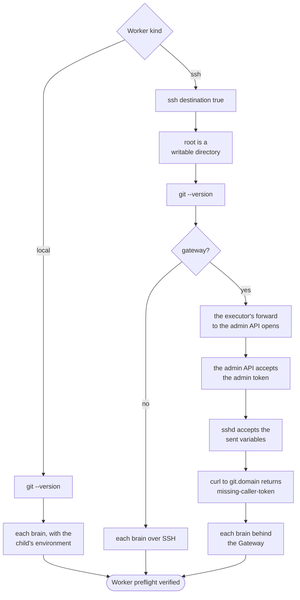
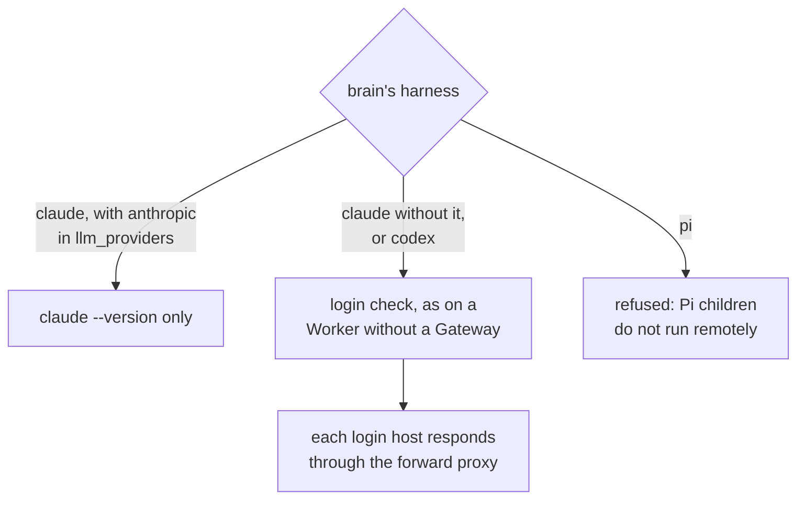
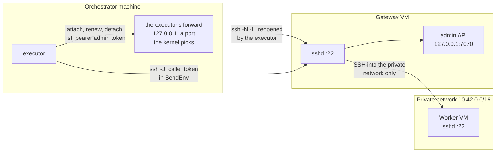
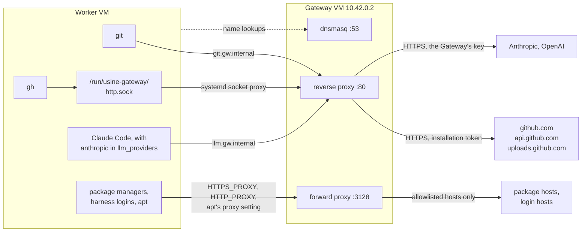
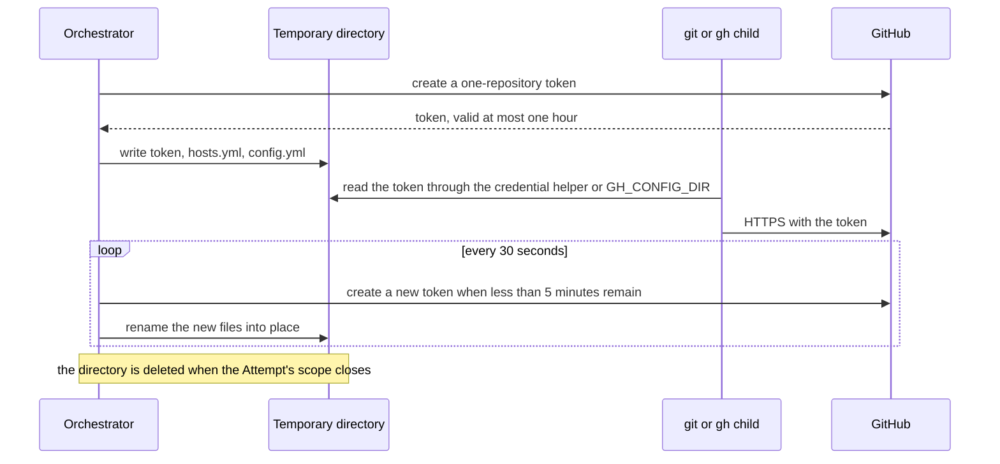
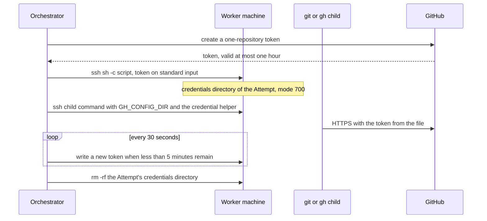
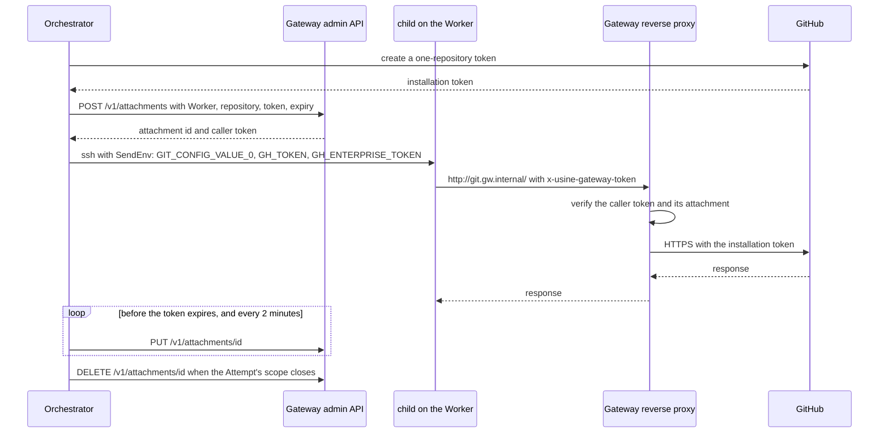
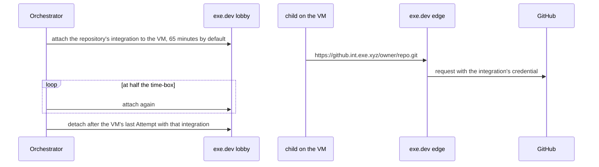

import { FileTree, Steps, TabItem, Tabs } from "@astrojs/starlight/components";

:::note
This page describes commit [`7c0c3d3`](https://github.com/basaltbytes/usine/tree/7c0c3d3696123d11e3d5b9cc3d27e18bb21e84e9) of basaltbytes/usine as it was on 2026-10-16, with the executor's own forward to the Gateway's admin API from [#249][] (2026-10-19), the handling of a refused GitHub token from [#431][] (2026-10-20), and SSH Workers that a reload adds or removes from [#387][] (2026-10-20).
:::

A Worker is the machine where an Attempt's checkout is and where its children run. The Pi parent always runs in the orchestrator. The operating recipes (creating machines, logging in to the harnesses, the SSH configuration, deleting) are in [`infra/hetzner/README.md`](https://github.com/basaltbytes/usine/blob/main/infra/hetzner/README.md) and [`infra/hetzner/gateway/README.md`](https://github.com/basaltbytes/usine/blob/main/infra/hetzner/gateway/README.md); this page explains what the code does.

## Worker kinds in `usine.yaml`

`Worker` is a union of three classes ([factory.ts:150][]). Without a `workers` key the factory has one Worker named `local` ([factory.ts:214][]).

| `kind`               | Fields                                                                                                                                                          | Executor              | Children run                                                                                          | GitHub credential on the machine                      |
| -------------------- | --------------------------------------------------------------------------------------------------------------------------------------------------------------- | --------------------- | ----------------------------------------------------------------------------------------------------- | ----------------------------------------------------- |
| `local`              | `name`, `max_concurrent_attempts` (default 1)                                                                                                                   | [local.ts][]          | as processes on the orchestrator's machine                                                            | token file in a private temporary directory           |
| `ssh`                | `name`, `destination`, `root`, optional `identity_file`, `port`, `max_concurrent_attempts`, `gateway`                                                           | [ssh/ssh.ts][]        | one SSH command each                                                                                  | token file under `<root>/workers/<name>/credentials/` |
| `ssh` with `gateway` | `gateway.domain`, `gateway.destination`, `gateway.admin_token_env`, optional `gateway.admin_port` (default 7070) and `gateway.llm_providers` (only `anthropic`) | the same SSH executor | one SSH command each; the operator's SSH configuration routes it through the Gateway with `ProxyJump` | none; a caller token in the SSH session's environment |
| `exe.dev`            | `name`, `max_concurrent_attempts`                                                                                                                               | [exe-dev.ts][]        | one SSH command each on the VM                                                                        | none; exe.dev's edge adds it                          |

The two `ssh` forms, as they appear in the Hetzner READMEs:

<Tabs>
  <TabItem label="ssh">

```yaml title="usine.yaml"
workers:
  - name: eu-one
    kind: ssh
    destination: usine@203.0.113.7
    identity_file: ~/.ssh/usine_worker
    root: /home/usine/.usine
    max_concurrent_attempts: 2
```

  </TabItem>
  <TabItem label="ssh behind a Gateway">

```yaml title="usine.yaml"
workers:
  - name: worker-one
    kind: ssh
    destination: worker-one
    root: /home/usine/.usine
    gateway:
      domain: gw.internal
      destination: usine-gateway
      admin_token_env: USINE_GATEWAY_ADMIN_TOKEN
```

Both `destination` keys are `Host` aliases. The orchestrator user's SSH configuration routes the connection to the Worker through the Gateway. The executor opens its own forward to the admin API through `gateway.destination` (see [the forward to the admin API](#the-forward-to-the-admin-api)), so the Gateway's entry has no `LocalForward`:

```ssh-config title="~/.ssh/config"
Host usine-gateway
  HostName 203.0.113.7
  User root
  IdentityFile ~/.ssh/usine_worker

Host worker-one
  HostName 10.42.0.3
  User usine
  ProxyJump usine-gateway
  IdentityFile ~/.ssh/usine_worker
```

  </TabItem>
</Tabs>

`usine up` uses one executor for all Workers. `workerEngineLayer` ([worker-engine.ts:13][]) picks the SSH executor when every Worker is `ssh` and the local executor otherwise. `stepExecutorLayer` then refuses any Worker whose kind differs from the executor's with `UnsupportedWorkerError` ([scheduler.ts:76][]). A mix of kinds, or any `exe.dev` Worker, therefore stops startup. The exe.dev executor also needs `githubIntegrations` options that `usine.yaml` can't set ([exe-dev.ts:34][]), so it runs only from the integration test (`pnpm --filter @usine/orchestrator test:exe-dev`). [#228][] tracks both.


## Executor behaviour per Worker kind

### local

State is under `<instance>/.usine/workers/<worker>/`: `repos/` for bare caches, `attempts/` for worktrees, `turbo/` for `TURBO_CACHE_DIR` ([local.ts:103][], [local.ts:290][]). Credentials go to a `usine-credentials-*` directory in the OS temporary folder, mode 700, with the token in `token` and gh's `hosts.yml` and `config.yml` next to it ([local/credentials.ts:22][]). Git reads the token through a credential helper and gh through `GH_CONFIG_DIR` ([credential-environment.ts:15][]), so a renewed file takes effect without restarting a child. The executor removes every issued token from Git output before the output goes into an error or a log ([local.ts:133][]).

### ssh without a Gateway

Every command is `ssh -o BatchMode=yes -o ServerAliveInterval=30 -o ServerAliveCountMax=4 [-p port] [-i key -o IdentitiesOnly=yes] <destination> -- <quoted command>` ([commands.ts:87][], [ssh/ssh.ts:22][], [child-host.ts:85][]). The SSH client inherits only `HOME`, `LANG`, `LC_ALL`, `PATH`, `SHELL`, `SSH_AGENT_PID`, `SSH_AUTH_SOCK`, `TMPDIR`, and `USER` ([commands.ts:70][]). The Worker directory on the machine is `<root>/workers/<name>`.

A shell script writes the token to `<root>/workers/<name>/credentials/<attempt>` from standard input, so the token doesn't appear on any command line ([ssh/credentials.ts:25][]). The directories are mode 700 and the files 600. The first Attempt of each Worker in a process removes every credential directory that an earlier process left. All Attempts on one machine run as the same user and can read each other's tokens ([ADR 0026](https://github.com/basaltbytes/usine/blob/main/docs/adr/0026-eu-ssh-worker.md), [#231][]).

### ssh behind a Gateway

`gatewayAttachmentsFor` ([attachments.ts:58][]) gives the Attempt repository access with no token on the machine:

<Steps>

1. Write gh's configuration to `<worker directory>/gh`: `http_unix_socket: /run/usine-gateway/http.sock` and the host `git.<domain>`. Neither file contains a token ([gateway/environment.ts:42][]).
2. Create the Attempt's token and send `POST /v1/attachments` to the Gateway's admin API. The response contains the attachment id and a caller token.
3. Renew the same attachment id with `PUT` before the token expires, and store it again every two minutes ([attachments.ts:35][]), because the Gateway keeps attachments in memory and loses them when it restarts. The caller token stays the same.
4. `DELETE` the attachment when the Attempt's scope closes.
5. Once per process and Worker, detach the attachments that an earlier process left for that Worker ([attachments.ts:64][]).

</Steps>

The children's environment has two parts ([gateway/environment.ts:88][]). The exported part is in each command line and contains no secret. The sent part goes through OpenSSH `SendEnv` ([commands.ts:101][]), so the caller token doesn't appear on any command line; the Worker's sshd must accept each sent variable name with `AcceptEnv`.

| Variable                                                 | Value                                                                           | Part     |
| -------------------------------------------------------- | ------------------------------------------------------------------------------- | -------- |
| `GIT_CONFIG_COUNT`                                       | `3`                                                                             | exported |
| `GIT_CONFIG_KEY_0`                                       | `http.http://git.<domain>/.extraHeader`                                         | exported |
| `GIT_CONFIG_VALUE_0`                                     | `x-usine-gateway-token: <caller token>`                                         | sent     |
| `GIT_CONFIG_KEY_1`, `GIT_CONFIG_KEY_2`                   | `url.http://git.<domain>/.insteadOf`                                            | exported |
| `GIT_CONFIG_VALUE_1`, `GIT_CONFIG_VALUE_2`               | `https://github.com/`, `https://git.<domain>/`                                  | exported |
| `GH_HOST`                                                | `git.<domain>`                                                                  | exported |
| `GH_CONFIG_DIR`                                          | `<worker directory>/gh`                                                         | exported |
| `GH_PROMPT_DISABLED`                                     | `1`                                                                             | exported |
| `HTTPS_PROXY`, `HTTP_PROXY`, `https_proxy`, `http_proxy` | `http://<domain>:3128`                                                          | exported |
| `NO_PROXY`, `no_proxy`                                   | `localhost,127.0.0.1,::1,<domain>`                                              | exported |
| `GH_ENTERPRISE_TOKEN`, `GH_TOKEN`                        | the caller token                                                                | sent     |
| `ANTHROPIC_BASE_URL`                                     | `http://llm.<domain>/anthropic`, only when `llm_providers` contains `anthropic` | exported |
| `ANTHROPIC_AUTH_TOKEN`                                   | the caller token, only when `llm_providers` contains `anthropic`                | sent     |

The clone URL is `http://git.<domain>/<owner>/<repo>.git` ([gateway/environment.ts:33][]).

#### The forward to the admin API

The admin API listens on the Gateway's loopback interface only. The SSH executor opens one forward to each Gateway, named by its `destination` and `admin_port`, when the first Worker behind it is added, at startup or by a reload. The Workers behind that Gateway share it ([gateway/forward.ts][], [ssh/workers.ts][]):

```sh
ssh -o BatchMode=yes -o ServerAliveInterval=30 -o ServerAliveCountMax=4 -N \
  -o ExitOnForwardFailure=yes -o ControlPath=none \
  -o PermitLocalCommand=yes -o 'LocalCommand=echo usine-gateway-forward-open' \
  -L 127.0.0.1:<port>:127.0.0.1:<admin_port> <gateway.destination>
```

`<port>` is a free port on 127.0.0.1 that the kernel picks for each SSH client, so the forward never competes with one the operator opens by hand. The client prints the `LocalCommand` line once its listener is up, and `ExitOnForwardFailure` makes it exit when it can't listen. A `LocalForward` in the SSH configuration for the Gateway's host also applies to this client, which exits when that port is taken. Every log line names the Gateway by its destination.

| When                                                                    | The executor                                                                                 | Log                                                                                                  |
| ----------------------------------------------------------------------- | -------------------------------------------------------------------------------------------- | ---------------------------------------------------------------------------------------------------- |
| the client prints the line                                              | sends admin requests to its port                                                             | `Opened the forward to the Gateway's admin API`, or `Reopened ...` with `closedSince`                |
| the client exits                                                        | starts another client after a pause of 1, 2, 4 seconds and so on, at most one minute         | `The forward to the Gateway's admin API exited; reopening it after a pause`, with ssh's error output |
| a client exits before the line, or no line comes within 30 seconds      | the same, with the pause doubled                                                             | `Could not open the forward to the Gateway's admin API; trying again after a pause`                  |
| an admin request finds the forward closed, or gets no answer through it | ends the client or the pause, starts another client at once, and sends the request once more | `A Gateway admin request did not get through; reopening the forward and sending it once more`        |
| the last Worker behind the Gateway is removed                           | ends the client                                                                              | `Closed the forward to the Gateway's admin API`                                                      |
| the executor's layer closes                                             | ends the client                                                                              | `Closed the forward to the Gateway's admin API`                                                      |

A request that fails a second time fails as it did before the forward: an attach fails the Attempt with `CredentialUnavailableError`, and a renewal is tried again 30 seconds later. While the forward is closed, the error says since when, for example `the forward through usine-gateway is closed since 2026-10-19T08:12:03.000Z: ssh: connect to host 203.0.113.7 port 22: Connection timed out`. While the forward opens but the admin API does not answer, as when the `usine-gateway` service is stopped, the error and the warning say since when it has answered no request, for example `the admin API through usine-gateway has not answered since 2026-10-19T08:12:03.000Z: no answer (TransportError)`, and the warning has `unansweredSince`. The time is kept per Gateway and cleared by the next answered request. The executor keeps reopening the forward for as long as a Worker behind the Gateway remains.

#### Worker changes on reload

`SshWorkers` holds the SSH executor's machines ([ssh/workers.ts][]). It starts with the Workers in `usine.yaml`, and the scheduler changes it on each reload ([scheduler.ts][], [orchestrator/src/ssh.ts][]):

- A Worker the reload adds: the orchestrator reads its Gateway's admin token, `addWorker` gives the executor its machine, and preflight runs on it. Behind a Gateway that another Worker uses, it shares that Gateway's forward; behind a new Gateway, the executor opens a forward to it. If the variable named by `admin_token_env` is unset, or the preflight fails, the reload is refused with `ReloadPreflightError` and the Worker is removed again.
- A Worker the reload removes stays with the executor until its last Attempt ends, because the Attempt's credential renewals and cleanup use its machine and its Gateway's forward. Then `removeWorker` takes it away, and closes the forward when it was the last Worker behind that Gateway.
- A Worker the reload adds back while its Attempts still run keeps the machine it has when its settings are the same. With other settings `addWorker` fails with a `machine` capability error, and the reload is refused until those Attempts end.

### Common to remote kinds

`remoteExecutorFor` ([remote.ts:44][]) contains the checkout, salvage, recovery, and reattach code that SSH and exe.dev share. Each Claude Code or Codex child is one SSH command with a pid file `<worktree>.child-<n>.pid` ([child-host.ts:96][]). `CHILD_KILL_SCRIPT` sends TERM, waits up to five seconds, then sends KILL, before the worktree is kept or removed ([child-host.ts:106][]).

## Preflight

`stepExecutorLayer` runs `Executor.preflight` for every configured Worker with every rostered brain while the runtime layer is built ([scheduler.ts:96][]). A failure stops `usine up`. `prepare` repeats the check for the Attempt's brain only ([local.ts:331][], [remote.ts:236][]). A missing capability found there fails the Attempt with `AgentFailure`; a transport failure or a timeout is a retryable `InfraFailure` ([scheduler.ts:51][]).



Behind a Gateway, the check for each brain depends on where its harness gets its model credential ([gateway/preflight.ts:162][]):



| Worker             | Checks                                                                                                                                                                                                                                                                                                                                                                                                                                                                                                          | Code                                                      |
| ------------------ | --------------------------------------------------------------------------------------------------------------------------------------------------------------------------------------------------------------------------------------------------------------------------------------------------------------------------------------------------------------------------------------------------------------------------------------------------------------------------------------------------------------- | --------------------------------------------------------- |
| local              | `git --version`; each brain where children run, with the child's environment                                                                                                                                                                                                                                                                                                                                                                                                                                    | [local.ts:256][], [agents/src/preflight/preflight.ts][]   |
| ssh                | SSH connects (`true`); `root` is a writable directory; `git --version`; each brain over SSH; Pi is refused on a remote machine                                                                                                                                                                                                                                                                                                                                                                                  | [ssh/preflight.ts:31][]                                   |
| ssh with a Gateway | The checks above, plus: the executor's forward to the admin API opens, or the error gives the `ssh` command to run to see why; the admin API accepts the admin token; sshd accepts the variables that contain the caller token; `curl http://git.<domain>/` from the machine is refused because it has no caller token; for each harness that uses its login on the machine, the login's hosts respond through the forward proxy; only the Claude Code binary is checked when the Gateway has the Anthropic key | [gateway/preflight.ts:47][], [gateway/preflight.ts:162][] |

Only exe.dev Workers have long-lived GitHub credentials: their GitHub integrations. Their preflight tests each integration and fails with the `credentials` capability when one isn't ready ([exe-dev/preflight.ts:123][]). Local and SSH Workers have no long-lived GitHub credential: `prepare` mints each Attempt's token from the GitHub App before the checkout. When GitHub refuses the mint, because the installation doesn't cover the repository, lacks a permission, or is suspended, the Attempt fails once with GitHub's reason and isn't retried ([#431][]). When GitHub can't be reached or rate-limits the request, the Attempt fails with a retryable `InfraFailure`.

## The Hetzner Gateway VM

`infra/hetzner/gateway/gateway.sh create` creates a private network (`10.42.0.0/16`), the Gateway VM with a public address, and a Hetzner firewall that allows SSH from the orchestrator's address. On first boot, `gateway-cloud-init.yaml` installs the parts below and writes an admin token and a caller key, generated with `openssl rand -hex 32`, to `/etc/usine-gateway/secrets.env`.

The orchestrator connects to the Worker and the admin API through the Gateway's sshd. The diagrams use the defaults of `gateway.sh`: the domain `gw.internal` and the Gateway's private address `10.42.0.2`.



A Worker has no public address and no default route. All its outbound traffic goes through the Gateway:



| Part                            | Listens on                                                              | Does                                                                                                                                                                                                                                                                                                                             | Code                                            |
| ------------------------------- | ----------------------------------------------------------------------- | -------------------------------------------------------------------------------------------------------------------------------------------------------------------------------------------------------------------------------------------------------------------------------------------------------------------------------- | ----------------------------------------------- |
| Reverse proxy (`usine-gateway`) | port 80 on the private address (the binary's default is `127.0.0.1:80`) | `git.<domain>` forwards to github.com, api.github.com (paths under `/api/`), and uploads.github.com with the attached installation token; `llm.<domain>` forwards to Anthropic or OpenAI with the Gateway's own credential. Every request needs a caller token whose attachment is active; a request for any other host gets 404 | [proxy.ts][], [github.ts:15][]                  |
| Forward proxy                   | port 3128 on the private address                                        | `CONNECT` to port 443 of an allowlisted host only, after checking that the TLS ClientHello's server name is that host and that the name resolves to public addresses only; the proxy forwards plain HTTP with caller tokens removed                                                                                              | [egress-proxy.ts:241][], [client-hello.ts:88][] |
| Admin API                       | `127.0.0.1:7070`                                                        | `POST /v1/attachments`, `PUT /v1/attachments/:id`, `DELETE /v1/attachments/:id`, `GET /v1/attachments`, bearer admin token                                                                                                                                                                                                       | [api.ts:92][]                                   |
| dnsmasq                         | port 53 on the private address                                          | Answers `<domain>` and its subdomains with the Gateway's address and refuses other names; `local=/<domain>/` answers AAAA with no address, for Codex's musl resolver ([#260][])                                                                                                                                                  | [gateway-cloud-init.yaml:42][]                  |
| nftables                        |                                                                         | Input: SSH, plus DNS, 80, and 3128 from the private network. No forwarding. Outbound SSH only into the private network                                                                                                                                                                                                           | [gateway-nftables.conf][]                       |
| sshd                            | port 22                                                                 | Bastion with `AllowTcpForwarding local`, for `ssh -J` to Workers and the admin API forward                                                                                                                                                                                                                                       | [gateway-cloud-init.yaml:66][]                  |

`gateway.sh` replaces the `@@NAME@@` placeholders before it creates the VM. These tabs show the service, DNS, and SSH settings from `gateway-cloud-init.yaml`, and the firewall rules:

<Tabs>
  <TabItem label="settings.env">

```yaml title="infra/hetzner/gateway/gateway-cloud-init.yaml"
write_files:
  # ...
  - path: /etc/usine-gateway/settings.env
    permissions: "0644"
    content: |
      USINE_GATEWAY_DOMAIN=@@DOMAIN@@
      USINE_GATEWAY_PROXY_HOST=@@GATEWAY_IP@@
      USINE_GATEWAY_PROXY_PORT=80
      USINE_GATEWAY_EGRESS_HOST=@@GATEWAY_IP@@
      USINE_GATEWAY_EGRESS_PORT=3128
      USINE_GATEWAY_ADMIN_HOST=127.0.0.1
      USINE_GATEWAY_ADMIN_PORT=7070
      USINE_GATEWAY_EGRESS_ALLOWLIST=/etc/usine-gateway/egress-allowlist
```

  </TabItem>
  <TabItem label="dnsmasq">

```yaml title="infra/hetzner/gateway/gateway-cloud-init.yaml"
write_files:
  # ...
  # dnsmasq answers Worker queries for the gateway's names only. It has no upstream server, so it refuses every other name, and it logs each query to the journal.
  # With local=, an AAAA query for the gateway's names gets an empty answer instead of a refusal, because musl's resolver, which Codex uses, fails the whole lookup on a refusal.
  - path: /etc/dnsmasq.d/usine-gateway.conf
    permissions: "0644"
    content: |
      bind-dynamic
      listen-address=@@GATEWAY_IP@@
      no-resolv
      no-hosts
      log-queries
      address=/@@DOMAIN@@/@@GATEWAY_IP@@
      local=/@@DOMAIN@@/
```

  </TabItem>
  <TabItem label="sshd">

```yaml title="infra/hetzner/gateway/gateway-cloud-init.yaml"
write_files:
  # ...
  - path: /etc/ssh/sshd_config.d/50-usine-gateway.conf
    permissions: "0644"
    content: |
      PasswordAuthentication no
      KbdInteractiveAuthentication no
      PermitRootLogin prohibit-password
      AllowTcpForwarding local
      AllowAgentForwarding no
      AllowStreamLocalForwarding no
      GatewayPorts no
      PermitTunnel no
      X11Forwarding no
```

  </TabItem>
  <TabItem label="nftables">

```txt title="infra/hetzner/gateway/gateway-nftables.conf"
define network = 10.42.0.0/16

flush ruleset

table inet usine_gateway {
	chain input {
		type filter hook input priority filter; policy drop;
		iif lo accept
		ct state established,related accept
		ct state invalid drop
		meta l4proto { icmp, ipv6-icmp } accept
		tcp dport 22 accept
		# DHCP renewals for the private network address.
		udp sport 67 udp dport 68 accept
		ip saddr $network udp dport 53 accept
		ip saddr $network tcp dport { 53, 80, 3128 } accept
	}

	chain forward {
		type filter hook forward priority filter; policy drop;
	}

	chain output {
		type filter hook output priority filter; policy accept;
		# The bastion only opens SSH connections into the private network.
		tcp dport 22 ip daddr != $network reject
	}
}
```

  </TabItem>
</Tabs>

The admin API is an Effect `HttpApi` that the executor's client and the Gateway's server share:

```ts title="packages/gateway/src/admin/api.ts"
export const GatewayAdminApi = HttpApi.make("GatewayAdminApi").add(
  HttpApiGroup.make("attachments")
    .add(
      HttpApiEndpoint.post("attach", "/v1/attachments", {
        payload: AttachRequest.annotate(strict),
        success: Attached,
        error: AttachmentAlreadyExpired.annotate({ httpApiStatus: 422 }),
      }),
      HttpApiEndpoint.put("renew", "/v1/attachments/:id", {
        params: { id: AttachmentId },
        payload: AttachRequest.annotate(strict),
        success: Attached,
        error: [
          AttachmentAlreadyExpired.annotate({ httpApiStatus: 422 }),
          AttachmentConflict.annotate({ httpApiStatus: 409 }),
        ],
      }),
      HttpApiEndpoint.delete("detach", "/v1/attachments/:id", {
        params: { id: AttachmentId },
        success: Detached,
      }),
      HttpApiEndpoint.get("list", "/v1/attachments", { success: AttachmentList }),
    )
    .middleware(AdminAuthorization),
);
```

The caller token is HMAC-signed with the caller key and contains its attachment id, Worker, and repository ([caller.ts:93][]). The reverse proxy reads it from the `x-usine-gateway-token` header, an `Authorization` header, or `x-api-key`, and removes it before it forwards the request. The proxy refuses a token from a detached attachment, even when a new attachment exists for the same Worker and repository. Refusals have a reason in the `x-usine-gateway-refusal` header ([proxy.ts:33][]):

| Reason                                                            | Status |
| ----------------------------------------------------------------- | ------ |
| `unknown-host`, `unsupported-path`                                | 404    |
| `missing-caller-token`, `invalid-caller-token`                    | 401    |
| `stale-caller-token`, `attachment-expired`, `repository-mismatch` | 403    |
| `provider-not-configured`                                         | 503    |

The forward proxy has its own reasons: `host-not-allowed`, `port-not-allowed`, `address-literal`, `private-address`, `not-tls`, `server-name-missing`, and `server-name-mismatch` ([egress.ts:59][]). The service reads its settings once at start ([node/environment.ts:64][]): `USINE_GATEWAY_DOMAIN`, `USINE_GATEWAY_ADMIN_TOKEN`, `USINE_GATEWAY_CALLER_KEY`, the allowlist file (default `/etc/usine-gateway/egress-allowlist`), and optionally `ANTHROPIC_API_KEY` or `USINE_GATEWAY_ANTHROPIC_SUBSCRIPTION_TOKEN` (not both) and `OPENAI_API_KEY`. It logs one JSON object per line to journald ([node/main.ts:7][]). [ADR 0027](https://github.com/basaltbytes/usine/blob/main/docs/adr/0027-gateway-credential-proxy.md) explains why usine has its own proxy instead of a TLS-intercepting one.

## Credential flow

Only the orchestrator has the GitHub App's private key, which it reads from the environment variable `USINE_GITHUB_PRIVATE_KEY` or from `.usine/github-app.json`. For each Attempt, `CredentialProvider.issue` ([orchestrator/src/credentials.ts:79][]) calls `GitHubApp.workerToken` ([github-app.ts:294][]), which sends `POST /app/installations/:id/access_tokens` with one repository id and receives a token that expires after at most one hour. `renewableCredential` issues a new token when less than five minutes remain, and checks every 30 seconds ([renewable-credential.ts:11][], [renewable-credential.ts:69][]). The next steps depend on the Worker kind:

<Tabs>
  <TabItem label="local">



  </TabItem>
  <TabItem label="ssh">



  </TabItem>
  <TabItem label="ssh behind a Gateway">



The orchestrator connects to the admin API through its own SSH forward to the Gateway, which it reopens when it closes.

  </TabItem>
  <TabItem label="exe.dev">



No token goes through the orchestrator: each repository needs a persistent exe.dev GitHub integration ([exe-dev.ts:34][]).

  </TabItem>
</Tabs>

The orchestrator reads the Gateway's admin token from the environment variable named by `admin_token_env`: at startup for the Workers in `usine.yaml`, and for a Worker a reload adds, at that reload. If the variable is unset, startup stops with a `gateway` capability error ([orchestrator/src/ssh.ts:27][]), and a reload is refused with `ReloadPreflightError` carrying the same kind of error. A running process does not see variables set after it started, so the variable must be in the environment `usine up` starts with. The executor opens the SSH forward to the admin API itself; see [the forward to the admin API](#the-forward-to-the-admin-api).

## Harness logins on the Worker

The Claude Code and Codex logins belong to the operator, who creates them on the Worker as the `usine` user with `claude auth login` and `codex login --device-auth`. Behind a Gateway, the logins call their providers through the forward proxy, so the allowlist includes their hosts:

```txt title="infra/hetzner/gateway/egress-allowlist"
# Claude Code with a Claude subscription: the API, and the OAuth token
# endpoint that claude auth login and token refreshes call.
api.anthropic.com
platform.claude.com

# Codex with a ChatGPT plan: the ChatGPT API, and the device-code login and
# token refreshes.
chatgpt.com
auth.openai.com
```

With `llm_providers: [anthropic]`, Claude Code children call `llm.<domain>/anthropic` instead, and the Gateway sends its own key. The Gateway's use of a Claude subscription token for this isn't verified against Anthropic ([#234][]), and the Gateway has no ChatGPT login ([#235][]). [ADR 0027](https://github.com/basaltbytes/usine/blob/main/docs/adr/0027-gateway-credential-proxy.md), amendment of 2026-10-15, explains why the logins stay on the Worker.

## cloud-init files

<FileTree>

- infra/hetzner/
  - cloud-init.yaml the Worker machine
  - create-worker.sh
  - gateway/
    - egress-allowlist
    - gateway-cloud-init.yaml the Gateway VM
    - gateway-nftables.conf
    - gateway.sh
    - worker-cloud-init.yaml added for a Worker behind the Gateway
    - worker-nftables.conf

</FileTree>

| File                                            | Adds                                                                                                                                                                                                                                                                                                                                                                                                                                                                                                                                                          |
| ----------------------------------------------- | ------------------------------------------------------------------------------------------------------------------------------------------------------------------------------------------------------------------------------------------------------------------------------------------------------------------------------------------------------------------------------------------------------------------------------------------------------------------------------------------------------------------------------------------------------------- |
| `infra/hetzner/cloud-init.yaml`                 | Debian 13 with the `usine` user, key-only SSH (`AllowUsers usine`). Packages `build-essential`, `bubblewrap` for Codex's sandbox ([#269][]), `ca-certificates`, `chromium`, `curl`, `git`, `gnupg`, `jq`. A 2 GB swap file and `vm.overcommit_memory = 1` for the 6 GiB virtual buffer of the lint gates ([#270][]). `/etc/environment` gets `DISABLE_AUTOUPDATER=1` and `PLAYWRIGHT_CHROMIUM_EXECUTABLE_PATH=/usr/bin/chromium`. A setup script installs gh, Node.js 24, pnpm 11.20.0, Claude Code 2.1.296, Codex 0.153.4, and creates `/home/usine/.usine`. |
| `infra/hetzner/gateway/worker-cloud-init.yaml`  | Appended for a Worker behind the Gateway: the Gateway as the only resolver, apt through the forward proxy, Worker nftables (gateway only), `/etc/environment` with `GH_HOST`, the proxy variables, `NO_PROXY`, and `CLAUDE_CODE_DISABLE_NONESSENTIAL_TRAFFIC=1`, a systemd socket that forwards `/run/usine-gateway/http.sock` to the Gateway's port 80, and `AcceptEnv GIT_CONFIG_VALUE_0 GH_ENTERPRISE_TOKEN GH_TOKEN ANTHROPIC_AUTH_TOKEN`.                                                                                                                |
| `infra/hetzner/gateway/gateway-cloud-init.yaml` | The Gateway VM: nftables, dnsmasq, the bastion sshd settings, Node.js, the `usine-gateway` systemd service, the secrets file.                                                                                                                                                                                                                                                                                                                                                                                                                                 |
| `infra/hetzner/create-worker.sh`                | Creates a server from `cloud-init.yaml`, labels it `usine=worker`, attaches a firewall that allows SSH from one address.                                                                                                                                                                                                                                                                                                                                                                                                                                      |
| `infra/hetzner/gateway/gateway.sh`              | `create`, `delete`, `install <tarballs>`, and `worker-user-data`, which renders the two Worker files as one MIME cloud-init.                                                                                                                                                                                                                                                                                                                                                                                                                                  |

The parts of `worker-cloud-init.yaml` that every SSH session reads:

```yaml title="infra/hetzner/gateway/worker-cloud-init.yaml"
write_files:
  # ...
  # Every SSH session reads this file, including the harness logins, and so does the setup script of ../cloud-init.yaml.
  - path: /etc/environment
    append: true
    content: |
      GH_HOST=git.@@DOMAIN@@
      HTTPS_PROXY=http://@@GATEWAY_IP@@:3128
      HTTP_PROXY=http://@@GATEWAY_IP@@:3128
      https_proxy=http://@@GATEWAY_IP@@:3128
      http_proxy=http://@@GATEWAY_IP@@:3128
      NO_PROXY=@@DOMAIN@@
      no_proxy=@@DOMAIN@@
      CLAUDE_CODE_DISABLE_NONESSENTIAL_TRAFFIC=1
  # ...
  # The executor sends each Attempt's caller token in these variables over the SSH connection, so the token never appears on a command line.
  - path: /etc/ssh/sshd_config.d/40-usine-gateway.conf
    permissions: "0644"
    content: |
      AcceptEnv GIT_CONFIG_VALUE_0 GH_ENTERPRISE_TOKEN GH_TOKEN ANTHROPIC_AUTH_TOKEN
```

These proxy variables use the Gateway's address and apply to SSH sessions such as the harness logins. An Attempt's children also get the executor's exported values, which override them and use the domain: `http://<domain>:3128`.

`gateway.sh` writes the Gateway's private address into the Worker nftables file and the domain into the Worker cloud-init; the defaults are `10.42.0.2` and `gw.internal` ([gateway.sh:19][]):

```sh title="infra/hetzner/gateway/gateway.sh"
NAME=${NAME:-usine-gateway}
LOCATION=${LOCATION:-fsn1}
SERVER_TYPE=${SERVER_TYPE:-cx23}
IMAGE=${IMAGE:-debian-13}
NETWORK_ZONE=${NETWORK_ZONE:-eu-central}
NETWORK_CIDR=${NETWORK_CIDR:-10.42.0.0/16}
SUBNET_CIDR=${SUBNET_CIDR:-10.42.0.0/24}
GATEWAY_IP=${GATEWAY_IP:-10.42.0.2}
DOMAIN=${DOMAIN:-gw.internal}
LABEL=${LABEL:-usine=gateway}
GATEWAY_PACKAGE=${GATEWAY_PACKAGE:-@usine/gateway}
```

A Worker behind the Gateway has no time source ([#254][]), and you must apply infrastructure changes to running machines by hand ([#264][]).

[factory.ts:150]: https://github.com/basaltbytes/usine/blob/7c0c3d3696123d11e3d5b9cc3d27e18bb21e84e9/packages/config/src/factory.ts#L150
[factory.ts:214]: https://github.com/basaltbytes/usine/blob/7c0c3d3696123d11e3d5b9cc3d27e18bb21e84e9/packages/config/src/factory.ts#L214
[local.ts]: https://github.com/basaltbytes/usine/blob/7c0c3d3696123d11e3d5b9cc3d27e18bb21e84e9/packages/executor/src/local/local.ts
[local.ts:103]: https://github.com/basaltbytes/usine/blob/7c0c3d3696123d11e3d5b9cc3d27e18bb21e84e9/packages/executor/src/local/local.ts#L103
[local.ts:133]: https://github.com/basaltbytes/usine/blob/7c0c3d3696123d11e3d5b9cc3d27e18bb21e84e9/packages/executor/src/local/local.ts#L133
[local.ts:256]: https://github.com/basaltbytes/usine/blob/7c0c3d3696123d11e3d5b9cc3d27e18bb21e84e9/packages/executor/src/local/local.ts#L256
[local.ts:290]: https://github.com/basaltbytes/usine/blob/7c0c3d3696123d11e3d5b9cc3d27e18bb21e84e9/packages/executor/src/local/local.ts#L290
[local.ts:331]: https://github.com/basaltbytes/usine/blob/7c0c3d3696123d11e3d5b9cc3d27e18bb21e84e9/packages/executor/src/local/local.ts#L331
[local/credentials.ts:22]: https://github.com/basaltbytes/usine/blob/7c0c3d3696123d11e3d5b9cc3d27e18bb21e84e9/packages/executor/src/local/credentials.ts#L22
[credential-environment.ts:15]: https://github.com/basaltbytes/usine/blob/7c0c3d3696123d11e3d5b9cc3d27e18bb21e84e9/packages/executor/src/credential-environment.ts#L15
[ssh/ssh.ts]: https://github.com/basaltbytes/usine/blob/7c0c3d3696123d11e3d5b9cc3d27e18bb21e84e9/packages/executor/src/ssh/ssh.ts
[ssh/ssh.ts:22]: https://github.com/basaltbytes/usine/blob/7c0c3d3696123d11e3d5b9cc3d27e18bb21e84e9/packages/executor/src/ssh/ssh.ts#L22
[ssh/credentials.ts:25]: https://github.com/basaltbytes/usine/blob/7c0c3d3696123d11e3d5b9cc3d27e18bb21e84e9/packages/executor/src/ssh/credentials.ts#L25
[ssh/preflight.ts:31]: https://github.com/basaltbytes/usine/blob/7c0c3d3696123d11e3d5b9cc3d27e18bb21e84e9/packages/executor/src/ssh/preflight.ts#L31
[commands.ts:70]: https://github.com/basaltbytes/usine/blob/7c0c3d3696123d11e3d5b9cc3d27e18bb21e84e9/packages/executor/src/remote/commands.ts#L70
[commands.ts:87]: https://github.com/basaltbytes/usine/blob/7c0c3d3696123d11e3d5b9cc3d27e18bb21e84e9/packages/executor/src/remote/commands.ts#L87
[commands.ts:101]: https://github.com/basaltbytes/usine/blob/7c0c3d3696123d11e3d5b9cc3d27e18bb21e84e9/packages/executor/src/remote/commands.ts#L101
[remote.ts:44]: https://github.com/basaltbytes/usine/blob/7c0c3d3696123d11e3d5b9cc3d27e18bb21e84e9/packages/executor/src/remote/remote.ts#L44
[remote.ts:236]: https://github.com/basaltbytes/usine/blob/7c0c3d3696123d11e3d5b9cc3d27e18bb21e84e9/packages/executor/src/remote/remote.ts#L236
[child-host.ts:85]: https://github.com/basaltbytes/usine/blob/7c0c3d3696123d11e3d5b9cc3d27e18bb21e84e9/packages/agents/src/child-host/child-host.ts#L85
[child-host.ts:96]: https://github.com/basaltbytes/usine/blob/7c0c3d3696123d11e3d5b9cc3d27e18bb21e84e9/packages/agents/src/child-host/child-host.ts#L96
[child-host.ts:106]: https://github.com/basaltbytes/usine/blob/7c0c3d3696123d11e3d5b9cc3d27e18bb21e84e9/packages/agents/src/child-host/child-host.ts#L106
[agents/src/preflight/preflight.ts]: https://github.com/basaltbytes/usine/blob/7c0c3d3696123d11e3d5b9cc3d27e18bb21e84e9/packages/agents/src/preflight/preflight.ts
[attachments.ts:35]: https://github.com/basaltbytes/usine/blob/7c0c3d3696123d11e3d5b9cc3d27e18bb21e84e9/packages/executor/src/ssh/gateway/attachments.ts#L35
[attachments.ts:58]: https://github.com/basaltbytes/usine/blob/7c0c3d3696123d11e3d5b9cc3d27e18bb21e84e9/packages/executor/src/ssh/gateway/attachments.ts#L58
[attachments.ts:64]: https://github.com/basaltbytes/usine/blob/7c0c3d3696123d11e3d5b9cc3d27e18bb21e84e9/packages/executor/src/ssh/gateway/attachments.ts#L64
[gateway/environment.ts:33]: https://github.com/basaltbytes/usine/blob/7c0c3d3696123d11e3d5b9cc3d27e18bb21e84e9/packages/executor/src/ssh/gateway/environment.ts#L33
[gateway/environment.ts:42]: https://github.com/basaltbytes/usine/blob/7c0c3d3696123d11e3d5b9cc3d27e18bb21e84e9/packages/executor/src/ssh/gateway/environment.ts#L42
[gateway/environment.ts:88]: https://github.com/basaltbytes/usine/blob/7c0c3d3696123d11e3d5b9cc3d27e18bb21e84e9/packages/executor/src/ssh/gateway/environment.ts#L88
[gateway/forward.ts]: https://github.com/basaltbytes/usine/blob/main/packages/executor/src/ssh/gateway/forward.ts
[ssh/workers.ts]: https://github.com/basaltbytes/usine/blob/main/packages/executor/src/ssh/workers.ts
[scheduler.ts]: https://github.com/basaltbytes/usine/blob/main/packages/orchestrator/src/scheduler.ts
[orchestrator/src/ssh.ts]: https://github.com/basaltbytes/usine/blob/main/packages/orchestrator/src/ssh.ts
[gateway/preflight.ts:47]: https://github.com/basaltbytes/usine/blob/7c0c3d3696123d11e3d5b9cc3d27e18bb21e84e9/packages/executor/src/ssh/gateway/preflight.ts#L47
[gateway/preflight.ts:162]: https://github.com/basaltbytes/usine/blob/7c0c3d3696123d11e3d5b9cc3d27e18bb21e84e9/packages/executor/src/ssh/gateway/preflight.ts#L162
[exe-dev.ts]: https://github.com/basaltbytes/usine/blob/7c0c3d3696123d11e3d5b9cc3d27e18bb21e84e9/packages/executor/src/exe-dev/exe-dev.ts
[exe-dev.ts:34]: https://github.com/basaltbytes/usine/blob/7c0c3d3696123d11e3d5b9cc3d27e18bb21e84e9/packages/executor/src/exe-dev/exe-dev.ts#L34
[exe-dev/preflight.ts:123]: https://github.com/basaltbytes/usine/blob/7c0c3d3696123d11e3d5b9cc3d27e18bb21e84e9/packages/executor/src/exe-dev/preflight.ts#L123
[renewable-credential.ts:11]: https://github.com/basaltbytes/usine/blob/7c0c3d3696123d11e3d5b9cc3d27e18bb21e84e9/packages/executor/src/renewable-credential.ts#L11
[renewable-credential.ts:69]: https://github.com/basaltbytes/usine/blob/7c0c3d3696123d11e3d5b9cc3d27e18bb21e84e9/packages/executor/src/renewable-credential.ts#L69
[worker-engine.ts:13]: https://github.com/basaltbytes/usine/blob/7c0c3d3696123d11e3d5b9cc3d27e18bb21e84e9/packages/orchestrator/src/worker-engine.ts#L13
[scheduler.ts:51]: https://github.com/basaltbytes/usine/blob/7c0c3d3696123d11e3d5b9cc3d27e18bb21e84e9/packages/orchestrator/src/scheduler.ts#L51
[scheduler.ts:76]: https://github.com/basaltbytes/usine/blob/7c0c3d3696123d11e3d5b9cc3d27e18bb21e84e9/packages/orchestrator/src/scheduler.ts#L76
[scheduler.ts:96]: https://github.com/basaltbytes/usine/blob/7c0c3d3696123d11e3d5b9cc3d27e18bb21e84e9/packages/orchestrator/src/scheduler.ts#L96
[orchestrator/src/credentials.ts:79]: https://github.com/basaltbytes/usine/blob/7c0c3d3696123d11e3d5b9cc3d27e18bb21e84e9/packages/orchestrator/src/credentials.ts#L79
[orchestrator/src/ssh.ts:27]: https://github.com/basaltbytes/usine/blob/7c0c3d3696123d11e3d5b9cc3d27e18bb21e84e9/packages/orchestrator/src/ssh.ts#L27
[github-app.ts:294]: https://github.com/basaltbytes/usine/blob/7c0c3d3696123d11e3d5b9cc3d27e18bb21e84e9/packages/github/src/github-app.ts#L294
[proxy.ts]: https://github.com/basaltbytes/usine/blob/7c0c3d3696123d11e3d5b9cc3d27e18bb21e84e9/packages/gateway/src/proxy/proxy.ts
[proxy.ts:33]: https://github.com/basaltbytes/usine/blob/7c0c3d3696123d11e3d5b9cc3d27e18bb21e84e9/packages/gateway/src/proxy/proxy.ts#L33
[github.ts:15]: https://github.com/basaltbytes/usine/blob/7c0c3d3696123d11e3d5b9cc3d27e18bb21e84e9/packages/gateway/src/github/github.ts#L15
[egress-proxy.ts:241]: https://github.com/basaltbytes/usine/blob/7c0c3d3696123d11e3d5b9cc3d27e18bb21e84e9/packages/gateway/src/node/egress-proxy.ts#L241
[client-hello.ts:88]: https://github.com/basaltbytes/usine/blob/7c0c3d3696123d11e3d5b9cc3d27e18bb21e84e9/packages/gateway/src/egress/client-hello.ts#L88
[egress.ts:59]: https://github.com/basaltbytes/usine/blob/7c0c3d3696123d11e3d5b9cc3d27e18bb21e84e9/packages/gateway/src/egress/egress.ts#L59
[api.ts:92]: https://github.com/basaltbytes/usine/blob/7c0c3d3696123d11e3d5b9cc3d27e18bb21e84e9/packages/gateway/src/admin/api.ts#L92
[caller.ts:93]: https://github.com/basaltbytes/usine/blob/7c0c3d3696123d11e3d5b9cc3d27e18bb21e84e9/packages/gateway/src/caller/caller.ts#L93
[node/environment.ts:64]: https://github.com/basaltbytes/usine/blob/7c0c3d3696123d11e3d5b9cc3d27e18bb21e84e9/packages/gateway/src/node/environment.ts#L64
[node/main.ts:7]: https://github.com/basaltbytes/usine/blob/7c0c3d3696123d11e3d5b9cc3d27e18bb21e84e9/packages/gateway/src/node/main.ts#L7
[gateway-cloud-init.yaml:42]: https://github.com/basaltbytes/usine/blob/7c0c3d3696123d11e3d5b9cc3d27e18bb21e84e9/infra/hetzner/gateway/gateway-cloud-init.yaml#L42
[gateway-cloud-init.yaml:66]: https://github.com/basaltbytes/usine/blob/7c0c3d3696123d11e3d5b9cc3d27e18bb21e84e9/infra/hetzner/gateway/gateway-cloud-init.yaml#L66
[gateway-nftables.conf]: https://github.com/basaltbytes/usine/blob/7c0c3d3696123d11e3d5b9cc3d27e18bb21e84e9/infra/hetzner/gateway/gateway-nftables.conf
[gateway.sh:19]: https://github.com/basaltbytes/usine/blob/7c0c3d3696123d11e3d5b9cc3d27e18bb21e84e9/infra/hetzner/gateway/gateway.sh#L19
[#228]: https://github.com/basaltbytes/usine/issues/228
[#231]: https://github.com/basaltbytes/usine/issues/231
[#234]: https://github.com/basaltbytes/usine/issues/234
[#235]: https://github.com/basaltbytes/usine/issues/235
[#249]: https://github.com/basaltbytes/usine/issues/249
[#254]: https://github.com/basaltbytes/usine/issues/254
[#260]: https://github.com/basaltbytes/usine/issues/260
[#264]: https://github.com/basaltbytes/usine/issues/264
[#269]: https://github.com/basaltbytes/usine/issues/269
[#270]: https://github.com/basaltbytes/usine/issues/270
[#431]: https://github.com/basaltbytes/usine/issues/431
[#387]: https://github.com/basaltbytes/usine/issues/387
