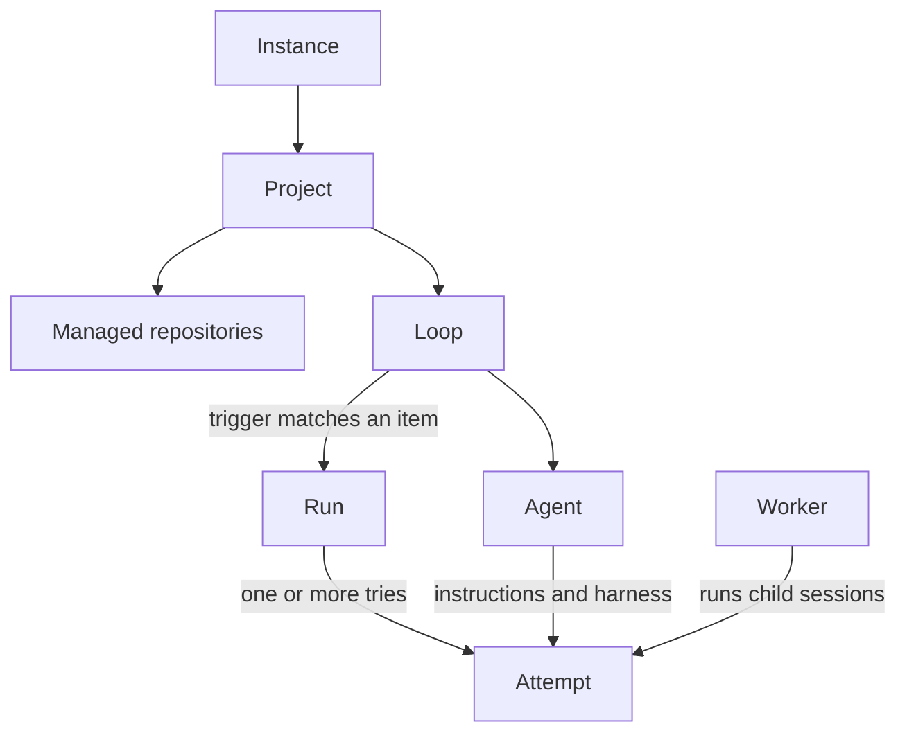

An instance stores your configuration and run history. Its projects group repositories; each project's loops select work for agents.

## Instance

An instance is one installation of usine with its own configuration, credentials, and runtime state, served by an orchestrator. Its instance folder contains `.usine/`; an instance repo is a Git repository for bootstrap and configuration import and export files. [Start an instance in the quickstart](/get-started/quickstart/).

## Project

A project is a named group of managed repositories with one board and the loops that run on them. The registry lists managed repositories, and a repository belongs to at most one project. [Operate a project's board](/guides/operate-runs/#project-boards-and-tasks).

## Loop

A loop defines a trigger and the agent run to start for each matching item in a project. An item is a GitHub issue or pull request; a trigger can select issues, pull requests, or schedule ticks. [Write a loop](/guides/write-a-loop/).

## Agent

An agent is a named definition of standing instructions and a brain spec: its harness, model, and reasoning effort. The harness is the coding-agent CLI, such as Claude Code, Codex, or Pi. [Write an agent](/guides/write-an-agent/).

## Run

A run is the work for one event of a loop. In the UI, a run can wait for approval, queue for a worker, run an attempt, or wait for CI before it closes as succeeded, failed, or canceled. [Approve and follow a run](/guides/operate-runs/).

## Attempt

An attempt is one try of a run's step on a worker. Retrying a failed run creates another attempt in the same run, with its own transcript of session messages. [Retry an attempt](/guides/operate-runs/#retry-a-failed-run).

## Worker

A worker is a machine that runs an attempt's child sessions in a checkout. The default local worker uses the machine and user running `usine up`; the Pi parent session always runs in the orchestrator. [Add a worker](/guides/add-a-worker/) to run children on another machine.

## Board and task

A board groups a project's tasks into lanes. A task groups linked issues and pull requests with their runs; its current item is the issue or pull request shown on the board. A lane maps to GitHub labels or item states, and moving a card changes labels on GitHub. [Use the board](/guides/operate-runs/).

## Configuration revision

A revision records a configuration change with its number, actor, time, optional message, and before-and-after values. Later starts read stored configuration; editing the original bootstrap files has no effect until you import them. [Change the configuration](/guides/change-the-configuration/).
