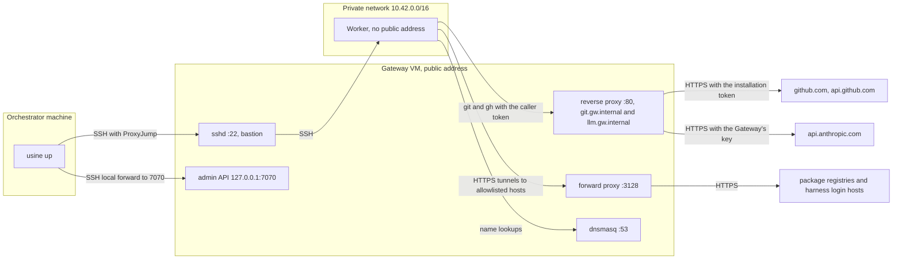

import { Steps } from "@astrojs/starlight/components";

A Worker is the machine where an Attempt's checkout is and where its Claude Code or Codex children run. The Pi parent of every Attempt runs in the orchestrator, whatever the Worker. The `workers` list of `usine.yaml` declares the Workers; without it, the factory has one local Worker named `local` that runs one Attempt at a time.

## Worker kinds

| `kind`               | Where children run                                           | GitHub credential on the machine                                     |
| -------------------- | ------------------------------------------------------------ | -------------------------------------------------------------------- |
| `local`              | as processes on the orchestrator's machine                   | a token file in a private temporary folder, removed with the Attempt |
| `ssh`                | on a Linux machine, one SSH command per child                | a token file under the Worker's root, removed with the Attempt       |
| `ssh` with `gateway` | on a Linux machine with no public address, through a Gateway | none: the Gateway adds the token to the machine's GitHub requests    |
| `exe.dev`            | not available: `usine up` refuses this kind at this commit   |                                                                      |

All Workers of one `usine.yaml` must have the same kind. When every Worker is `ssh`, `usine up` runs the SSH executor; otherwise it runs the local executor, which refuses any Worker that is not `local`. A mix of kinds, or any `exe.dev` Worker, stops startup with `UnsupportedWorkerError` ([#228](https://github.com/basaltbytes/usine/issues/228)).

Each Worker has a `name` (kebab-case) and `max_concurrent_attempts`, the number of Attempts it runs at the same time, 1 by default. Runs take free slots in the order their Events arrived. [`usine.yaml`](/reference/configuration/usine-yaml/) lists every Worker field.

## Local Workers

```yaml title="usine.yaml"
workers:
  - name: local
    kind: local
    max_concurrent_attempts: 2
```

A local Worker's state is under `.usine/workers/<name>/` in the instance folder: cached bare clones in `repos/`, one worktree per Attempt in `attempts/`, and a Turborepo cache in `turbo/`. Children run as the user who runs `usine up`, with only `HOME`, `LANG`, `LC_ALL`, `PATH`, `SHELL`, `TMPDIR`, `USER`, the Attempt's credential settings, and `TURBO_CACHE_DIR` in their environment. The harnesses must be on that `PATH` and logged in for that user. Pi children can run only on local Workers.

## Preflight

usine checks each Worker without changing it. At startup it checks every Worker for the harness of every Agent in the roster, and a failure stops `usine up` with the Worker and what is missing. Before each Attempt it checks the Attempt's Agent again on the chosen Worker; a missing harness or login then fails the Attempt with `AgentFailure`, and the Run waits for you to fix the Worker and retry.

| Worker               | Checks                                                                                                                                                                                                                                                              |
| -------------------- | ------------------------------------------------------------------------------------------------------------------------------------------------------------------------------------------------------------------------------------------------------------------- |
| `local`              | `git --version`, and each harness with the children's environment ([Write an Agent](/guides/write-an-agent/#preflight)).                                                                                                                                            |
| `ssh`                | The SSH connection, a writable `root`, `git --version`, and each harness over SSH. A Pi Agent in the roster fails this check.                                                                                                                                       |
| `ssh` with `gateway` | The `ssh` checks, then: the admin API accepts the admin token, the Worker's sshd accepts the caller token variables, the Worker reaches `git.<domain>`, and for each harness that uses its login on the Worker, the login's hosts answer through the forward proxy. |

Preflight never installs anything or logs in. Making a Worker ready is your job; on Hetzner Cloud, the scripts below install the toolchain for you.

## SSH Workers

An SSH Worker is any Linux machine that the orchestrator's `ssh` client can reach. The machine needs Git, the harnesses your Agents use on the `PATH` of a non-interactive SSH session, their logins under the SSH user, and a directory the SSH user can write to.

```yaml title="usine.yaml"
workers:
  - name: worker-one
    kind: ssh
    destination: usine@203.0.113.20
    identity_file: ~/.ssh/usine_worker
    root: /home/usine/.usine
    max_concurrent_attempts: 1
```

| Field           | Meaning                                                                                                                  |
| --------------- | ------------------------------------------------------------------------------------------------------------------------ |
| `destination`   | `user@host`, a host, or a `Host` alias of the SSH configuration of the user who runs `usine up`.                         |
| `root`          | An absolute directory on the machine. The Worker's clones, worktrees, and credentials are under `<root>/workers/<name>`. |
| `identity_file` | Optional. A private key, absolute or under `~/`. Without it, the SSH agent and configuration decide.                     |
| `port`          | Optional. The SSH port.                                                                                                  |

The orchestrator runs `ssh` in batch mode, so the machine's host key must already be in `known_hosts`: connect once by hand before you start `usine up`. The `ssh` client sees only `HOME`, `LANG`, `LC_ALL`, `PATH`, `SHELL`, `SSH_AGENT_PID`, `SSH_AUTH_SOCK`, `TMPDIR`, and `USER` from the orchestrator's environment, so an SSH agent works.

Each Attempt's token is written to `<root>/workers/<name>/credentials/<attempt>`, from standard input so that it is in no command line, and removed when the Attempt ends. Attempts on one machine run as the same user and can read each other's tokens ([#231](https://github.com/basaltbytes/usine/issues/231)); a Gateway removes the token from the machine.

### A Worker on Hetzner Cloud

`infra/hetzner/` in the usine repository creates SSH Workers on Hetzner Cloud with the `hcloud` CLI. `infra/hetzner/cloud-init.yaml` builds a Debian 13 machine with a `usine` user that accepts SSH by key only, installs Git, gh, Node.js 24, pnpm 11.20.0, Claude Code 2.1.296, Codex 0.153.4, and Chromium, and creates `/home/usine/.usine` for the Worker's root. It also adds a 2 GB swap file, because a Worker needs 8 GB of memory: two Attempts at once thrash a 4 GB machine ([#270](https://github.com/basaltbytes/usine/issues/270)).

<Steps>

1. Create a key pair for the Worker on the orchestrator's machine, then create the server. The arguments are the Worker name, the location (`fsn1`, `nbg1`, or `hel1`), the IPv4 address the orchestrator connects from, and the public key. The script registers the key with Hetzner, creates a firewall `usine-<name>` that admits SSH from that address only, and prints the server's address. `HCLOUD_SERVER_TYPE` changes the server type, `cpx32` by default.

   ```sh title="usine checkout"
   ssh-keygen -t ed25519 -f ~/.ssh/usine_worker -C usine-worker
   ./infra/hetzner/create-worker.sh worker-one fsn1 203.0.113.10 ~/.ssh/usine_worker.pub
   ```

2. Connect once to record the host key, and wait for cloud-init to finish:

   ```sh title="Orchestrator machine"
   ssh -i ~/.ssh/usine_worker usine@203.0.113.20 cloud-init status --wait
   ```

3. Log in to each harness the roster uses, as the `usine` user:

   ```sh title="Orchestrator machine"
   ssh -t -i ~/.ssh/usine_worker usine@203.0.113.20
   claude auth login          # Claude subscription: open the URL it prints, then paste the code back
   codex login --device-auth  # ChatGPT plan: open the URL it prints and enter the code it prints
   ```

4. Add the Worker to `usine.yaml` as above, with its address as the `destination`, and restart `usine up`.

</Steps>

## SSH Workers behind a Gateway

A Gateway is a VM in front of Workers that have no public address. It is their SSH bastion and their DNS resolver. It is also the proxy that adds the Attempt's GitHub token, and optionally an LLM provider's key, to their requests, and the forward proxy to an allowlist of package hosts and harness login hosts. A Worker behind it has no GitHub token on disk and can reach nothing else. [ADR 0027](https://github.com/basaltbytes/usine/blob/main/docs/adr/0027-gateway-credential-proxy.md) records why.

For each Attempt, the executor attaches the Attempt's installation token to the Gateway through the admin API and gets back a caller token. The children receive the caller token through the SSH connection, in environment variables that the Worker's sshd accepts, and send it with every request to `git.<domain>` or `llm.<domain>`. The Gateway checks it, replaces it with the real credential, and forwards the request over HTTPS.



The files are in `infra/hetzner/gateway/`, and `infra/hetzner/gateway/README.md` describes every traffic path. The defaults are the network `10.42.0.0/16`, the Gateway's private address `10.42.0.2`, and the domain `gw.internal`; `NAME`, `LOCATION`, `SERVER_TYPE`, `NETWORK_CIDR`, `SUBNET_CIDR`, `GATEWAY_IP`, and `DOMAIN` override them.

<Steps>

1. Pack the Gateway service. `gateway.sh create` installs `@usine/gateway` from npm by default, but that package is not published, so build it from your checkout:

   ```sh title="usine checkout"
   pnpm build
   pnpm --filter @usine/core --filter @usine/gateway pack --pack-destination .
   ```

   This writes `usine-core-0.3.0.tgz` and `usine-gateway-0.0.0.tgz` at this commit.

2. Create the private network, the Gateway VM, and its firewall. `ORCHESTRATOR_CIDR` is the only address allowed to reach the Gateway's SSH port. `SSH_KEY` is the name of an SSH key of the Hetzner project; register the Worker key under the name `usine-worker` if the project does not have it yet. `GATEWAY_PACKAGE=none` skips the npm install. The scripts and the commands below connect as `root@<gateway>` without naming a key, so load the key into your SSH agent first:

   ```sh title="usine checkout"
   ssh-add ~/.ssh/usine_worker
   hcloud ssh-key create --name usine-worker --public-key-from-file ~/.ssh/usine_worker.pub
   ORCHESTRATOR_CIDR=203.0.113.10/32 SSH_KEY=usine-worker GATEWAY_PACKAGE=none \
     ./infra/hetzner/gateway/gateway.sh create
   ```

3. Wait for the Gateway's cloud-init, then install the two tarballs, which also starts the service. `gateway.sh create` printed the Gateway's public address, here `203.0.113.30`:

   ```sh title="usine checkout"
   ssh root@203.0.113.30 cloud-init status --wait
   ./infra/hetzner/gateway/gateway.sh install ./usine-core-0.3.0.tgz ./usine-gateway-0.0.0.tgz
   ```

   On first boot the VM generates its admin token and caller key in `/etc/usine-gateway/secrets.env`, readable by root only. To let the Gateway call Anthropic with its own key, add `ANTHROPIC_API_KEY` to that file and restart the service with `systemctl restart usine-gateway`. A restarted Gateway forgets its attachments; the executor stores each running Attempt's attachment again within two minutes.

4. Create the Worker on the private network, without public addresses. `worker-user-data` combines `infra/hetzner/cloud-init.yaml` with `infra/hetzner/gateway/worker-cloud-init.yaml`, which points the Worker's resolver, apt, and environment at the Gateway, forwards gh's socket to it, accepts the caller token variables in sshd, and allows connections to the Gateway only. The type `cx33` has the 8 GB a Worker needs.

   ```sh title="usine checkout"
   ./infra/hetzner/gateway/gateway.sh worker-user-data ~/.ssh/usine_worker.pub > worker.mime
   hcloud server create --name worker-one --type cx33 --image debian-13 --location fsn1 \
     --ssh-key usine-worker --network usine-gateway --without-ipv4 --without-ipv6 \
     --label usine=worker --user-data-from-file worker.mime
   ```

   `hcloud server describe worker-one` shows its private address, here `10.42.0.3`. The Worker takes about four minutes; follow it through the Gateway, which also records its host key:

   ```sh title="Orchestrator machine"
   ssh -J root@203.0.113.30 usine@10.42.0.3 cloud-init status --wait
   ```

5. Log in to the harnesses on the Worker. Both logins go through the Gateway's forward proxy.

   ```sh title="Orchestrator machine"
   ssh -t -J root@203.0.113.30 usine@10.42.0.3
   claude auth login
   codex login --device-auth
   ```

6. Add both hosts to the SSH configuration of the user who runs `usine up`. The executor reaches the Worker through the Gateway as a jump host, and the admin API through a local forward that you keep open: usine does not open it ([#249](https://github.com/basaltbytes/usine/issues/249)).

   ```text title="~/.ssh/config"
   Host usine-gateway
     HostName 203.0.113.30
     User root
     IdentityFile ~/.ssh/usine_worker
     LocalForward 7070 127.0.0.1:7070

   Host worker-one
     HostName 10.42.0.3
     User usine
     ProxyJump usine-gateway
     IdentityFile ~/.ssh/usine_worker
   ```

   ```sh title="Orchestrator machine"
   ssh -N usine-gateway
   ```

7. Copy the admin token into a file that only you can read, in the instance folder:

   ```sh title="Instance folder"
   (umask 077; ssh root@203.0.113.30 "sed -n 's/^USINE_GATEWAY_ADMIN_TOKEN=//p' /etc/usine-gateway/secrets.env" > .usine/gateway-admin-token)
   ```

8. Give the Worker a `gateway` in `usine.yaml`. `destination` is the `Host` alias, `domain` the Gateway's `DOMAIN`, `admin_url` the local forward, and `admin_token_env` the name of the orchestrator's environment variable that contains the admin token; the token itself never goes in the file.

   ```yaml title="usine.yaml"
   workers:
     - name: worker-one
       kind: ssh
       destination: worker-one
       root: /home/usine/.usine
       gateway:
         domain: gw.internal
         admin_url: http://127.0.0.1:7070
         admin_token_env: USINE_GATEWAY_ADMIN_TOKEN
   ```

   Add `llm_providers: [anthropic]` under `gateway` when the Gateway has `ANTHROPIC_API_KEY`. Claude Code children then call `llm.gw.internal/anthropic` with the caller token instead of a login on the Worker, and preflight checks only the `claude` binary. Remove the Claude Code hosts, `api.anthropic.com` and `platform.claude.com`, from the Gateway's `/etc/usine-gateway/egress-allowlist` and restart the service, so that no tunnel can send the caller token past the Gateway. Codex always uses its login on the Worker.

9. Start the orchestrator with the token in its environment:

   ```sh title="Instance folder"
   USINE_GATEWAY_ADMIN_TOKEN=$(cat .usine/gateway-admin-token) usine up
   ```

   Without the variable, `usine up` stops with an error that gives its name. A login host that the forward proxy refuses fails preflight with the host to add to `/etc/usine-gateway/egress-allowlist`.

</Steps>

The Gateway logs one JSON object per line to the journal: `ssh root@203.0.113.30 journalctl -u usine-gateway -o cat`. The response to a refused request gives the reason in its `x-usine-gateway-refusal` header, and the log records it. Changes to the infra files apply to a running Gateway or Worker only when you make them there by hand ([#264](https://github.com/basaltbytes/usine/issues/264)).

## Remove a Worker

Remove the Worker from `usine.yaml` and restart `usine up` before you delete the machine. If an Attempt on it kept its worktree because its salvage push failed, every later start reports a reconciliation error for it ([#268](https://github.com/basaltbytes/usine/issues/268)).

```sh title="usine checkout"
hcloud server delete worker-one
hcloud firewall delete usine-worker-one   # a Worker made by create-worker.sh
./infra/hetzner/gateway/gateway.sh delete # the Gateway, its network, and its firewall, after its Workers
```
