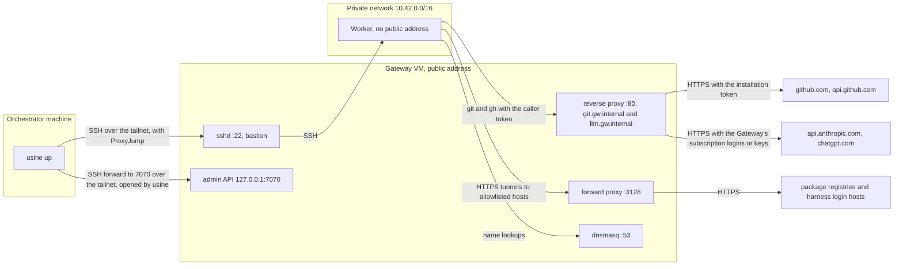

import { Steps } from "@astrojs/starlight/components";

A worker is the machine or sandbox that has an attempt's checkout and runs its Claude Code or Codex children. The Pi parent always runs in the orchestrator. The [`workers`](/reference/configuration/usine-yaml/#workers) list of `usine.yaml` declares the workers.

## Worker kinds

| `kind`                   | Where children run                                                                         | GitHub credential on the machine                                             |
| ------------------------ | ------------------------------------------------------------------------------------------ | ---------------------------------------------------------------------------- |
| `local`                  | as processes on the orchestrator machine                                                   | a token file in a private temporary folder, removed with the attempt         |
| `ssh`                    | on a Linux machine, in the attempt's own Docker container                                  | a token file under the worker's root, removed with the attempt               |
| `ssh` with `gateway`     | on a Linux machine with no public address, through a gateway                               | none: the gateway adds the token to the machine's GitHub requests            |
| `ssh` with `provisioner` | on a machine that Hetzner Cloud or Boat creates for the attempt and usine deletes after it | as for `ssh`, or `ssh` with `gateway` on Hetzner Cloud                       |
| `cloudflare`             | in a Cloudflare container per attempt, through the sandbox Worker that you deploy          | none: the Worker's outbound handlers add the token and the provider API keys |
| `exe.dev`                | not available: `usine up` refuses this kind at this commit                                 |                                                                              |

[Add a provisioned worker](/guides/add-a-provisioned-worker/) covers `ssh` workers with a `provisioner`, and [Run attempts in Cloudflare sandboxes](/guides/cloudflare-sandboxes/) covers `cloudflare` workers. All workers in one `usine.yaml` must have the same kind. `max_concurrent_attempts` sets how many attempts a worker runs at once, and the worker needs at least 1.5 GiB of memory per attempt, 3 GiB to avoid a warning.

## Local workers

```yaml title="usine.yaml"
workers:
  - name: local
    kind: local
    max_concurrent_attempts: 2
```

A local worker keeps cached bare clones in `.usine/workers/<name>/repos/`, one worktree per attempt in `attempts/`, and a Turborepo cache in `turbo/`. Children run as the user who runs `usine up`, so the harnesses must be on that user's `PATH` and logged in. Their environment contains only `HOME`, `LANG`, `LC_ALL`, `PATH`, `SHELL`, `TMPDIR`, `USER`, the attempt's credential settings, and `TURBO_CACHE_DIR`, which points at `turbo/`. Attempts also share pnpm's default store in the user's home directory. Pi children run only on local workers.

### Credentials that local attempts can read

Git and gh use the attempt's own token: git's credential helpers are reset to read the attempt's token file, and gh reads its own `GH_CONFIG_DIR`. But the children run as your Unix user with your `HOME`, so an agent can find and use your own credentials, such as gh's login in `~/.config/gh/hosts.yml`, `~/.git-credentials`, or a key in `~/.ssh`, for example with `GH_CONFIG_DIR=~/.config/gh gh` or a push to a `git@github.com:` URL. [`permissions: read`](/reference/configuration/loop-files/#permissions) doesn't prevent this.

Use the local worker only for agents that you trust with your own access. For other loops, use [SSH workers](#ssh-workers), which have none of your GitHub credentials, or [SSH workers behind a gateway](#ssh-workers-behind-a-gateway), which have no GitHub token on disk.

## Preflight

Worker [preflight](/reference/configuration/agent-files/#preflight) never installs anything or logs in. It checks:

| Worker               | Checks                                                                                                                                                                                                                                                                                         |
| -------------------- | ---------------------------------------------------------------------------------------------------------------------------------------------------------------------------------------------------------------------------------------------------------------------------------------------- |
| `local`              | `git --version`, the memory for `max_concurrent_attempts`, and each harness with the children's environment ([harness checks](/reference/configuration/agent-files/#preflight)).                                                                                                               |
| `ssh`                | The SSH connection, a writable `root`, `git --version`, the memory for `max_concurrent_attempts`, Docker and the attempt image, and each harness in a container from that image. Without Docker, each harness over SSH, and the worker is degraded. A Pi agent in the roster fails this check. |
| `ssh` with `gateway` | The `ssh` checks, and also: the admin API accepts the admin token, the worker's sshd accepts the caller token variables, the worker can connect to `git.<domain>`, and for each harness that uses its login on the worker, the login's hosts respond through the forward proxy.                |
| `cloudflare`         | The Worker's health route accepts the Access service token, the Worker has the image, the worker has an API key for each harness, and each harness's version in a preflight sandbox ([details](/guides/cloudflare-sandboxes/#preflight)). A Pi agent in the roster fails this check.           |

The `memory` check is described under [`workers`](/reference/configuration/usine-yaml/#workers).

## SSH workers

An SSH worker is a Linux machine with Git, Docker, a directory that the SSH user can write to, and your agents' harnesses logged in for the SSH user.

```yaml title="usine.yaml"
workers:
  - name: worker-one
    kind: ssh
    destination: usine@203.0.113.20
    identity_file: ~/.ssh/usine_worker
    root: /home/usine/.usine
    max_concurrent_attempts: 1
```

[`kind: ssh`](/reference/configuration/usine-yaml/#kind-ssh) describes the fields. `ssh` runs in batch mode, so connect once by hand to record the host key before you start `usine up`. An SSH agent works.

usine writes each attempt's token to `<root>/workers/<name>/credentials/<attempt>` through standard input, so it doesn't appear on a command line, and removes it when the attempt ends.

### A container per attempt

Each attempt runs in its own container from an image with Node.js 24, pnpm, Git, gh, Chromium, Claude Code, and Codex, built from `infra/worker-image/Dockerfile` ([ADR 0011](https://github.com/basaltbytes/usine/blob/main/docs/adr/0011-github-app-identity-scoped-worker-tokens.md), amended 2026-10-25). The container mounts only that attempt's checkout and the SSH user's harness login files read-write, and its cached clone and credential directory read-only. The harnesses rewrite the login files when they refresh their tokens, as they do without containers. Every command of the attempt runs in it with `docker exec`, so attempts can't read each other's checkouts, tokens, or processes. The SSH user's shell starts and removes the container and fetches the cached clone. [`workers[].container`](/reference/configuration/usine-yaml/#workerscontainer) sets the image and the CPU, memory, and process limits of each container. Preflight derives each limit you leave out from the machine: its total, less a reserve for the machine's own processes, divided by `max_concurrent_attempts`. Choose `max_concurrent_attempts` so that each container has the memory of the heaviest command its agents run, such as the repository's tests: [usine's own tests](https://github.com/basaltbytes/usine/blob/main/apps/web/README.md#conversation-browser-tests) need about 4.7 GiB, so a machine with 7.7 GiB runs one of its attempts at a time. Limits that add up to more than the machine's memory don't stop attempts from starting, but heavy commands that run at the same time make the machine swap, and the kernel kills processes for memory. The **Workers** page shows the limits that the last preflight applied.

The container is named `usine-<attempt id>` and is removed with the checkout when the attempt ends. A process that stops without removing it leaves it; the next process removes it before its first attempt on that machine, and removes the containers of workers that `usine.yaml` no longer declares too.

The containers use the machine's network, so a worker behind a gateway still reaches only the gateway. The SSH user must be in the `docker` group, which lets it act as root on the machine; the attempts never get Docker access.

Without Docker on the machine, attempts run as the SSH user and can read each other's tokens ([#231](https://github.com/basaltbytes/usine/issues/231)). Preflight passes and reports the worker as degraded in the log and on the **Workers** page. If the SSH user can use Docker, attempts never run as that user: a Docker that doesn't answer, or the `docker` group without the `docker` CLI, fails preflight.

### Create a worker on Hetzner Cloud

The scripts in `infra/hetzner/` create SSH workers with the `hcloud` CLI. `infra/hetzner/cloud-init.yaml` sets up a Debian 13 machine with a `usine` user that accepts SSH by key only, a 2 GB swap file, and `/home/usine/.usine` for the worker's root. It installs Docker, with `usine` in the `docker` group, and Git, gh, Node.js 24, pnpm 11.20.0, Claude Code 2.1.308, Codex 0.159.2, and Chromium, which the logins use. A cx33 or cpx32 has 7.7 GiB of memory, enough for two attempts without a warning.

Each attempt's container has its own pnpm store and Turborepo cache, removed with the container, so `pnpm install` downloads every package for each attempt.

<Steps>

1. On the orchestrator machine, create a key pair and the server. The script takes the worker name, the location (`fsn1`, `nbg1`, or `hel1`), the orchestrator's IPv4 address, and the public key. It registers the key with Hetzner, creates a firewall `usine-<name>` that allows SSH only from that address, and prints the server's address. `HCLOUD_SERVER_TYPE` sets the server type (default `cpx32`).

   ```sh title="usine checkout"
   ssh-keygen -t ed25519 -f ~/.ssh/usine_worker -C usine-worker
   ./infra/hetzner/create-worker.sh worker-one fsn1 203.0.113.10 ~/.ssh/usine_worker.pub
   ```

2. Connect once to record the host key, and wait for cloud-init to finish:

   ```sh title="Orchestrator machine"
   ssh -i ~/.ssh/usine_worker usine@203.0.113.20 cloud-init status --wait
   ```

3. As the `usine` user, log in to each harness that the roster uses:

   ```sh title="Orchestrator machine"
   ssh -t -i ~/.ssh/usine_worker usine@203.0.113.20
   claude auth login          # Claude subscription: open the URL it prints, then paste the code back
   codex login --device-auth  # ChatGPT plan: open the URL it prints and enter the code it prints
   ```

4. Add the worker to `usine.yaml` with its address as the `destination`, and [reload the configuration](/reference/configuration/cli/#reload). usine runs preflight on the worker before it takes attempts, and pulls the attempt image.

</Steps>

### Move a worker to containers

A worker created before cloud-init installed Docker runs its attempts as the SSH user. To give each attempt its own container:

<Steps>

1. Stop the worker's attempts: [stop](/reference/configuration/cli/#usine-stop) `usine up`, or wait until the worker runs none. After the restart, usine refuses to reattach or salvage a checkout from before Docker, since that would run git as a user who can now use Docker; it leaves the checkout for you to salvage and remove.

2. As root on the worker, install Docker and add `usine` to the `docker` group. `usine` has no sudo; [`infra/hetzner/README.md`](https://github.com/basaltbytes/usine/blob/main/infra/hetzner/README.md) shows how to become root:

   ```sh title="Worker, as root"
   apt-get install -y docker.io docker-cli
   usermod -aG docker usine
   ```

   Behind a gateway, also add the proxy drop-in, the `daemon.json`, and the `ghcr.io` hosts of `infra/hetzner/gateway/` first; [`infra/hetzner/gateway/README.md`](https://github.com/basaltbytes/usine/blob/main/infra/hetzner/gateway/README.md) lists them.

3. Start `usine up`. Preflight pulls the image and reports the worker as passed, not degraded.

</Steps>

## SSH workers behind a gateway

A gateway is a VM in front of workers that have no public address. It's their SSH bastion and DNS resolver, the proxy that adds the attempt's GitHub token and the operator's LLM credentials to their requests, and a forward proxy to allowlisted package and harness login hosts. A worker behind it has no GitHub token or subscription login on disk and can't reach any other host ([ADR 0027](https://github.com/basaltbytes/usine/blob/main/docs/adr/0027-gateway-credential-proxy.md)).

For each attempt, the executor attaches the attempt's installation token to the gateway through the admin API and receives a caller token. The children get the caller token over SSH, in environment variables that the worker's sshd accepts, and send it with every request to `git.<domain>` or `llm.<domain>`. The gateway checks it, replaces it with the real credential, and forwards the request over HTTPS.



The scripts are in `infra/hetzner/gateway/`, and its `README.md` describes every traffic path. The defaults are the network `10.42.0.0/16`, the gateway address `10.42.0.2`, and the domain `gw.internal`. `NAME`, `LOCATION`, `SERVER_TYPE`, `NETWORK_CIDR`, `SUBNET_CIDR`, `GATEWAY_IP`, and `DOMAIN` override them.

<Steps>

1. Create the private network, the gateway VM, and its firewall. `ORCHESTRATOR_CIDR` is the only address allowed on the gateway's public SSH port, until step 3 removes that rule. `SSH_KEY` is the name of an SSH key in the Hetzner project; register the worker key as `usine-worker` if needed. The next commands connect as `root@<gateway>` without a key option, so first load the key into your SSH agent:

   ```sh title="usine checkout"
   ssh-add ~/.ssh/usine_worker
   hcloud ssh-key create --name usine-worker --public-key-from-file ~/.ssh/usine_worker.pub
   ORCHESTRATOR_CIDR=203.0.113.10/32 SSH_KEY=usine-worker \
     ./infra/hetzner/gateway/gateway.sh create
   ```

2. Wait for cloud-init on the gateway, whose address `gateway.sh create` printed (here `203.0.113.30`), and log the gateway in to the [Tailscale](https://tailscale.com/) tailnet of the orchestrator machine. cloud-init installs Tailscale but doesn't log it in:

   ```sh title="usine checkout"
   ssh root@203.0.113.30 cloud-init status --wait
   ./infra/hetzner/gateway/gateway.sh tailnet-up
   ```

   `tailnet-up` runs `tailscale up` over SSH, which prints a login URL to open in your browser. Then it prints the gateway's tailnet address, here `100.64.0.10`. To log in without the browser, set `TAILSCALE_AUTH_KEY` to an [auth key](https://tailscale.com/kb/1085/auth-keys); the script sends it on SSH's standard input, never on a command line.

   By default, the gateway's node key expires after 180 days, and the gateway then leaves the tailnet. In the Tailscale admin console, disable key expiry for the gateway's machine, or log in with a tagged auth key: tagged devices have key expiry disabled by default.

3. Add the gateway to the SSH configuration of the user who runs `usine up`, with its tailnet address as `HostName` and its public address as `HostKeyAlias`, so that `ssh` checks the host key recorded in step 2. The executor uses the gateway as a jump host, and opens its own forward to the admin API on a port that the kernel picks. Don't add a `LocalForward` to the gateway's entry: it would apply to the executor's forward too, which then exits whenever that port is in use.

   ```text title="~/.ssh/config"
   Host usine-gateway
     HostName 100.64.0.10
     HostKeyAlias 203.0.113.30
     User root
     IdentityFile ~/.ssh/usine_worker
   ```

   Check the entry, then remove the public SSH rule:

   ```sh title="usine checkout"
   ssh usine-gateway true
   hcloud firewall delete-rule usine-gateway --direction in --protocol tcp --port 22 --source-ips 203.0.113.10/32 --description "SSH from the orchestrator"
   ```

   If the tailnet path stops working, add the rule back with `hcloud firewall add-rule`, or log in on the gateway's Hetzner Cloud Console. The gateway's `README.md` gives both commands.

4. Install and start the gateway service from npm (`@usine/gateway` 0.1.0 or later). `GATEWAY_SSH` sets the gateway's SSH destination for `install`:

   ```sh title="usine checkout"
   GATEWAY_SSH=usine-gateway ./infra/hetzner/gateway/gateway.sh install @usine/gateway
   ```

   To install a build of your checkout instead, pack it with `@usine/core` and install both tarballs. At this commit, they're `usine-core-0.3.0.tgz` and `usine-gateway-0.0.0.tgz`:

   ```sh title="usine checkout"
   pnpm build
   pnpm --filter @usine/core --filter @usine/gateway pack --pack-destination .
   GATEWAY_SSH=usine-gateway ./infra/hetzner/gateway/gateway.sh install ./usine-core-0.3.0.tgz ./usine-gateway-0.0.0.tgz
   ```

   On first boot, the VM generates its admin token and caller key in `/etc/usine-gateway/secrets.env`, readable by root and the `usine-gateway` group. See [`usine-gateway`](/reference/configuration/cli/#usine-gateway) for what a reload and a restart change.

5. Give the gateway your subscription logins, so that workers need none. Make each login on your own machine and copy it to the gateway:

   ```sh title="Your machine"
   claude setup-token
   ssh usine-gateway 'read -r token && echo "USINE_GATEWAY_ANTHROPIC_SUBSCRIPTION_TOKEN=$token" >> /etc/usine-gateway/secrets.env'
   export CODEX_HOME=$(mktemp -d)
   codex login
   scp "$CODEX_HOME/auth.json" usine-gateway:/var/lib/usine-gateway/codex-auth.json
   ssh usine-gateway 'chown usine-gateway:usine-gateway /var/lib/usine-gateway/codex-auth.json && chmod 0600 /var/lib/usine-gateway/codex-auth.json && echo USINE_GATEWAY_CHATGPT_AUTH_FILE=/var/lib/usine-gateway/codex-auth.json >> /etc/usine-gateway/settings.env && systemctl reload usine-gateway'
   rm -rf "$CODEX_HOME" && unset CODEX_HOME
   ```

   Paste the token that `claude setup-token` prints when the first `ssh` waits for it. The token is valid for one year. The ChatGPT login needs `@usine/gateway` 0.2.0 or later. The empty `CODEX_HOME` gives the gateway a ChatGPT login of its own, which it refreshes and rewrites in `/var/lib/usine-gateway`; a copy of the login you use yourself would stop working at the first refresh on either side. Then remove `api.anthropic.com`, `platform.claude.com`, `chatgpt.com`, and `auth.openai.com` from `/etc/usine-gateway/egress-allowlist` and run `systemctl reload usine-gateway` again, so that no tunnel can send the caller token past the gateway.

   To use API keys instead, add `ANTHROPIC_API_KEY` or `OPENAI_API_KEY` to `secrets.env` and reload. Each provider takes one credential. To keep a harness's login on the worker instead, skip its provider here and log in on the worker in step 7.

6. Create the worker on the private network, without public addresses. `worker-user-data` adds `infra/hetzner/gateway/worker-cloud-init.yaml` to `infra/hetzner/cloud-init.yaml`. It points the worker's resolver, apt, environment, and gh's socket at the gateway, makes sshd accept the caller token variables, and allows connections only to the gateway. A `cx33` has the 8 GB that a worker needs.

   ```sh title="usine checkout"
   ./infra/hetzner/gateway/gateway.sh worker-user-data ~/.ssh/usine_worker.pub > worker.mime
   hcloud server create --name worker-one --type cx33 --image debian-13 --location fsn1 \
     --ssh-key usine-worker --network usine-gateway --without-ipv4 --without-ipv6 \
     --label usine=worker --user-data-from-file worker.mime
   ```

   `hcloud server describe worker-one` shows its private address, here `10.42.0.3`. Setup takes about four minutes. Follow it through the gateway, which also records the host key:

   ```sh title="Orchestrator machine"
   ssh -J usine-gateway usine@10.42.0.3 cloud-init status --wait
   ```

7. Only for a harness whose provider credential the gateway doesn't hold, log in on the worker, through the gateway's forward proxy:

   ```sh title="Orchestrator machine"
   ssh -t -J usine-gateway usine@10.42.0.3
   claude auth login
   codex login --device-auth
   ```

8. Add the worker to the same SSH configuration, with the gateway as its jump host:

   ```text title="~/.ssh/config"
   Host worker-one
     HostName 10.42.0.3
     User usine
     ProxyJump usine-gateway
     IdentityFile ~/.ssh/usine_worker
   ```

9. In the instance folder, copy the admin token line into `.env`, the [environment file](/reference/configuration/cli/#environment-file) that usine reads at startup, and make it readable only by you:

   ```sh title="Instance folder"
   (umask 077; ssh usine-gateway "grep '^USINE_GATEWAY_ADMIN_TOKEN=' /etc/usine-gateway/secrets.env" >> .env)
   chmod 600 .env
   ```

   Add `.env` to `.gitignore`, so that it stays out of git.

10. Add a [`gateway`](/reference/configuration/usine-yaml/#workersgateway) to the worker in `usine.yaml`, with the `Host` aliases as destinations, the gateway's `DOMAIN`, and the name of the variable that will contain the admin token:

    ```yaml title="usine.yaml"
    workers:
      - name: worker-one
        kind: ssh
        destination: worker-one
        root: /home/usine/.usine
        gateway:
          domain: gw.internal
          destination: usine-gateway
          admin_token_env: USINE_GATEWAY_ADMIN_TOKEN
          llm_providers: [anthropic, openai]
    ```

    `llm_providers` lists the providers whose credential the gateway holds from step 5: `anthropic` for Claude Code, `openai` for Codex. Their children call the gateway with the caller token instead of using a login on the worker. Leave out a provider whose harness logs in on the worker.

    A subscription at the gateway is your own login used by your own agents. Anthropic's [legal and compliance page](https://code.claude.com/docs/en/legal-and-compliance) allows that, and forbids storing or relaying other people's subscription logins, so an instance with several users gives each user their own credential. The harness binaries run unmodified, and the plan's usage limits, meant for one person, apply to every attempt the gateway signs. [Provider terms](https://github.com/basaltbytes/usine/blob/main/infra/hetzner/gateway/README.md#provider-terms) in the gateway README has the full note.

11. Start the orchestrator. It reads the token from `.env`, and so do `usine restart` and `usine upgrade` from any shell:

    ```sh title="Instance folder"
    usine up
    ```

    If neither the environment nor `.env` sets the variable, `usine up` stops and gives its name. If the admin API forward doesn't open, preflight gives the `ssh` command that shows why. If the forward proxy refuses a login host, preflight gives the host to add to `/etc/usine-gateway/egress-allowlist`.

</Steps>

To read the gateway's log, run `ssh usine-gateway journalctl -u usine-gateway -o cat`. Changes to the infra files don't reach a running gateway or worker until you apply them on that machine by hand ([#264](https://github.com/basaltbytes/usine/issues/264)).

## Remove a worker

Remove the worker from `usine.yaml` and reload the configuration, or restart `usine up`. After a reload, wait until its running attempts end and the log shows `The last Attempt on a removed Worker ended; the Worker leaves the scheduler`. Then delete the machine. If an attempt on the worker kept its worktree because its salvage push failed, every later start reports a reconciliation error for it ([#268](https://github.com/basaltbytes/usine/issues/268)).

```sh title="usine checkout"
hcloud server delete worker-one
hcloud firewall delete usine-worker-one   # a Worker made by create-worker.sh
./infra/hetzner/gateway/gateway.sh delete # the Gateway, its network, and its firewall, after its Workers
```
