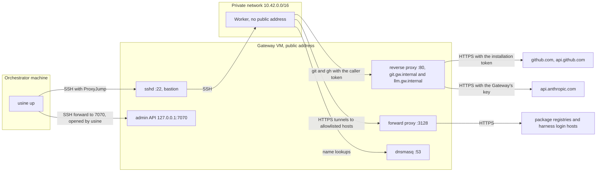

import { Steps } from "@astrojs/starlight/components";

A worker is the machine that has an attempt's checkout and runs its Claude Code or Codex children. The Pi parent always runs in the orchestrator. The [`workers`](/reference/configuration/usine-yaml/#workers) list of `usine.yaml` declares the workers.

## Worker kinds

| `kind`               | Where children run                                           | GitHub credential on the machine                                     |
| -------------------- | ------------------------------------------------------------ | -------------------------------------------------------------------- |
| `local`              | as processes on the orchestrator machine                     | a token file in a private temporary folder, removed with the attempt |
| `ssh`                | on a Linux machine, one SSH command per child                | a token file under the worker's root, removed with the attempt       |
| `ssh` with `gateway` | on a Linux machine with no public address, through a gateway | none: the gateway adds the token to the machine's GitHub requests    |
| `exe.dev`            | not available: `usine up` refuses this kind at this commit   |                                                                      |

All workers in one `usine.yaml` must have the same kind. `max_concurrent_attempts` sets how many attempts a worker runs at once, and the worker needs at least 1.5 GiB of memory per attempt, 3 GiB to avoid a warning.

## Local workers

```yaml title="usine.yaml"
workers:
  - name: local
    kind: local
    max_concurrent_attempts: 2
```

A local worker keeps cached bare clones in `.usine/workers/<name>/repos/`, one worktree per attempt in `attempts/`, and a Turborepo cache in `turbo/`. Children run as the user who runs `usine up`, so the harnesses must be on that user's `PATH` and logged in. Their environment contains only `HOME`, `LANG`, `LC_ALL`, `PATH`, `SHELL`, `TMPDIR`, `USER`, the attempt's credential settings, and `TURBO_CACHE_DIR`, which points at `turbo/`. Attempts also share pnpm's default store in the user's home directory. Pi children run only on local workers.

### Credentials that local attempts can read

Git and gh use the attempt's own token: git's credential helpers are reset to read the attempt's token file, and gh reads its own `GH_CONFIG_DIR`. But the children run as your Unix user with your `HOME`, so an agent can find and use your own credentials, such as gh's login in `~/.config/gh/hosts.yml`, `~/.git-credentials`, or a key in `~/.ssh`, for example with `GH_CONFIG_DIR=~/.config/gh gh` or a push to a `git@github.com:` URL. [`permissions: read`](/reference/configuration/loop-files/#permissions) doesn't prevent this.

Use the local worker only for agents that you trust with your own access. For other loops, use [SSH workers](#ssh-workers), which have none of your GitHub credentials, or [SSH workers behind a gateway](#ssh-workers-behind-a-gateway), which have no GitHub token on disk.

## Preflight

Worker [preflight](/reference/configuration/agent-files/#preflight) never installs anything or logs in. It checks:

| Worker               | Checks                                                                                                                                                                                                                                                                          |
| -------------------- | ------------------------------------------------------------------------------------------------------------------------------------------------------------------------------------------------------------------------------------------------------------------------------- |
| `local`              | `git --version`, the memory for `max_concurrent_attempts`, and each harness with the children's environment ([harness checks](/reference/configuration/agent-files/#preflight)).                                                                                                |
| `ssh`                | The SSH connection, a writable `root`, `git --version`, the memory for `max_concurrent_attempts`, and each harness over SSH. A Pi agent in the roster fails this check.                                                                                                         |
| `ssh` with `gateway` | The `ssh` checks, and also: the admin API accepts the admin token, the worker's sshd accepts the caller token variables, the worker can connect to `git.<domain>`, and for each harness that uses its login on the worker, the login's hosts respond through the forward proxy. |

The `memory` check is described under [`workers`](/reference/configuration/usine-yaml/#workers).

## SSH workers

An SSH worker is a Linux machine with Git, a directory that the SSH user can write to, and your agents' harnesses on the `PATH` of a non-interactive SSH session, logged in for the SSH user.

```yaml title="usine.yaml"
workers:
  - name: worker-one
    kind: ssh
    destination: usine@203.0.113.20
    identity_file: ~/.ssh/usine_worker
    root: /home/usine/.usine
    max_concurrent_attempts: 1
```

[`kind: ssh`](/reference/configuration/usine-yaml/#kind-ssh) describes the fields. `ssh` runs in batch mode, so connect once by hand to record the host key before you start `usine up`. An SSH agent works.

usine writes each attempt's token to `<root>/workers/<name>/credentials/<attempt>` through standard input, so it doesn't appear on a command line, and removes it when the attempt ends. Attempts on one machine run as the same user and can read each other's tokens ([#231](https://github.com/basaltbytes/usine/issues/231)).

### Create a worker on Hetzner Cloud

The scripts in `infra/hetzner/` create SSH workers with the `hcloud` CLI. `infra/hetzner/cloud-init.yaml` sets up a Debian 13 machine with a `usine` user that accepts SSH by key only, a 2 GB swap file, and `/home/usine/.usine` for the worker's root. It installs Git, gh, Node.js 24, pnpm 11.20.0, Claude Code 2.1.296, Codex 0.153.4, and Chromium. A cx33 or cpx32 has 7.7 GiB of memory, enough for two attempts without a warning.

Attempts on the machine run as `usine` and share pnpm's default store, `/home/usine/.local/share/pnpm/store`, and the Turborepo cache that `/etc/environment` sets with `TURBO_CACHE_DIR=/home/usine/.cache/turbo`. Children are non-interactive SSH sessions, so they get `/etc/environment` and read no shell profile. `TURBO_CACHE_DIR` overrides a `cacheDir` in the repository's `turbo.json`. Turborepo still writes task logs to `.turbo/` in each package folder of the worktree.

<Steps>

1. On the orchestrator machine, create a key pair and the server. The script takes the worker name, the location (`fsn1`, `nbg1`, or `hel1`), the orchestrator's IPv4 address, and the public key. It registers the key with Hetzner, creates a firewall `usine-<name>` that allows SSH only from that address, and prints the server's address. `HCLOUD_SERVER_TYPE` sets the server type (default `cpx32`).

   ```sh title="usine checkout"
   ssh-keygen -t ed25519 -f ~/.ssh/usine_worker -C usine-worker
   ./infra/hetzner/create-worker.sh worker-one fsn1 203.0.113.10 ~/.ssh/usine_worker.pub
   ```

2. Connect once to record the host key, and wait for cloud-init to finish:

   ```sh title="Orchestrator machine"
   ssh -i ~/.ssh/usine_worker usine@203.0.113.20 cloud-init status --wait
   ```

3. As the `usine` user, log in to each harness that the roster uses:

   ```sh title="Orchestrator machine"
   ssh -t -i ~/.ssh/usine_worker usine@203.0.113.20
   claude auth login          # Claude subscription: open the URL it prints, then paste the code back
   codex login --device-auth  # ChatGPT plan: open the URL it prints and enter the code it prints
   ```

4. Add the worker to `usine.yaml` with its address as the `destination`, and [reload the configuration](/reference/configuration/cli/#reload). usine runs preflight on the worker before it takes attempts.

</Steps>

## SSH workers behind a gateway

A gateway is a VM in front of workers that have no public address. It's their SSH bastion and DNS resolver, the proxy that adds the attempt's GitHub token and optionally an LLM provider's key to their requests, and a forward proxy to allowlisted package and harness login hosts. A worker behind it has no GitHub token on disk and can't reach any other host ([ADR 0027](https://github.com/basaltbytes/usine/blob/main/docs/adr/0027-gateway-credential-proxy.md)).

For each attempt, the executor attaches the attempt's installation token to the gateway through the admin API and receives a caller token. The children get the caller token over SSH, in environment variables that the worker's sshd accepts, and send it with every request to `git.<domain>` or `llm.<domain>`. The gateway checks it, replaces it with the real credential, and forwards the request over HTTPS.



The scripts are in `infra/hetzner/gateway/`, and its `README.md` describes every traffic path. The defaults are the network `10.42.0.0/16`, the gateway address `10.42.0.2`, and the domain `gw.internal`. `NAME`, `LOCATION`, `SERVER_TYPE`, `NETWORK_CIDR`, `SUBNET_CIDR`, `GATEWAY_IP`, and `DOMAIN` override them.

<Steps>

1. Create the private network, the gateway VM, and its firewall. `ORCHESTRATOR_CIDR` is the only address allowed on the gateway's SSH port. `SSH_KEY` is the name of an SSH key in the Hetzner project; register the worker key as `usine-worker` if needed. The next commands connect as `root@<gateway>` without a key option, so first load the key into your SSH agent:

   ```sh title="usine checkout"
   ssh-add ~/.ssh/usine_worker
   hcloud ssh-key create --name usine-worker --public-key-from-file ~/.ssh/usine_worker.pub
   ORCHESTRATOR_CIDR=203.0.113.10/32 SSH_KEY=usine-worker \
     ./infra/hetzner/gateway/gateway.sh create
   ```

2. Wait for cloud-init on the gateway, whose address `gateway.sh create` printed (here `203.0.113.30`), and install and start the gateway service from npm (`@usine/gateway` 0.1.0 or later). `-i` sets the key for `install`'s `ssh` and `scp`:

   ```sh title="usine checkout"
   ssh root@203.0.113.30 cloud-init status --wait
   ./infra/hetzner/gateway/gateway.sh install -i ~/.ssh/usine_worker @usine/gateway
   ```

   To install a build of your checkout instead, pack it with `@usine/core` and install both tarballs. At this commit, they're `usine-core-0.3.0.tgz` and `usine-gateway-0.0.0.tgz`:

   ```sh title="usine checkout"
   pnpm build
   pnpm --filter @usine/core --filter @usine/gateway pack --pack-destination .
   ./infra/hetzner/gateway/gateway.sh install -i ~/.ssh/usine_worker ./usine-core-0.3.0.tgz ./usine-gateway-0.0.0.tgz
   ```

   On first boot, the VM generates its admin token and caller key in `/etc/usine-gateway/secrets.env`, readable by root and the `usine-gateway` group. To let the gateway call Anthropic with its own key, add `ANTHROPIC_API_KEY` to that file and run `systemctl reload usine-gateway`. See [`usine-gateway`](/reference/configuration/cli/#usine-gateway) for what a reload and a restart change.

3. Create the worker on the private network, without public addresses. `worker-user-data` adds `infra/hetzner/gateway/worker-cloud-init.yaml` to `infra/hetzner/cloud-init.yaml`. It points the worker's resolver, apt, environment, and gh's socket at the gateway, makes sshd accept the caller token variables, and allows connections only to the gateway. A `cx33` has the 8 GB that a worker needs.

   ```sh title="usine checkout"
   ./infra/hetzner/gateway/gateway.sh worker-user-data ~/.ssh/usine_worker.pub > worker.mime
   hcloud server create --name worker-one --type cx33 --image debian-13 --location fsn1 \
     --ssh-key usine-worker --network usine-gateway --without-ipv4 --without-ipv6 \
     --label usine=worker --user-data-from-file worker.mime
   ```

   `hcloud server describe worker-one` shows its private address, here `10.42.0.3`. Setup takes about four minutes. Follow it through the gateway, which also records the host key:

   ```sh title="Orchestrator machine"
   ssh -J root@203.0.113.30 usine@10.42.0.3 cloud-init status --wait
   ```

4. Log in to the harnesses on the worker, through the gateway's forward proxy:

   ```sh title="Orchestrator machine"
   ssh -t -J root@203.0.113.30 usine@10.42.0.3
   claude auth login
   codex login --device-auth
   ```

5. Add both hosts to the SSH configuration of the user who runs `usine up`. The executor uses the gateway as a jump host, and opens its own forward to the admin API on a port that the kernel picks. Don't add a `LocalForward` to the gateway's entry: it would apply to the executor's forward too, which then exits whenever that port is in use.

   ```text title="~/.ssh/config"
   Host usine-gateway
     HostName 203.0.113.30
     User root
     IdentityFile ~/.ssh/usine_worker

   Host worker-one
     HostName 10.42.0.3
     User usine
     ProxyJump usine-gateway
     IdentityFile ~/.ssh/usine_worker
   ```

6. In the instance folder, copy the admin token into a file that only you can read:

   ```sh title="Instance folder"
   (umask 077; ssh root@203.0.113.30 "sed -n 's/^USINE_GATEWAY_ADMIN_TOKEN=//p' /etc/usine-gateway/secrets.env" > .usine/gateway-admin-token)
   ```

7. Add a [`gateway`](/reference/configuration/usine-yaml/#workersgateway) to the worker in `usine.yaml`, with the `Host` aliases as destinations, the gateway's `DOMAIN`, and the name of the variable that will contain the admin token:

   ```yaml title="usine.yaml"
   workers:
     - name: worker-one
       kind: ssh
       destination: worker-one
       root: /home/usine/.usine
       gateway:
         domain: gw.internal
         destination: usine-gateway
         admin_token_env: USINE_GATEWAY_ADMIN_TOKEN
   ```

   If the gateway has `ANTHROPIC_API_KEY`, add `llm_providers: [anthropic]` under `gateway`, so that Claude Code children use the gateway's key instead of a login on the worker. Then remove `api.anthropic.com` and `platform.claude.com` from the gateway's `/etc/usine-gateway/egress-allowlist` and restart the service, so that no tunnel can send the caller token past the gateway.

8. Start the orchestrator with the token in its environment:

   ```sh title="Instance folder"
   USINE_GATEWAY_ADMIN_TOKEN=$(cat .usine/gateway-admin-token) usine up
   ```

   If the variable isn't set, `usine up` stops and gives its name. If the admin API forward doesn't open, preflight gives the `ssh` command that shows why. If the forward proxy refuses a login host, preflight gives the host to add to `/etc/usine-gateway/egress-allowlist`.

</Steps>

To read the gateway's log, run `ssh root@203.0.113.30 journalctl -u usine-gateway -o cat`. Changes to the infra files don't reach a running gateway or worker until you apply them on that machine by hand ([#264](https://github.com/basaltbytes/usine/issues/264)).

## Remove a worker

Remove the worker from `usine.yaml` and reload the configuration, or restart `usine up`. After a reload, wait until its running attempts end and the log shows `The last Attempt on a removed Worker ended; the Worker leaves the scheduler`. Then delete the machine. If an attempt on the worker kept its worktree because its salvage push failed, every later start reports a reconciliation error for it ([#268](https://github.com/basaltbytes/usine/issues/268)).

```sh title="usine checkout"
hcloud server delete worker-one
hcloud firewall delete usine-worker-one   # a Worker made by create-worker.sh
./infra/hetzner/gateway/gateway.sh delete # the Gateway, its network, and its firewall, after its Workers
```
