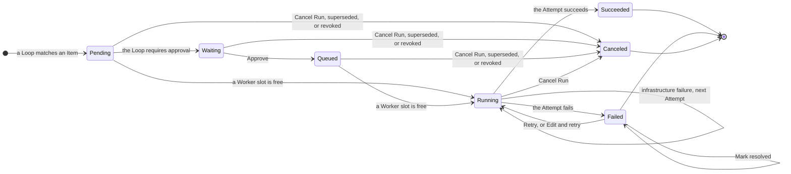

A Run is the work that a Loop does for one Event, and each try of its Step is an Attempt. This page explains how to manage Runs in the web UI at `http://127.0.0.1:7331`, and the CLI commands that back up and export their history. Every UI action is also available as an HTTP endpoint of the operator API.

## The desk

The page at `/`, which `usine up` opens, is the desk. It shows, in this order:

- **Needs you**: everything that waits for you, described [below](#needs-you). When nothing does, it says so, and the right of its heading says when usine last finished polling each repository.
- **Running now**: one row per Attempt in flight across the Projects, with the Item, Loop, Agent, Worker, start time, and last activity. A Worker that stopped answering or a child that cannot reach its provider shows as a yellow line under the Item ([Connectivity warnings](#connectivity-warnings)). When nothing runs, it says how many Worker slots are free.
- **Not moving**: each Item a Loop's trigger matches now that has no Attempt running on it, with the reason and the one action that moves it again. See [Why an Item is not moving](#why-an-item-is-not-moving).
- **Last outcomes**: the 10 Runs that closed last, newest first, with their outcome and pull request.
- **Workers**: one line with each Worker's slots in use and its last preflight, at startup or at a reload.

A row about a Run opens its Run page.

### Why an Item is not moving

| Reason                                                                     | Action                                          |
| -------------------------------------------------------------------------- | ----------------------------------------------- |
| Its Run waits for your approval.                                           | **Approve**                                     |
| The Agent asked you a question, or reported a blocker, and the Loop holds the Item. | **Mark answered** or **Mark resolved**          |
| The Item used its cycle budget.                                            | **Reset cycle budget**                          |
| Its Run failed and waits for a retry.                                      | **Retry**                                       |
| Its Run succeeded or was canceled and the Item has not changed since, so no Run opens: a Loop opens one Run per state of an Item. | **Run again**                                   |
| The Loop is paused.                                                        | **Resume**                                      |
| Its Run waits for a free Worker slot.                                      | None; it starts when a slot frees.              |
| The Loop has not acted on the Item's current state yet.                    | None; the next poll does.                       |

A change to the Item, such as a new label or comment, is a new state, and the Loop acts on it at the next poll.

## Follow a Run

The sidebar lists the Projects. Opening one shows its Board, where each lane names the labels and Item states that route Items to it, and each card is a task: an issue and the pull requests linked to it. While a task has an open Run, or a `Failed` Run you have not resolved, its card shows that Run's Loop, state, time, and Agent, so you can see when the Run is `Waiting` for your approval or `Queued` for a free Worker. The time counts from when the Run opened, from when its current Attempt started while it is `Running`, and from the failure once it is `Failed`; hover it for the full timestamp. The card's menu button lists only what applies: it opens the task's Items on GitHub and its Run, lists the task's other Runs under **Run history**, approves, retries, or cancels the Run when its state allows, and moves the card to another lane under **Move to**. The Board lists Runs without an Item, such as schedule Runs, below the lanes under **Runs without a card**.

Clicking a card opens its task page at `/projects/<owner>/<name>/tasks/<number>`, whether or not the task has a Run. The number is the task's originating issue, or its first pull request when it has no issue; the number of any of its Items opens the same page. The page shows:

- a header with the issue's number, which links to GitHub, its title, the state of the Item that places the task in its lane, the lane, that Item's labels, and **Move to**, which moves the card as on the Board;
- **Runs**: every Run on the task's Items, newest first, `Succeeded` and `Canceled` ones included, with its state, Loop, the Item it works on, Agent, Attempts, how long its Attempts ran, when it opened, the pull request it produced, the typed reason of a failure, and who approved it or ran it again. Clicking a row opens the Run page. A Run that needs you shows **Approve** or **Retry** in its row, and the row's menu lists the other actions its state allows;
- **Pull requests**: the task's pull requests, each with its state and whether it conflicts with its base;
- **Comments and reviews**: what the Runs' Agents posted on the task's Items, with the Run that posted it and when that Run's Attempt ended. A comment appears once its Attempt succeeds.

Like the Board, the page covers the Project's 500 newest Items.

Choosing **Open Run** in a card's menu, or selecting a Run in **Needs you**, opens the Run drawer. The URL gets `?run=<run id>`, so you can share or reload it. The drawer has:

- a header with the Loop, the Run's state, a **Loop paused** badge when that applies, the repository, and links to the Item and to the pull request the Run produced;
- a row of the actions the Run's state allows;
- **Conversation**: the parent's messages and one collapsible section per child, with **Everything**, **Messages**, and **Tools** filters, **Load earlier** for older activity, and a message box while the Attempt runs;
- **Task**: the task the Run currently uses;
- **Event**: the Event's identity and the Item payload it was recorded with;
- **Attempts**: the Run id, the rate windows the providers reported for each billing pool, and for each Attempt its Agent, Worker, harness, model, effort, the task it actually ran, its failure, and where its unfinished work was saved.

The drawer refreshes every second while the Run can be canceled, and the rest of the UI every 2 seconds while some Run can be canceled, or every 15 seconds otherwise.

## Run states

| State       | Meaning                                                                                       |
| ----------- | --------------------------------------------------------------------------------------------- |
| `Pending`   | Opened. No Attempt has started, and the Run waits for a Worker slot unless its Loop requires approval. |
| `Waiting`   | Waits for your approval.                                                                      |
| `Queued`    | Approved, and waits for a Worker slot. The drawer says **Waiting for a free worker**.          |
| `Running`   | An Attempt is running, or the next one is about to start.                                     |
| `Succeeded` | The Step's result is stored: the commits and pull requests the Attempt produced.              |
| `Failed`    | The last Attempt failed, and the engine doesn't retry it automatically.                       |
| `Canceled`  | Canceled by you, superseded by a newer Event on the same Item, or revoked because the Item no longer matches. |

The actions you see in the drawer move a Run between these states:



Workers take Runs in the order their Events arrived, and each Worker runs up to its `max_concurrent_attempts` at a time.

## Approve

A Loop with `approval: required` keeps each new Run in `Waiting`. The Run appears in **Needs you** as **Approval required**, and its card shows that a Run is waiting for approval. Open the Run, read its **Task** and **Event**, and select **Approve**. The Run becomes `Queued` and starts when a Worker slot is free. On the Run page, the **Event** then shows who approved the Run, when, and from where, such as **Approved by octocat · 15 Oct 19:30 · from the UI**, where the name is the `operator` login in `usine.yaml`. A Run approved before usine recorded approvers shows **Approved** without a name.

If the Item changes before you approve and still matches the Loop, a new waiting Run replaces this one, and usine cancels this one as superseded. If the Item no longer matches, usine cancels the waiting Run as revoked.

## Retry and Mark resolved

The engine retries an Attempt automatically only after an `InfraFailure`, such as an unreachable Worker or a failed checkout, and only up to three Attempts per Run. Every other failure leaves the Run `Failed` and lists it in **Needs you** under the failure's name:

| Failure                     | Cause                                                                                                      |
| --------------------------- | ---------------------------------------------------------------------------------------------------------- |
| `InfraFailure`              | Infrastructure failed around the Agent, and the Run has used its three automatic Attempts.                 |
| `AgentFailure`              | A harness isn't ready on the Worker, a child's harness failed during its turn, or the parent's model, effort, or credential is unusable. |
| `BlockedFailure`            | The Agent hit a blocker it can't resolve and reported it with `[usine:blocked]`. See [Clear a blocker](#clear-a-blocker). |
| `QuestionFailure`           | The Agent needs a decision from you and asked it with `[usine:question]`. See [Answer a question](#answer-a-question). |
| `DefectFailure`             | A defect in usine at the execution boundary.                                                               |
| `RunawayFailure`            | The Attempt reached `max_attempt_minutes` or `max_attempt_tokens`.                                         |
| `ChildSessionBudgetFailure` | The parent tried to start more children than `max_children` allows.                                       |

**Retry** starts a new Attempt of the same Run, and you can retry any number of times. When an Attempt ends without success, usine commits its uncommitted changes and pushes its worktree to the branch `usine/salvage/<run>/<attempt number>` of the repository. If that push fails, the worktree stays on the Worker and the Attempt shows its path. usine never deletes a salvage branch.

The next Attempt fetches the Run's revision again: for an issue Run, the default branch as it is now, so a fix you merged after the first Attempt is in it. usine then rebases the newest salvage onto it, and the Agent's prompt names the salvage it continues from. A salvage without changes is dropped. A salvage that conflicts with the new base is left out: the Attempt starts from the base, and the first line of its conversation, **Attempt started**, names the salvage branch that keeps the earlier work.

A later Event on the same Item can open a new Run of the Loop while the failed one waits for you. usine refuses to retry the failed Run while that other Run is open, so that one Loop never runs twice on one Item; the drawer names the open Run. Retry after it closes, or cancel it first. **Edit and retry** follows the same rule.

**Mark resolved** removes a failure you have handled from **Needs you** and from the project's status. The Run stays `Failed`, and you can still retry it. If a later Attempt fails, the Run appears in **Needs you** again.

## Answer a question

An Agent that can't continue without your decision posts its question on the Item and ends its Attempt with `[usine:question]`. The Run fails with `QuestionFailure`, and **Needs you** lists it as **\<loop\> asks a question**, with the question. usine doesn't retry it.

While the question waits, the Loop holds the Item. The Agent's own comment changed the Item, but the Loop opens no Run for that state, so a new Run doesn't ask the same question again and use up the cycle budget. The state the Loop holds is the first one polling sees after the question. The Loop acts on the Item again when one of these happens:

- the Item changes again, for example through your reply on the issue or pull request, an edit, or a pushed commit: the new state opens a Run, and its Agent reads your reply;
- the Item stops matching the Loop and comes back, for example when you remove and add the Loop's label;
- you **Retry** the Run, or **Edit and retry** it with your answer in the task;
- you select **Mark answered** in the Run drawer: the Loop takes the newest state it saw after the question, checks the trigger against the Item again, and opens a Run for it.

An answer on GitHub only counts when it changes the Item after polling has seen the Agent's question. If the Agent asked without posting anything, or you answer within the same poll, use **Mark answered** or **Retry** instead.

## Clear a blocker

An Agent that hits a blocker it can't resolve, such as a failing baseline check or a missing permission, records the blocker on the Item and ends its Attempt with `[usine:blocked]`. The Run fails with `BlockedFailure`, and **Needs you** lists it as **\<loop\> is blocked**, with the blocker. usine doesn't retry it.

The Loop holds the Item as it does for a question: the Agent's blocker comment opens no Run, so a new Run doesn't meet the same blocker and post it again. Once you have removed the blocker, the Loop acts on the Item again when the Item changes again, when it stops matching and comes back, when you **Retry** or **Edit and retry** the Run, or when you select **Mark resolved**, which checks the trigger against the Item's newest state and opens a Run for it.

## Edit and retry

**Edit and retry** opens an editor with the Run's task and a list of the roster's Agents. **Save and retry** replaces the task, the Agent, and the parent model that usine picks for that Agent, then retries. The change persists: every later Attempt of the Run uses it, including automatic retries, until you edit again. Each Attempt records the task and Agent it actually ran, and the Event doesn't change.

## Cancel

Select **Cancel Run**, then **Confirm cancel**, to close any open Run as `Canceled`. usine stops a running Attempt and pushes its unfinished work to a salvage branch, as on a failure. The cancel holds while the Item stays as it is: polling sees the same content again and starts nothing.

To run the Loop on the Item again, make it leave the Loop and come back: remove the Loop's label, wait until usine sees the Item without it (one poll, or right away for a Board move), then add the label again. The same content then opens a new Run with a new id. A Run that usine superseded or revoked behaves the same way when the Item returns to its content. A `Failed` Run is different: it keeps its Event, and you retry it instead.

If you remove and add the label within one poll interval, polling sees only the end state and starts nothing. Use **Run again** instead.

## Run again

A `Succeeded` or `Canceled` Run has **Run again** and **Edit and run again** in its drawer, on its Run page, and in its row's menu on the task page. **Run again** opens a new Run of the same Loop on the same Item content, with the Run's task and Agent, and shows the new Run. **Edit and run again** opens the task and Agent editor first; **Save and run again** starts the new Run with your changes. The Run you ran again stays as it ended, and both Runs are in the Item's Run history.

The new Run follows the Loop file as it is now: it waits for your approval when the Loop requires approval, and it counts against the Item's cycle budget. When the budget is used up, no Run opens, the drawer says so, and the Item's cycle budget appears in **Needs you**. usine refuses to run a Run again while another Run of the Loop is open on the Item. The Event section of the new Run's page shows who ran it again, when, and from which Run.

After a Run again, polling the unchanged Item still starts nothing. A Run again works on a paused Loop too.

## Steer a live Attempt

While a Run is `Running`, the drawer has a message box under the parent's conversation, **Message the parent**, and one in each live child's section, **Message this child**. usine sends your message to the session through the Attempt's live channel and adds it to the transcript, with the `operator` login from `usine.yaml`, or `local operator`, as the sender. It never becomes an Event, and the Attempt gets an **Operator intervened** badge.

| UI control              | To the parent                                                                       | To a child                                                                                     |
| ----------------------- | ----------------------------------------------------------------------------------- | ---------------------------------------------------------------------------------------------- |
| **Send** a message      | Places a Hold. A waiting or paused parent starts its next turn with the message. A parent waiting on a child reads it when the child returns. After it answers, the parent waits for you instead of ending the Attempt. | Goes into the child's conversation and places a Hold: the parent receives the child's answer only after you release it. |
| **Pause session**       | Stops the current turn, children included. The parent waits until you send a message or release it. | Pauses the child at its next tool or model call, until you send a message.                    |
| **Release parent** / **Release child** | Shown while the parent is held or paused. Ends the Hold and the pause: a waiting parent continues the task, and a working parent ends the Attempt with its next answer. | Ends the Hold, so the parent receives the child's answer once the child is idle.               |

To take over a live session, send it messages: you work in the session as a user would. A held child returns to the parent only after you release it, and a held parent ends the Attempt only after you release it. You can hold several sessions at once. While a session is held, the `max_attempt_minutes` clock stops; tokens still count toward `max_attempt_tokens`.

A message to a parent that is waiting on a child shows **Queued until the parent's current delegation returns** under it, in the conversation and in the drawer, until the parent reads it. If you pause the parent first, the message shows **Not delivered**; send it again to resume the parent with it.

A message to a child that is working shows **Queued until the child finishes its current step** until the child reads it, and the child is not shown as resumed, since it never stopped. A Pi child reads it before its next model request, a Codex child before its next model request in the same turn, and a Claude Code child when a tool call returns or as its next turn. If the child stops before it reads the message, the message shows **Not delivered**.

The API has one more action, `Steer`, which adds guidance to the parent or a child without a Hold. The runaway guard sends one `Steer` from the operator `engine` when an Attempt reaches 80% of a ceiling. All four actions use `POST /api/runs/<run id>/intervene`. usine refuses an action when the Run isn't `Running`, when the Attempt is no longer the Run's latest, or when the session isn't live in this process (for example, before a restarted orchestrator reattaches the Attempt). The drawer shows the error. When the session itself refuses an action, such as a message to a child that has already returned, the refusal appears in the conversation. When the parent's last turn answered you and the Attempt has no commit, pull request, or comment to show, the Attempt fails with the parent's answer instead of succeeding, so you decide what happens next.

For a Claude Code or Codex child, the expanded child section also shows its saved session id, its worktree on the Worker, and a **Resume on worker** command, `claude --resume <id>` or `codex resume -- <id>` from that worktree. Run it on the same Worker, under the same login, to continue the conversation yourself. This works only while the worktree exists; Attempt cleanup removes it.

## Needs you

**Needs you**, first on the desk and at the top of every other page, lists the items that are waiting for you. Selecting an entry about a Run opens its drawer.

| Entry                                  | Meaning                                                                                                              |
| -------------------------------------- | -------------------------------------------------------------------------------------------------------------------- |
| **Approval required**                  | A Run is in `Waiting`. Approve or cancel it.                                                                         |
| A failure name, such as `AgentFailure` | A Run is `Failed`. Read the Attempt, then **Retry**, **Edit and retry**, or **Mark resolved**.                       |
| **\<loop\> asks a question**           | An Agent asked you a question and its Loop holds the Item. [Answer it](#answer-a-question).                          |
| **Cycle budget exhausted**             | An Item reached a Loop's `max_cycles`. Inspect it, then **Reset cycle budget**.                                      |
| An error name from polling             | A repository's poll failed, for example on a GitHub error, a missing App permission, or an `if:` that fails to evaluate. |
| **Label preflight failed**             | usine couldn't create a label that `usine.yaml` declares.                                                            |
| **Item projection quarantined**        | usine couldn't place an Item on its Board.                                                                           |
| A schedule error                       | A schedule Loop couldn't evaluate or submit a tick.                                                                  |
| **Loop quarantined**                   | A Loop file failed to load and opens no Runs. Fix the file and reload the configuration.                             |
| **Agent file not loaded**              | An Agent file failed to load and isn't in the roster. Fix the file and reload the configuration.                    |
| **Worker not configured**              | Attempts are recorded on a Worker that `usine.yaml` no longer declares, so startup doesn't reconcile them. Declare the Worker again and restart `usine up`, or **Discard leftovers**. |

## Cycle budgets

Each Loop can open `max_cycles` Runs on one Item between your resets, 3 by default. When a Loop is about to open one more, usine opens an Ask instead: **Cycle budget exhausted** in **Needs you**, with the Item, the number of completed rounds, and the Runs of each Loop that took part. From then on, no Loop opens a Run on that Item, and the Runs already open continue. Restarts and label changes don't clear the Ask.

Look at the Item, then select **Reset cycle budget**. usine gives the Item a new allowance and polls its repository again from the start, so each active Loop that matches the Item's current state can open a Run. A paused Loop stays paused. usine doesn't post anything about the Ask on GitHub ([#36](https://github.com/basaltbytes/usine/issues/36)). [Bounded review and fix Loops](/guides/review-fix-loops/) explains how to write Loops around the budget.

## Ceilings

Two optional ceilings in `usine.yaml` stop an Attempt that runs too long, and both are off by default:

```yaml title="usine.yaml"
settings:
  max_attempt_minutes: 120
  max_attempt_tokens: 5000000
```

At 80% of a ceiling the parent gets one warning. At 100% the Attempt stops with `RunawayFailure`, which the engine never retries automatically. The minutes clock stops while a child is held, and the token count includes the parent and every child.

## Connectivity warnings

When an Attempt's Worker stops answering, or one of its children can't reach its model provider, the Run page's conversation shows a yellow line and the orchestrator logs a warning. Nothing stops the Attempt: it keeps running until it finishes, you cancel it, or a ceiling you set trips.

- **Worker \<name\> stopped answering**: while Attempts run on an `ssh` or `exe.dev` Worker, usine runs `true` on the Worker's machine over a new SSH connection every minute, one probe for all of them, and this probe got no answer within 45 seconds. The line appears in the conversation of every Attempt on that Worker. The line says when the Worker last answered and what the probe saw. **Worker \<name\> answers again** follows when a probe gets through.
- **Cannot reach its provider**: a Codex child reported `Reconnecting...`, or a Claude Code child reported an API retry. A child's consecutive retries share one line, with the count so far and the harness's latest message. **Reached its provider again** follows when the child's turn goes on.

While a warning is open, the current activity at the end of the conversation and in the Run drawer says what hasn't answered and since when. Needs you doesn't list these warnings.

## Reload the configuration

Select **Reload configuration** on any **Configuration** page to apply edits to Loops, Agents, and `usine.yaml` without stopping the orchestrator. `POST /api/instance/reload` and `SIGHUP` do the same. Running Attempts continue, and an open Run keeps the Agent it was opened with, also when you retry it. **Edit and retry** offers the Agents of the reloaded roster. New Runs use the new configuration. Changes to `workers` or `webhooks` still need a restart. [Run a factory](/guides/#change-the-configuration) describes what a reload applies.

## Restarts

When the orchestrator stops, a running Attempt's Pi parent task stays in `.usine/durable.sqlite`. The next `usine up` reattaches the same Attempt with the same worktree, and this doesn't count as a retry. If the parent task or the worktree no longer exists, the Attempt fails with an `InfraFailure`, and the Run retries with a new Attempt, starting from the newest salvage branch if there is one.

At each start, usine also checks every Worker that `usine.yaml` declares for checkouts that earlier Attempts left: it salvages the unfinished work of a failed or canceled Attempt and removes the checkout of a succeeded one. It skips the Attempts recorded on a Worker that `usine.yaml` no longer declares, for example after you replace the `local` Worker with an SSH Worker. The log has one warning per start with their count and the Workers, and **Needs you** shows **Worker not configured** for each such Worker. Their checkouts stay where they are. Declare the Worker again and restart `usine up` to reconcile them, or select **Discard leftovers**, then **Confirm discard**, to stop tracking them. Discarding changes nothing on the Worker, so remove its checkouts yourself if you no longer need them. A Worker you declare again later only reconciles the Attempts recorded after the discard.

## Stop the orchestrator

Press Ctrl+C once or send SIGTERM. usine stops starting Attempts and waits for the running ones to end: for at most `max_attempt_minutes` when that setting is present, and with no limit otherwise. The log shows `Orchestrator shutdown started`, then `Orchestrator exiting after graceful drain`.

A second Ctrl+C or SIGTERM stops the orchestrator without waiting. The Attempts still running stay recorded as open, and the next `usine up` reattaches them. Runs waiting for a Worker and pending automatic retries stay saved and continue at the next start. Start the next `usine up` only after the process has exited, because until then the instance lock prevents a second one.

## Back up and export

`usine backup` copies the runtime store and the durable storage while the orchestrator runs. Run it from the instance folder with a new file name:

```sh title="Instance folder"
usine backup /backups/factory-2026-10-16.sqlite
```

It copies `.usine/runtime.sqlite` to that path and `.usine/durable.sqlite` next to it, as `/backups/factory-2026-10-16.durable.sqlite`. Both copies have owner-only permissions. The command never overwrites a file. The target directory must exist and be on a file system that supports hard links. Keep backups outside the instance folder, and keep `usine.yaml`, the Loop and Agent files, and the credentials in their own backup.

To restore, stop the orchestrator, move `.usine/runtime.sqlite` and `.usine/durable.sqlite` aside with their `-wal` and `-shm` files, copy both files of one backup into their places, and start `usine up` with the same configuration and usine version. An older backup also contains an older record of Events, so work done after the backup can run again.

`usine export-run` writes one Run to a JSON file: its Event, its approval, effective task and Agent, revision, Step result, every Attempt, and the whole transcript, read in one transaction.

```sh title="Instance folder"
usine export-run <run id>
usine export-run <run id> --output /evidence/run.json
```

Without `--output`, the file is `run-<run id>.json` in the current directory, with characters such as `/` percent-encoded. The command opens the runtime store read-only and never overwrites a file. The Run id is at the top of the drawer's **Attempts** tab and in the URL after `?run=`. Transcripts contain repository content and tool output, so read the file before you share it.
