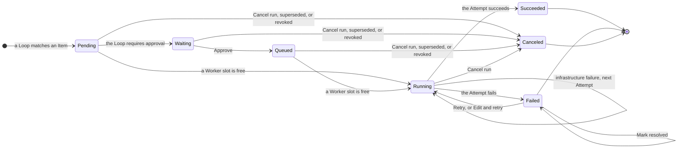

## Overview page

**Overview**, at `/`, has these sections:

- **Statistics**: the tasks done over the last 7 days, the last 30 days (the default), or all stored runs, with the run statistics under **Details**. See [Read the statistics](#read-the-statistics).
- **Needs attention**: what waits for you. If it's empty, its heading shows when usine last finished polling each repository.
- **Running**: one row per running attempt, with the item, loop, agent, worker, start time, last activity, and any [connectivity warning](#connectivity-warnings). If nothing runs, it shows the free worker slots.
- **Stalled**: each item that a trigger matches but that no attempt works on, with the reason and the action that moves it again.
- **Recent runs**: the 10 most recently closed runs, with their outcome and pull request.
- **Workers**: each worker's slots in use and its last preflight.

Select a run's row to open its run page.

### Read the statistics

A task is done when its pull request merges in the window, and counts if usine ran on it. Days are UTC days, and a window longer than 62 days counts per week. Runs that a newer event or an item change canceled before any attempt are left out. A window without a task done says so in one line.

- **Tasks done**: the count and the median time from issue to merge. The time starts when the task's first run opened, which its trigger label caused. The chart has a dot per task, by merge day and time on a log scale, and a line at the median; select a dot to open the task. A window longer than 62 days shows tasks per week over the median per week instead.
- **Time per task**: one bar that splits a task's time between the loops' attempts and waiting, which covers approval, the queue, and the time between runs, averaged over the tasks. Each line under it gives a loop's median run time, such as `finish-pr about 15 min`.
- **First time right**: the share of tasks where no loop succeeded twice on one item, so no review round sent the task back, and the operator actions per task: approvals, retries, failures marked resolved, and cycle budget resets. A sparkline beside each shows its trend over the window.
- **Tokens per task**: the median tokens and their split by loop. The median cost shows only if every session of every task has a price; a `~` marks an estimate from the Claude or ChatGPT plan.

The line under the blocks names the tasks left out, such as `19 tasks before 19 Oct lack timing and are left out`: their attempts ended before usine recorded end times, or their runs reported no tokens.

Select **Details** for the run statistics, read only once you open it:

- **Runs closed**, **Median run time**, **Median attempt time**, **Runs in one attempt**: run time is from a run's opening to its close; attempt time is from an attempt's start to its end.
- **Runs closed per day**, stacked by outcome, and **Needs attention entries per day**, with the median wait for an approval and from a failure to your retry. **Mark resolved** records no time.
- **Runs per loop**, **Runs per agent**, **Attempts per model**: outcomes, median time, tokens, and cost. A run has a price only if each of its sessions has one.
- **Attempts per run**, **Queue wait** per worker, and **Worker utilization**: the share of the window that each worker's slots held attempts.

### Stall reasons

| Reason                                                                     | Action                                          |
| -------------------------------------------------------------------------- | ----------------------------------------------- |
| **Waiting for approval**                                                   | **Approve**                                     |
| **Question from the agent** or **Blocked by the agent**                    | **Mark answered** or **Mark resolved**          |
| **Cycle budget used, \<n\> rounds**                                        | **Reset cycle budget**                          |
| **Failed \<time\> ago**, with the failure's reason                         | **Retry**                                       |
| **Canceled \<time\> ago, unchanged since** or **Succeeded \<time\> ago, unchanged since**. A loop opens one run per state of an item. | **Run again**                                   |
| **\<loop\> paused**                                                        | **Resume**                                      |
| **Waiting for attempt \<n\> to stop on \<worker\>**                          | None. It starts once usine confirms that the attempt's parent task stopped. See [Cancel a run](#cancel-a-run). |
| **Waiting for a free worker slot**                                         | None. It starts when a slot is free.            |
| **Waiting for the next poll**                                              | None. The next poll acts on the item's current state. |

A new label or comment is a new item state, which the loop acts on at the next poll.

## Follow a run

Each project has a board. A lane shows the labels and item states that route items to it, and a card is a task: an issue and its linked pull requests.

A card with an open or unresolved `Failed` run shows the run's loop, state, agent, and time since it opened, since the current attempt started, or since the failure (hover for the timestamp). A stalled card gives the same reason and action as **Stalled**, such as **Retry**, **Mark answered**, or **Mark resolved**.

A `Running` run's card goes to the lane of the item's current labels, such as a label that the loop sets when it starts. If the loop removes its trigger label and sets no other lane label, the card stays in the lane of its trigger label until the first poll after the run ends. A card that you move during a run moves like any other card.

The card menu lists only the actions that apply: open the items on GitHub or the run, **Run history**, approve, retry, or cancel, run the latest run again, and **Move to**. Runs without an item, such as schedule runs, are under **Runs without a card**.

The arrow between two authored label lanes shows the loops whose `if:` matches a task in the left lane, marked `paused` if paused. It's blue while one has a `Queued` or `Running` run on the lane's tasks, orange while all their open runs wait for approval, and unnamed if no loop picks up work from the lane.

All lanes are in one row: draggable lanes, read-only lanes, and then **Done** (closed items) and **Unmapped** (items that no lane routes), which start collapsed. Find issues to drag into a lane in **Unmapped**.

Click a card to open its task page at `/projects/<owner>/<name>/tasks/<number>`. The number is the originating issue, or the first pull request if there's no issue, and any of the task's item numbers opens the same page. Like the board, it covers the project's 500 newest items. It shows:

- A header with the issue number and title, the state and labels of the item that places the task in its lane, the lane, and **Move to**.
- **Runs**: every run on the task's items, newest first, with its state, loop, item, agent, attempts, attempt duration, open time, pull request, typed failure reason, and who approved it or ran it again. Click a row to open its run page. A run that needs you shows **Approve** or **Retry**, and the row menu lists its other actions.
- **Pull requests**: each pull request's state, and whether it conflicts with its base.
- **Comments and reviews**: what the agents posted on the task's items, with the run and the end time of its attempt. A comment appears after its attempt succeeds.

**Open run** in a card menu, or a run in **Needs attention**, opens the run drawer at a shareable `?run=<run id>` URL. It shows the item, the run's state, pull request or **No pull request**, loop, agent, a **Loop paused** note if paused, the newest attempt's worker and the **Duration** of all attempts once one has started, the available actions, a summary of what the run waits for, is doing, or how it ended, and **Open run page**. The drawer refreshes every second while the run can be canceled. The rest of the UI refreshes every 2 seconds while any run can be canceled, and every 15 seconds otherwise.

### Read the run page

The run page adds **Tokens** to the drawer's header: the output plus uncached input tokens of all the run's sessions and attempts, as each harness reports them. Select it for a breakdown per pool and per session, each with a price:

- API keys at Pi's catalog price. A Claude Code child whose gateway injects an Anthropic API key counts here, at the Agent SDK's price, and a Codex child whose gateway injects an OpenAI API key, at OpenAI's API price.
- The Claude plan at the Agent SDK's price, marked **estimate** because the plan doesn't bill per token.
- The ChatGPT plan at Pi's catalog price for the parent and OpenAI's API price for Codex children, marked **estimate** for the same reason.

usine prices Codex sessions from a table of OpenAI's API rates that it bundles. A pool shows no price if one of its sessions was recorded before usine stored prices, or ran a Codex model that the table lacks; the log names each such model once.

The conversation is next to an outline of the task, the event, and the attempts. Each attempt shows why it started, when, and for how long:

| Line                                         | The attempt started because                                                    |
| -------------------------------------------- | ------------------------------------------------------------------------------ |
| **From the event**                           | the run's event opened it. Every run's first attempt starts this way.          |
| **Retried by \<login\>**                     | you selected **Retry**. The login is the `operator` in `usine.yaml`.           |
| **Edited and retried by \<login\>**          | you used **Edit and retry**.                                                   |
| **Retried after an infrastructure failure**  | the engine retried after the previous attempt's `InfraFailure`.                |
| **Started again after a restart**            | a restart interrupted the previous attempt, and its parent task no longer existed. |

A reattached attempt also shows **Reattached after a restart**. Attempts other than a run's first that started before usine recorded the reason show no line.

The selected attempt lists its sessions and checkpoints. Consecutive messages of one session collapse into one entry, such as **developer, 14 messages**, that you can expand. Blockers, questions, your messages, warnings, and the outcome are never collapsed.

A red count under the outline, such as **2 errors**, steps through each failed attempt's outcome (the last one is the run's failure), every blocker and question, refused messages, and open connectivity warnings. A grey count, such as **12 recovered**, steps through tool calls that failed while the agent continued. A count with **loaded** or **+** covers only the loaded history.

## Run states

| State       | Meaning                                                                                       |
| ----------- | --------------------------------------------------------------------------------------------- |
| `Pending`   | Opened. No attempt has started. The run waits for a worker slot unless its loop requires approval. |
| `Waiting`   | Waits for your approval.                                                                      |
| `Queued`    | Approved, and waits for a worker slot. The drawer shows **Approved, waiting for a free worker**. |
| `Running`   | An attempt is running, or the next attempt is about to start.                                 |
| `Succeeded` | The step's result is stored: the commits and pull requests that the attempt produced.         |
| `Failed`    | The last attempt failed, and the engine doesn't retry it automatically.                       |
| `Canceled`  | Canceled by you, superseded by a newer event on the same item, or revoked because the item no longer matches. |



## Approve a run

A run that needs approval appears in **Needs attention** as **\<loop\>: approval needed**. Read its **Task** and **Event**, and select **Approve**. The run becomes `Queued` and starts when a worker slot is free. Its **Event** then shows the approver, time, and channel, such as **Approved by octocat · 15 Oct 19:30 · from the UI**, where the name is the `operator` in `usine.yaml`. Runs approved before usine recorded approvers show **Approved**.

If the item changes before you approve and still matches, usine opens a new waiting run and cancels this one as superseded. If the item no longer matches, usine revokes the run.

## Retry a failed run

The engine retries automatically only after an `InfraFailure`, such as an unreachable worker or a failed checkout, up to three attempts per run. Any other failure leaves the run `Failed` and lists it in **Needs attention** under the failure's name:

| Failure                     | Cause                                                                                                      |
| --------------------------- | ---------------------------------------------------------------------------------------------------------- |
| `InfraFailure`              | Infrastructure failed around the agent, and the run has used its three automatic attempts.                 |
| `AgentFailure`              | A harness isn't ready on the worker, a child's harness failed during its turn, or the parent's model, effort, or credential is unusable. |
| `BlockedFailure`            | The agent reported a blocker with `[usine:blocked]`. See [Clear a blocker](#clear-a-blocker).              |
| `QuestionFailure`           | The agent asked you for a decision with `[usine:question]`. See [Answer a question](#answer-a-question).   |
| `DefectFailure`             | A defect in usine at the execution boundary.                                                               |
| `RunawayFailure`            | The attempt reached `max_attempt_minutes` or `max_attempt_tokens`.                                         |
| `ChildSessionBudgetFailure` | The parent tried to start more children than `max_children` allows.                                       |

When an attempt fails, usine stops its parent task. If usine can't confirm the stop, the attempt keeps its slot on the worker and its worktree, as after a [cancel](#cancel-a-run). Until a retried stop succeeds, no other attempt starts in that slot, the run's automatic retry starts on no worker, the run page shows **Waiting for attempt \<n\> to stop on \<worker\>**, and **Needs attention** shows **\<loop\>: parent task not stopped**. usine then salvages the worktree, and the retry starts from that salvage.

**Retry** starts a new attempt, as many times as you want. When an attempt doesn't succeed, usine commits its changes and pushes the worktree to `usine/salvage/<run>/<attempt number>`, a branch that usine never deletes. If the push fails, the worktree stays on the worker and the attempt shows its path.

The next attempt fetches the run's revision again (for an issue run, the current default branch), rebases the newest salvage onto it, and gives the salvage branch in its prompt. A salvage without changes is dropped. If a salvage conflicts, the attempt starts from the base, and its first line, **Attempt started**, gives the salvage branch.

While another run of the same loop is open on the item, usine refuses **Retry** and **Edit and retry**, and the drawer shows the open run. Retry after it closes, or cancel it.

**Mark resolved** removes a handled failure from **Needs attention** and from the project's status. The run stays `Failed` and you can still retry it. If a later attempt fails, it appears again.

## Answer a question

If an agent needs your decision, it posts the question on the item and ends with `[usine:question]`. The run fails with `QuestionFailure`, and **Needs attention** shows **Question from \<loop\>** with the question. usine doesn't retry it.

The agent's comment changes the item, but the loop opens no run for the first state that polling sees after the question, so it doesn't ask again and use up the cycle budget. The loop acts on the item again when:

- The item changes again, for example with your reply, an edit, or a commit. The new run's agent reads your reply.
- The item stops matching and matches again, for example when you remove and add the loop's label.
- You select **Retry**, or **Edit and retry** with your answer in the task.
- You select **Mark answered**. The loop checks the trigger against the newest state that it saw after the question and opens a run for it.

A GitHub reply counts only if it changes the item after polling saw the question. If the agent posted nothing, or you reply within the same poll, use **Mark answered** or **Retry**.

## Clear a blocker

If an agent hits a blocker that it can't resolve, such as a failing baseline check or a missing permission, it records the blocker on the item and ends with `[usine:blocked]`. The run fails with `BlockedFailure`, and **Needs attention** shows **\<loop\>: blocked** with the blocker. usine doesn't retry it.

As with a question, the blocker comment opens no run. After you remove the blocker, the loop acts on the item again in the same cases, or when you select **Mark resolved**, which checks the trigger against the item's newest state and opens a run.

## Edit and retry a run

**Edit and retry** opens the run's task and the roster's agents, including agents that a reload added. **Save and retry** replaces the task, the agent, and the parent model that usine picks for it, and retries. Every later attempt of the run uses the change, including automatic retries, until you edit again. Each attempt records the task and agent that it ran. The event doesn't change.

## Cancel a run

Select **Cancel run**, then **Confirm cancel**. usine stops a running attempt, pushes its work to a salvage branch, and closes the run as `Canceled`. Polling the same item content starts nothing.

If usine can't confirm that the attempt's parent task stopped, the cancel returns an error, and the attempt keeps its slot on the worker, so no other attempt starts there in its place. The worktree stays on the worker without salvage, and no attempt of the loop starts on the item, so a queued event's run waits too. **Needs attention** shows **\<loop\>: parent task not stopped**. usine retries the stop at each reconcile, every three minutes, also after the next `usine up`. Once a stop succeeds, usine salvages the worktree and frees the slot.

To run the loop on the item again, remove the loop's label, wait until usine sees the item without it (one poll, or immediately after a board move), and add the label again. The same applies to superseded and revoked runs. If you remove and add the label within one poll interval, polling sees no change, so use **Run again**. A `Failed` run keeps its event, so retry it instead.

## Run again

A `Succeeded` or `Canceled` run has **Run again** and **Edit and run again** in its drawer, run page, and task page row menu, and, for the task's latest run, in the card menu. **Run again** opens a new run of the same loop on the same item content, with the same task and agent. **Edit and run again** lets you change them first, then **Save and run again**. The card shows **Opening a run…** until the new run's drawer opens.

The new run follows the current loop file, including approval, and counts against the cycle budget. If the budget is used up, no run opens and the budget appears in **Needs attention**. usine refuses while another run of the loop is open on the item. The original run stays as it ended, and the new run's event shows who ran it again, when, and a link to the original. Run again also works on a paused loop. Polling the unchanged item still starts nothing.

## Steer a live attempt

While a run is `Running`, the drawer has **Message the parent** and, for each live child, **Message this child**. usine sends the message through the attempt channel and adds it to the transcript, from the `operator` login or `local operator`. It never becomes an event, and the attempt gets an **Operator intervened** badge.

| UI control              | To the parent                                                                       | To a child                                                                                     |
| ----------------------- | ----------------------------------------------------------------------------------- | ---------------------------------------------------------------------------------------------- |
| **Send** a message      | Places a hold. A waiting or paused parent starts its next turn with the message, and a parent that waits on a child reads it when the child returns. After it answers, the parent waits for you instead of ending the attempt. | Adds the message to the child's conversation and places a hold: the parent gets the child's answer only after you release it. |
| **Pause session**       | Stops the current turn, including children, until you send a message or release the parent. | Pauses the child at its next tool or model call, until you send a message.                    |
| **Release parent** / **Release child** | Shown while the parent has a hold or is paused. A waiting parent continues the task, and a working parent ends the attempt with its next answer. | The parent gets the child's answer when the child is idle.               |

To take over a session, message it as a user would. You can hold several sessions. While a session is held, the `max_attempt_minutes` clock stops, but tokens count.

A message to a parent that waits on a child shows **Queued until the delegated task ends** under it, in the conversation and the drawer, until the parent reads it. If you paused the parent first, it shows **Not delivered**; send it again to resume the parent. A message to a working child shows **Queued until the current child step ends**, and the child isn't shown as resumed. A Pi child reads it before its next model request, a Codex child before its next model request in the turn, and a Claude Code child when a tool call returns or as its next turn. If the child stops first, the message shows **Not delivered**.

The API also has `Steer`, which adds guidance without a hold, and which the runaway guard sends from the operator `engine` at 80% of a limit. All four actions use `POST /api/runs/<run id>/intervene`. usine refuses an action, and the drawer shows why, if the run isn't `Running`, the attempt isn't the latest, or the session isn't live in this process, such as before a reattach. A session's own refusal, such as a message to a child that has returned, appears in the conversation.

If the parent's last turn answered you and the attempt has no commit, pull request, or comment to show, the attempt fails with that answer instead of succeeding, so that you decide what happens next.

For a Claude Code or Codex child, the terminal icon in the outline shows the session ID, the worktree, and a **Resume this session** command: `cd -- '<worktree>' && claude --resume '<id>'`, or `codex resume -- '<id>'`. For an ssh worker, the command runs over `ssh -t <destination>`, with `-p <port>` if the worker sets `port`, and the worktree line includes the worker. If `usine.yaml` no longer declares the worker, the block shows the local form and says so. For a Codex child that saved its session in the attempt's own Codex home, as behind a gateway with `openai` in `llm_providers`, the command sets `CODEX_HOME='<home>'` before `codex resume`. The block notes that the command uses the attempt's harness login, or, for a child whose model requests used the gateway's credential, that the gateway credential isn't available from your shell. The command works only until attempt cleanup removes the worktree.

## Needs attention

**Needs attention** is first on the overview page and at the top of every other page. Select a run's entry to open its drawer. While an approve or cancel is in progress, the entry's buttons show it, such as **Approving…**. The entry disappears when usine accepts an action on its run. If the run already changed, for example because you approved it in the drawer, **Approve** shows no error, the entry disappears at the next refresh, and the drawer and run page show why usine refused.

| Entry                                  | Meaning                                                                                                              |
| -------------------------------------- | -------------------------------------------------------------------------------------------------------------------- |
| **\<loop\>: approval needed**          | A run is in `Waiting`. Approve or cancel it.                                                                         |
| **\<loop\>: \<failure\>**, such as **review: agent failure** | A run is `Failed`. Read the attempt, then select **Retry**, **Edit and retry**, or **Mark resolved**.                |
| **Question from \<loop\>**             | An agent asked you a question. See [Answer a question](#answer-a-question).                                          |
| **Cycle budget exhausted**             | An item reached a loop's [`max_cycles`](/reference/configuration/loop-files/#max_cycles). Inspect it, then select **Reset cycle budget**. |
| An error name from polling             | A repository's poll failed, for example on a GitHub error, a missing App permission, or an `if:` that fails to evaluate. |
| **Label preflight failed**             | usine couldn't create a label that `usine.yaml` declares.                                                            |
| **Item not shown on the board**        | usine couldn't place an item on its board.                                                                           |
| A schedule error                       | A schedule loop couldn't evaluate or submit a tick.                                                                  |
| **Loop file not loaded**               | A loop file failed to load and opens no runs. Fix the file and reload the configuration.                             |
| **Agent file not loaded**              | An agent file failed to load and isn't in the roster. Fix the file and reload the configuration.                    |
| **Worker not configured**              | Attempts are recorded on a worker that `usine.yaml` no longer declares. See [Restarts](#restarts).                   |
| **\<loop\>: parent task not stopped**  | A closed attempt's parent task may still run, so the attempt keeps a slot on its worker and its worktree, and no attempt of the loop starts on the item. See [Cancel a run](#cancel-a-run) and [Retry a failed run](#retry-a-failed-run). |

Entries about an issue that is closed or a pull request that is closed or merged leave on their own:

- A failed run, question, or blocker on the item isn't listed, and it doesn't mark the project or the item's board card as needing attention. The run stays under **Recent runs**, and its drawer says `Issue closed`, `Pull request closed`, or `Pull request merged`. You can still retry it or mark it resolved.
- The item's **Cycle budget exhausted** entry leaves at the next poll. usine records the ask as closed, not reset, so the item keeps its budget: if the item is reopened and a loop matches it again, the entry comes back.
- A run waiting for approval is revoked at the next poll if the loop's `if:` requires an open item, such as `item.state == "OPEN"`.

A run in a repository that you remove from `usine.yaml` leaves too: its approval, failure, question, or blocker isn't listed, because the repository has no project to mark. A failed run stays under **Recent runs**.

## Runaway guards

`max_attempt_minutes` and `max_attempt_tokens` in [`settings`](/reference/configuration/usine-yaml/#settings) limit each attempt. Both are off by default:

```yaml title="usine.yaml"
settings:
  max_attempt_minutes: 120
  max_attempt_tokens: 5000000
```

At 80% of a limit, the parent gets one warning. At 100%, the attempt fails with `RunawayFailure`, which the engine never retries automatically.

## Connectivity warnings

If an attempt's worker stops responding, or a child can't reach its model provider, the conversation shows a yellow line and the orchestrator logs a warning. The attempt keeps running until it finishes, you cancel it, or it reaches a limit.

- **\<worker\> silent since \<time\>**: while attempts run on an `ssh` or `exe.dev` worker, usine runs `true` on it over a new SSH connection every minute, one probe for all attempts. The line means that the probe got no answer within 45 seconds. It appears on every attempt on that worker, with the last answer time and what the probe saw. **\<worker\> answering again** follows when a probe succeeds. An attempt that starts during the silence gets the line immediately, and gets **answering again** only with it.
- **Provider unreachable**: a Codex child reported `Reconnecting...`, or a Claude Code or Pi child reported an API retry. A child's consecutive retries share one line with the count and the latest message. **Provider reachable again** follows when the turn continues.

While a warning is open, the current activity in the conversation and the drawer says what isn't responding and since when. **Needs attention** doesn't list these warnings.

## Restarts

When the orchestrator stops, a running attempt's Pi parent task stays in `.usine/durable.sqlite`, and its worktree stays on its worker. The next `usine up` reattaches the attempt, which isn't a retry. The attempt keeps the time and tokens that it used, with no second 80% warning. If you lowered a limit below its usage, it stops at the reattach, and past 80% of it, the parent gets the warning then. Stopped time doesn't count, nor do up to the last 30 seconds before a crash, so an attempt can run up to 30 seconds past its limit per crash. If usine can't read the usage, it stops the parent task, salvages the worktree, and fails the attempt with an `InfraFailure` that says what it couldn't read. The run retries from the salvage.

A reattached attempt keeps a slot on its own worker from the moment `usine up` starts, before any run gets one. If you lowered `max_concurrent_attempts` while usine was stopped, the worker logs `An Attempt that already runs on the Worker occupies a slot beyond its max_concurrent_attempts` and takes no new attempt until enough end.

If an attempt isn't reattached:

- If its parent task or worktree is gone, the attempt fails with an `InfraFailure`, and the run retries from the newest salvage branch, if any.
- If the parent task stopped first, its state can't be read, or the reattach fails, for example because usine can't issue the attempt's credential, usine stops the task if needed and salvages the worktree, and the new attempt starts from that salvage.
- If usine can't confirm that the parent task stopped, it keeps the worktree and the slot, starts no new attempt, and logs `Could not confirm that the parent task of an Attempt its Run does not reattach stopped`. It tries again at each reconcile, every three minutes, and reattaches the attempt if the task is still live.

Canceling a run whose attempt waits for its reattach salvages and removes the worktree, unless usine has taken it over again. If usine can't confirm that the parent task stopped, it keeps the worktree and the slot and retries the stop at each reconcile, also after the next `usine up`.

At each start, usine also reconciles checkouts that earlier attempts left on declared workers: it salvages failed and canceled attempts and removes succeeded ones, after it stops the parent task of a closed attempt that still runs. If it can't confirm that stop, it keeps the worktree and a slot, starts no attempt of the loop on the item, logs `Could not confirm that the parent task of a closed Attempt stopped`, lists the attempt in **Needs attention**, and retries at each reconcile. After that, and at each reconcile, it removes each Codex home in `<root>/workers/<name>/codex/` on an SSH worker that no running attempt uses and whose attempt has no checkout there, such as one that a crash left with the attempt's Codex sessions.

usine skips attempts on a worker that `usine.yaml` no longer declares, for example after you replace `local` with an SSH worker. It logs one warning per start with their count, shows **Worker not configured** in **Needs attention**, and leaves their checkouts. Their runs wait until you declare the worker again or cancel them. Declare the worker again and restart `usine up`, or select **Discard leftovers**, then **Confirm discard**, to stop tracking them. On an SSH worker with its own machine, the discard also removes the attempts' Codex homes from `<root>/workers/<name>/codex/`: usine records how to reach the machine in `.usine/ssh-workers/` each time it adds the worker. If the machine can't be reached, or usine has no record of it, usine logs it and the Codex homes stay. Remove the checkouts yourself. A worker that you declare again reconciles only attempts recorded after the discard. After a reload removes a worker, the entry says how many attempts still run, such as `2 attempts still running on it. Discard the leftovers after they end`, and refuses a discard until they end.

## Stop the orchestrator

From the instance folder, run `usine stop`, or press Ctrl+C once in the terminal of `usine up`. usine stops starting attempts and waits for running attempts to end, for at most `max_attempt_minutes`. `usine stop` names the runs that it waits for and returns when the process exits, or after `--timeout` seconds (120 by default) while the drain continues. `usine stop --force`, or a second Ctrl+C, stops the orchestrator without waiting, and the next `usine up` reattaches the running attempts. If the process still runs after `--timeout`, `usine stop --force` sends it `SIGKILL`. See [Shutdown](/reference/configuration/cli/#shutdown).

`usine status` tells whether the orchestrator runs, with its PID, address, engine version, uptime, and open runs. It exits with status 3 if the orchestrator doesn't run.

## Restart and upgrade

`usine restart` stops the orchestrator and starts it again in the background, with the same Node.js binary, entry point, port, and flags, and its output in `.usine/usine.log`. If an earlier usine version started the orchestrator without a record that the new one reads, `usine restart` checks the orchestrator on the port where it answers, then starts it as `usine up --detach` would, on the port that your shell or `.env` sets. To start it in the background the first time, run `usine up --detach`.

`usine restart` and `usine upgrade` refuse while a run has a running attempt, so that the drain doesn't keep the orchestrator down. Wait for the attempt to end, or pass `--force` to stop without waiting; the new process reattaches the attempt. The new process gets the environment of your shell and reads `.env` in the instance folder. Keep the variables that `usine up` needs, such as a gateway's `admin_token_env`, in `.env`, so that the commands work from any shell. `usine restart` refuses if neither your shell nor `.env` sets a gateway's variable. See [Environment file](/reference/configuration/cli/#environment-file).

To upgrade an instance that pins `@usine/server` in its `package.json`, run `usine upgrade`, or `usine upgrade <version>` for another version than `latest`. It backs up the stores into `.usine/backups/`, moves the pin, installs it, commits the change, and restarts the orchestrator. `usine upgrade --check` prints the versions and changes nothing. If the orchestrator runs from a checkout, pull and build that checkout, then run `usine restart`. See [`usine upgrade`](/reference/configuration/cli/#usine-upgrade-version).

## Back up and export

Run `usine backup` from the instance folder, with a new file name, while the orchestrator runs:

```sh title="Instance folder"
usine backup /backups/factory-2026-10-16.sqlite
```

It also writes the durable storage to `/backups/factory-2026-10-16.durable.sqlite` ([`usine backup`](/reference/configuration/cli/#usine-backup-path)). Keep backups outside the instance folder, and back up `usine.yaml`, the loop and agent files, and the credentials separately.

To restore a backup:

1. Stop the orchestrator with `usine stop`.
2. Move `.usine/runtime.sqlite` and `.usine/durable.sqlite` aside, with their `-wal` and `-shm` files.
3. Copy both files of one backup in their place.
4. Start `usine up` with the same configuration and usine version.

An older backup has an older event record, so work done after it can run again.

`usine export-run` writes one run, with its transcript, to a JSON file ([`usine export-run`](/reference/configuration/cli/#usine-export-run-runid)):

```sh title="Instance folder"
usine export-run <run id>
usine export-run <run id> --output /evidence/run.json
```

The run ID is at the top of the drawer's **Attempts** tab and after `?run=` in the URL. Transcripts contain repository content and tool output, so read the file before you share it.
