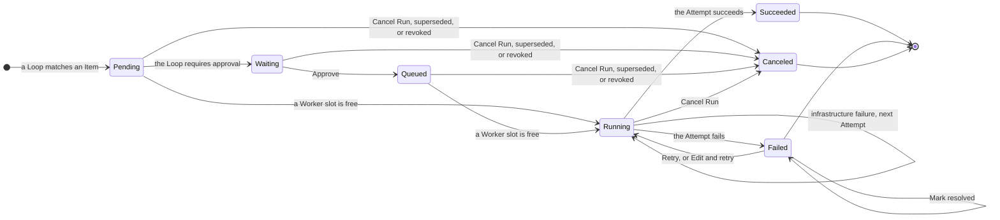

A Run is the work a Loop owes one Event, and each try of its Step is an Attempt. This page covers what you do with Runs in the web UI at `http://127.0.0.1:7331`, and the CLI commands that keep their history. Every action in the UI is also an HTTP endpoint of the operator API.

## Follow a Run

**Projects** lists the registered repositories with their Item and lane counts and a status: **needs you**, **active** while a Run can still be canceled, or **clear**. A project opens as its Board, where each card is a task: an issue and the pull requests linked to it, with the history of their Runs. A card says when one of its Runs waits for approval or for a free Worker. Runs without an Item, such as schedule Runs, are listed below the lanes under **Runs without a card**.

Selecting a Run in a card's history, or in **Needs you**, opens the Run drawer. The address gets `?run=<run id>`, so you can share or reload it. The drawer has:

- a header with the Loop, the Run's state, a **Loop paused** badge when that applies, the repository, and links to the Item and to the pull request the Run produced;
- a row of the actions the Run's state allows;
- **Conversation**: the parent's messages and one collapsible section per child, with **Everything**, **Messages**, and **Tools** filters, **Load earlier** for older activity, and a message box while the Attempt runs;
- **Task**: the task the Run currently uses;
- **Event**: the Event's identity and the Item payload it was recorded with;
- **Attempts**: the Run id, the rate windows the providers reported for each billing pool, and for each Attempt its Agent, Worker, harness, model, effort, the task it actually ran, its failure, and where its unfinished work was saved.

The drawer refreshes every second while the Run can be canceled, and the rest of the UI every 2 seconds while some Run can be canceled, or every 15 seconds otherwise.

## Run states

| State       | Meaning                                                                                       |
| ----------- | --------------------------------------------------------------------------------------------- |
| `Pending`   | Opened. No Attempt has started, and the Run waits for a Worker slot unless its Loop requires approval. |
| `Waiting`   | Waits for your approval.                                                                      |
| `Queued`    | Approved, and waits for a Worker slot. The drawer says **Waiting for a free worker**.          |
| `Running`   | An Attempt runs, or the next one is about to start.                                           |
| `Succeeded` | The Step's result is stored: the commits and pull requests the Attempt produced.              |
| `Failed`    | The last Attempt failed and the engine does not retry it on its own.                          |
| `Canceled`  | Canceled by you, superseded by a newer Event on the same Item, or revoked because the Item stopped matching. |

The actions you see in the drawer move a Run between these states:



Workers take Runs in the order their Events arrived, and each Worker runs up to its `max_concurrent_attempts` at a time.

## Approve

A Loop with `approval: required` parks each new Run in `Waiting`. It appears in **Needs you** as **Approval required**, and its card says that a Run waits for approval. Open the Run, read its **Task** and **Event**, and select **Approve**. The Run becomes `Queued` and starts when a Worker slot is free.

If the Item changes before you approve and still matches the Loop, a new waiting Run replaces this one, which is canceled as superseded. If it stops matching, the waiting Run is canceled as revoked.

## Retry and Mark resolved

The engine retries an Attempt on its own only after an `InfraFailure`, such as an unreachable Worker or a failed checkout, and only up to three Attempts per Run. Every other failure leaves the Run `Failed` and lists it in **Needs you** under the failure's name:

| Failure                     | Cause                                                                                                      |
| --------------------------- | ---------------------------------------------------------------------------------------------------------- |
| `InfraFailure`              | Infrastructure failed around the Agent, and the Run has used its three automatic Attempts.                 |
| `AgentFailure`              | The Agent reported a blocker with `[usine:blocked]`, a harness is not ready on the Worker, or the parent's model, effort, or credential is unusable. |
| `DefectFailure`             | A defect in usine at the execution boundary.                                                               |
| `RunawayFailure`            | The Attempt reached `max_attempt_minutes` or `max_attempt_tokens`.                                         |
| `ChildSessionBudgetFailure` | The parent tried to start more children than `max_children` allows.                                       |

**Retry** starts a new Attempt of the same Run, with no limit on how many. When an Attempt ends without success, usine commits what it left uncommitted and pushes its worktree to the branch `usine/salvage/<run>/<attempt number>` of the repository; the next Attempt starts from the newest such branch, and its prompt says so. If that push fails, the worktree stays on the Worker and the Attempt shows its path. usine deletes no salvage branch.

**Mark resolved** removes a failure you have handled from **Needs you** and from the project's status. The Run stays `Failed` and you can still retry it. A later failed Attempt asks for attention again.

## Edit and retry

**Edit and retry** opens an editor with the Run's task and a list of the roster's Agents. **Save and retry** replaces the task, the Agent, and the parent model that Agent resolves to, then retries. The change sticks: every later Attempt of the Run uses it, automatic retries included, until you edit again. Each Attempt records the task and Agent it actually ran, and the Event stays unchanged.

## Cancel

**Cancel Run**, then **Confirm cancel**, closes any open Run as `Canceled`. A running Attempt is stopped and its unfinished work is pushed to a salvage branch, as on a failure. The Event of a canceled Run stays recorded, so the same Item content does not open a new Run; the Item must change first, for example by a new comment or a label you remove and add again ([#267](https://github.com/basaltbytes/usine/issues/267)).

## Steer a live Attempt

While a Run is `Running`, the drawer has a message box under the parent's conversation, **Message the parent**, and one in each live child's section, **Message this child**. What you send goes to the session through the Attempt's live channel and into the transcript, attributed to the `operator` login of `usine.yaml` or to `local operator`. It never becomes an Event, and the Attempt gets an **Operator intervened** badge.

| UI control              | To the parent                                                                       | To a child                                                                                     |
| ----------------------- | ----------------------------------------------------------------------------------- | ---------------------------------------------------------------------------------------------- |
| **Send** a message      | Joins the current turn while the parent works, or resumes a paused parent with it.  | Joins the child's conversation and places a Hold: the child's answer goes back to the parent only when you release it. |
| **Pause session**       | Stops the current turn. The parent waits until you send a message.                  | Pauses the child at its next tool or model call, until you send a message.                    |
| **Release child**       | not shown                                                                            | Ends the Hold, so the child's answer returns to the parent once the child is idle.             |

Sending messages to a live session is the takeover: you work in the session as a user would, and the parent keeps waiting for a held child until you release it. Several children can be held at once. While a child is held, the `max_attempt_minutes` clock stops; tokens still count toward `max_attempt_tokens`.

The API has one more action, `Steer`, which adds guidance to the parent or a child without a Hold. The runaway guard sends one `Steer` from the operator `engine` when an Attempt reaches 80% of a ceiling. All four actions go to `POST /api/runs/<run id>/intervene`. usine refuses one when the Run is not `Running`, when the Attempt is no longer the Run's latest, or when the session is not live in this process, as before a restarted orchestrator reattaches the Attempt, and the drawer shows the error. When the session itself refuses an action, such as a message to a child that has already returned, the refusal appears in the conversation. A message to a parent that is waiting for a child is delivered only after the child returns, and the parent may then end the Attempt with its answer to you as the result ([#159](https://github.com/basaltbytes/usine/issues/159)). Message the child instead when the parent is delegating.

For a Claude Code or Codex child, the expanded child section also shows its saved session id, its worktree on the Worker, and a **Resume on worker** command, `claude --resume <id>` or `codex resume -- <id>` from that worktree. Run it on the same Worker under the same login to continue the conversation yourself, while the worktree still exists; Attempt cleanup removes it.

## Needs you

**Needs you**, at the top of every page, lists what waits for you. An entry that concerns a Run opens its drawer.

| Entry                                  | Meaning                                                                                                              |
| -------------------------------------- | -------------------------------------------------------------------------------------------------------------------- |
| **Approval required**                  | A Run waits in `Waiting`. Approve or cancel it.                                                                      |
| A failure name, such as `AgentFailure` | A Run is `Failed`. Read the Attempt, then **Retry**, **Edit and retry**, or **Mark resolved**.                       |
| **Cycle budget exhausted**             | An Item reached a Loop's `max_cycles`. Inspect it, then **Reset cycle budget**.                                      |
| An error name from polling             | A repository's poll failed, for example on a GitHub error, a missing App permission, or an `if:` that fails to evaluate. |
| **Label preflight failed**             | usine could not create a label that `usine.yaml` declares.                                                           |
| **Item projection quarantined**        | An Item could not be placed on its Board.                                                                            |
| A schedule error                       | A schedule Loop could not evaluate or submit a tick.                                                                 |

## Cycle budgets

Each Loop may open `max_cycles` Runs on one Item between your resets, 3 by default. When a Loop is about to open one more, usine opens an Ask instead: **Cycle budget exhausted** in **Needs you**, with the Item, the number of completed rounds, and the Runs of each Loop that took part. From then on no Loop opens a Run on that Item, while the Runs already open continue. Restarts and label changes do not clear the Ask.

Look at the Item, then select **Reset cycle budget**. usine grants the Item a new allowance and polls its repository again from the start, so each active Loop that matches the Item's current state can open a Run. A paused Loop stays paused. Nothing about the Ask is posted on GitHub ([#36](https://github.com/basaltbytes/usine/issues/36)). [Bounded review and fix Loops](/guides/review-fix-loops/) explains how to write Loops around the budget.

## Ceilings

Two optional ceilings in `usine.yaml` stop an Attempt that runs too long, and both are off by default:

```yaml title="usine.yaml"
settings:
  max_attempt_minutes: 120
  max_attempt_tokens: 5000000
```

At 80% of a ceiling the parent gets one warning. At 100% the Attempt stops with `RunawayFailure`, which the engine never retries on its own. The minutes clock stops while a child is held, and the token count adds up the parent and every child.

## Restarts

An Attempt whose orchestrator stopped keeps its Pi parent task in `.usine/durable.sqlite`. The next `usine up` reattaches it: same Attempt, same worktree, and no retry spent. If its parent task or its worktree is gone, the Attempt fails as an `InfraFailure` and the Run retries on a new Attempt, from the newest salvage branch when there is one.

## Stop the orchestrator

Press Ctrl+C once or send SIGTERM. usine starts no new Attempt and waits for the running ones to end, for at most `max_attempt_minutes` when that setting is present and without a limit otherwise. The log shows `Orchestrator shutdown started`, then `Orchestrator exiting after graceful drain`.

A second Ctrl+C or SIGTERM stops the wait. The Attempts still running stay recorded as open, and the next `usine up` reattaches them. Runs waiting for a Worker and pending automatic retries remain saved and continue at the next start. Start the next `usine up` only after the process has exited, because the instance lock refuses a second one until then.

## Back up and export

`usine backup` copies the runtime store and the durable storage while the orchestrator runs. Run it from the instance folder with a new file name:

```sh title="Instance folder"
usine backup /backups/factory-2026-10-16.sqlite
```

It writes `.usine/runtime.sqlite` to that path and `.usine/durable.sqlite` beside it, as `/backups/factory-2026-10-16.durable.sqlite`. Both copies have owner-only permissions. The command never overwrites a file, needs a directory that exists, and needs a file system with hard links. Keep backups outside the instance folder, and keep `usine.yaml`, the Loop and Agent files, and the credentials in their own backup.

To restore, stop the orchestrator, move `.usine/runtime.sqlite` and `.usine/durable.sqlite` aside with their `-wal` and `-shm` files, copy both files of one backup into their places, and start `usine up` with the same configuration and usine version. An older backup also restores an older record of Events, so work done after it can run again.

`usine export-run` writes one Run to a JSON file: its Event, effective task and Agent, revision, Step result, every Attempt, and the whole transcript, read in one transaction.

```sh title="Instance folder"
usine export-run <run id>
usine export-run <run id> --output /evidence/run.json
```

Without `--output`, the file is `run-<run id>.json` in the current directory, with characters such as `/` percent-encoded. The command opens the runtime store read-only and never overwrites a file. The Run id is at the top of the drawer's **Attempts** tab and in the address after `?run=`. Transcripts contain repository content and tool output, so read the file before you share it.
