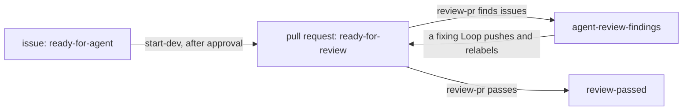

import { Steps } from "@astrojs/starlight/components";

Create a loop in **Configuration > Loops > New**, or import a Markdown file from `loops/`. The export-format frontmatter sets which issues or pull requests start work, on which repositories, whether you approve each run, and which agent does the work. Its body is the agent's task. The name is in kebab-case. [Loop files](/reference/configuration/loop-files/) lists every key, and [Expressions](/reference/configuration/expressions/) lists every field that an expression can read.

## Create a minimal loop

Choose **New**, enter a name, and edit the template below. Save the loop, then select **Resume** after reviewing it; new loops start paused.

```markdown title="loops/start-dev.md"
---
trigger:
  on: issue
  if: >-
    item.state == "OPEN" &&
    item.labels.nodes.exists(label, label.name == "ready-for-agent")
agent: developer
---

Complete issue #{{ item.number }}: {{ item.title }}.
```

`trigger` and `agent` are the only required keys. `agent` is the name of a file in `agents/`, here `agents/developer.md`. When someone adds `ready-for-agent` to an open issue, the next poll finds `if:` true, and the orchestrator opens a run with the rendered body as its task. An attempt starts when a worker has a free slot.

## Triggers

`trigger.on` sets what starts the loop:

| `on`       | The loop fires for                                                                       | The attempt's checkout                            |
| ---------- | ---------------------------------------------------------------------------------------- | ------------------------------------------------- |
| `issue`    | an issue whose content changed while `if:` is true. Pull requests don't count as issues. | the default branch, detached at its latest commit |
| `pr`       | a pull request whose content changed while `if:` is true                                 | the pull request's head commit, detached          |
| `schedule` | each tick of `cron`, once per repository that the loop applies to, if `if:` is true      | the default branch, detached at its latest commit |

usine polls every `settings.poll_interval` seconds (default 60). A loop acts once for each version of an item's content: if the same content matches again, no new run opens. When `if:` becomes false, usine revokes the loop's runs on that item that haven't started. A schedule trigger also takes `cron` and `tz`. See [`trigger`](/reference/configuration/loop-files/#trigger).

## Match items with `if:`

`if:` is a [CEL](https://cel.dev) expression that must evaluate to a boolean. It reads `repo` and `item`, the item's payload with GitHub's GraphQL field names ([variables](/reference/configuration/expressions/#variables)). Lists are GraphQL connections with `totalCount` and `nodes`, so CEL's list macros apply to `nodes`:

| Condition                                 | Expression                                                                  |
| ----------------------------------------- | --------------------------------------------------------------------------- |
| The item has a label                      | `item.labels.nodes.exists(label, label.name == "ready-for-agent")`          |
| No open pull request closes the issue yet | `!item.closedByPullRequestsReferences.nodes.exists(pr, pr.state == "OPEN")` |
| The pull request is open and not a draft  | `item.state == "OPEN" && !item.isDraft`                                     |
| GitHub reports a merge conflict           | `item.mergeable == "CONFLICTING"`                                           |
| Every review thread is resolved           | `item.reviewThreads.nodes.all(thread, thread.isResolved)`                   |

If an expression reads a field that the payload doesn't have, or `if:` isn't a boolean, the loop doesn't load. Test nullable fields before you read below them, as in `item.milestone != null && item.milestone.title == "v1"` ([fields that can be null](/reference/configuration/expressions/#fields-that-can-be-null)).

## Limit the repositories

```yaml title="loops/start-dev.md"
selector:
  repos: [acme/widgets]
  tags: [backend]
```

Without a `selector`, a loop applies to every repository in `usine.yaml`. With both keys, a repository must be listed and have one of the tags ([`selector`](/reference/configuration/loop-files/#selector)).

## Require approval

`approval: required` keeps every new run in `Waiting` until you [approve it](/guides/operate-runs/#approve-a-run). If the item changes meanwhile, the run that you approve still has the newest task.

## Name the step

`step` is the name of the run's one step (default `run`). It appears in attempt IDs and logs, so describe the work, such as `implement` or `review`.

## Write the task template

The body is Markdown. Each `{{ ... }}` is a CEL expression over `item` and `repo` that must produce a scalar. usine renders the body when it records the event, and adds the repository, the payload, the persona, and fixed rules around it ([agent prompt](/reference/configuration/loop-files/#agent-prompt)). So write only what is specific to the loop.

A pull request run starts detached at the head commit, so a task that pushes must tell the agent to check out `{{ item.headRefName }}` first. usine removes the worktree when the attempt ends, so commits that weren't pushed by a successful attempt are lost.

## Pass an item to the next loop

usine changes labels only when you move a card on the board. Loops pass work to each other through labels that the agent changes with `gh`: each loop's `if:` requires one label, and its task removes that label first and adds the next loop's label when done.

Remove the trigger label first because the agent's comments and commits change the item. If the label is still there, `if:` stays true, and the loop runs again after the current run ends, until the [cycle budget](/reference/configuration/loop-files/#max_cycles) stops it.

<Steps>

1. Declare the labels in [`labels`](/reference/configuration/usine-yaml/#labels). usine creates them in every repository that lacks them.

   ```yaml title="usine.yaml"
   labels:
     - name: ready-for-agent
       color: "0e8a16"
     - name: agent-in-progress
     - name: ready-for-review
     - name: agent-review-findings
     - name: review-passed
   ```

2. Write the first loop's task so that it changes the labels. This is `start-dev` from the factory that runs usine on its own repository. It also requires approval and skips issues that an open pull request already closes:

   ```markdown title="loops/start-dev.md"
   ---
   trigger:
     on: issue
     if: >-
       item.state == "OPEN" &&
       item.labels.nodes.exists(label, label.name == "ready-for-agent") &&
       !item.closedByPullRequestsReferences.nodes.exists(pr, pr.state == "OPEN")
   selector:
     repos: [acme/widgets]
   approval: required
   step: implement
   agent: developer
   ---

   Use the repository's `tackle-issue` skill to complete issue #{{ item.number }}: {{ item.title }}.

   Before editing, remove `ready-for-agent` from the issue and add `agent-in-progress`. Complete the issue through a non-draft pull request whose body closes the issue. Do not merge it. Once the pull request is ready, remove `agent-in-progress` from the issue and add `ready-for-review` to the pull request.

   If work cannot continue, add a comment to the issue that states the exact blocker. Do not add a workaround that changes the issue's scope.
   ```

3. Write the loop for the next label. `review-pr` ends by adding `agent-review-findings` or `review-passed`, the trigger labels of the next loops:

   ```markdown title="loops/review-pr.md"
   ---
   trigger:
     on: pr
     if: >-
       item.state == "OPEN" &&
       !item.isDraft &&
       item.labels.nodes.exists(label, label.name == "ready-for-review") &&
       !item.labels.nodes.exists(label, label.name == "review-passed")
   selector:
     repos: [acme/widgets]
   step: review
   agent: reviewer
   ---

   Review pull request #{{ item.number }} at commit {{ item.headRefOid }} with the repository's `code-review` skill. Remove `ready-for-review` from the pull request before starting.

   Post the review on GitHub. If you find any actionable issue, explain it with file and line references and add `agent-review-findings`. If there are none, make sure `agent-review-findings` is absent and add `review-passed`. Do not edit the branch or merge the pull request.
   ```

4. Map the labels to [board lanes](/reference/configuration/usine-yaml/#projectslanes), so that dragging a card into a lane sets its label and starts a loop:

   ```yaml title="usine.yaml"
   repos:
     - name: acme/widgets
       lanes:
         - name: Ready
           sources: [{ label: ready-for-agent }]
         - name: In progress
           sources: [{ label: agent-in-progress }]
         - name: Review
           sources: [{ label: ready-for-review }]
         - name: Findings
           sources: [{ label: agent-review-findings }]
         - name: Passed
           sources: [{ label: review-passed }]
         - name: Done
           sources: [{ state: pr-merged }, { state: issue-closed }]
   ```

</Steps>

[Write review and fix loops](/guides/review-fix-loops/) adds a fixing loop and a finishing loop to this flow:



## Write a schedule loop

```markdown title="loops/weekly-dependencies.md"
---
trigger:
  on: schedule
  cron: "0 6 * * 1"
  tz: Europe/Paris
  if: "true"
selector:
  tags: [backend]
step: update-dependencies
agent: developer
---

Check {{ repo.name }} for outdated dependencies as of {{ item.tick.scheduledAtLocal }}. Open one pull request that updates them and passes the repository's checks. Do not merge it.
```

Quote the `cron` value, because YAML reads a leading `*` as an alias. The loop fires once per selected repository at each tick, and the board lists its runs under **Runs without a card**.

## Pause a loop

On the **Loops** page under **Configuration**, select **Pause** on a loop, and **Resume** to undo it. The page lists every loop file, with the ones that failed to load first, and shows each one as usine parsed it, with its prompt expressions outlined, or the error that prevents it from loading. `POST /api/loops/<name>/pause` and `POST /api/loops/<name>/unpause` do the same.

A paused loop opens no new runs, and its open runs continue. usine stores the flag in the runtime store, never in the loop file, so it persists across restarts. When you unpause an `issue` or `pr` loop, the next poll reads the repository's items from the start, so the loop sees what changed while it was paused. To remove a loop, open its detail page, select **Delete**, and confirm.

## Fix a loop that doesn't load

If a loop file has an error, usine skips it, loads the other loops, logs the reason, and lists the file in **Needs attention** as **Loop file not loaded**. [Validation and quarantine](/reference/configuration/loop-files/#validation-and-quarantine) lists the checks. The raw editor validates changes before saving and lists field errors below the text. Correct the text and save again. See [Configuration history and editing](/guides/#change-the-configuration).
