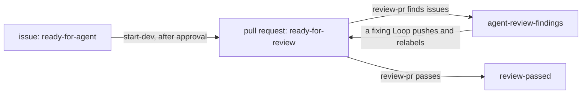

import { Steps } from "@astrojs/starlight/components";

A Loop is one Markdown file in the instance folder's `loops/` folder. Its YAML frontmatter sets which issues or pull requests start work, on which repositories, whether you approve each Run first, and which Agent does the work. Its body is the task the Agent receives. The file name without `.md` is the Loop's name: it must be kebab-case, renaming the file creates a different Loop, and deleting the file retires the Loop at the next restart. usine has no built-in Loops.

This page starts with a minimal Loop and extends it into two Loops that pass an Item from one to the other. [Loop files](/reference/configuration/loop-files/) lists every key and its validation, and [Expressions](/reference/configuration/expressions/) lists every field an expression can read.

## A minimal Loop

```markdown title="loops/start-dev.md"
---
trigger:
  on: issue
  if: >-
    item.state == "OPEN" &&
    item.labels.nodes.exists(label, label.name == "ready-for-agent")
agent: developer
---

Complete issue #{{ item.number }}: {{ item.title }}.
```

`trigger` and `agent` are the only required keys. `developer` must be the name of a file in `agents/`, here `agents/developer.md`. Keys you don't set use their defaults: no `selector`, so the Loop applies to every repository in `usine.yaml`; `approval: none`; `step: run`; and `max_cycles: 3`.

When someone adds `ready-for-agent` to an open issue, the next poll detects the change and evaluates `if:` against the issue's current state. The expression is true, so the orchestrator records an Event, opens a Run, renders the body into the Run's task, and starts an Attempt as soon as a Worker has a free slot.

## Triggers

`trigger.on` sets what starts the Loop:

| `on`       | The Loop fires for                                                                       | The Attempt's checkout                            |
| ---------- | ---------------------------------------------------------------------------------------- | ------------------------------------------------- |
| `issue`    | an issue whose content changed while `if:` is true. Pull requests don't count as issues. | the default branch, detached at its latest commit |
| `pr`       | a pull request whose content changed while `if:` is true                                 | the pull request's head commit, detached          |
| `schedule` | each tick of `cron`, once per repository the Loop applies to, when `if:` is true         | the default branch, detached at its latest commit |

Every `settings.poll_interval` seconds (60 by default), the orchestrator asks GitHub which issues and pull requests of each registered repository changed, fetches each changed one, and evaluates the `if:` of every issue or pr Loop against it. The orchestrator fetches open pull requests again on every poll, because GitHub can change their mergeability without updating them. When you move a card on the Board, usine queues a fetch of that Item instead of waiting for the next poll.

A Loop acts once for each version of an Item's content. usine identifies the Event that opens a Run by the Loop, the repository, the Item number, and a hash of the Item's payload without its timestamps. If the same content matches again, no new Run opens; a new Run needs a change in the payload, such as a label, a comment, or a new commit on the pull request. When `if:` becomes false, usine cancels the Loop's Runs on that Item that haven't started an Attempt, with the reason revoked. A running Attempt always finishes.

A schedule trigger adds two keys: `cron`, a five-field cron expression, and `tz`, an IANA time zone that defaults to `UTC`. When the orchestrator starts after being down, only the latest missed tick fires. Schedule Loops still need `if:`. To fire on every tick, write `if: "true"` in quotes: an unquoted `true` is a YAML boolean, not an expression, and the Loop doesn't load.

## The `if:` expression

`if:` is a [CEL](https://cel.dev) expression that must evaluate to a boolean. It can use two variables:

- `repo` is the repository: `repo.name` is the full name (`acme/widgets`), `repo.owner` the account (`acme`), and `repo.url` its GitHub URL.
- `item` is the Item's payload, with GitHub's GraphQL field names. An issue has `number`, `title`, `body`, `state` (`OPEN` or `CLOSED`), `labels`, `assignees`, `comments` (the last 20), `closedByPullRequestsReferences`, and more. A pull request adds `isDraft`, `merged`, `headRefName`, `headRefOid`, `baseRefName`, `mergeable`, `reviews` (the last 20), `reviewThreads`, and `closingIssuesReferences`. For a schedule Loop, `item.tick` has `scheduledAt`, `scheduledAtLocal`, `cron`, and `tz`.

Lists are GraphQL connections with `totalCount` and `nodes`, so CEL's list macros apply to `nodes`:

| Condition                                 | Expression                                                                  |
| ----------------------------------------- | --------------------------------------------------------------------------- |
| The Item has a label                      | `item.labels.nodes.exists(label, label.name == "ready-for-agent")`          |
| No open pull request closes the issue yet | `!item.closedByPullRequestsReferences.nodes.exists(pr, pr.state == "OPEN")` |
| The pull request is open and not a draft  | `item.state == "OPEN" && !item.isDraft`                                     |
| GitHub reports a merge conflict           | `item.mergeable == "CONFLICTING"`                                           |
| Every review thread is resolved           | `item.reviewThreads.nodes.all(thread, thread.isResolved)`                   |

The orchestrator type-checks `if:` and every `{{ }}` expression of the body when it loads the Loop. If an expression reads a field that the payload doesn't have, or `if:` isn't a boolean, the Loop doesn't load.

Some fields are null when GitHub has no value for them: `milestone`, `issueType`, `stateReason`, `closedAt`, and `author` on an issue; `mergedAt`, `reviewDecision`, `statusCheckRollup`, and `author` on a pull request; and the `author` of a comment or review written by a deleted account. Reading a null field makes the evaluation fail, and at this commit you can't test for null with `has()` or with a comparison to `null`. When a field can be null, combine the read with `&&` and a condition that is false in that case, as in `item.merged && item.mergedAt >= "2026-10-01T00:00:00Z"`. CEL's `&&` is false when either side is false, even if the other side fails. An `if:` that fails stops the poll of that repository before its cursor advances. The orchestrator then fetches the same Items again on every poll, and the failure appears in **Needs you** until you fix the Loop and restart.

## Narrow the repositories

```yaml title="loops/start-dev.md"
selector:
  repos: [acme/widgets]
  tags: [backend]
```

Without a `selector`, a Loop applies to every repository in `usine.yaml`. `repos` lists full repository names as they appear in `usine.yaml`, and `tags` matches the `tags` of `repos` entries. With both, a repository must be listed and have one of the tags. A selector must have at least one of the two keys. If it lists a name or tag that `usine.yaml` doesn't declare, the Loop doesn't load.

## Approve each Run

`approval: required` keeps every new Run in `Waiting` until you approve it from the Run drawer. With the default `approval: none`, a Run starts as soon as a Worker is free. If the Item changes while a Run waits for approval and still matches, usine opens a new waiting Run for the new state and cancels the older one as superseded, so the Run you approve always has the newest task.

## Step and Agent

`agent` is the name of the Agent file for the Agent that does the Loop's work. `step` is the name of the Run's one Step and defaults to `run`. The Step name appears in Attempt ids (`<run>/<step>/<number>`) and in logs, so a name that describes what the Agent does, such as `implement` or `review`, makes both easier to read.

## The task template

The body is Markdown. Each `{{ ... }}` in it is a CEL expression over the same `item` and `repo`, and must produce a string, a number, a boolean, or null; with a list or an object, the Loop doesn't load. The orchestrator renders the body when it records the Event, and the result is the Run's task. Later, you can change the task of a failed Run with **Edit and retry** in the Run drawer.

The task is one part of what the Agent's first session receives. The full prompt contains, in order:

1. the repository name and, on a retry, the salvage branch the Attempt resumes from;
2. the Item payload as JSON;
3. the Agent's persona;
4. the task;
5. fixed instructions: run checks in the foreground, push before finishing, start a final answer with `[usine:blocked]` to report a blocker, submit pull request reviews as `COMMENT` only, and end every GitHub comment, issue, pull request, and review with the line `— usine agent: <name>`.

The task doesn't need to repeat the payload or these rules; it only needs what is specific to the Loop. A pull request Run starts detached at the head commit, so a task that pushes must tell the Agent to check out `{{ item.headRefName }}` first. usine removes the worktree when the Attempt ends, and when the Attempt succeeds, commits that weren't pushed are lost.

If a `{{ }}` expression fails, for example because it reads a null field, **Needs you** reports the failure for that Loop only. The repository's other Loops still run and the poll continues; the failure appears again each time usine evaluates the Item.

## Pass an Item to the next Loop

usine adds or removes a label on an Item only when you move a card on the Board. Loops pass work to each other through labels that the Agent changes with `gh`, as the task instructs. In this pattern, each Loop's `if:` requires one label, and its task removes that label first and adds the next Loop's label when the work is done.

The task must remove the trigger label first. While the Agent works, new comments, labels, and commits change the Item's content. If the trigger label is still there, `if:` stays true for the new content, a new Event waits behind the running one, and the Loop runs again on the same Item after the current Run ends. The cycle budget stops these repeats after `max_cycles` Runs and asks you what to do in **Needs you** ([Bounded review and fix Loops](/guides/review-fix-loops/)).

<Steps>

1. Declare the labels in `usine.yaml`. At every poll, usine creates the declared labels that a registered repository doesn't have. It never edits or deletes a label. If a Loop's `if:` or a Board lane uses a label that isn't declared, usine logs a warning at startup.

   ```yaml title="usine.yaml"
   labels:
     - name: ready-for-agent
       color: "0e8a16"
     - name: agent-in-progress
     - name: ready-for-review
     - name: agent-review-findings
     - name: review-passed
   ```

2. Write the first Loop's task so that it changes the labels. This is `start-dev` from the factory that runs usine on its own repository, with the repository name replaced. It also requires approval, sets a Step name, and checks that no open pull request already closes the issue:

   ```markdown title="loops/start-dev.md"
   ---
   trigger:
     on: issue
     if: >-
       item.state == "OPEN" &&
       item.labels.nodes.exists(label, label.name == "ready-for-agent") &&
       !item.closedByPullRequestsReferences.nodes.exists(pr, pr.state == "OPEN")
   selector:
     repos: [acme/widgets]
   approval: required
   step: implement
   agent: developer
   ---

   Use the repository's `tackle-issue` skill to complete issue #{{ item.number }}: {{ item.title }}.

   Before editing, remove `ready-for-agent` from the issue and add `agent-in-progress`. Complete the issue through a non-draft pull request whose body closes the issue. Do not merge it. Once the pull request is ready, remove `agent-in-progress` from the issue and add `ready-for-review` to the pull request.

   If work cannot continue, add a comment to the issue that states the exact blocker. Do not add a workaround that changes the issue's scope.
   ```

3. Write the Loop for the next label. `review-pr` selects pull requests with `ready-for-review` and ends by adding either `agent-review-findings` or `review-passed`, the trigger labels of the next Loops:

   ```markdown title="loops/review-pr.md"
   ---
   trigger:
     on: pr
     if: >-
       item.state == "OPEN" &&
       !item.isDraft &&
       item.labels.nodes.exists(label, label.name == "ready-for-review") &&
       !item.labels.nodes.exists(label, label.name == "review-passed")
   selector:
     repos: [acme/widgets]
   step: review
   agent: reviewer
   ---

   Review pull request #{{ item.number }} at commit {{ item.headRefOid }} with the repository's `code-review` skill. Remove `ready-for-review` from the pull request before starting.

   Post the review on GitHub. If you find any actionable issue, explain it with file and line references and add `agent-review-findings`. If there are none, make sure `agent-review-findings` is absent and add `review-passed`. Do not edit the branch or merge the pull request.
   ```

4. Map the labels to Board lanes, so that dragging a card starts a Loop. Moving a card into a lane whose source is a label adds that label, removes the labels of the other label lanes, and queues a fetch of the Item. You can't move a card into a lane whose source is a state, such as `pr-merged`.

   ```yaml title="usine.yaml"
   repos:
     - name: acme/widgets
       lanes:
         - name: Ready
           sources: [{ label: ready-for-agent }]
         - name: In progress
           sources: [{ label: agent-in-progress }]
         - name: Review
           sources: [{ label: ready-for-review }]
         - name: Findings
           sources: [{ label: agent-review-findings }]
         - name: Passed
           sources: [{ label: review-passed }]
         - name: Done
           sources: [{ state: pr-merged }, { state: issue-closed }]
   ```

</Steps>

The two Loops form the flow below. [Bounded review and fix Loops](/guides/review-fix-loops/) adds a fixing Loop and a finishing Loop to it:



## A schedule Loop

```markdown title="loops/weekly-dependencies.md"
---
trigger:
  on: schedule
  cron: "0 6 * * 1"
  tz: Europe/Paris
  if: "true"
selector:
  tags: [backend]
step: update-dependencies
agent: developer
---

Check {{ repo.name }} for outdated dependencies as of {{ item.tick.scheduledAtLocal }}. Open one pull request that updates them and passes the repository's checks. Do not merge it.
```

Quote the `cron` value, because YAML reads a leading `*` as an alias. A schedule Loop fires once per selected repository at each tick, and its Runs have no Item, so the Board lists them under **Runs without a card**. Schedule Loops have no cycle budget.

## Pause a Loop

The **Loops** page under **Configuration** lists every loaded Loop with its trigger, its Agent, and a **Pause** button. A paused Loop opens no new Runs, and the Runs it already opened continue. usine keeps the paused flag in the runtime store, so it persists across restarts, and never writes it to the Loop file. When you unpause an issue or pr Loop, the next poll reads the repository's Items from the start, so usine evaluates the Items that changed while the Loop was paused.

The HTTP API has the same switch: `POST /api/loops/<name>/pause` and `POST /api/loops/<name>/unpause`. To retire a Loop permanently, delete or rename its file and restart.

## When a Loop does not load

usine leaves out a Loop file that has an error and loads the other Loops. At this commit, usine doesn't log or display the reason, so after a restart, check that the Loop appears on the **Loops** page. usine leaves out a Loop when:

- the file doesn't start with a `---` line or has no closing `---`;
- the file name isn't kebab-case;
- the frontmatter has a key that isn't part of the Loop format, or a value of the wrong type;
- `if:` doesn't type-check as a boolean, or a `{{ }}` expression doesn't type-check or isn't closed;
- `cron` isn't a valid five-field expression or `tz` isn't an IANA time zone;
- `agent` isn't the name of an Agent file that loaded, or `selector` lists a repository or tag that `usine.yaml` doesn't declare.
