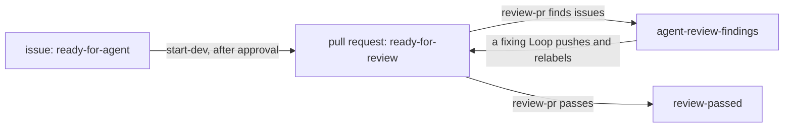

import { Steps } from "@astrojs/starlight/components";

A Loop is one Markdown file in the instance folder's `loops/` folder. Its YAML frontmatter says which issues or pull requests start work, on which repositories, whether you approve each Run first, and which Agent does the work. Its body is the task the Agent receives. The file name without `.md` is the Loop's name: it must be kebab-case, renaming the file creates a different Loop, and deleting the file retires the Loop at the next restart. usine comes with no Loop of its own.

This page starts from a minimal Loop and builds it into two Loops that pass an Item from one to the other. [Loop files](/reference/configuration/loop-files/) lists every key and its validation, and [Expressions](/reference/configuration/expressions/) lists every field an expression can read.

## A minimal Loop

```markdown title="loops/start-dev.md"
---
trigger:
  on: issue
  if: >-
    item.state == "OPEN" &&
    item.labels.nodes.exists(label, label.name == "ready-for-agent")
agent: developer
---

Complete issue #{{ item.number }}: {{ item.title }}.
```

`trigger` and `agent` are the only required keys. `developer` must be the name of a file in `agents/`, here `agents/developer.md`. The keys this file leaves out take their defaults: no `selector`, so the Loop applies to every repository in `usine.yaml`; `approval: none`; `step: run`; and `max_cycles: 3`.

When someone adds `ready-for-agent` to an open issue, the next poll sees that the issue changed and evaluates `if:` against its current state. The expression is true, so the orchestrator records an Event, opens a Run, renders the body into the Run's task, and starts an Attempt as soon as a Worker has a free slot.

## Triggers

`trigger.on` is what the Loop watches:

| `on`       | The Loop fires for                                                                        | The Attempt's checkout                            |
| ---------- | ----------------------------------------------------------------------------------------- | ------------------------------------------------- |
| `issue`    | an issue whose content changed while `if:` is true. Pull requests do not count as issues. | the default branch, detached at its latest commit |
| `pr`       | a pull request whose content changed while `if:` is true                                  | the pull request's head commit, detached          |
| `schedule` | each tick of `cron`, once per repository the Loop applies to, when `if:` is true          | the default branch, detached at its latest commit |

Every `settings.poll_interval` seconds (60 by default), the orchestrator asks GitHub which issues and pull requests of each registered repository changed, fetches each changed one, and evaluates the `if:` of every issue or pr Loop against it. Open pull requests are fetched again on every poll, because GitHub can change their mergeability without updating them. Moving a card on the Board asks for that Item at once instead of waiting for the next poll.

A Loop acts once per Item content. The Event that opens a Run is identified by the Loop, the repository, the Item number, and a hash of the Item's payload with its timestamps left out. If the same content matches again, nothing new opens; a new Run needs a change in the payload, such as a label, a comment, or a new commit on the pull request. When `if:` stops being true, the Loop's Runs on that Item that have not started an Attempt are canceled as revoked. A running Attempt always finishes.

A schedule trigger adds two keys: `cron`, a five-field cron expression, and `tz`, an IANA time zone that defaults to `UTC`. When the orchestrator starts after being down, only the latest missed tick fires. Schedule Loops still need `if:`; write `if: "true"` in quotes to fire on every tick, because an unquoted `true` is a YAML boolean, not an expression, and the Loop does not load.

## The `if:` expression

`if:` is a [CEL](https://cel.dev) expression that must evaluate to a boolean. It reads two variables:

- `repo` is the repository: `repo.name` is the full name (`acme/widgets`), `repo.owner` the account (`acme`), and `repo.url` its GitHub URL.
- `item` is the Item's payload, with GitHub's GraphQL field names. An issue has `number`, `title`, `body`, `state` (`OPEN` or `CLOSED`), `labels`, `assignees`, `comments` (the last 20), `closedByPullRequestsReferences`, and more. A pull request adds `isDraft`, `merged`, `headRefName`, `headRefOid`, `baseRefName`, `mergeable`, `reviews` (the last 20), `reviewThreads`, and `closingIssuesReferences`. For a schedule Loop, `item.tick` has `scheduledAt`, `scheduledAtLocal`, `cron`, and `tz`.

Lists are GraphQL connections with `totalCount` and `nodes`, so CEL's list macros apply to `nodes`:

| Condition                                               | Expression                                                                                   |
| ------------------------------------------------------- | -------------------------------------------------------------------------------------------- |
| The Item has a label                                    | `item.labels.nodes.exists(label, label.name == "ready-for-agent")`                           |
| No open pull request closes the issue yet               | `!item.closedByPullRequestsReferences.nodes.exists(pr, pr.state == "OPEN")`                  |
| The pull request is open and not a draft                | `item.state == "OPEN" && !item.isDraft`                                                      |
| GitHub reports a merge conflict                         | `item.mergeable == "CONFLICTING"`                                                            |
| Fewer than three reviews carry the reviewer's signature | `size(item.reviews.nodes.filter(review, review.body.contains("usine agent: reviewer"))) < 3` |

The orchestrator type-checks `if:` and every `{{ }}` expression of the body when it loads the Loop. If an expression reads a field the payload does not have, or `if:` is not a boolean, the Loop does not load.

Some fields are null when GitHub has no value for them: `milestone`, `issueType`, `stateReason`, `closedAt`, and `author` on an issue; `mergedAt`, `reviewDecision`, `statusCheckRollup`, and `author` on a pull request; and the `author` of a comment or review written by a deleted account. Reading a null field makes the evaluation fail, and at this commit neither `has()` nor a comparison with `null` can test for one. When a null is possible, join the read with `&&` to a condition that is false in that case, as in `item.merged && item.mergedAt >= "2026-10-01T00:00:00Z"`: CEL's `&&` is false when either side is false, even if the other side fails. An `if:` that fails stops the poll of that repository before its cursor advances, so the same Items are fetched again on every poll and the failure appears in **Needs you** until you fix the Loop and restart.

## Narrow the repositories

```yaml title="loops/start-dev.md"
selector:
  repos: [acme/widgets]
  tags: [backend]
```

Without a `selector`, a Loop applies to every repository in `usine.yaml`. `repos` lists full repository names as `usine.yaml` writes them, and `tags` matches the `tags` of `repos` entries. With both, a repository must be listed and have one of the tags. A selector must have at least one of the two keys, and with a name or tag that `usine.yaml` does not declare, the Loop does not load.

## Approve each Run

`approval: required` parks every new Run in `Waiting` until you approve it from the Run drawer. With the default `approval: none`, a Run starts as soon as a Worker is free. If the Item changes while a Run waits for approval and still matches, the new state opens a new waiting Run and the older one is canceled as superseded, so the Run you approve always has the newest task.

## Step and Agent

`agent` is the name of the Agent file whose Agent does the Loop's work. `step` is the name of the Run's one Step and defaults to `run`. The Step name appears in Attempt ids (`<run>/<step>/<number>`) and in logs, so a name that says what the Agent does, such as `implement` or `review`, makes both easier to read.

## The task template

The body is Markdown. Each `{{ ... }}` in it is a CEL expression over the same `item` and `repo`, and must produce a string, a number, a boolean, or null; with a list or an object, the Loop does not load. The orchestrator renders the body when it records the Event, and the result is the Run's task. **Edit and retry** in the Run drawer can change the task of a failed Run later.

The task is one part of what the Agent's first session receives. The full prompt contains, in order:

1. the repository name and, on a retry, the salvage branch the Attempt resumes from;
2. the Item payload as JSON;
3. the Agent's persona;
4. the task;
5. fixed instructions: run checks in the foreground, push before finishing, start a final answer with `[usine:blocked]` to report a blocker, submit pull request reviews as `COMMENT` only, and end every GitHub comment, issue, pull request, and review with the line `— usine agent: <name>`.

So the task does not need to repeat the payload or these rules. It needs what is specific to the Loop. A pull request Run starts detached at the head commit, so a task that pushes must tell the Agent to check out `{{ item.headRefName }}` first. The worktree is removed when the Attempt ends, and commits that were not pushed are lost when the Attempt succeeds.

A `{{ }}` expression that fails, for example by reading a null field, is reported in **Needs you** for that Loop only. The repository's other Loops still run and the poll moves on; the failure comes back whenever the Item is evaluated again.

## Hand an Item to the next Loop

usine adds or removes a label on an Item only when you move a card on the Board. Loops pass work to each other through labels that the Agent changes with `gh`, because the task tells it to. The pattern: each Loop's `if:` requires one label, its task removes that label first, and its task adds the label of the next Loop when the work is done.

Removing the trigger label first matters. While the Agent works, the Item's content changes through new comments, labels, and commits. If the trigger label is still there, `if:` stays true for the new content, a new Event waits behind the running one, and the Loop runs again on the same Item after the current Run ends. The cycle budget stops such a repeat after `max_cycles` Runs and asks you in **Needs you** ([Bounded review and fix Loops](/guides/review-fix-loops/)).

<Steps>

1. Declare the labels in `usine.yaml`. At every poll, usine creates the declared labels that a registered repository lacks. It never edits or deletes a label. A label that a Loop's `if:` or a Board lane uses without a declaration gets a warning in the startup log.

   ```yaml title="usine.yaml"
   labels:
     - name: ready-for-agent
       color: 0e8a16
     - name: agent-in-progress
     - name: ready-for-review
     - name: agent-review-findings
     - name: review-passed
   ```

2. Write the first Loop's task so that it moves the labels. This is `start-dev` from the factory that runs usine on its own repository, with the repository name replaced. It also requires approval, sets a Step name, and checks that no open pull request already closes the issue:

   ```markdown title="loops/start-dev.md"
   ---
   trigger:
     on: issue
     if: >-
       item.state == "OPEN" &&
       item.labels.nodes.exists(label, label.name == "ready-for-agent") &&
       !item.closedByPullRequestsReferences.nodes.exists(pr, pr.state == "OPEN")
   selector:
     repos: [acme/widgets]
   approval: required
   step: implement
   agent: developer
   ---

   Use the repository's `tackle-issue` skill to complete issue #{{ item.number }}: {{ item.title }}.

   Before editing, remove `ready-for-agent` from the issue and add `agent-in-progress`. Complete the issue through a non-draft pull request whose body closes the issue. Do not merge it. Once the pull request is ready, remove `agent-in-progress` from the issue and add `ready-for-review` to the pull request.

   If work cannot continue, add a comment to the issue that states the exact blocker. Do not add a workaround that changes the issue's scope.
   ```

3. Write the Loop that picks up the next label. `review-pr` watches pull requests with `ready-for-review` and ends by adding either `agent-review-findings` or `review-passed`, which other Loops watch in turn:

   ```markdown title="loops/review-pr.md"
   ---
   trigger:
     on: pr
     if: >-
       item.state == "OPEN" &&
       !item.isDraft &&
       item.labels.nodes.exists(label, label.name == "ready-for-review") &&
       !item.labels.nodes.exists(label, label.name == "review-passed")
   selector:
     repos: [acme/widgets]
   step: review
   agent: reviewer
   ---

   Review pull request #{{ item.number }} at commit {{ item.headRefOid }} with the repository's `code-review` skill. Remove `ready-for-review` from the pull request before starting.

   Post the review on GitHub. If you find any actionable issue, explain it with file and line references and add `agent-review-findings`. If there are none, make sure `agent-review-findings` is absent and add `review-passed`. Do not edit the branch or merge the pull request.
   ```

4. Map the labels to Board lanes, so that dragging a card starts a Loop. Moving a card into a lane whose source is a label adds that label and removes the labels of the other label lanes, then asks for the Item at once. Lanes whose source is a state, such as `pr-merged`, cannot receive a card.

   ```yaml title="usine.yaml"
   repos:
     - name: acme/widgets
       lanes:
         - name: Ready
           sources: [{ label: ready-for-agent }]
         - name: In progress
           sources: [{ label: agent-in-progress }]
         - name: Review
           sources: [{ label: ready-for-review }]
         - name: Findings
           sources: [{ label: agent-review-findings }]
         - name: Passed
           sources: [{ label: review-passed }]
         - name: Done
           sources: [{ state: pr-merged }, { state: issue-closed }]
   ```

</Steps>

The two Loops then form this flow, which [Bounded review and fix Loops](/guides/review-fix-loops/) completes with a fixing Loop and a finishing Loop:



## A schedule Loop

```markdown title="loops/weekly-dependencies.md"
---
trigger:
  on: schedule
  cron: "0 6 * * 1"
  tz: Europe/Paris
  if: "true"
selector:
  tags: [backend]
step: update-dependencies
agent: developer
---

Check {{ repo.name }} for outdated dependencies as of {{ item.tick.scheduledAtLocal }}. Open one pull request that updates them and passes the repository's checks. Do not merge it.
```

Quote the `cron` value: a cron expression that starts with `*` is otherwise read as a YAML alias. A schedule Loop fires once per selected repository at each tick, and its Runs have no Item, so the Board lists them under **Runs without a card**. Schedule Loops have no cycle budget.

## Pause a Loop

The **Loops** page under **Configuration** lists every loaded Loop with its trigger, its Agent, and a **Pause** button. A paused Loop opens no new Run, while the Runs it already opened continue. The paused flag is stored in the runtime store, survives restarts, and is never written to the Loop file. When you unpause an issue or pr Loop, the next poll goes over the repository's Items from the start, so Items that changed while the Loop was paused are evaluated.

The same switch is in the HTTP API as `POST /api/loops/<name>/pause` and `POST /api/loops/<name>/unpause`. To retire a Loop for good, delete or rename its file and restart.

## When a Loop does not load

A Loop file with an error is left out, and the other Loops load. At this commit usine neither logs nor displays the reason, so after a restart check that the Loop appears on the **Loops** page. A Loop is left out when:

- the file does not start with a `---` line or has no closing `---`;
- the file name is not kebab-case;
- the frontmatter has a key that is not part of the Loop format, or a value of the wrong type;
- `if:` does not type-check as a boolean, or a `{{ }}` expression does not type-check or is not closed;
- `cron` is not a valid five-field expression or `tz` is not an IANA time zone;
- `agent` is not the name of an Agent file that loaded, or `selector` lists a repository or tag that `usine.yaml` does not declare.
