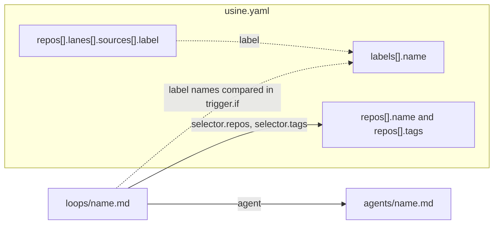

`usine.yaml` is at the top of the instance folder, next to the `loops/` and `agents/` folders. It contains the registry of managed repositories, the labels usine creates, the Board lanes, factory-wide settings, and the Workers that run Attempts.

The orchestrator reads it when `usine up` starts and at each reload ([CLI](/reference/configuration/cli/#reload)). A reload applies `labels`, `repos`, `settings`, and `operator` to new work. It refuses a change to `workers` or `webhooks`, which take effect at the next start.

The parser is strict:

- Keys are snake_case in the file. The parser renames them to camelCase domain fields ([`Schema.encodeKeys`](https://github.com/basaltbytes/usine/blob/7c0c3d3696123d11e3d5b9cc3d27e18bb21e84e9/packages/config/src/factory.ts#L182)), so `poll_interval` in the file is `pollInterval` in code.
- An unknown key at any level is an error ([`onExcessProperty: "error"`](https://github.com/basaltbytes/usine/blob/7c0c3d3696123d11e3d5b9cc3d27e18bb21e84e9/packages/config/src/parser.ts#L186)).
- Duplicate keys and YAML parser warnings are errors ([`parseYamlDocument`](https://github.com/basaltbytes/usine/blob/7c0c3d3696123d11e3d5b9cc3d27e18bb21e84e9/packages/config/src/yaml/document.ts#L18)).
- An invalid `usine.yaml` stops the whole instance from loading: `usine up` prints one line naming the file, the failed stage, and the reason, including the path of the offending key, and exits with status 1. An invalid Loop or Agent file affects only that file; see [Loop files](/reference/configuration/loop-files/#validation-and-quarantine).

The schema is [`UsineConfig`](https://github.com/basaltbytes/usine/blob/7c0c3d3696123d11e3d5b9cc3d27e18bb21e84e9/packages/config/src/factory.ts#L209) in `packages/config/src/factory.ts`.

## Complete example

```yaml title="usine.yaml"
# Schema version of this file. Required; 1 is the only accepted value.
version: 1

# GitHub login recorded on operator interventions (steer, interrupt, messages).
operator: octocat

# Labels usine creates in every managed repository that doesn't have them.
labels:
  - name: ready-for-agent
    color: "0e8a16"
    description: An Agent may start this issue
  - name: agent-in-progress
  - name: ready-for-review
  - name: agent-review-findings
  - name: review-passed
  - name: ready-to-merge

# The registry: the repositories this factory manages.
repos:
  - name: acme/widgets
    tags: [web]
    lanes:
      - name: Ready
        sources: [{ label: ready-for-agent }]
      - name: In progress
        sources: [{ label: agent-in-progress }]
      - name: Review
        sources: [{ label: ready-for-review }]
      - name: Findings
        sources: [{ label: agent-review-findings }]
      - name: Passed
        sources: [{ label: review-passed }]
      - name: Merge
        sources: [{ label: ready-to-merge }]
      - name: Pull requests
        sources: [{ state: pr-open }]
      - name: Done
        sources: [{ state: pr-merged }, { state: pr-closed }, { state: issue-closed }]
  - name: acme/gadgets
    tags: [web, mobile]

settings:
  poll_interval: 60 # seconds between poll cycles
  max_children: 4 # child sessions per Attempt
  max_attempt_minutes: 180 # omit for no wall-clock ceiling
  max_attempt_tokens: 20000000 # omit for no token ceiling
  parent_model: openai-codex/gpt-5.6-terra
  parent_effort: medium

# Where Attempts run. Omit the key for one local Worker named `local`.
workers:
  - name: worker-1
    kind: ssh
    destination: usine@203.0.113.10
    identity_file: ~/.ssh/usine_worker
    root: /home/usine/.usine
    max_concurrent_attempts: 2
    gateway:
      domain: gateway.example.com
      admin_url: http://127.0.0.1:7070
      admin_token_env: USINE_GATEWAY_ADMIN_TOKEN
      llm_providers: [anthropic]
  - name: worker-2
    kind: ssh
    destination: worker-2
    port: 2222
    root: /srv/usine

webhooks:
  mode: off
```

The smallest valid file sets `version` and `repos`, and `repos` can be an empty list. Every other key has a default:

```yaml title="usine.yaml"
version: 1
repos:
  - name: acme/widgets
```

## How the instance files reference each other

A Loop file references an Agent file and selects repositories from the registry. usine checks the label names in Lanes and in Loop conditions against the declared labels.



A solid arrow is a reference that must resolve: usine quarantines a Loop whose Agent, selected repository, or selected tag doesn't exist. A dotted arrow only logs a warning when the label isn't declared ([`configWarnings`](https://github.com/basaltbytes/usine/blob/7c0c3d3696123d11e3d5b9cc3d27e18bb21e84e9/packages/config/src/parser.ts#L256)).

## Top-level keys

| Key | Type | Default | Description |
| --- | --- | --- | --- |
| `version` | `1` | required | Schema version. Any other value is an error. |
| `operator` | GitHub login | none | The login recorded as the author of operator interventions and approvals given in the web UI. |
| `labels` | list of [labels](#labels) | `[]` | Labels created in every managed repository. |
| `repos` | list of [repositories](#repos) | required | The registry. An empty list is valid. |
| `settings` | [settings](#settings) | `{}` | Polling, Attempt limits, and parent defaults. |
| `workers` | list of [Workers](#workers) | one local Worker named `local` | Where Attempts run. Must not be empty when present. |
| `webhooks` | [webhooks](#webhooks) | `{ mode: off }` | Parsed and validated; not read by the orchestrator at this commit. |

## `operator`

A GitHub login: 1 to 39 letters, digits, or hyphens, starting and ending with a letter or digit ([`OperatorLogin`](https://github.com/basaltbytes/usine/blob/7c0c3d3696123d11e3d5b9cc3d27e18bb21e84e9/packages/config/src/factory.ts#L26)). When the operator steers, interrupts, or messages a session from the UI, the transcript records this login as the sender. Without it the transcript records `local operator` ([`operator.ts`](https://github.com/basaltbytes/usine/blob/7c0c3d3696123d11e3d5b9cc3d27e18bb21e84e9/packages/orchestrator/src/operator/operator.ts#L485)). When the operator approves a Run from the UI, usine records this login as the approver, and records no approver without it.

## `labels`

Each entry declares one GitHub label ([`DeclaredLabel`](https://github.com/basaltbytes/usine/blob/7c0c3d3696123d11e3d5b9cc3d27e18bb21e84e9/packages/config/src/label.ts#L35)).

| Key | Type | Default | Description |
| --- | --- | --- | --- |
| `name` | string | required | At most 50 characters, no leading or trailing whitespace. Names must be unique, compared case-insensitively. |
| `color` | string | none | Six hex digits without `#`, such as `"0e8a16"`. |
| `description` | string | none | At most 100 characters. |

During each poll cycle, usine compares the declared labels with each managed repository's labels, case-insensitively. It creates a declared label that the repository doesn't have, with the declared color and description ([`LabelReconciler`](https://github.com/basaltbytes/usine/blob/7c0c3d3696123d11e3d5b9cc3d27e18bb21e84e9/packages/orchestrator/src/label-reconciler.ts#L80)). When an existing label's color or description differs from the declaration, usine logs a warning and leaves the label unchanged. usine never edits or deletes a label.

Quote colors. YAML reads `123456` as a number and `0e8016` as a float, and the parser rejects both with `Expected string`.

```yaml title="usine.yaml"
labels:
  - name: ready-for-agent
    color: "0e8a16"
    description: An Agent may start this issue
```

## `repos`

Each entry is one managed repository ([`ManagedRepo`](https://github.com/basaltbytes/usine/blob/7c0c3d3696123d11e3d5b9cc3d27e18bb21e84e9/packages/config/src/factory.ts#L62)). Names must be unique, compared case-insensitively as on GitHub.

| Key | Type | Default | Description |
| --- | --- | --- | --- |
| `name` | string | required | Full `owner/name` of the GitHub repository. Letters, digits, `_`, `.`, and `-` on each side of the slash. |
| `tags` | list of strings | `[]` | Tags that Loop selectors match. Each tag is non-blank; tags are unique within a repository. |
| `lanes` | list of [lanes](#reposlanes) | `[]` | The Board columns for this repository. |

The GitHub App installation must cover every repository in the list. A Loop applies to every repository unless its [selector](/reference/configuration/loop-files/#selector) narrows it.

### `repos[].lanes`

Each lane is one Board column ([`Lane`](https://github.com/basaltbytes/usine/blob/7c0c3d3696123d11e3d5b9cc3d27e18bb21e84e9/packages/config/src/board.ts#L43)).

| Key | Type | Default | Description |
| --- | --- | --- | --- |
| `name` | string | required | Non-blank. Unique within the repository. |
| `sources` | list of sources | required | At least one. Each source is a mapping with exactly one key, `label` or `state`. |

| Source | Valid values | Description |
| --- | --- | --- |
| `label` | a GitHub label name | Places Items that have this label, in any case, in the lane. A Board move into the lane adds the label. |
| `state` | `issue-open`, `issue-closed`, `pr-open`, `pr-closed`, `pr-merged` | Places Items in this GitHub state in the lane. A Board move can't change a state. |

A source may appear in only one lane of a repository; two `label` sources that differ only in case count as the same source. The Board places each Task as follows ([`laneFor`](https://github.com/basaltbytes/usine/blob/7c0c3d3696123d11e3d5b9cc3d27e18bb21e84e9/packages/orchestrator/src/board/projection.ts#L78)):

1. A Task whose current Item is a merged or closed pull request, or a closed issue, goes to the first lane with a matching `state` source.
2. Any other Task goes to the first lane, in file order, that has a `label` source matching one of the Item's labels. If no lane matches, it goes to the first lane with a matching `state` source.
3. A Task that matches no lane goes to the `Unmapped` column.

A lane with at least one `label` source accepts Board moves. Moving a card adds the target lane's labels and removes the labels of every other authored lane ([`labelMutationForBoardMove`](https://github.com/basaltbytes/usine/blob/7c0c3d3696123d11e3d5b9cc3d27e18bb21e84e9/packages/orchestrator/src/board/projection.ts#L160)).

When `lanes` is empty, the Board proposes one read-only lane per label in the repository, sorted by name ([`effectiveLanes`](https://github.com/basaltbytes/usine/blob/7c0c3d3696123d11e3d5b9cc3d27e18bb21e84e9/packages/orchestrator/src/board/projection.ts#L50)).

A `label` source that isn't declared under `labels` still loads, and usine logs `Board Lane references an undeclared GitHub label`.

```yaml title="usine.yaml"
repos:
  - name: acme/widgets
    lanes:
      - name: Ready
        sources: [{ label: ready-for-agent }]
      - name: Done
        sources: [{ state: pr-merged }, { state: issue-closed }]
```

## `settings`

Factory-wide values ([`Settings`](https://github.com/basaltbytes/usine/blob/7c0c3d3696123d11e3d5b9cc3d27e18bb21e84e9/packages/config/src/factory.ts#L154)).

| Key | Type | Default | Description |
| --- | --- | --- | --- |
| `poll_interval` | integer ≥ 1 | `60` | Seconds between the starts of two GitHub poll cycles. A GitHub rate limit can push the next cycle later. |
| `max_children` | integer ≥ 1 | `4` | The Child-session budget: child sessions one Attempt may spawn over its lifetime, sequential and concurrent together. The next spawn fails the Attempt. |
| `max_attempt_minutes` | integer ≥ 1 | none | Wall-clock ceiling per Attempt, in minutes. Time while the operator holds a child doesn't count. Also the drain deadline when `usine up` stops. |
| `max_attempt_tokens` | integer ≥ 1 | none | Token ceiling per Attempt, summed over the parent and every child. |
| `parent_model` | string | none | Model of each Attempt's Pi parent, as `provider/model`, when the Agent sets no `parent_model`. |
| `parent_effort` | effort | none | Reasoning effort of the Pi parent when the Agent sets no `parent_effort`. |

`max_attempt_minutes` and `max_attempt_tokens` arm the runaway guard ([`attemptGuard`](https://github.com/basaltbytes/usine/blob/7c0c3d3696123d11e3d5b9cc3d27e18bb21e84e9/packages/executor/src/guard.ts#L139)). Each armed ceiling sends the parent one warning at 80% of its limit and fails the Attempt at the limit. usine doesn't retry a runaway failure automatically.

The effort values are `off`, `minimal`, `low`, `medium`, `high`, `xhigh`, and `max`. usine picks the parent's model in this order: the Agent's `parent_model`, then `settings.parent_model`, then Pi's configured default model, then the first Pi model with a configured credential. It picks the parent's effort from the Agent's `parent_effort`, then `settings.parent_effort`, then the Agent's own `effort` ([`resolveParentEffort`](https://github.com/basaltbytes/usine/blob/7c0c3d3696123d11e3d5b9cc3d27e18bb21e84e9/packages/core/src/agent/agent.ts#L39)). An Attempt fails before its conversation starts when Pi doesn't know the model or the model doesn't support the effort.

## `workers`

Each entry is one Worker. When the key is absent, the instance has one Worker: `{ name: local, kind: local }`. When present, the list must have at least one entry and the names must be unique ([`Worker`](https://github.com/basaltbytes/usine/blob/7c0c3d3696123d11e3d5b9cc3d27e18bb21e84e9/packages/config/src/factory.ts#L150)).

Every kind takes these keys:

| Key | Type | Default | Description |
| --- | --- | --- | --- |
| `name` | string | required | Kebab-case: lowercase letters and digits separated by single hyphens. |
| `kind` | `local`, `ssh`, `exe.dev` | required | Selects the Worker adapter and the other keys it accepts. |
| `max_concurrent_attempts` | integer ≥ 1 | `1` | Attempts the Worker runs at the same time. The Worker's memory must carry them; see below. |

Runs wait for a free Worker slot in the order their Events arrived ([`stepExecutorLayer`](https://github.com/basaltbytes/usine/blob/7c0c3d3696123d11e3d5b9cc3d27e18bb21e84e9/packages/orchestrator/src/scheduler.ts#L87)). At startup, `usine up` runs Preflight on every Worker for every harness in the Agent roster. A failed Preflight stops startup.

Preflight also divides the Worker's memory by `max_concurrent_attempts`. It fails the `memory` check, which stops startup, when an Attempt would get less than 1.5 GiB, or when the Worker has no swap and `max_concurrent_attempts` is more than 1. Below 3 GiB per Attempt it logs a warning with a value to use. The limits come from two Attempts that thrashed a 4 GB Worker without swap until sshd stopped answering ([#270](https://github.com/basaltbytes/usine/issues/270)). Local Workers on Linux and SSH Workers report memory and swap in `/proc/meminfo`. On macOS, preflight reads the physical memory and counts swap as present, because macOS adds swap files as memory runs short.

:::caution
`usine up` uses one executor for every Worker. It starts the instance only when all Workers are `local` or all are `ssh` ([`workerEngineLayer`](https://github.com/basaltbytes/usine/blob/7c0c3d3696123d11e3d5b9cc3d27e18bb21e84e9/packages/orchestrator/src/worker-engine.ts#L13)). Any other combination, and any `exe.dev` Worker, parses but fails startup with `UnsupportedWorkerError`.
:::

### `kind: local`

The machine the orchestrator runs on. It accepts only the common keys. It keeps cached clones, Attempt worktrees, and a Turbo cache under `.usine/workers/<name>/` in the instance folder.

```yaml title="usine.yaml"
workers:
  - name: local
    kind: local
    max_concurrent_attempts: 2
```

### `kind: ssh`

A Linux machine that the orchestrator connects to with its local `ssh` client ([`SshWorker`](https://github.com/basaltbytes/usine/blob/7c0c3d3696123d11e3d5b9cc3d27e18bb21e84e9/packages/config/src/factory.ts#L130)). The client runs with `BatchMode=yes`, so the key must work without a prompt.

| Key | Type | Default | Description |
| --- | --- | --- | --- |
| `destination` | string | required | A host name, an address, or a `Host` alias from the operator's SSH configuration, optionally prefixed by `user@`. A value starting with `-` is rejected. |
| `identity_file` | string | none | Private key passed as `ssh -i`, with `IdentitiesOnly=yes`. An absolute path or a path starting with `~/`, without spaces. |
| `port` | integer 1 to 65535 | none | Passed as `ssh -p`. Without it, the SSH configuration or port 22 applies. |
| `root` | string | required | Absolute directory on the machine, without spaces or a trailing `/`. The Worker keeps its clones, worktrees, and credentials under `<root>/workers/<name>`. |
| `gateway` | [Gateway](#workersgateway) | none | The Gateway in front of the machine. |

```yaml title="usine.yaml"
workers:
  - name: worker-2
    kind: ssh
    destination: usine@203.0.113.10
    identity_file: ~/.ssh/usine_worker
    port: 2222
    root: /srv/usine
```

### `workers[].gateway`

A Worker behind a Gateway has no GitHub token on its machine. The executor attaches each Attempt's token to the Gateway instead ([`WorkerGateway`](https://github.com/basaltbytes/usine/blob/7c0c3d3696123d11e3d5b9cc3d27e18bb21e84e9/packages/config/src/factory.ts#L113)).

| Key | Type | Default | Description |
| --- | --- | --- | --- |
| `domain` | string | required | The Gateway's private DNS domain, in lowercase. The machine resolves `git.<domain>` for GitHub, `llm.<domain>` for LLM providers, and `<domain>` for the forward proxy. |
| `admin_url` | URL | required | The URL the orchestrator uses for the Gateway's admin API, often a local port forward. `http` or `https`, without a user name or password. |
| `admin_token_env` | string | required | Name of the orchestrator's environment variable that contains the admin token. The file never contains the token itself. |
| `llm_providers` | list | `[]` | Providers whose credential is stored on the Gateway. The only value is `anthropic` (Claude Code). |

`usine up` reads the variable named by `admin_token_env` at startup. When it's unset, startup fails with a `gateway` capability error that includes the Worker and variable names ([`sshWorkerAddressesOf`](https://github.com/basaltbytes/usine/blob/7c0c3d3696123d11e3d5b9cc3d27e18bb21e84e9/packages/orchestrator/src/ssh.ts#L27)).

A harness whose provider isn't in `llm_providers` uses the operator's login on the Worker and connects to its provider through the Gateway's forward proxy. Codex always works this way.

```yaml title="usine.yaml"
workers:
  - name: worker-1
    kind: ssh
    destination: worker-1
    root: /home/usine/.usine
    gateway:
      domain: gateway.example.com
      admin_url: http://127.0.0.1:7070
      admin_token_env: USINE_GATEWAY_ADMIN_TOKEN
      llm_providers: [anthropic]
```

### `kind: exe.dev`

An exe.dev VM named after the Worker ([`ExeDevWorker`](https://github.com/basaltbytes/usine/blob/7c0c3d3696123d11e3d5b9cc3d27e18bb21e84e9/packages/config/src/factory.ts#L80)). It accepts only the common keys. The parser accepts this kind, but `usine up` doesn't run it at this commit; see the caution above.

## `webhooks`

Sets where GitHub hints would come from ([`Webhooks`](https://github.com/basaltbytes/usine/blob/7c0c3d3696123d11e3d5b9cc3d27e18bb21e84e9/packages/config/src/factory.ts#L170)). The parser validates the key, but the orchestrator doesn't read it at this commit; usine detects GitHub changes only by polling.

| Key | Type | Default | Description |
| --- | --- | --- | --- |
| `mode` | `off`, `deliveries`, `endpoint` | `off` | The hint source. |
| `public_url` | URL | required when `mode` is `endpoint` | Not accepted with the other modes. |
