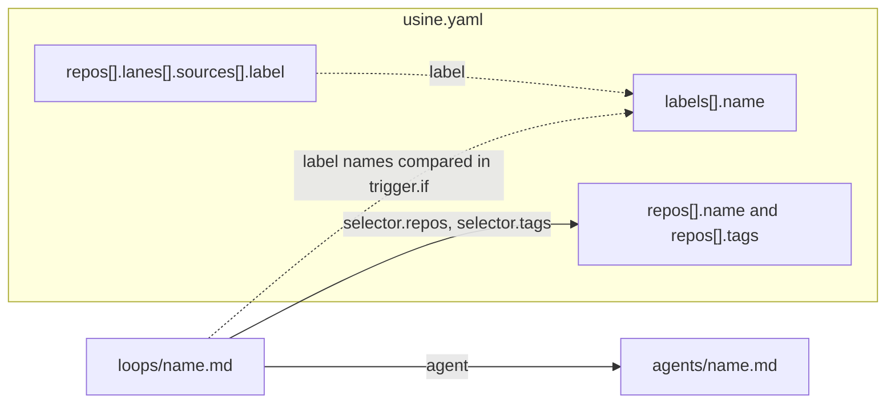

`usine.yaml` is at the top of the instance folder, next to `loops/` and `agents/`. It contains the registry of managed repositories, labels, board lanes, settings, and workers.

The orchestrator reads it at startup and at each [reload](/reference/configuration/cli/#reload). A reload applies `labels`, `repos`, `settings`, and `operator` to new work, and resizes, adds, or removes [workers](#workers). Changes to `webhooks` and some `workers` changes need a restart.

The parser is strict:

- Keys are snake_case in the file. The parser renames them to camelCase domain fields ([`Schema.encodeKeys`](https://github.com/basaltbytes/usine/blob/7c0c3d3696123d11e3d5b9cc3d27e18bb21e84e9/packages/config/src/factory.ts#L182)), so `poll_interval` in the file is `pollInterval` in code.
- An unknown key at any level is an error ([`onExcessProperty: "error"`](https://github.com/basaltbytes/usine/blob/7c0c3d3696123d11e3d5b9cc3d27e18bb21e84e9/packages/config/src/parser.ts#L186)).
- Duplicate keys and YAML parser warnings are errors ([`parseYamlDocument`](https://github.com/basaltbytes/usine/blob/7c0c3d3696123d11e3d5b9cc3d27e18bb21e84e9/packages/config/src/yaml/document.ts#L18)).
- An invalid `usine.yaml` stops the instance from loading: `usine up` prints one line with the file, the failed stage, the reason, and the path of the invalid key, and exits with status 1. An invalid loop or agent file affects only that file ([Validation and quarantine](/reference/configuration/loop-files/#validation-and-quarantine)).

The schema is [`UsineConfig`](https://github.com/basaltbytes/usine/blob/7c0c3d3696123d11e3d5b9cc3d27e18bb21e84e9/packages/config/src/factory.ts#L209) in `packages/config/src/factory.ts`.

## Complete example

```yaml title="usine.yaml"
# Schema version of this file. Required; 1 is the only accepted value.
version: 1

# GitHub login recorded on operator interventions (steer, interrupt, messages).
operator: octocat

# Labels usine creates in every managed repository that doesn't have them.
labels:
  - name: ready-for-agent
    color: "0e8a16"
    description: An Agent may start this issue
  - name: agent-in-progress
  - name: ready-for-review
  - name: agent-review-findings
  - name: review-passed
  - name: ready-to-merge

# The registry: the repositories this factory manages.
repos:
  - name: acme/widgets
    tags: [web]
    lanes:
      - name: Ready
        sources: [{ label: ready-for-agent }]
      - name: In progress
        sources: [{ label: agent-in-progress }]
      - name: Review
        sources: [{ label: ready-for-review }]
      - name: Findings
        sources: [{ label: agent-review-findings }]
      - name: Passed
        sources: [{ label: review-passed }]
      - name: Merge
        sources: [{ label: ready-to-merge }]
      - name: Pull requests
        sources: [{ state: pr-open }]
      - name: Done
        sources: [{ state: pr-merged }, { state: pr-closed }, { state: issue-closed }]
  - name: acme/gadgets
    tags: [web, mobile]

settings:
  poll_interval: 60 # seconds between poll cycles
  max_children: 4 # child sessions per attempt
  max_attempt_minutes: 180 # omit for no wall-clock ceiling
  max_attempt_tokens: 20000000 # omit for no token ceiling
  parent_model: openai-codex/gpt-5.6-terra
  parent_effort: medium

# Where attempts run. Omit the key for one local worker named `local`.
workers:
  - name: worker-1
    kind: ssh
    destination: usine@203.0.113.10
    identity_file: ~/.ssh/usine_worker
    root: /home/usine/.usine
    max_concurrent_attempts: 2
    gateway:
      domain: gateway.example.com
      destination: usine-gateway
      admin_token_env: USINE_GATEWAY_ADMIN_TOKEN
      llm_providers: [anthropic]
  - name: worker-2
    kind: ssh
    destination: worker-2
    port: 2222
    root: /srv/usine

webhooks:
  mode: off
```

The smallest valid file sets `version` and `repos`, which can be empty:

```yaml title="usine.yaml"
version: 1
repos:
  - name: acme/widgets
```

## References between instance files

A loop file references an agent file and selects repositories from the registry. usine checks label names in lanes and loop conditions against the declared labels.



A solid arrow is a reference that must resolve: usine quarantines a loop whose agent, selected repository, or selected tag doesn't exist. A dotted arrow only logs a warning if the label isn't declared ([`configWarnings`](https://github.com/basaltbytes/usine/blob/7c0c3d3696123d11e3d5b9cc3d27e18bb21e84e9/packages/config/src/parser.ts#L256)).

## Top-level keys

| Key | Type | Default | Description |
| --- | --- | --- | --- |
| `version` | `1` | required | Schema version. Any other value is an error. |
| `operator` | GitHub login | none | The login recorded as the author of operator interventions and approvals given in the web UI. |
| `labels` | list of [labels](#labels) | `[]` | Labels created in every managed repository. |
| `repos` | list of [repositories](#repos) | required | The registry. An empty list is valid. |
| `settings` | [settings](#settings) | `{}` | Polling, attempt limits, and parent defaults. |
| `workers` | list of [workers](#workers) | one local worker named `local` | Where attempts run. Must not be empty if present. |
| `webhooks` | [webhooks](#webhooks) | `{ mode: off }` | Parsed and validated. The orchestrator doesn't read it at this commit. |

## `operator`

A GitHub login: 1 to 39 letters, digits, or hyphens, starting and ending with a letter or digit ([`OperatorLogin`](https://github.com/basaltbytes/usine/blob/7c0c3d3696123d11e3d5b9cc3d27e18bb21e84e9/packages/config/src/factory.ts#L26)). The transcript records it as the sender of operator messages, steers, and interrupts from the UI, or `local operator` if `operator` is unset ([`operator.ts`](https://github.com/basaltbytes/usine/blob/7c0c3d3696123d11e3d5b9cc3d27e18bb21e84e9/packages/orchestrator/src/operator/operator.ts#L485)). usine also records it as the approver of runs approved in the UI. Without it, usine records no approver.

## `labels`

Each entry declares one GitHub label ([`DeclaredLabel`](https://github.com/basaltbytes/usine/blob/7c0c3d3696123d11e3d5b9cc3d27e18bb21e84e9/packages/config/src/label.ts#L35)).

| Key | Type | Default | Description |
| --- | --- | --- | --- |
| `name` | string | required | At most 50 characters, no leading or trailing whitespace. Names must be unique, compared case-insensitively. |
| `color` | string | none | Six hex digits without `#`, such as `"0e8a16"`. |
| `description` | string | none | At most 100 characters. |

In each poll cycle, usine creates each declared label that a managed repository doesn't have, comparing names case-insensitively ([`LabelReconciler`](https://github.com/basaltbytes/usine/blob/7c0c3d3696123d11e3d5b9cc3d27e18bb21e84e9/packages/orchestrator/src/label-reconciler.ts#L80)). If an existing label's color or description differs, usine logs a warning. usine never edits or deletes a label.

Quote colors: YAML reads `123456` as a number and `0e8016` as a float, which fail with `Expected string`.

```yaml title="usine.yaml"
labels:
  - name: ready-for-agent
    color: "0e8a16"
    description: An Agent may start this issue
```

## `repos`

Each entry is one managed repository ([`ManagedRepo`](https://github.com/basaltbytes/usine/blob/7c0c3d3696123d11e3d5b9cc3d27e18bb21e84e9/packages/config/src/factory.ts#L62)). Names must be unique, compared case-insensitively as on GitHub.

| Key | Type | Default | Description |
| --- | --- | --- | --- |
| `name` | string | required | Full `owner/name` of the GitHub repository. Letters, digits, `_`, `.`, and `-` on each side of the slash. |
| `tags` | list of strings | `[]` | Tags that loop selectors match. Each tag is non-blank. Tags are unique within a repository. |
| `lanes` | list of [lanes](#reposlanes) | `[]` | The board columns for this repository. |

The GitHub App installation must include every repository in the list. A loop applies to every repository unless its [selector](/reference/configuration/loop-files/#selector) limits it.

### `repos[].lanes`

Each lane is one board column ([`Lane`](https://github.com/basaltbytes/usine/blob/7c0c3d3696123d11e3d5b9cc3d27e18bb21e84e9/packages/config/src/board.ts#L43)).

| Key | Type | Default | Description |
| --- | --- | --- | --- |
| `name` | string | required | Non-blank. Unique within the repository. |
| `sources` | list of sources | required | At least one. Each source is a mapping with exactly one key, `label` or `state`. |

| Source | Valid values | Description |
| --- | --- | --- |
| `label` | a GitHub label name | Places items that have this label, in any case, in the lane. A board move into the lane adds the label. |
| `state` | `issue-open`, `issue-closed`, `pr-open`, `pr-closed`, `pr-merged` | Places items in this GitHub state in the lane. A board move can't change a state. |

A source can appear in only one lane of a repository, ignoring case for labels. The board places each task as follows ([`laneFor`](https://github.com/basaltbytes/usine/blob/7c0c3d3696123d11e3d5b9cc3d27e18bb21e84e9/packages/orchestrator/src/board/projection.ts#L78)):

1. A task whose current item is a merged or closed pull request, or a closed issue, goes to the first lane with a matching `state` source. An item that GitHub no longer has, as found by polling, counts as closed.
2. A task whose newest open run is `Running` goes to the first lane, in file order, with a `label` source that matches a label the item had when that run's trigger matched. The card stays there until the run ends, even if the loop removes the label. If no lane matches, rule 3 applies.
3. Any other task goes to the first lane, in file order, with a `label` source that matches one of the item's labels, or else to the first lane with a matching `state` source.
4. A task that matches no lane goes to the `Unmapped` column.

A lane with a `label` source accepts board moves, which add its labels and remove those of every other authored lane ([`labelMutationForBoardMove`](https://github.com/basaltbytes/usine/blob/7c0c3d3696123d11e3d5b9cc3d27e18bb21e84e9/packages/orchestrator/src/board/projection.ts#L160)).

Without `lanes`, the board shows one read-only lane per repository label, sorted by name ([`effectiveLanes`](https://github.com/basaltbytes/usine/blob/7c0c3d3696123d11e3d5b9cc3d27e18bb21e84e9/packages/orchestrator/src/board/projection.ts#L50)).

An undeclared `label` source still loads, and usine logs `Board Lane references an undeclared GitHub label`.

```yaml title="usine.yaml"
repos:
  - name: acme/widgets
    lanes:
      - name: Ready
        sources: [{ label: ready-for-agent }]
      - name: Done
        sources: [{ state: pr-merged }, { state: issue-closed }]
```

## `settings`

Factory-wide values ([`Settings`](https://github.com/basaltbytes/usine/blob/7c0c3d3696123d11e3d5b9cc3d27e18bb21e84e9/packages/config/src/factory.ts#L154)).

| Key | Type | Default | Description |
| --- | --- | --- | --- |
| `poll_interval` | integer ≥ 1 | `60` | Seconds between the starts of two GitHub poll cycles. A GitHub rate limit can push the next cycle later. |
| `max_children` | integer ≥ 1 | `4` | The child-session budget: the number of child sessions that one attempt can start over its lifetime, sequential and concurrent together. The next start fails the attempt. |
| `max_attempt_minutes` | integer ≥ 1 | none | Wall-clock limit per attempt, in minutes. Time while a child has an operator hold doesn't count. Also the drain deadline when `usine up` stops. |
| `max_attempt_tokens` | integer ≥ 1 | none | Token limit per attempt, summed over the parent and every child. |
| `parent_model` | string | none | Model of each attempt's Pi parent, as `provider/model`, if the agent sets no `parent_model`. |
| `parent_effort` | effort | none | Reasoning effort of the Pi parent if the agent sets no `parent_effort`. |

`max_attempt_minutes` and `max_attempt_tokens` enable the runaway guard ([`attemptGuard`](https://github.com/basaltbytes/usine/blob/7c0c3d3696123d11e3d5b9cc3d27e18bb21e84e9/packages/executor/src/guard.ts#L139)), which warns the parent once at 80% of a limit and fails the attempt with `RunawayFailure`, never retried automatically, at 100%.

The effort values are `off`, `minimal`, `low`, `medium`, `high`, `xhigh`, and `max`. [Pi parent](/reference/configuration/agent-files/#pi-parent) describes how usine picks the parent model and effort, and when an attempt fails because of them.

## `workers`

Each entry is one worker. Without the key, the instance has one worker, `{ name: local, kind: local }`. With it, the list must not be empty, and names must be unique ([`Worker`](https://github.com/basaltbytes/usine/blob/7c0c3d3696123d11e3d5b9cc3d27e18bb21e84e9/packages/config/src/factory.ts#L150)).

Every kind takes these keys:

| Key | Type | Default | Description |
| --- | --- | --- | --- |
| `name` | string | required | Kebab-case: lowercase letters and digits separated by single hyphens. |
| `kind` | `local`, `ssh`, `exe.dev` | required | Selects the worker adapter and the other keys that it accepts. |
| `max_concurrent_attempts` | integer ≥ 1 | `1` | The number of attempts that the worker runs at the same time. See the memory check below. |

Runs take worker slots in the order that their events arrived, from the first worker in this list with a free slot ([`stepExecutorLayer`](https://github.com/basaltbytes/usine/blob/main/packages/orchestrator/src/scheduler.ts)). At startup, a failed preflight on any worker stops `usine up`.

A [reload](/reference/configuration/cli/#reload) applies these `workers` changes without stopping running attempts:

| Change | What the reload does |
| --- | --- |
| A worker's `max_concurrent_attempts` goes up | Runs preflight on the worker with the new count and every harness in the roster. Then the new slots take waiting runs immediately. |
| A worker's `max_concurrent_attempts` goes down | The worker starts no new attempt until it runs fewer attempts than the new count. Running attempts finish, and usine removes each extra slot when its attempt ends. |
| A new worker | Runs preflight on it with every harness in the roster. The worker takes attempts after preflight passes. For an `ssh` worker behind a gateway, the reload first reads the variable named by `admin_token_env`, and refuses with `ReloadPreflightError` if it's unset. A new worker shares the admin API forward of a gateway that another worker uses. For a new gateway, usine opens a new forward. |
| A removed worker | The worker starts no new attempt, and its running attempts finish. **Needs attention** shows **Worker not configured** with the number of attempts that still run. After the last one ends, you can select **Discard leftovers**. Then the forward to an `ssh` worker's gateway closes, unless another worker uses that gateway. |

A failed preflight refuses the whole reload with `ReloadPreflightError`. These changes need a restart, and a reload refuses them with `RestartRequiredError`, which includes the field, such as `workers.worker-2.destination`:

- A worker's `kind`, or any key other than `name` and `max_concurrent_attempts`: `destination`, `identity_file`, `port`, `root`, or `gateway`.
- A renamed worker: one worker removed and one added with the same `kind` and other keys.
- A new worker whose `kind` differs from the kind of the running workers.

Preflight divides the worker's memory by `max_concurrent_attempts`, because attempts run the repository's own `pnpm install`, `pnpm build`, and `pnpm test`, which need far more memory than the harnesses. The `memory` check fails if an attempt gets less than 1.5 GiB, or if the worker has no swap and `max_concurrent_attempts` is more than 1. Below 3 GiB per attempt, it logs a warning with a value to use. To fix a failure, lower `max_concurrent_attempts` or add memory or swap. On 2026-10-15, two attempts made a 4 GB worker without swap thrash until sshd stopped responding ([#270](https://github.com/basaltbytes/usine/issues/270)). Local workers on Linux and SSH workers report memory and swap in `/proc/meminfo`. On macOS, preflight reads the physical memory and counts swap as present, because macOS adds swap files when memory runs low.

:::caution
`usine up` uses one executor for every worker. It starts the instance only if all workers are `local` or all are `ssh` ([`workerEngineLayer`](https://github.com/basaltbytes/usine/blob/7c0c3d3696123d11e3d5b9cc3d27e18bb21e84e9/packages/orchestrator/src/worker-engine.ts#L13)). Any other combination, and any `exe.dev` worker, parses but fails startup with `UnsupportedWorkerError` ([#228](https://github.com/basaltbytes/usine/issues/228)).
:::

### `kind: local`

The orchestrator machine. It accepts only the common keys, and stores cached clones, attempt worktrees, and a Turbo cache in `.usine/workers/<name>/` in the instance folder.

```yaml title="usine.yaml"
workers:
  - name: local
    kind: local
    max_concurrent_attempts: 2
```

### `kind: ssh`

A Linux machine that the orchestrator connects to with its local `ssh` client ([`SshWorker`](https://github.com/basaltbytes/usine/blob/7c0c3d3696123d11e3d5b9cc3d27e18bb21e84e9/packages/config/src/factory.ts#L130)). The client runs with `BatchMode=yes`, so the key must work without a prompt and the host key must already be in `known_hosts`.

| Key | Type | Default | Description |
| --- | --- | --- | --- |
| `destination` | string | required | A host name, an address, or a `Host` alias from the operator's SSH configuration, optionally prefixed by `user@`. A value starting with `-` is rejected. |
| `identity_file` | string | none | Private key passed as `ssh -i`, with `IdentitiesOnly=yes`. An absolute path or a path starting with `~/`, without spaces. Without it, the SSH agent and configuration choose the key. |
| `port` | integer 1 to 65535 | none | Passed as `ssh -p`. Without it, the SSH configuration or port 22 applies. |
| `root` | string | required | Absolute directory on the machine, without spaces or a trailing `/`. The worker stores its clones, worktrees, and credentials in `<root>/workers/<name>`. |
| `gateway` | [gateway](#workersgateway) | none | The gateway in front of the machine. |

```yaml title="usine.yaml"
workers:
  - name: worker-2
    kind: ssh
    destination: usine@203.0.113.10
    identity_file: ~/.ssh/usine_worker
    port: 2222
    root: /srv/usine
```

### `workers[].gateway`

A worker behind a gateway has no GitHub token on its machine. The executor attaches each attempt's token to the gateway instead ([`WorkerGateway`](https://github.com/basaltbytes/usine/blob/7c0c3d3696123d11e3d5b9cc3d27e18bb21e84e9/packages/config/src/factory.ts#L113)).

| Key | Type | Default | Description |
| --- | --- | --- | --- |
| `domain` | string | required | The gateway's private DNS domain, in lowercase. The machine resolves `git.<domain>` for GitHub, `llm.<domain>` for LLM providers, and `<domain>` for the forward proxy. |
| `destination` | string | required | What the orchestrator's `ssh` client connects to for the gateway: a host name or address, optionally prefixed by `user@`, or a `Host` alias from the SSH configuration. The executor opens its own forward to the admin API through it, and reopens the forward whenever it closes. |
| `admin_port` | integer, 1 to 65535 | `7070` | The admin API's port on the gateway's loopback interface (`USINE_GATEWAY_ADMIN_PORT` on the gateway). |
| `admin_token_env` | string | required | Name of the orchestrator's environment variable that contains the admin token. The file never contains the token itself. |
| `llm_providers` | list | `[]` | Providers whose credential is stored on the gateway. The only value is `anthropic` (Claude Code). |

`usine up` reads the variable named by `admin_token_env` at startup, and at the reload that adds the worker. If it's unset, startup fails with a `gateway` capability error that includes the worker and variable names ([`sshWorkerAddressesOf`](https://github.com/basaltbytes/usine/blob/7c0c3d3696123d11e3d5b9cc3d27e18bb21e84e9/packages/orchestrator/src/ssh.ts#L27)), and a reload fails with a `ReloadPreflightError` that contains that error. A running process doesn't see variables that are set after it starts, so set the variable before `usine up` starts.

With `llm_providers: [anthropic]`, Claude Code children call `llm.<domain>/anthropic` with the caller token instead of using a login on the worker, and preflight checks only the `claude` binary. Preflight also asks the gateway which Anthropic credential it has, and fails if it has none. With an API key, the run page counts these children under API keys. With a subscription token, it counts them under the Claude plan. A harness whose provider isn't listed, and Codex always, uses its login on the worker and connects to its provider through the gateway's forward proxy.

```yaml title="usine.yaml"
workers:
  - name: worker-1
    kind: ssh
    destination: worker-1
    root: /home/usine/.usine
    gateway:
      domain: gateway.example.com
      destination: usine-gateway
      admin_token_env: USINE_GATEWAY_ADMIN_TOKEN
      llm_providers: [anthropic]
```

### `kind: exe.dev`

An exe.dev VM with the worker's name ([`ExeDevWorker`](https://github.com/basaltbytes/usine/blob/7c0c3d3696123d11e3d5b9cc3d27e18bb21e84e9/packages/config/src/factory.ts#L80)). It accepts only the common keys. `usine up` doesn't run this kind at this commit (see [`workers`](#workers)).

## `webhooks`

Sets the source of GitHub hints ([`Webhooks`](https://github.com/basaltbytes/usine/blob/7c0c3d3696123d11e3d5b9cc3d27e18bb21e84e9/packages/config/src/factory.ts#L170)). The orchestrator doesn't read it at this commit, and detects GitHub changes only by polling.

| Key | Type | Default | Description |
| --- | --- | --- | --- |
| `mode` | `off`, `deliveries`, `endpoint` | `off` | The hint source. |
| `public_url` | URL | required when `mode` is `endpoint` | Not accepted with the other modes. |
