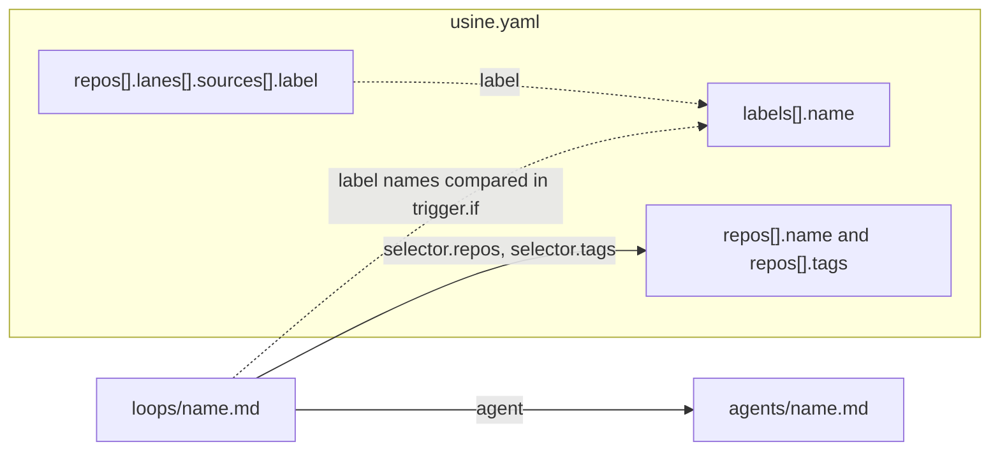

`usine.yaml` is the import and export format at the top of the instance folder, next to `loops/` and `agents/`. The first start imports these files once; later starts read the configuration store. Use [`usine config edit` or `usine config import`](/reference/configuration/cli/#configuration-revisions) to save changes. It contains the registry of managed repositories, labels, board lanes, settings, workers, and span export.

The orchestrator reads it at startup and at each [reload](/reference/configuration/cli/#reload). A reload applies `labels`, `repos`, `settings`, and `operator` to new work, and resizes, adds, or removes [workers](#workers). Changes to `webhooks` and `tracing`, and some `workers` changes, need a restart.

The parser is strict:

- Keys are snake_case in the file. The parser renames them to camelCase domain fields ([`Schema.encodeKeys`](https://github.com/basaltbytes/usine/blob/7c0c3d3696123d11e3d5b9cc3d27e18bb21e84e9/packages/config/src/factory.ts#L182)), so `poll_interval` in the file is `pollInterval` in code.
- An unknown key at any level is an error ([`onExcessProperty: "error"`](https://github.com/basaltbytes/usine/blob/7c0c3d3696123d11e3d5b9cc3d27e18bb21e84e9/packages/config/src/parser.ts#L186)).
- Duplicate keys and YAML parser warnings are errors ([`parseYamlDocument`](https://github.com/basaltbytes/usine/blob/7c0c3d3696123d11e3d5b9cc3d27e18bb21e84e9/packages/config/src/yaml/document.ts#L18)).
- An invalid configuration file rejects the complete import. The command lists schema, CEL, and reference problems and saves no revision.

The schema is [`UsineConfig`](https://github.com/basaltbytes/usine/blob/7c0c3d3696123d11e3d5b9cc3d27e18bb21e84e9/packages/config/src/factory.ts#L209) in `packages/config/src/factory.ts`.

## Complete example

```yaml title="usine.yaml"
# Schema version of this file. Required; 1 is the only accepted value.
version: 1

# GitHub login recorded on operator interventions (steer, interrupt, messages).
operator: octocat

# Labels usine creates in every managed repository that doesn't have them.
labels:
  - name: ready-for-agent
    color: "0e8a16"
    description: An Agent may start this issue
  - name: agent-in-progress
  - name: ready-for-review
  - name: agent-review-findings
  - name: review-passed
  - name: ready-to-merge

# The registry: the repositories this factory manages.
repos:
  - name: acme/widgets
    tags: [web]
    lanes:
      - name: Ready
        sources: [{ label: ready-for-agent }]
      - name: In progress
        sources: [{ label: agent-in-progress }]
      - name: Review
        sources: [{ label: ready-for-review }]
      - name: Findings
        sources: [{ label: agent-review-findings }]
      - name: Passed
        sources: [{ label: review-passed }]
      - name: Merge
        sources: [{ label: ready-to-merge }]
      - name: Pull requests
        sources: [{ state: pr-open }]
      - name: Done
        sources: [{ state: pr-merged }, { state: pr-closed }, { state: issue-closed }]
  - name: acme/gadgets
    tags: [web, mobile]

settings:
  poll_interval: 60 # seconds between poll cycles
  max_children: 4 # child sessions per attempt
  max_attempt_minutes: 180 # omit for no wall-clock ceiling
  max_attempt_tokens: 20000000 # omit for no token ceiling
  parent_model: openai-codex/gpt-5.6-terra
  parent_effort: medium

# Where attempts run. Omit the key for one local worker named `local`.
workers:
  - name: worker-1
    kind: ssh
    destination: usine@203.0.113.10
    identity_file: ~/.ssh/usine_worker
    root: /home/usine/.usine
    max_concurrent_attempts: 2
    gateway:
      domain: gateway.example.com
      destination: usine-gateway
      admin_token_env: USINE_GATEWAY_ADMIN_TOKEN
      llm_providers: [anthropic]
    # Each attempt's container, if the machine has Docker. All keys are optional;
    # preflight derives each limit left out from the machine.
    container:
      memory_mib: 4096
  - name: worker-2
    kind: ssh
    destination: worker-2
    port: 2222
    root: /srv/usine

webhooks:
  mode: off

# Span export over OTLP/HTTP. Omit the block to export nothing.
tracing:
  otlp_url: http://localhost:4318/v1/traces
  service_name: usine
```

The smallest valid file sets `version` and `repos`, which can be empty:

```yaml title="usine.yaml"
version: 1
repos:
  - name: acme/widgets
```

## References between instance files

A loop file references an agent file and selects repositories from the registry. usine checks label names in lanes and loop conditions against the declared labels.



A solid arrow is a reference that must resolve: an import fails if a loop's agent, selected repository, or selected tag doesn't exist. A dotted arrow only logs a warning if the label isn't declared ([`configWarnings`](https://github.com/basaltbytes/usine/blob/7c0c3d3696123d11e3d5b9cc3d27e18bb21e84e9/packages/config/src/parser.ts#L256)).

## Top-level keys

| Key | Type | Default | Description |
| --- | --- | --- | --- |
| `version` | `1` | required | Schema version. Any other value is an error. |
| `operator` | GitHub login | none | The login recorded as the author of operator interventions and approvals given in the web UI. |
| `labels` | list of [labels](#labels) | `[]` | Labels created in every managed repository. |
| `repos` | list of [repositories](#repos) | required | The registry. An empty list is valid. |
| `settings` | [settings](#settings) | `{}` | Polling, attempt limits, and parent defaults. |
| `workers` | list of [workers](#workers) | one local worker named `local` | Where attempts run. Must not be empty if present. |
| `webhooks` | [webhooks](#webhooks) | `{ mode: off }` | Parsed and validated. The orchestrator doesn't read it at this commit. |
| `tracing` | [tracing](#tracing) | none | Where `usine up` exports its spans. Without it, spans aren't exported. |

## `operator`

A GitHub login: 1 to 39 letters, digits, or hyphens, starting and ending with a letter or digit ([`OperatorLogin`](https://github.com/basaltbytes/usine/blob/7c0c3d3696123d11e3d5b9cc3d27e18bb21e84e9/packages/config/src/factory.ts#L26)). The transcript records it as the sender of operator messages, steers, and interrupts from the UI, or `local operator` if `operator` is unset ([`operator.ts`](https://github.com/basaltbytes/usine/blob/7c0c3d3696123d11e3d5b9cc3d27e18bb21e84e9/packages/orchestrator/src/operator/operator.ts#L485)). usine also records it as the approver of runs approved in the UI. Without it, usine records no approver.

## `labels`

Each entry declares one GitHub label ([`DeclaredLabel`](https://github.com/basaltbytes/usine/blob/7c0c3d3696123d11e3d5b9cc3d27e18bb21e84e9/packages/config/src/label.ts#L35)).

| Key | Type | Default | Description |
| --- | --- | --- | --- |
| `name` | string | required | At most 50 characters, no leading or trailing whitespace. Names must be unique, compared case-insensitively. |
| `color` | string | none | Six hex digits without `#`, such as `"0e8a16"`. |
| `description` | string | none | At most 100 characters. |

In each poll cycle, usine creates each declared label that a managed repository doesn't have, comparing names case-insensitively ([`LabelReconciler`](https://github.com/basaltbytes/usine/blob/7c0c3d3696123d11e3d5b9cc3d27e18bb21e84e9/packages/orchestrator/src/label-reconciler.ts#L80)). If an existing label's color or description differs, usine logs a warning. usine never edits or deletes a label.

Quote colors: YAML reads `123456` as a number and `0e8016` as a float, which fail with `Expected string`.

```yaml title="usine.yaml"
labels:
  - name: ready-for-agent
    color: "0e8a16"
    description: An Agent may start this issue
```

## `repos`

Each entry is one managed repository ([`ManagedRepo`](https://github.com/basaltbytes/usine/blob/7c0c3d3696123d11e3d5b9cc3d27e18bb21e84e9/packages/config/src/factory.ts#L62)). Names must be unique, compared case-insensitively as on GitHub.

| Key | Type | Default | Description |
| --- | --- | --- | --- |
| `name` | string | required | Full `owner/name` of the GitHub repository. Letters, digits, `_`, `.`, and `-` on each side of the slash. |
| `tags` | list of strings | `[]` | Tags that loop selectors match. Each tag is non-blank. Tags are unique within a repository. |
| `lanes` | list of [lanes](#reposlanes) | `[]` | The board columns for this repository. |

The GitHub App installation must include every repository in the list. A loop applies to every repository unless its [selector](/reference/configuration/loop-files/#selector) limits it.

### `repos[].lanes`

Each lane is one board column ([`Lane`](https://github.com/basaltbytes/usine/blob/7c0c3d3696123d11e3d5b9cc3d27e18bb21e84e9/packages/config/src/board.ts#L43)).

| Key | Type | Default | Description |
| --- | --- | --- | --- |
| `name` | string | required | Non-blank. Unique within the repository. |
| `sources` | list of sources | required | At least one. Each source is a mapping with exactly one key, `label` or `state`. |

| Source | Valid values | Description |
| --- | --- | --- |
| `label` | a GitHub label name | Places items that have this label, in any case, in the lane. A board move into the lane adds the label. |
| `state` | `issue-open`, `issue-closed`, `pr-open`, `pr-closed`, `pr-merged` | Places items in this GitHub state in the lane. A board move can't change a state. |

A source can appear in only one lane of a repository, ignoring case for labels. The board places each task as follows ([`laneFor`](https://github.com/basaltbytes/usine/blob/7c0c3d3696123d11e3d5b9cc3d27e18bb21e84e9/packages/orchestrator/src/board/projection.ts#L78)):

1. A task whose current item is a merged or closed pull request, or a closed issue, goes to the first lane with a matching `state` source. An item that GitHub no longer has, as found by polling, counts as closed.
2. A task whose newest open run is `Running` goes to the first lane, in file order, with a `label` source that matches one of the item's labels. If none matches, it goes to the first lane with a `label` source that matches a label the item had when that run's trigger matched, so a loop that removes its trigger label and sets no other lane label leaves the card in that lane until the run ends. If neither matches, rule 3 applies.
3. Any other task goes to the first lane, in file order, with a `label` source that matches one of the item's labels, or else to the first lane with a matching `state` source.
4. A task that matches no lane goes to the `Unmapped` column.

A lane with a `label` source accepts board moves, which add its labels and remove those of every other authored lane ([`labelMutationForBoardMove`](https://github.com/basaltbytes/usine/blob/7c0c3d3696123d11e3d5b9cc3d27e18bb21e84e9/packages/orchestrator/src/board/projection.ts#L160)).

Without `lanes`, the board shows one read-only lane per repository label, sorted by name ([`effectiveLanes`](https://github.com/basaltbytes/usine/blob/7c0c3d3696123d11e3d5b9cc3d27e18bb21e84e9/packages/orchestrator/src/board/projection.ts#L50)).

Lane order also ranks runs that wait for a worker slot: a run whose item had the label of a later lane when its trigger matched goes first ([queue order](/reference/configuration/loop-files/#priority)). The proposed lanes of a repository without `lanes` don't rank runs.

An undeclared `label` source still loads, and usine logs `Board Lane references an undeclared GitHub label`.

```yaml title="usine.yaml"
repos:
  - name: acme/widgets
    lanes:
      - name: Ready
        sources: [{ label: ready-for-agent }]
      - name: Done
        sources: [{ state: pr-merged }, { state: issue-closed }]
```

## `settings`

Factory-wide values ([`Settings`](https://github.com/basaltbytes/usine/blob/7c0c3d3696123d11e3d5b9cc3d27e18bb21e84e9/packages/config/src/factory.ts#L154)).

| Key | Type | Default | Description |
| --- | --- | --- | --- |
| `upgrade_channel` | `latest` or `next` | `latest` | npm channel checked every five minutes for a global server managed by systemd. |
| `upgrade_mode` | `off`, `propose`, or `automatic` | `propose` | Disable checks, offer upgrades in Settings, or upgrade after admitted attempts finish. |
| `poll_interval` | integer ≥ 1 | `60` | Seconds between the starts of two GitHub poll cycles. A GitHub rate limit can push the next cycle later. |
| `max_children` | integer ≥ 1 | `4` | The child-session budget: the number of child sessions that one attempt can start over its lifetime, sequential and concurrent together. The next start fails the attempt. |
| `max_attempt_minutes` | integer ≥ 1 | none | Wall-clock limit per attempt, in minutes. Time while a child has an operator hold doesn't count. Also the drain deadline when `usine up` stops. |
| `max_attempt_tokens` | integer ≥ 1 | none | Token limit per attempt, summed over the parent and every child. |
| `parent_model` | string | none | Model of each attempt's Pi parent, as `provider/model`, if the agent sets no `parent_model`. |
| `parent_effort` | effort | none | Reasoning effort of the Pi parent if the agent sets no `parent_effort`. |

`max_attempt_minutes` and `max_attempt_tokens` enable the runaway guard ([`attemptGuard`](https://github.com/basaltbytes/usine/blob/7c0c3d3696123d11e3d5b9cc3d27e18bb21e84e9/packages/executor/src/guard.ts#L139)), which warns the parent once at 80% of a limit and fails the attempt with `RunawayFailure`, never retried automatically, at 100%.

The effort values are `off`, `minimal`, `low`, `medium`, `high`, `xhigh`, and `max`. [Pi parent](/reference/configuration/agent-files/#pi-parent) describes how usine picks the parent model and effort, and when an attempt fails because of them.

## `workers`

Each entry is one worker. Without the key, the instance has one worker, `{ name: local, kind: local }`. With it, the list must not be empty, and names must be unique ([`Worker`](https://github.com/basaltbytes/usine/blob/7c0c3d3696123d11e3d5b9cc3d27e18bb21e84e9/packages/config/src/factory.ts#L150)).

Every kind takes these keys:

| Key | Type | Default | Description |
| --- | --- | --- | --- |
| `name` | string | required | Kebab-case: lowercase letters and digits separated by single hyphens. |
| `kind` | `local`, `ssh`, `cloudflare`, `exe.dev` | required | Selects the worker adapter and the other keys that it accepts. |
| `max_concurrent_attempts` | integer ≥ 1 | `1` | The number of attempts that the worker runs at the same time. See the memory check below. For a [provisioned worker](#workersprovisioner), it also caps the machines in flight, including those being created. |

A run takes a slot of the first worker in this list with a free slot ([`stepExecutorLayer`](https://github.com/basaltbytes/usine/blob/main/packages/orchestrator/src/scheduler.ts)). Waiting runs take free slots in [queue order](/reference/configuration/loop-files/#priority): runs in later [lanes](#reposlanes) first, then in the order that their events arrived. At startup, a failed preflight on any worker stops `usine up`.

A [reload](/reference/configuration/cli/#reload) applies these `workers` changes without stopping running attempts:

| Change | What the reload does |
| --- | --- |
| A worker's `max_concurrent_attempts` goes up | Runs preflight on the worker with the new count and every harness in the roster. Then the new slots take waiting runs immediately. |
| A worker's `max_concurrent_attempts` goes down | The worker starts no new attempt until it runs fewer attempts than the new count. Running attempts finish, and usine removes each extra slot when its attempt ends. |
| A new worker | Runs preflight on it with every harness in the roster. The worker takes attempts after preflight passes. For an `ssh` worker behind a gateway, the reload first reads the variable named by `admin_token_env`, and refuses with `ReloadPreflightError` if it's unset. A new worker shares the admin API forward of a gateway that another worker uses. For a new gateway, usine opens a new forward. A reload can't add a `cloudflare` worker that `usine up` didn't start with, and refuses with `ReloadPreflightError`. |
| A removed worker | The worker starts no new attempt, and its running attempts finish. **Needs attention** shows **Worker not configured** with the number of attempts that still run. After the last one ends, you can select **Discard leftovers**. Then the forward to an `ssh` worker's gateway closes, unless another worker uses that gateway. |

A failed preflight refuses the whole reload with `ReloadPreflightError`. These changes need a restart, and a reload refuses them with `RestartRequiredError`, which includes the field, such as `workers.worker-2.destination`:

- A worker's `kind`, or any key other than `name` and `max_concurrent_attempts`: `destination`, `identity_file`, `port`, `root`, `gateway`, `container`, or `provisioner` for `ssh`, and `worker_url`, `access_client_id_env`, `access_client_secret_env`, `image`, `instance_type`, or `llm_providers` for `cloudflare`.
- A renamed worker: one worker removed and one added with the same `kind` and other keys.
- A new worker whose `kind` differs from the kind of the running workers.

Preflight divides the worker's memory by `max_concurrent_attempts`, because attempts run the repository's own `pnpm install`, `pnpm build`, and `pnpm test`, which need far more memory than the harnesses. The `memory` check fails if an attempt gets less than 1.5 GiB, or if the worker has no swap and `max_concurrent_attempts` is more than 1. Below 3 GiB per attempt, it logs a warning with a value to use. To fix a failure, lower `max_concurrent_attempts` or add memory or swap. On 2026-10-15, two attempts made a 4 GB worker without swap thrash until sshd stopped responding ([#270](https://github.com/basaltbytes/usine/issues/270)). Local workers on Linux and SSH workers report memory and swap in `/proc/meminfo`. On macOS, preflight reads the physical memory and counts swap as present, because macOS adds swap files when memory runs low. A `cloudflare` worker has no memory check: each attempt gets its own sandbox with the memory of its `instance_type`.

:::caution
`usine up` uses one executor for every worker. It starts the instance only if all workers are `local`, all are `ssh`, or all are `cloudflare` ([`workerEngineLayer`](https://github.com/basaltbytes/usine/blob/main/packages/orchestrator/src/worker-engine.ts)). Any other combination, and any `exe.dev` worker, parses but fails startup with `UnsupportedWorkerError` ([#228](https://github.com/basaltbytes/usine/issues/228)).
:::

### `kind: local`

The orchestrator machine. It accepts only the common keys, and stores cached clones, attempt worktrees, and a Turbo cache in `.usine/workers/<name>/` in the instance folder.

```yaml title="usine.yaml"
workers:
  - name: local
    kind: local
    max_concurrent_attempts: 2
```

### `kind: ssh`

A Linux machine that the orchestrator connects to with its local `ssh` client ([`SshWorker`](https://github.com/basaltbytes/usine/blob/7c0c3d3696123d11e3d5b9cc3d27e18bb21e84e9/packages/config/src/factory.ts#L130)). The client runs with `BatchMode=yes`, so the key must work without a prompt and the host key must already be in `known_hosts`. A provisioned worker's machines get their own known-hosts files instead (see [`workers[].provisioner`](#workersprovisioner)).

A worker sets either `destination`, for one long-lived machine, or `provisioner`, for one machine per attempt.

| Key | Type | Default | Description |
| --- | --- | --- | --- |
| `destination` | string | required unless `provisioner` is set | A host name, an IPv4 or IPv6 address, or a `Host` alias from the operator's SSH configuration, optionally prefixed by `user@`. A value starting with `-` is rejected, and so is a worker that sets both `destination` and `provisioner`. |
| `provisioner` | [provisioner](#workersprovisioner) | none | Creates a machine for each attempt at Hetzner Cloud or Boat, and deletes it after the attempt. |
| `identity_file` | string | none | Private key passed as `ssh -i`, with `IdentitiesOnly=yes`. An absolute path or a path starting with `~/`, without spaces. Without it, the SSH agent and configuration choose the key. Required with a Boat provisioner. |
| `port` | integer 1 to 65535 | none | Passed as `ssh -p`. Without it, the SSH configuration or port 22 applies. Refused with a `provisioner`, which takes the port from the provider. |
| `root` | string | required | Absolute directory on the machine, without spaces or a trailing `/`. The worker stores its clones, worktrees, and credentials in `<root>/workers/<name>`. |
| `gateway` | [gateway](#workersgateway) | none | The gateway in front of the machine. |
| `container` | [container](#workerscontainer) | the defaults below | The container of each attempt, if the machine has Docker. |

```yaml title="usine.yaml"
workers:
  - name: worker-2
    kind: ssh
    destination: usine@203.0.113.10
    identity_file: ~/.ssh/usine_worker
    port: 2222
    root: /srv/usine
```

### `workers[].container`

If the machine has Docker, each attempt on the worker runs in its own container, which mounts only that attempt's checkout and the harness login files read-write, and its cached clone and credential directory read-only. Every command of the attempt runs in it with `docker exec`: the children, git in the checkout, salvage, the pre-push hook, and the attempt's harness check. The SSH user's shell runs only the container's start and removal and the fetch into the cached clone. Concurrent attempts can't read each other's checkouts, tokens, or processes ([`WorkerContainer`](https://github.com/basaltbytes/usine/blob/main/packages/config/src/factory.ts)).

Without Docker, the worker runs its attempts as the SSH user, as before containers. Preflight passes and reports the worker as degraded in the log and on the **Workers** page. If the machine has Docker, preflight fails with a `container` capability error when Docker doesn't answer the SSH user, the image can't be pulled, or the SSH user is in the `docker` group without the `docker` CLI: attempts run as the SSH user only if that user can't use Docker.

| Key | Type | Default | Description |
| --- | --- | --- | --- |
| `image` | string | the release's image | The image to run, such as `ghcr.io/basaltbytes/usine-worker:claude-2.1.308-codex-0.159.2`. Without it, the image built from `infra/worker-image/Dockerfile` with the harness versions of the running usine release. Preflight pulls it. |
| `cpus` | number > 0 | derived from the machine | CPUs per container, passed as `docker run --cpus`. |
| `memory_mib` | integer ≥ 256 | derived from the machine | Memory per container in MiB, passed as `docker run --memory`. A process that goes over it is ended by the kernel, not the whole machine. |
| `pids` | integer ≥ 64 | derived from the machine | Processes and threads per container, passed as `docker run --pids-limit`. |

`max_concurrent_attempts` stays the number of attempts, and so of containers, that the worker runs at the same time. For each limit that the file leaves out, preflight reads the machine and gives each container an equal share of it, after a reserve for the machine's own processes, such as sshd and Docker:

| Limit | The machine's total | Reserve | Each container gets |
| --- | --- | --- | --- |
| `cpus` | the CPUs that `nproc` counts | 0.5 CPU | (total − 0.5) ÷ `max_concurrent_attempts`, rounded down to a hundredth |
| `memory_mib` | `MemTotal` in `/proc/meminfo` | 1024 MiB | (total − 1024) ÷ `max_concurrent_attempts`, rounded down to a MiB |
| `pids` | the lower of `/proc/sys/kernel/threads-max` and `/proc/sys/kernel/pid_max` | 1024 | (total − 1024) ÷ `max_concurrent_attempts`, rounded down |

A machine with 4 CPUs and 8 GiB of memory gives each container 3.5 CPUs and 7168 MiB with `max_concurrent_attempts: 1`, and 1.16 CPUs and 2389 MiB with `max_concurrent_attempts: 3`. No derived limit goes below 0.01 CPU, 256 MiB, or 64 processes. A provisioned worker's machines each run one attempt, so its first machine each day gets the limits for one attempt, and the worker's machines keep them until the next day's first machine.

Preflight logs the limits with the worker's preflight line, `SSH Worker preflight verified`: `cpus`, `memoryMib`, `pids`, `derivedLimits` (the ones it derived), `slots`, and the machine's `machineCpus`, `machineMemoryMib`, and `machineTasks`. The **Workers** page shows the limits that the last preflight applied and which ones it derived. A value in the file always wins over a derived one. A reload that raises `max_concurrent_attempts` runs preflight, which derives the limits again for new containers; one that lowers it runs no preflight, so new containers keep the smaller limits until the next preflight.

A custom image needs what the default one has: a `usine` user whose user ID is the SSH user's, with the home directory `/home/usine`, and Git, gh, curl, Node.js, and the harnesses on the `PATH`. Preflight compares the user IDs.

```yaml title="usine.yaml"
workers:
  - name: worker-2
    kind: ssh
    destination: worker-2
    root: /home/usine/.usine
    max_concurrent_attempts: 2
    # 3584 MiB per container; preflight derives cpus and pids from the machine.
    container:
      memory_mib: 3584
```

### `workers[].gateway`

A worker behind a gateway has no GitHub token on its machine. The executor attaches each attempt's token to the gateway instead ([`WorkerGateway`](https://github.com/basaltbytes/usine/blob/7c0c3d3696123d11e3d5b9cc3d27e18bb21e84e9/packages/config/src/factory.ts#L113)).

| Key | Type | Default | Description |
| --- | --- | --- | --- |
| `domain` | string | required | The gateway's private DNS domain, in lowercase. The machine resolves `git.<domain>` for GitHub, `llm.<domain>` for LLM providers, and `<domain>` for the forward proxy. |
| `destination` | string | required | What the orchestrator's `ssh` client connects to for the gateway: a host name or address, optionally prefixed by `user@`, or a `Host` alias from the SSH configuration. The executor opens its own forward to the admin API through it, and reopens the forward whenever it closes. |
| `admin_port` | integer, 1 to 65535 | `7070` | The admin API's port on the gateway's loopback interface (`USINE_GATEWAY_ADMIN_PORT` on the gateway). |
| `admin_token_env` | string | required | Name of the orchestrator's environment variable that contains the admin token. The file never contains the token itself. |
| `llm_providers` | list | `[]` | Providers whose credential is stored on the gateway: `anthropic` (Claude Code) and `openai` (Codex). |

`usine up` reads the variable named by `admin_token_env` at startup, and at the reload that adds the worker. If it's unset, startup fails with a `gateway` capability error that includes the worker and variable names ([`sshWorkerAddressesOf`](https://github.com/basaltbytes/usine/blob/7c0c3d3696123d11e3d5b9cc3d27e18bb21e84e9/packages/orchestrator/src/ssh.ts#L27)), and a reload fails with a `ReloadPreflightError` that contains that error. A running process doesn't see variables that are set after it starts, so set the variable before `usine up` starts.

With `anthropic`, Claude Code children call `llm.<domain>/anthropic` with the caller token instead of using a login on the worker, and preflight checks only the `claude` binary. With `openai`, the executor writes a Codex `model_provider` to each attempt's Codex home, `<root>/workers/<name>/codex/<attempt>/config.toml`, and gives the attempt's Codex children that directory as `CODEX_HOME`, so they call `llm.<domain>/openai/v1` with the caller token; preflight checks only the `codex` binary and its version. Preflight also asks the gateway which credential it has for each listed provider, and fails if it has none. With an API key, the run page counts these children under API keys. With a subscription, a Claude subscription token or a ChatGPT login, it counts them under the Claude plan or the ChatGPT plan. A harness whose provider isn't listed uses its login on the worker and connects to its provider through the gateway's forward proxy.

```yaml title="usine.yaml"
workers:
  - name: worker-1
    kind: ssh
    destination: worker-1
    root: /home/usine/.usine
    gateway:
      domain: gateway.example.com
      destination: usine-gateway
      admin_token_env: USINE_GATEWAY_ADMIN_TOKEN
      llm_providers: [anthropic, openai]
```

### `workers[].provisioner`

A provisioned worker creates a machine for each attempt at its provider, runs the attempt there as on a long-lived SSH worker, and deletes the machine after the attempt ([`HetznerProvisioner`, `BoatProvisioner`](https://github.com/basaltbytes/usine/blob/main/packages/config/src/factory.ts), [#550](https://github.com/basaltbytes/usine/issues/550)). [Add a provisioned worker](/guides/add-a-provisioned-worker/) gives the setup.

Both providers take these keys:

| Key | Type | Default | Description |
| --- | --- | --- | --- |
| `provider` | `hetzner`, `boat` | required | Selects the provider and the other keys that it accepts. |
| `token_env` | string | required | Name of the orchestrator's environment variable that contains the provider's API token: a Hetzner Cloud API token with **Read & Write** permission for the project, or a Boat API key. The file never contains the token itself. |
| `api_keys` | mapping | `{}` | LLM provider API keys for each attempt, as names of the orchestrator's environment variables. Each attempt's container gets `anthropic` as `ANTHROPIC_API_KEY` for Claude Code, and `openai` as `OPENAI_API_KEY` for Codex, unless the worker's gateway has the provider in `llm_providers`. |

Both providers accept a `timings` mapping. Values are positive whole seconds, at most 2147483:

| Key under `timings` | Default | Description |
| --- | --- | --- |
| `ssh_wait` | `600` | Maximum wait for the new machine's endpoint, SSH readiness, and gateway connection. |
| `creation_backoff_min` | `30` | Delay after the first failed machine creation. Each consecutive failure doubles it. |
| `creation_backoff_max` | `600` | Maximum creation delay. Must be at least `creation_backoff_min`. |
| `machine_check_interval` | `86400` | Time between successful machine checks. The first machine after startup is always checked. |

For example, `timings: { ssh_wait: 900, machine_check_interval: 3600 }` waits up to 15 minutes for SSH and checks the next machine created at least an hour after the previous successful check. A failed check does not reset the interval.

`kind: ssh` keys with a `provisioner`:

- `destination` and `port` are refused: the provider gives each machine's address and port.
- `identity_file` is the key the executor connects with. A Boat provisioner requires it and adds `<identity_file>.pub` to each sandbox.
- `root` is created on each machine before its attempt.
- `max_concurrent_attempts` caps the machines in flight, including those being created.

`usine up` reads the variables named by `token_env` and `api_keys` when it starts, and a reload reads them for the worker that it adds.

With `api_keys.openai`, the executor writes a Codex `model_provider` to each attempt's `CODEX_HOME`, which sends the Responses API to `api.openai.com` with the key from `OPENAI_API_KEY`, so Codex needs no login. Behind a gateway on a private network, a harness with an API key reaches its provider through the forward proxy, so the gateway's egress allowlist must have `api.anthropic.com` or `api.openai.com`.

The executor connects to each machine only with a host key that it knows beforehand, with `StrictHostKeyChecking=yes`. It writes the key to a file for that machine under `.usine/known-hosts/` in the instance folder before the first connection, and the file stays across restarts until the machine is deleted. For a Hetzner server, the executor generates the key and passes it in the server's cloud-init user data. For a Boat sandbox, it uses the key that Boat's API returns, and a sandbox without one fails its creation.

#### `provider: hetzner`

Creates a Hetzner Cloud server for each attempt.

| Key | Type | Default | Description |
| --- | --- | --- | --- |
| `server_type` | string | required | The server type, such as `cx33` or `cpx32`. Lowercase letters, digits, and hyphens. Each server runs one attempt; a `cx33` or `cpx32` has the 8 GB that usine's own gates need. |
| `location` | string | required | The location, such as `fsn1`, `nbg1`, or `hel1`. With `network`, a location in the network's zone. |
| `image` | string | required | A snapshot's numeric ID or description, which `infra/hetzner/snapshot.sh` prints, or a system image's name, such as `debian-13`. A name that no system image has selects the newest available snapshot with that description. Printable ASCII, at most 255 characters, with no space at either end. |
| `network` | string | none | Name of the private network that each server joins. Required with a `gateway`: the gateway's network, in which servers get no public address and the executor connects to the private address. Without a gateway, servers get a public IPv4 address, which the executor connects to. |
| `firewall` | string | none | Name of the project's firewall that each server gets when it's created, such as one that admits SSH only from the orchestrator's address. |
| `ssh_key` | string | required | Name of the project's SSH key for each server: the public key of `identity_file`. Hetzner adds it for root, whom the snapshot's sshd refuses, and so emails no root password. |
| `ssh_user` | Unix user name | `usine` | The user that the executor connects as, whose key the snapshot authorizes. |
| `labels` | mapping of strings | `{}` | More labels for each server, by Hetzner's label rules. Keys that start with `usine-` are refused. |

Each server gets these labels:

- `usine-instance`: `github-app-<App ID>`.
- `usine-worker` and `usine-run`: the worker and the run that the server was created for.
- `usine-process`: a random value for each `usine up` process.
- `usine-attempt`: a hash of the attempt ID, once the attempt starts.

A value that is longer than 63 characters or has characters other than letters, digits, `_`, `.`, and `-` becomes a hash. Behind a gateway, the executor connects to each server through `gateway.destination` with `ssh -J`.

Each server is created with cloud-init user data that replaces the image's SSH host keys with an Ed25519 key that the executor generated, so the image must run cloud-init at first boot, as Hetzner's images and the snapshots of `snapshot.sh` do.

```yaml title="usine.yaml"
workers:
  - name: hetzner-pool
    kind: ssh
    max_concurrent_attempts: 4
    root: /home/usine/.usine
    identity_file: ~/.ssh/usine_worker
    gateway:
      domain: gw.internal
      destination: usine-gateway
      admin_token_env: USINE_GATEWAY_ADMIN_TOKEN
      llm_providers: [anthropic, openai]
    provisioner:
      provider: hetzner
      token_env: HCLOUD_TOKEN
      server_type: cx33
      location: fsn1
      image: usine-worker-claude-2.1.308-codex-0.159.2
      network: usine-gateway
      ssh_key: usine-worker
      labels: { team: platform }
```

#### `provider: boat`

Creates a Boat sandbox for each attempt, with none of the account's secrets, no snapshots, no command monitoring, and no automatic stop.

| Key | Type | Default | Description |
| --- | --- | --- | --- |
| `size` | `small`, `default`, `large`, `xlarge` | `default` | The Boat machine type. `default` has 4 vCPU and 8 GB. `xlarge` needs a Boat plan of $100 per month or more. |
| `snapshot` | string | none | Saved snapshot name. Required with a gateway. Preflight requires status `ready`. Rebuild it when the attempt image changes. |
| `tailnet` | mapping | none | Required with a gateway; refused without one. Its fields are listed below. |

`tailnet` accepts these keys:

| Key | Type | Description |
| --- | --- | --- |
| `gateway_address` | string | Gateway IPv4 address in Tailscale's `100.64.0.0/10` range. |
| `client_id_env` | string | Environment variable containing the Tailscale OAuth client ID. |
| `client_secret_env` | string | Environment variable containing its secret. The client needs `auth_keys` write access for `tag:usine-attempt`. |

The OAuth variables are read from the instance's `.env` at startup. The [provisioned-worker guide](/guides/add-a-provisioned-worker/#gateway-subscriptions-over-tailscale) covers the policy, snapshot builder, gateway listener, and cleanup. Boat workers use direct internet access for package downloads; the tailnet grants only the gateway's port 80.

A Boat worker can use a `gateway` over Tailscale when `snapshot` and `tailnet` are set. Without a gateway, each attempt's installation token is written to its machine, as on an SSH worker without a gateway, Claude Code needs `api_keys.anthropic`, and Codex needs `api_keys.openai`. Boat documents no region choice, and its machines are in Germany, Finland, and France, so a `region` key is refused like any unknown key. Each sandbox's name records the recovery tags: `usine <instance> <worker> <run> <process> <attempt>`.

```yaml title="usine.yaml"
workers:
  - name: boat-pool
    kind: ssh
    root: /home/user/.usine
    identity_file: ~/.ssh/usine_boat
    provisioner:
      provider: boat
      token_env: BOAT_API_KEY
      size: default
      api_keys: { anthropic: USINE_ANTHROPIC_API_KEY }
```

#### Refusals and preflight

The parser refuses an `ssh` worker that:

- Sets both `destination` and `provisioner`, or neither.
- Sets `port` and `provisioner`.
- Has a `gateway` and a Hetzner provisioner without `network`.
- Has a `gateway` and a Boat provisioner, or a Boat provisioner without `identity_file`.

Removing a worker keeps its provider token for one final machine sweep, then discards it. If deletion fails, the warning includes the instance and worker labels to use for manual cleanup. At startup, usine also warns about machines with its instance label whose worker is not configured. This discovery uses configured workers' tokens; if the removed worker used a separate provider account, restore its configuration to sweep that account.

A reload refuses a changed `provisioner` with `RestartRequiredError`.

Preflight creates no machine. It checks the provider token; for Hetzner, the server type in the location, the image, the SSH key, and the network; for Boat, the account's limits, which fail preflight if Boat doesn't offer the account the `size`. Hetzner documents no limits endpoint, so preflight reads none for it. It also checks the gateway's admin API, and that each harness of the roster has a credential that no machine has to keep: for Claude Code, `anthropic` in the gateway's `llm_providers` or `api_keys.anthropic`; for Codex, `openai` in `llm_providers` or `api_keys.openai`. Pi agents fail preflight on a provisioned worker. A Hetzner server type that is out of stock in the location logs a warning, and so does a Boat account that can't start sandboxes now or whose active-sandbox cap is below `max_concurrent_attempts`. The checks that need a machine run on the worker's first machine each day (UTC) and its first machine after `usine up`.

### `kind: cloudflare`

Runs each attempt in its own Cloudflare sandbox, through the Worker that you deploy from `@usine/cloudflare` ([`CloudflareWorker`](https://github.com/basaltbytes/usine/blob/main/packages/config/src/factory.ts)). [Run attempts in Cloudflare sandboxes](/guides/cloudflare-sandboxes/) describes the deployment and the limitations.

| Key | Type | Default | Description |
| --- | --- | --- | --- |
| `worker_url` | URL | required | The deployed Worker's origin, such as `https://usine-sandboxes.acme.workers.dev`. Must start with `https://`, and can't have a path, a username, a password, a query string, or a fragment. |
| `access_client_id_env` | string | required | Name of the orchestrator's environment variable that contains the client ID of the Cloudflare Access service token that the Worker accepts. |
| `access_client_secret_env` | string | required | Name of the orchestrator's environment variable that contains the token's client secret. |
| `image` | string | required | The name of an image in the Worker's `containers[].images`: letters, digits, and underscores, up to 63 characters, not starting with a digit. The deployed `wrangler.jsonc` names it `usine`. |
| `instance_type` | `lite`, `basic`, `standard-1`, `standard-2`, `standard-3`, `standard-4` | `standard-4` | The Cloudflare container instance type of each sandbox. `standard-4` has 4 vCPU, 12 GiB of memory, and 20 GB of disk. |
| `llm_providers` | list | `[]` | The providers whose API key the Worker's outbound handlers add to the sandbox's requests. Each entry has a `provider`, `anthropic` or `openai`, and an `api_key_env`, the name of the orchestrator's environment variable with the key. Each provider can appear once. |

A sandbox holds no harness login. Claude Code agents need `anthropic`, and Codex agents need `openai`; preflight fails the `harness-login` check without it. Pi agents can't run on this kind.

`usine up` reads every variable that the worker names at startup. If one is unset, startup fails with a `credentials` capability error that names the variable and the worker ([`cloudflareWorkerAddressesOf`](https://github.com/basaltbytes/usine/blob/main/packages/orchestrator/src/cloudflare.ts)). The orchestrator sends the service token with each request to the Worker, and the provider keys and each attempt's installation token to the outbound handlers of the attempt's sandbox. The sandbox never receives them.

```yaml title="usine.yaml"
workers:
  - name: cf-one
    kind: cloudflare
    worker_url: https://usine-sandboxes.acme.workers.dev
    access_client_id_env: USINE_CF_ACCESS_CLIENT_ID
    access_client_secret_env: USINE_CF_ACCESS_CLIENT_SECRET
    image: usine
    max_concurrent_attempts: 4
    llm_providers:
      - provider: anthropic
        api_key_env: ANTHROPIC_API_KEY
```

### `kind: exe.dev`

An exe.dev VM with the worker's name ([`ExeDevWorker`](https://github.com/basaltbytes/usine/blob/7c0c3d3696123d11e3d5b9cc3d27e18bb21e84e9/packages/config/src/factory.ts#L80)). It accepts only the common keys. `usine up` doesn't run this kind at this commit (see [`workers`](#workers)).

## `webhooks`

Sets the source of GitHub hints ([`Webhooks`](https://github.com/basaltbytes/usine/blob/7c0c3d3696123d11e3d5b9cc3d27e18bb21e84e9/packages/config/src/factory.ts#L170)). The orchestrator doesn't read it at this commit, and detects GitHub changes only by polling.

| Key | Type | Default | Description |
| --- | --- | --- | --- |
| `mode` | `off`, `deliveries`, `endpoint` | `off` | The hint source. |
| `public_url` | URL | required when `mode` is `endpoint` | Not accepted with the other modes. |

## `tracing`

Exports the spans of the `usine up` process to an OpenTelemetry collector over OTLP/HTTP ([`Tracing`](https://github.com/basaltbytes/usine/blob/main/packages/config/src/factory.ts), [ADR 0028](https://github.com/basaltbytes/usine/blob/main/docs/adr/0028-span-export-otlp-http.md)). Without the block, usine exports no spans.

| Key | Type | Default | Description |
| --- | --- | --- | --- |
| `otlp_url` | URL | required | The collector's OTLP/HTTP traces endpoint, such as `http://localhost:4318/v1/traces`. usine posts to it as given, without appending `/v1/traces`. Must start with `http://` or `https://`, and can't have a username, password, or query string. |
| `service_name` | string | `usine` | The `service.name` resource attribute of every span. Non-blank. Set it to tell instances apart in one collector. |

`usine up` sends spans in protobuf batches every 5 seconds, and the remaining spans when it stops. Spans keep their `Effect.fn` names, such as `PollingTriggers.pollRepository`, and their domain-id attributes, such as `repository`, `runId`, `attemptId`, and `worker`. The HTTP server and the SQLite client add `http.server` and `sql.execute` spans, and logs written inside a span are span events. The resource also has `service.version`, the installed `@usine/server` version, and the attributes in the `OTEL_RESOURCE_ATTRIBUTES` environment variable of `usine up`, such as `deployment.environment=eu`. The variable holds comma-separated `key=value` pairs with percent-encoded keys and values; if a key or value isn't valid percent-encoding, `usine up` doesn't start and names the key. Harness processes on workers export no spans.

Each poll cycle and each HTTP request is a trace. Each run is a trace of its own, whose root span `RunDriver.drive` lasts as long as the run, attempts included, and links to the span that started the run: a poll cycle, an operator request such as an approval, a reconcile, or the closed run whose item had a queued event. The web UI sends no trace headers, so a request from it starts a new trace. Requests from usine to GitHub and to gateways have client spans but send no trace headers.

At startup, `usine up` logs `Exporting spans over OTLP` with the URL's origin and path, or `Span export is off`. Each failed export request logs `Span export to the OTLP collector failed` with the same URL, the failure reason, and the HTTP status, if any. A failed export, after up to three retries, drops the buffered spans and pauses export for 60 seconds. A changed `tracing` block takes effect only after a restart; a reload refuses it with `RestartRequiredError`. The **Settings** configuration page shows the block that `usine up` runs with.

usine sends no authentication headers, and `otlp_url` can't hold a token. To export to a hosted backend, run a collector next to `usine up` that holds the backend's credentials. Span attributes include repository names, URLs, instance folder paths, and SQL statements without their parameter values, so export only to a collector that you control.

```yaml title="usine.yaml"
tracing:
  otlp_url: http://localhost:4318/v1/traces
  service_name: usine-eu
```
